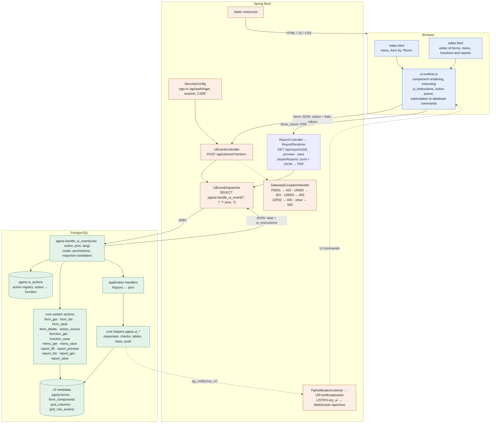
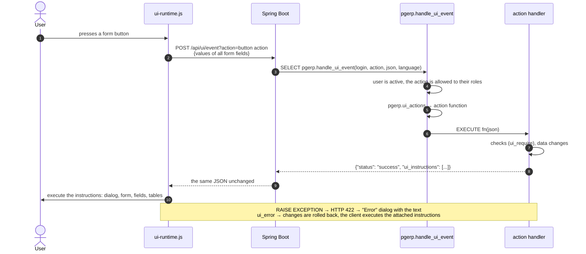
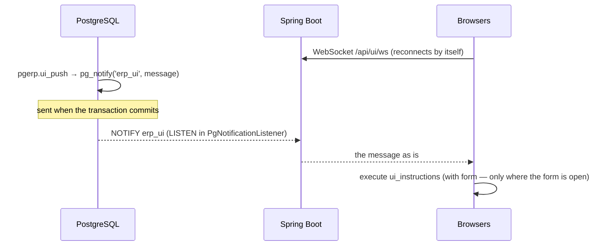
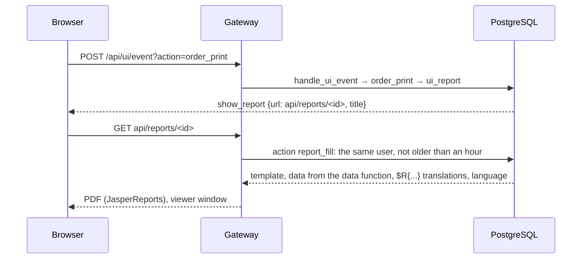
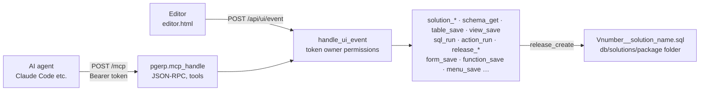
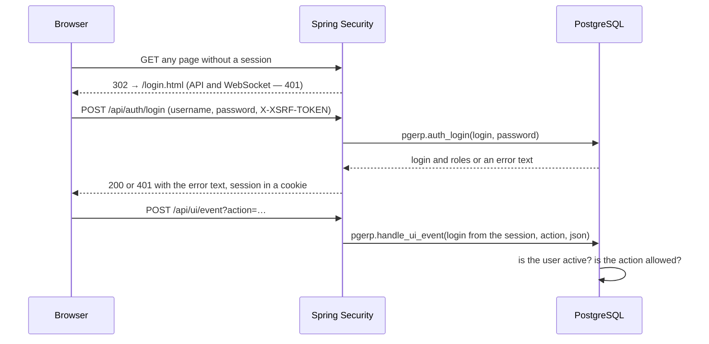
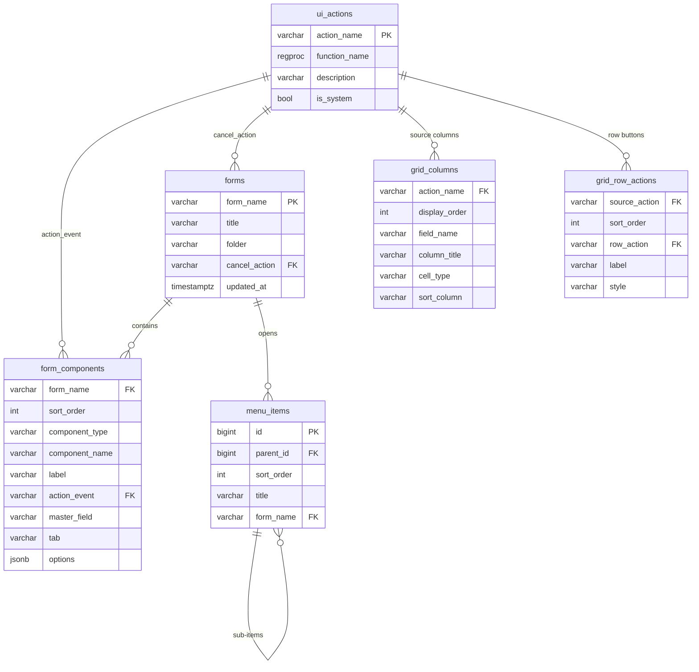

**English** · [Русский](ARCHITECTURE.ru.md)

# PgERP architecture — the platform core

Data-Driven UI in the SmartDB style: business logic and the description of the user interface live in PostgreSQL.
The Java server is a thin gateway, and the browser is a universal form renderer that executes instructions
sent by the database. This document describes only the platform core; application solutions (forms, tables
and handlers for specific tasks) are built on top of it and are not covered here.

**Stack:** HTML + ES modules · Java 25 · Spring Boot 4.1.2 · JdbcClient / HikariCP · WebSocket ·
PostgreSQL 18 / PL/pgSQL · Flyway (`db/migration/V1__core.sql` — the core) · solution packages (`db/solutions/<folder>`:
CRM, examples and solutions made in the editor; each in its own database schema) · MCP (Streamable HTTP) for AI agents

> The platform's source language is English: interface texts, messages and metadata are written in English and translated
> into other languages through `pgerp.translations` (Russian is included).

## Layers and components



Java does not parse JSON and knows nothing about the domain: it passes the login from the session, the browser language,
the action name and the form data to a single database function and returns its response as is. A new form or button
means rows in the metadata and a PL/pgSQL function registered in `pgerp.ui_actions`; Java does not change.

| Where | File |
|---|---|
| Sign-in, session, CSRF | <nobr>`src/main/java/com/erp/gateway/security/`</nobr> — <nobr>`SecurityConfig`</nobr>, <nobr>`DatabaseAuthenticationProvider`</nobr>, <nobr>`CsrfCookieFilter`</nobr> |
| Action controller | `src/main/java/com/erp/gateway/web/UiEventController.java` |
| Dispatcher | `src/main/java/com/erp/gateway/dispatcher/UiEventDispatcher.java`, <nobr>`DispatcherProperties.java`</nobr> |
| Error handling | `src/main/java/com/erp/gateway/web/GatewayExceptionHandler.java` |
| Commands from the database | <nobr>`src/main/java/com/erp/gateway/push/`</nobr> — <nobr>`PgNotificationListener`</nobr>, <nobr>`UiPushBroadcaster`</nobr>, <nobr>`UiPushWebSocketConfig`</nobr>, <nobr>`UiPushProperties`</nobr> |
| Client | <nobr>`src/main/resources/static/js/ui-runtime.js`</nobr>, <nobr>`js/menu-editor.js`</nobr>, <nobr>`js/i18n.js`</nobr>, <nobr>`js/theme.js`</nobr>, <nobr>`index.html`</nobr>, <nobr>`editor.html`</nobr>, <nobr>`login.html`</nobr>, <nobr>`css/app.css`</nobr> |
| Solution development in the editor | <nobr>`js/solution-editor.js`</nobr> (solutions and releases), <nobr>`js/schema-editor.js`</nobr> (data schema), <nobr>`js/sql-console.js`</nobr> (SQL console), <nobr>`js/mcp-access.js`</nobr> (MCP access), <nobr>`js/solution-packages.js`</nobr> (installing solutions), <nobr>`js/editor-kit.js`</nobr> (shared elements); <nobr>`src/main/java/com/erp/gateway/dev/`</nobr> — <nobr>`DevController`</nobr> (release with file saving, package installation), <nobr>`SolutionPackages`</nobr>, <nobr>`SolutionUpgradeRunner`</nobr>, <nobr>`MigrationWriter`</nobr>, <nobr>`DevProperties`</nobr> |
| MCP server | <nobr>`src/main/java/com/erp/gateway/mcp/`</nobr> — <nobr>`McpController`</nobr> (<nobr>`POST /mcp`</nobr>), <nobr>`McpSecurityConfig`</nobr> and <nobr>`McpTokenFilter`</nobr> (token sign-in), <nobr>`McpGateway`</nobr>, <nobr>`McpProperties`</nobr> |
| Schema, functions and metadata | <nobr>`src/main/resources/db/migration/V1__core.sql`</nobr> — the core; <nobr>`db/solutions/crm/`</nobr>, <nobr>`db/solutions/examples/`</nobr> — solution packages |
| Settings | <nobr>`src/main/resources/application.properties`</nobr> — <nobr>`erp.dispatcher.function-name`</nobr>, <nobr>`erp.push.channel`</nobr>, <nobr>`spring.flyway.init-sqls`</nobr>, <nobr>`erp.dev.solutions-dir`</nobr>, <nobr>`erp.dev.auto-update`</nobr>, <nobr>`erp.mcp.allowed-origins`</nobr> |

## The path of one event



Actions of one form run one after another: the next one receives field values already updated by the previous one.
That is why a timer, hotkeys and buttons do not interfere with each other.

## The contract between the database and the browser

### Form components

| Type | Purpose |
|---|---|
| <nobr>`label`</nobr> | Text |
| <nobr>`input`</nobr> | Input field; its value goes to button actions and to table sources |
| <nobr>`date`</nobr> | Date with the browser calendar; value <nobr>`YYYY-MM-DD`</nobr> |
| <nobr>`hidden`</nobr> | Hidden field, for example the record id |
| <nobr>`display`</nobr> | Read-only value set by the database |
| <nobr>`lookup`</nobr> | Choice from a reference list: the "..." button calls an action that opens a form in selection mode; ✕ clears it. The value is in the field <nobr>`<name>`</nobr>, the text in <nobr>`<name>__display`</nobr> |
| <nobr>`combobox`</nobr> | Drop-down list: items are returned by the source action; the value is the id of the selected item; the first item is empty. On selection it reloads tables with <nobr>`master`</nobr> = the list name and the <nobr>`refresh`</nobr> components; can be a table master |
| <nobr>`button`</nobr> | Calls an action with the values of all form fields; the first button of a row is the primary one |
| <nobr>`grid`</nobr> | Table: paging, sorting, row actions; with <nobr>`master`</nobr> — a detail table, the source receives <nobr>`master_id`</nobr> |
| <nobr>`tree`</nobr> | Tree: levels load when expanded; the value is the id of the selected node; can be a table master and a selection source for <nobr>`lookup`</nobr> |
| <nobr>`board`</nobr> | Grid of cells: rows separated by <nobr>`/`</nobr>, <nobr>`#`</nobr> — occupied cell, <nobr>`@`</nobr> — active, <nobr>`.`</nobr> — empty |
| <nobr>`timer`</nobr> | Calls its action every <nobr>`interval`</nobr> ms while its value is not empty; the database turns it on and off with <nobr>`set_values`</nobr> |
| <nobr>`chart`</nobr> | Chart: histogram, trend, area or pie chart from the source action data; SVG without libraries, a tooltip with the values on hover; reloaded by <nobr>`refresh_grid`</nobr> |

**Component parameters** — `options` (JSON):

| Parameter | Component | Value |
|---|---|---|
| <nobr>`column`</nobr> | any visible | Column number (1, 2, …): components with the same number stack vertically, columns sit side by side; the first column is narrower |
| <nobr>`type`</nobr> | <nobr>`input`</nobr> | <nobr>`password`</nobr> — hidden password input |
| <nobr>`refresh`</nobr> | <nobr>`input`</nobr> | Filter field: comma-separated names of form tables or trees that reload while typing (300 ms pause) |
| <nobr>`refresh`</nobr> | <nobr>`combobox`</nobr> | Comma-separated names of tables, trees or other lists of the form that reload on selection — filters and dependent lists |
| <nobr>`placeholder`</nobr> | <nobr>`combobox`</nobr> | Text of the empty item, for example "All groups"; "Not selected" by default |
| <nobr>`hotkey`</nobr> | <nobr>`button`</nobr> | Hotkey: <nobr>`event.code`</nobr> or <nobr>`event.key`</nobr> (<nobr>`ArrowLeft`</nobr>, <nobr>`Space`</nobr>, <nobr>`KeyP`</nobr>) |
| <nobr>`interval`</nobr> | <nobr>`timer`</nobr> | Action call period, ms |
| <nobr>`page_size`</nobr> | <nobr>`grid`</nobr> | Rows per page: 1–100, 10 by default (the source receives it as <nobr>`limit`</nobr>) |
| <nobr>`rows`</nobr>, <nobr>`cols`</nobr> | <nobr>`board`</nobr> | Size of the empty board |
| <nobr>`chart`</nobr> | <nobr>`chart`</nobr> | Chart type: <nobr>`bar`</nobr> — histogram (default), <nobr>`line`</nobr> — trend, <nobr>`area`</nobr>, <nobr>`pie`</nobr> — pie chart of the first series |
| <nobr>`stacked`</nobr> | <nobr>`chart`</nobr> | <nobr>`true`</nobr> — series of bars and areas are stacked |
| <nobr>`height`</nobr> | <nobr>`chart`</nobr> | Height, px (260 by default) |

**Form layout and behaviour:** the component property `tab` lays components out on tabs;
`master_field` links a table to its master field; `pgerp.forms.cancel_action` is the action the client calls
when a modal window is closed with the cross or Escape, like a "Cancel" button;
`pgerp.forms.folder` is the folder of the form in lists.

**A table source** (the action of a `grid` component) receives the form field values (filters), `page`, `limit`,
`sort_field`, `sort_dir`, `master_id` and returns `{status, meta, columns, rows, row_actions}` — usually through `pgerp.ui_grid_page`.
Row buttons call their actions with the row `{id}`. In selection mode, rows get a "Select" button.

**A tree source** (the action of a `tree` component) receives the form field values and `parent_id`
(empty — roots) and returns a level `{status, nodes: [{id, label, has_children, icon?, ...}]}` —
usually through `pgerp.ui_tree_level`. `"icon": "file"` marks a leaf instead of a folder.

**A drop-down list source** (the action of a `combobox` component) receives the form field values and
returns `{status, items: [{id, label}]}` — usually through `pgerp.ui_combo_items`. A value that arrives
before the items are loaded (`data` in `open_form`, `set_values`) is applied after loading; `refresh_grid`
reloads the items and keeps the selection.

**A chart source** (the action of a `chart` component) receives the form field values and returns
`{status, labels: [...], series: [{name, values: [...]}], format}` — usually through `pgerp.ui_chart`:
labels are the X axis (categories or dates), each series is a set of values, `format` is `number`, `money` or
`percent` (axis labels are compact, the tooltip shows full values in the interface language). `type` in the
response overrides the `chart` option. Example — CRM “Sales pipeline”: the amount and the weighted amount by stage.

### UI instructions (`ui_instructions`)

| Command | Parameters | What the client does |
|---|---|---|
| <nobr>`show_message`</nobr> | <nobr>`text`</nobr> | Message dialog |
| <nobr>`confirm`</nobr> | <nobr>`text`</nobr>, <nobr>`action`</nobr>, <nobr>`data`</nobr>, <nobr>`confirm_label`</nobr> | Confirmation; if the user agrees, calls <nobr>`action`</nobr> with <nobr>`data`</nobr> |
| <nobr>`open_form`</nobr> | <nobr>`form`</nobr>, <nobr>`modal`</nobr>, <nobr>`title`</nobr>, <nobr>`data`</nobr>, <nobr>`select`</nobr> | Open a form; <nobr>`data`</nobr> — field values; <nobr>`select`</nobr> — selection mode (<nobr>`value_field`</nobr>, <nobr>`display_field`</nobr>, <nobr>`fill`</nobr>) |
| <nobr>`close_form`</nobr> | — | Close the form window |
| <nobr>`clear_form`</nobr> | — | Reset fields to their initial values |
| <nobr>`set_values`</nobr> | <nobr>`values`</nobr>, <nobr>`form`</nobr> | Fill in fields of this or another open form |
| <nobr>`set_title`</nobr> | <nobr>`title`</nobr> | Change the form title |
| <nobr>`logout`</nobr> | — | End the session and open the sign-in page |
| <nobr>`refresh_grid`</nobr> | <nobr>`grid`</nobr>, <nobr>`keep_page`</nobr> | Reload a table, tree or drop-down list; <nobr>`keep_page`</nobr> — stay on the current page |
| <nobr>`show_report`</nobr> | <nobr>`url`</nobr>, <nobr>`title`</nobr> | Load a PDF report from <nobr>`url`</nobr> and show it in a window (see "PDF reports") |

An action response: `{"status": "success", "ui_instructions": [...]}`; instructions are executed in order.
An error: HTTP 422 and `{"status": "error", "message"}`; with `pgerp.ui_error` — with `ui_instructions` that the
client executes before showing the text.

### Commands from the database to the UI

The database can send instructions to open browser tabs on its own, without a user request:

```sql
SELECT ui_push(ui_message('The server restarts in 5 minutes'));          -- to all tabs
PERFORM ui_push_to('my_form', ui_refresh_grid('my_grid', TRUE));          -- where the form is open
```



A message is `{"form": form name or null, "ui_instructions": [...], "users"?: [logins]}`, at most 8000 bytes (a NOTIFY
limit). A rolled-back transaction sends nothing; identical messages of one transaction arrive once. Messages are not
stored: a tab closed at the moment of sending does not receive it. `ui_push` can be called from handlers, triggers,
jobs and the console. Only signed-in users can subscribe; with the `users` field (`ui_push_to_user`, `ui_push_to_role`)
only the tabs of those users receive the message. On sign-out the subscriptions of the session's tabs are closed.

## Message panel

A function prints text to a panel at the bottom of the screen without interrupting work or opening dialogs.

```sql
PERFORM ui_print('Starting recalculation');
PERFORM ui_print(format('Rows processed: %s', v_count));
PERFORM ui_print('Stock balance is below zero', 'warning');   -- info | warning | error
```

`ui_print` sends a `RAISE NOTICE` with its own code: U0010 — information, U0011 — warning, U0012 — error
(only the line style; execution continues). The gateway collects such NOTICEs from the query response and adds a
`"messages": [{"text", "kind"}]` array to the JSON; a response without messages does not change. A NOTICE is not rolled
back with the transaction, so when an action fails, the error response also carries the messages printed before it.
Other NOTICEs (for example, from `CREATE ... IF NOT EXISTS`) do not reach the panel. The text is translated through the
translation table, like `ui_message`.

A new message opens the panel automatically: time, text, a colour by kind; ✕ hides it, "Clear" clears it, the log keeps
up to 500 lines. The "Messages" button in the header (with the message count next to it) shows and hides the panel at any
time. Messages and the panel state are kept in the tab's `sessionStorage`: they survive going to another form or to the
editor and are erased on sign-out or session expiry. If a modal form is open, the panel is embedded at its bottom
(the browser blocks everything outside a modal window) and returns to the bottom of the page after the form closes.
WebSocket messages (`ui_push`) do not go to the panel — it is a response to the user's own action.

## PDF reports

Reports are built with JasperReports 7 (`jasperreports`, `-pdf`, `-jdt`, `-fonts` in `pom.xml`). The template (jrxml),
the data function and permissions live in the database; the gateway only compiles and fills the template. A report is
shown by an instruction from any action:

```sql
CREATE FUNCTION order_print(p_data JSON) RETURNS JSON AS $$
BEGIN
    RETURN ui_ok(ui_report('order_invoice', jsonb_build_object('order_id', ui_parse_id(p_data->>'id'))));
END;
$$ LANGUAGE plpgsql;
```



**Data.** The data function is an ordinary action function `fn(p_data JSON) RETURNS JSON`; it receives the parameters from
`ui_report` and returns a JSON object: top-level keys are report parameters (`$P{...}`), the `rows` array —
rows (`$F{...}`; a field takes its value by `<description>` — a dot-separated path, otherwise by name). Values are
converted to the classes from the jrxml: `String`, `Integer`, `Long`, `BigDecimal` (without precision loss), `Double`,
`Boolean`, `java.util.Date`, `LocalDate`, `Timestamp`…; a nested array in a `JRDataSource` parameter is a source
for a subreport or a table. Without `rows` the report is filled once (parameters only); an empty `rows` gives a report
with a header and totals but no rows.

**Texts and formatting.** `$R{text}` is the translation of the text into the user's language from `pgerp.translations`; such
texts and report titles appear in the "Translations" form. Numbers and dates (`pattern`) are formatted for the user's
language. The default font is DejaVu Sans embedded into the PDF (`jasperreports.properties`): Cyrillic works without setup.

**Permissions.** A report is shown only by an action the user is allowed to call; the address `api/reports/<id>`
works only for the same user and for one hour. The report editor and `api/reports/preview`, `api/reports/save` are
for administrators only. jrxml expressions are Java code executed on the application server: the right to edit reports
equals the right to run code on the server, just as editing functions in the editor does in the database.

**Editor** (`editor.html?reports=<name>`): reports are listed in the editor sidebar under "Reports"
(the item opens the first report, "+ New report" — a template); a report has a name, a title, an action
with a data function (`{ }` — its code or a `<report>_data` template) and preview parameters; the jrxml template
is highlighted. "Preview" (Ctrl+Enter) fills the unsaved template, "Save" (Ctrl+S) compiles it first —
an error is shown above the template and nothing is saved. "Upload jrxml" / "Download jrxml" — exchange with
Jaspersoft Studio; the format is JasperReports 7 (`<element kind="textField">`), 6.x templates must be converted
in Studio 7. Compiled templates are cached by name and modification time.

## Table columns in the form editor

The table properties have a "Columns…" button (a source action must be selected). The dialog shows the source columns
(`pgerp.grid_columns`): field, title, format (`text`, `number`, `money`, `datetime`, `badge` — a label coloured by
its data, see `ui_badge`), sorting; columns can be
added ("+ Column", "Add all fields"), removed and reordered. Below is a sample of the first source rows with the new
titles. It is saved immediately (action `grid_columns_save`), separately from the form.

Fields to choose from: the columns of the table or view from the `ui_grid_page('<action>', p_data, '<source>', …)`
call in the source function code, otherwise the row fields of a trial call. The trial call (`page: 1, limit: 3`) runs
in a subtransaction and is rolled back: the source changes nothing. Columns and sorting are accepted only for source
fields when they could be determined.

Columns belong to the source, not to the form: tables with one source in different forms change together —
the dialog lists such forms. Titles are translated in the "Translations" form ("Table column"). Changes live in the
database; a solution release carries them to new installations (see "Solution development").

## Function editor

The `{ }` button next to the "Action" field in the form editor opens the action function:

- **an action is selected** — the function code for editing; core functions (`pgerp`) and functions with special
  properties (not `name(JSON) RETURNS JSON`, `SET`, `SECURITY DEFINER`, `STRICT`) are read-only, with the reason;
- **no action** — a template for the component type (`pgerp.function_templates`): a button or timer handler with
  variables for the form fields (`ui_text`, `ui_parse_date`, `ui_parse_id`), a check of the first field and a
  `ui_ok` response; a table source (`ui_grid_page`), a tree source (`ui_tree_level`), a drop-down list source
  (`ui_combo_items`), a chart source (`ui_chart`); opening a list form for a lookup field. The name is `form_component`.

You can edit the name (only for a new function), the description, the language (`plpgsql`, `sql`), the volatility and the body;
Ctrl+S saves, Tab indents. The code is highlighted (comments, strings, `$$` quotes, numbers, types, keywords,
function calls) without external libraries: a transparent `textarea` lies over a `<pre>` with a coloured copy of the text.
Saving (`function_save`) creates or replaces `name(p_data JSON) RETURNS JSON` (a new function — in the schema of its
solution by name prefix, otherwise in `public`) and registers the action with the same name; a new function immediately becomes the component's action. A compilation error is shown in the window, and the
previous version of the function stays.

The client sends not SQL but the name, language, volatility and body: the database builds the `CREATE FUNCTION` header
(`%I`, a body delimiter that does not occur in the body), so a second statement cannot be appended to it.
The editor actions are system actions — for administrators only. Functions created in the editor, like forms
from the form editor, live in the database: a solution release carries them to new installations (see "Solution development").

## Solution development

Step-by-step examples: [Hello World](docs/tutorial-hello.md) — a form, a button and a message; [a "To-do list" application from scratch](docs/tutorial-todo.md) — with screenshots.

The full development cycle of an application solution happens in the editor (`editor.html`) or by an AI agent through the MCP server:
data model → action functions → forms, table columns, menu, roles, translations, reports → testing → release
(a file of the solution package for other installations). All of these are system database actions (administrators only);
the editor and MCP call the same actions through the router.



### Solutions

A solution is an application module (`pgerp.solutions`): a title, a **prefix** of object names (`crm_`), a top-level menu
folder, a package folder and a **database schema** (`db_schema`) for its tables, views and functions. An object (table, view, sequence, function, enum, form, action, report, role) belongs to
a solution if its name starts with the prefix (the longest one wins) or if it was added explicitly
(`pgerp.solution_objects`: objects without a prefix, as in the examples). Core objects (schema `pgerp`, administration
forms, the `admin` role) belong to the read-only `core` solution. Reference tables whose rows are needed on every
installation (stages, types) are marked in `pgerp.solution_data`.

The core migration creates only the `core` solution. CRM and the examples are **solution packages**
(see "Migrations and solution packages"): installing a package creates the solution, its schema and objects and records
its releases. A new solution made in the editor gets its schema at creation (by default — the solution name).

In the editor: the "Solution" filter in the sidebar (forms, reports and the data schema of that solution only; a new
form gets its prefix and menu folder), and the "Solutions" item — properties, contents (adding and excluding objects
explicitly, the "Data" mark on tables), release and release history; "Install solutions" — the packages shipped with the
application.

### Data schema

The "Data schema" item shows the solution's tables and views. **The table designer** (`table_get` / `table_save`):
columns (name, type, required, default, comment), primary key, foreign keys, unique constraints, checks, indexes.
Existing constraints and indexes can be dropped and new ones added; complex things (triggers, generated columns,
partitions) go through the SQL console. "Save" first shows the SQL of the changes (`apply: false`), "Apply" executes it.
The designer records table and column renames in `pgerp.solution_renames`: a release renames the object instead of
dropping and recreating it (a rename in the SQL console is seen by a release as a drop and an add — with a warning).
**A view** (`view_get` / `view_save`): a highlighted query; if columns were removed or changed type, the view is recreated.
Deletion (`object_drop`) first shows the dependent objects; deleting with them uses CASCADE.

### SQL console

`sql_run` runs a query or a script as the database (60 s per query): result rows (up to `max_rows`) or the number of
affected rows; "Roll back after running" executes and rolls back. An error (text, details, hint, SQLSTATE) comes as a
response field. A script whose statements create an object and then refer to it (a function and its registration) is
executed statement by statement. The "Action test" tab (`action_run`) calls an action the way a form does:
with field values and **the permissions of the selected user**; changes are rolled back by default. Recent queries are
kept in the browser. The console works with the rights of the database role the application connects as: in production,
give it only to those who may change the database directly.

### Release

A release (`release_preview`, `release_create`) is a file of the solution package assembled by the database. A solution snapshot
(`pgerp.solution_state`) holds the table structure (columns, constraints, indexes, triggers, comments), views in dependency
order, functions (`pg_get_functiondef`), enums, sequences, reference table rows and metadata SQL by section (actions,
forms, components, table columns and row buttons, reports, roles with granted forms, the menu folder, translations of the
solution's texts). A release is the difference between the current snapshot and the snapshot of the previous release
(`pgerp.solution_releases`); the first release (and "Full script") is the whole solution.

| Change | In the release |
|---|---|
| New table / column | <nobr>`CREATE TABLE IF NOT EXISTS`</nobr> / <nobr>`ADD COLUMN IF NOT EXISTS`</nobr> |
| Column type, default, required | <nobr>`ALTER COLUMN … TYPE … USING`</nobr>, <nobr>`SET/DROP DEFAULT`</nobr>, <nobr>`SET/DROP NOT NULL`</nobr> |
| Constraints, indexes, triggers | changed ones are dropped and recreated |
| Removed column, table, function, type | <nobr>`DROP … IF EXISTS`</nobr> — with a warning |
| Functions | <nobr>`CREATE OR REPLACE`</nobr>; if the result type changed — <nobr>`DROP`</nobr> and create |
| Views | on any change of views or table columns, all views of the solution are recreated in dependency order |
| Reference data | insert with update by primary key, sequences moved forward |
| Metadata | the whole section if it changed; removed forms, reports, roles, actions — <nobr>`DELETE`</nobr> |

The release file is `V<number>__<solution>_<name>.sql` in `db/solutions/<package folder>/`; numbers are per solution
(1, 2, …). Inside is a call `pgerp.solution_release_apply('solution', number, 'name', $release$ … SQL … $release$)` and a
summary of changes in a comment. The SQL does not name schemas: it is executed with the solution's schema first in the
search path, so the package can be installed into any schema. The function runs the SQL **once per database**: on the
database where the release was created it is already recorded in `pgerp.solution_releases` — later developer changes are
not rolled back. On another installation the release is applied when the solution is installed or updated (see
"Migrations and solution packages"). Next to the releases lies `solution.json` — the package description (name, title,
description, default schema); the first saved release creates it.

If the project packages folder is set (`ERP_DEV_SOLUTIONS_DIR`, for example `…/erp-gateway/src/main/resources/db/solutions`),
"Create release" saves the file there (the gateway checks the name and that the version is free in the package); otherwise
the file is downloaded. The last release can be cancelled (`release_delete`) — the next one collects its changes again.

Release warnings: a required column without a default, a type change, dropped columns and tables, reference data
referring to a table whose rows are not carried. A release does not carry permissions (`GRANT`), RLS policies, changes
of generated columns, identity and collations, users and their roles.

## MCP server

`POST /mcp` is a [Model Context Protocol](https://modelcontextprotocol.io) server (Streamable HTTP transport, JSON
responses without an SSE stream, no session): an AI agent gets tools for the full solution development cycle.

**Sign-in** — the `Authorization: Bearer <token>` header. Tokens are issued by an administrator in the editor
("MCP access"): purpose, user, expiry; the token is shown once, only its SHA-256 is stored (`pgerp.mcp_tokens`).
The agent works **with the permissions of the token owner**: tools are the actions allowed to its roles (`tools/list`
shows only those); development is for administrators only. The `/mcp` security chain is separate
(`McpSecurityConfig`): no session and no CSRF, cookies and password sign-in do not work here, and a token does not open
the rest of the application. A request with a foreign `Origin` header is rejected (`ERP_MCP_ALLOWED_ORIGINS` — exceptions).

**The protocol** is implemented by the database: `pgerp.mcp_handle(login, request, language)` — `initialize` (with a hint
to start with `platform_guide`), `ping`, `tools/list`, `tools/call`, request batches; notifications get `202 Accepted`.
A tool is a row of `pgerp.mcp_tools`: name → action, description and the JSON Schema of the arguments; the call goes
through `handle_ui_event`, an error comes back as a result with `isError`, changes are rolled back on error. A new tool is
a row in the table; Java does not change. The gateway adds only what the database cannot do: compiling the template
before `report_save` (`hook = compile_jrxml`), writing the release file to the package (`write_migration`), the package
tools (`packages`: the files are in the application, not in the database) and the `ui_print` messages.
Without `Accept-Language` the responses use the user's language, otherwise the default language (English).
The developer guide for the agent (`platform_guide`) is written in the platform's source language (English).

| Group | Tools |
|---|---|
| Guide | <nobr>`platform_guide`</nobr> — platform design, rules, workflow, core helpers, form format (<nobr>`pgerp.dev_guide()`</nobr>) |
| Solutions | <nobr>`solution_list`</nobr>, <nobr>`solution_get`</nobr>, <nobr>`solution_save`</nobr>, <nobr>`solution_object_set`</nobr>, <nobr>`solution_data_set`</nobr>, <nobr>`solution_packages`</nobr>, <nobr>`solution_install`</nobr> |
| Data schema | <nobr>`schema_get`</nobr>, <nobr>`table_get`</nobr>, <nobr>`table_save`</nobr>, <nobr>`view_get`</nobr>, <nobr>`view_save`</nobr>, <nobr>`object_drop`</nobr>, <nobr>`function_source`</nobr> |
| Actions | <nobr>`function_get`</nobr> (code or template), <nobr>`function_save`</nobr> |
| Interface | <nobr>`form_list`</nobr>, <nobr>`form_get`</nobr>, <nobr>`form_save`</nobr>, <nobr>`form_delete`</nobr>, <nobr>`grid_columns_get`</nobr>, <nobr>`grid_columns_save`</nobr>, <nobr>`menu_get`</nobr>, <nobr>`menu_save`</nobr> |
| Permissions and texts | <nobr>`role_list`</nobr>, <nobr>`role_set`</nobr>, <nobr>`translation_list`</nobr>, <nobr>`translation_save`</nobr> |
| Reports | <nobr>`report_list`</nobr>, <nobr>`report_get`</nobr>, <nobr>`report_save`</nobr> |
| Testing | <nobr>`sql_run`</nobr>, <nobr>`action_run`</nobr> |
| Release | <nobr>`release_preview`</nobr>, <nobr>`release_create`</nobr>, <nobr>`release_get`</nobr> |

**Connecting Claude Code** (the editor shows the command with the token when it issues one):

```bash
claude mcp add --transport http pgerp https://erp.example.com/mcp --header "Authorization: Bearer <token>"
```

## Authentication and authorization

Users, roles, passwords and permissions are stored and checked in the database. Spring Security keeps only the
session (cookie) and CSRF protection.



**Sign-in.** `pgerp.auth_login` checks the password against a bcrypt hash (`crypt` from pgcrypto). After 5 failed
attempts in a row, sign-in is closed for 5 minutes. A disabled user cannot sign in, and an already open session stops
working at the next action (HTTP 401). If the account has `must_change_password` (first sign-in, password set by an
administrator), only `everyone` actions are available: the client immediately opens the `password_change` form, and
cancelling it signs out. The first administrator is **admin / admin**; the password must be changed at first sign-in.
After that the administrator is asked which solutions to install (see "Migrations and solution packages").

**Permissions: role → forms.** An administrator grants forms to roles (`pgerp.role_forms`, the "Roles" form). The
database derives which actions may be called:

- actions of the components of the allowed forms (buttons, sources of tables, trees, lists, timers, lookup fields),
  row buttons of their tables and the form's cancel action — the `pgerp.form_actions` view;
- forms opened by those actions are allowed automatically together with their actions. The links are found by
  `ui_open_form('name', …)` calls in the function code (`pgerp.action_forms`). So cards and selection windows need not be
  granted separately, but the actions of those forms become available too (for example, a product selection window also
  gives the "New product" button). A form whose name is computed at run time, or an action called from `ui_confirm`
  under another name, must be granted to the role explicitly.

Only forms granted to roles directly appear in the menu. The `admin` role has all forms and actions, including system
ones (form and menu editors); the `editor.html` page is open only to it. Actions with `ui_actions.everyone`
(`form_get`, `menu_get`, `session_get`, password change) are available to any signed-in user; `form_get` returns only
an allowed form.

**Access errors:** SQLSTATE `U0002` (user disabled or deleted) → HTTP 401, the client goes to the sign-in page;
`U0003` (no permission) → HTTP 403 with the text. A 403 without database JSON is a rejected CSRF token
(for example, after signing out in another tab); the client also goes to the sign-in page.

**CSRF:** the server puts the token into the `XSRF-TOKEN` cookie, the client sends it in the `X-XSRF-TOKEN` header
with every POST (`csrfHeaders()` in `ui-runtime.js`).

**Administration** (the "Administration" menu, `admin` only): "Users" — login, name, state, new password (the user
changes it at sign-in), roles; "Roles" — code, title, forms. You cannot disable yourself, delete the `admin` role or
leave the system without an active administrator.


## Multilingual interface

English is both the **default language** (everyone sees it until they choose another one) and the **source language**:
form metadata and handler messages are written in it, and other languages are translations of these texts. Languages are
listed in `pgerp.languages` (`en` — default and source, `is_default` and `is_source`; `ru` — a translation); adding a
language means a row in this table and translations. An untranslated text is shown in the source language, so new texts
need a Russian translation (the "Translations" form, the "Untranslated" tab).

**What is translated and where**

| What | Where it is translated | How |
|---|---|---|
| Client texts: sign-in, header, tables, editors | browser | <nobr>`js/i18n.js`</nobr>: a dictionary keyed by the source text, <nobr>`t('Page {0} of {1} · {2} total', …)`</nobr>; static HTML — <nobr>`data-i18n`</nobr>, <nobr>`data-i18n-attrs`</nobr> attributes |
| Form: title, labels, tabs, empty list item | <nobr>`ui_form_open`</nobr> (<nobr>`form_get`</nobr>) | <nobr>`pgerp.translations`</nobr>, exact match |
| Menu | <nobr>`ui_menu_get`</nobr> | the same |
| Action response: error text, instructions (<nobr>`text`</nobr>, <nobr>`title`</nobr>, <nobr>`confirm_label`</nobr>), table columns and row buttons, list items | router, <nobr>`i18n_response`</nobr> | exact match or template |

A translation is looked up by the source text, like gettext, so handler code does not change. A message with
placeholders ("Product “Table” already exists") is translated by a template: the source text `Product “%s” already exists`
with `format()` placeholders (`%s`, `%I`, `%L`, `%1$s`) or `RAISE` placeholders (`%`) is turned into a regular
expression, the substituted values are carried into the translation (`%s` or `%1$s`, `%2$s` — in the order of the source
text) and are themselves translated if an exact translation exists. The "Translation" form does not save a translation
that does not match the number of placeholders.

Data is not translated: table rows, tree nodes, field values (`set_values`), and commands from the database (`ui_push`).
A handler can translate a text with placeholders explicitly: template first, then values —
`format(ui_t('Hello, %s'), v_name)` (this is how `hello_run` works). Do not glue a phrase from pieces
(`'Hello, ' || name`): the translator will see only a piece. The form and menu editors receive the source texts
(`"source": true` in `form_get` and `menu_get`), otherwise a translation would be saved instead of the original.

**User language:** `pgerp.users.lang` — the switcher in the header (action `session_lang_set`), otherwise the language
chosen in the browser (`localStorage`; the client sends it in `Accept-Language`), otherwise the default language —
English (`pgerp.i18n_default_lang()`; on the client — `DEFAULT` in `js/i18n.js`). The browser's own language is not used.
Requests without a language (MCP without `Accept-Language`, the console, jobs) use the default language. The router sets
`pgerp.lang` until the end of the transaction; sign-in errors use the language of the user or of the sign-in page.
The client remembers the language in `localStorage` and reloads the page if another one is chosen in the database.

**The "Translations" form** (Administration): the "Translations" tab — editing and deleting, the "Untranslated" tab —
texts without a translation for each language (`pgerp.translation_missing_v`). The texts are collected by
`pgerp.translatable_texts`: metadata (forms, folders, labels, tabs, columns, row buttons, menu, action descriptions,
roles) and phrase-like string literals (a capital letter followed by a lowercase one) from the function code of the
application schemas and `pgerp`. Russian translations of core texts are in the core migration, of solution texts — in the
releases of their packages.


## Themes

Themes: light (`light`) and dark (`dark`), listed in `pgerp.themes`. A theme is a set of colour CSS variables: the light
one is defined in `:root` (`css/app.css`), the dark one in `:root[data-theme="dark"]` (with `color-scheme: dark` for the
browser's calendar, lists and scrollbars). Components use only the variables, so a new theme is a
`:root[data-theme="<code>"]` block with the same variables and a row in `pgerp.themes` (the title is translated through
`pgerp.translations`).

The user's choice is `pgerp.users.theme` (the switcher in the header, action `session_theme_set`); the default is
light (`light`), `NULL` means "System": the theme follows `prefers-color-scheme` and changes with the OS theme. `js/theme.js` is included with a plain
`<script>` in `<head>` and sets `data-theme` on `<html>` before rendering (no flash of the light theme); the choice is
also kept in `localStorage`, so the sign-in page opens in the same theme and a change in one tab applies to the others.
The theme changes immediately, without a reload.

## Schemas

The core lives in the `pgerp` schema: the router, system actions, all `ui_*` helpers and the metadata tables.
Each application solution lives in **its own schema** (`pgerp.solutions.db_schema`): the schema is chosen when the
package is installed (by default — from the package, for example `crm`) or when a solution is created in the editor;
`public` is also allowed. The name `pg_erp` is not allowed: PostgreSQL reserves the `pg_` prefix for system schemas.

The router sets the search path for every action: `public`, the schemas of the installed solutions, `pgerp`
(`pgerp.app_search_path()`); installation also writes it to the database settings (for psql and jobs). So application code
calls the helpers and the objects of any solution without a schema: `ui_ok(...)`, `crm_deals`. Object names must therefore
be unique across solutions — that is what the prefix is for. Core objects are created and referenced with the schema:
`CREATE FUNCTION pgerp.ui_...`, `INSERT INTO pgerp.ui_actions ...`; without it a function would land in the first schema
of the path, and an application table with the same name would shadow the core table.

## Core data model



| Table | Contents |
|---|---|
| <nobr>`pgerp.forms`</nobr> | Forms: name, title, folder, cancel action |
| <nobr>`pgerp.form_components`</nobr> | Form components in <nobr>`sort_order`</nobr>; the type is checked against <nobr>`ui_component_types()`</nobr> |
| <nobr>`pgerp.ui_actions`</nobr> | The action registry — a whitelist of functions callable from the browser. <nobr>`is_system`</nobr> — core system actions, not shown in the editor; <nobr>`everyone`</nobr> — available to any signed-in user without granting a form |
| <nobr>`pgerp.users`</nobr> | Users: login (lower case), name, bcrypt password hash, <nobr>`is_active`</nobr>, <nobr>`must_change_password`</nobr>, failed attempt counter and <nobr>`locked_until`</nobr>, last sign-in time, language <nobr>`lang`</nobr> (empty — chosen in the browser or the default), theme <nobr>`theme`</nobr> (empty — system) |
| <nobr>`pgerp.roles`</nobr>, <nobr>`pgerp.user_roles`</nobr> | Roles (code, title) and their assignment to users; the <nobr>`admin`</nobr> role has full access |
| <nobr>`pgerp.role_forms`</nobr> | Role forms; the row is deleted when the form is deleted |
| <nobr>`pgerp.function_templates`</nobr> | Function body templates for the editor by component type (<nobr>`handler`</nobr> — button, timer; <nobr>`report`</nobr> — report data function); placeholders <nobr>`{name}`</nobr>, <nobr>`{label}`</nobr>, <nobr>`{declare}`</nobr>, <nobr>`{require}`</nobr> |
| <nobr>`pgerp.reports`</nobr> | PDF reports: name, title, <nobr>`data_action`</nobr> — the action with the data function, <nobr>`sample_params`</nobr> — preview parameters, <nobr>`jrxml`</nobr> — the JasperReports 7 template |
| <nobr>`pgerp.report_requests`</nobr> | <nobr>`ui_report`</nobr> requests: user, report, parameters, title; the address <nobr>`api/reports/<id>`</nobr> is valid for an hour, records older than a day are deleted |
| <nobr>`pgerp.themes`</nobr> | Themes: code (the <nobr>`data-theme`</nobr> value), title, order in the switcher |
| <nobr>`pgerp.languages`</nobr> | Languages: code, title, <nobr>`is_source`</nobr> — the source language (one), <nobr>`is_default`</nobr> — the default (one), order in the switcher |
| <nobr>`pgerp.translations`</nobr> | Translations: language, source text → translation; <nobr>`is_template`</nobr> — a source text with placeholders |
| <nobr>`pgerp.grid_columns`</nobr> | Table source columns: field, title, cell type (<nobr>`text`</nobr>, <nobr>`number`</nobr>, <nobr>`money`</nobr>, <nobr>`datetime`</nobr>, <nobr>`badge`</nobr>), sort column (<nobr>`NULL`</nobr> — no sorting). Edited in the form editor: table properties → "Columns…" |
| <nobr>`pgerp.menu_items`</nobr> | The application menu: items of any depth (<nobr>`parent_id`</nobr>), order <nobr>`sort_order`</nobr>, the item's form (optional; when the form is deleted the item stays without it) |
| <nobr>`pgerp.grid_row_actions`</nobr> | Buttons in table rows: action, label, style <nobr>`default`</nobr> / <nobr>`danger`</nobr> |

## Core functions

All functions live in the `pgerp` schema. An "action" is a function registered in `pgerp.ui_actions` under this name
and called from the browser.

### Router and system actions

| Function | Returns | Description |
|---|---|---|
| `handle_ui_event(p_user VARCHAR, p_action VARCHAR, p_form_data JSON, p_lang VARCHAR DEFAULT NULL)` | <nobr>`JSON`</nobr> | The single entry point from Java; <nobr>`p_user`</nobr> — the login from the server session, <nobr>`p_lang`</nobr> — the client language. Sets the action language <nobr>`pgerp.lang`</nobr> (the user setting wins over the client); translates the response (<nobr>`i18n_response`</nobr>) and the texts of <nobr>`RAISE`</nobr>, <nobr>`U0002`</nobr>, <nobr>`U0003`</nobr> errors. User not found or disabled — error <nobr>`U0002`</nobr>. Sets <nobr>`pgerp.user`</nobr> until the end of the transaction (<nobr>`ui_user()`</nobr>). While the password must be changed — only <nobr>`everyone`</nobr> actions; others are checked by <nobr>`auth_action_allowed`</nobr>, otherwise error <nobr>`U0003`</nobr>. Looks up <nobr>`p_action`</nobr> in <nobr>`pgerp.ui_actions`</nobr> (otherwise an "Unknown action" error) and calls the registered function with <nobr>`p_form_data`</nobr> through <nobr>`regproc`</nobr>. Catches the <nobr>`ui_error`</nobr> error (SQLSTATE <nobr>`U0001`</nobr>): the handler's changes are rolled back (subtransaction) and `{"status": "error", "message", "ui_instructions"}` is returned. Other errors are re-raised. Sets the search path <nobr>`public`, solution schemas, `pgerp`</nobr> (<nobr>`app_search_path()`</nobr>) until the end of the transaction |
| <nobr>`ui_form_open(p_data JSON)`</nobr> | <nobr>`JSON`</nobr> | Action <nobr>`form_get`</nobr> (system, <nobr>`everyone`</nobr>): checks the user's access to the form (<nobr>`U0003`</nobr>) and returns <nobr>`ui_form_get`</nobr> in the user's language; <nobr>`"source": true`</nobr> — source texts for the editor |
| <nobr>`ui_form_get(p_data JSON)`</nobr> | <nobr>`JSON`</nobr> | Structure of the form <nobr>`p_data->>'form'`</nobr>: `{name, title, folder, cancel, components: [{type, name, label, action, master, tab, options}]}` in component order. Error if the form does not exist |
| <nobr>`ui_form_list(p_data JSON)`</nobr> | <nobr>`JSON`</nobr> | Action <nobr>`form_list`</nobr> (system). All forms <nobr>`{name, title, folder, solution}`</nobr> — by folder (forms without a folder last) and title — and non-system actions <nobr>`{name, description, solution}`</nobr> for selection in the editor |
| <nobr>`ui_form_save(p_data JSON)`</nobr> | <nobr>`JSON`</nobr> | Action <nobr>`form_save`</nobr> (system). Saves the whole form from the editor: checks the names of the form and components, types, required actions of <nobr>`grid`</nobr>, <nobr>`tree`</nobr>, <nobr>`combobox`</nobr>, <nobr>`lookup`</nobr>, <nobr>`timer`</nobr>, <nobr>`chart`</nobr>, action registration, the table master field, the <nobr>`options`</nobr> object and name uniqueness; then replaces the components. Does not touch the form's cancel action |
| <nobr>`ui_form_delete(p_data JSON)`</nobr> | <nobr>`JSON`</nobr> | Action <nobr>`form_delete`</nobr> (system). Deletes the form <nobr>`p_data->>'form'`</nobr> with its components; error if the form does not exist |
| <nobr>`ui_action_source(p_data JSON)`</nobr> | <nobr>`JSON`</nobr> | Action <nobr>`action_source`</nobr> (system). For the action <nobr>`p_data->>'action'`</nobr> returns the function name, description and source code (<nobr>`pg_get_functiondef`</nobr>) |
| <nobr>`ui_function_get(p_data JSON)`</nobr> | <nobr>`JSON`</nobr> | Action <nobr>`function_get`</nobr> (system): <nobr>`{action}`</nobr> — the action function code and whether it can be edited; without <nobr>`action`</nobr> — a template for a component <nobr>`{form, component, type, label, fields}`</nobr> (<nobr>`ui_function_template`</nobr>) |
| <nobr>`ui_function_save(p_data JSON)`</nobr> | <nobr>`JSON`</nobr> | Action <nobr>`function_save`</nobr> (system): `{name, description, language, volatility, body, is_new}` — create or replace <nobr>`name(p_data JSON) RETURNS JSON`</nobr> (a new one — in the solution's schema) and register the action |
| <nobr>`ui_form_close(p_data JSON)`</nobr> | <nobr>`JSON`</nobr> | Action <nobr>`form_close`</nobr>: a universal "Close" / "Cancel" button of a modal form — the <nobr>`close_form`</nobr> instruction |
| <nobr>`ui_menu_get(p_data JSON)`</nobr> | <nobr>`JSON`</nobr> | Action <nobr>`menu_get`</nobr> (system, <nobr>`everyone`</nobr>). The menu as a tree: <nobr>`{items: [{id, title, form, items: [...]}]}`</nobr> — via the recursive <nobr>`ui_menu_level(p_parent, p_forms)`</nobr>. For a non-administrator — only items with forms granted to their roles directly; empty groups are hidden. Titles are in the user's language; <nobr>`"source": true`</nobr> — source texts for the menu editor |
| <nobr>`ui_session_get(p_data JSON)`</nobr> | <nobr>`JSON`</nobr> | Action <nobr>`session_get`</nobr> (system, <nobr>`everyone`</nobr>): `{user: {login, full_name, roles, is_admin, must_change_password, lang, theme}, languages: [{code, title}], themes: [{code, title}]}` |
| <nobr>`ui_session_theme_set(p_data JSON)`</nobr> | <nobr>`JSON`</nobr> | Action <nobr>`session_theme_set`</nobr> (system, <nobr>`everyone`</nobr>): the user's theme <nobr>`p_data->>'theme'`</nobr>, empty — system |
| <nobr>`ui_session_lang_set(p_data JSON)`</nobr> | <nobr>`JSON`</nobr> | Action <nobr>`session_lang_set`</nobr> (system, <nobr>`everyone`</nobr>): the user's language <nobr>`p_data->>'lang'`</nobr> |
| <nobr>`ui_password_change(p_data JSON)`</nobr> | <nobr>`JSON`</nobr> | Action <nobr>`password_change`</nobr> (<nobr>`everyone`</nobr>): <nobr>`old_password`</nobr>, <nobr>`new_password`</nobr>, <nobr>`new_password_repeat`</nobr>; clears <nobr>`must_change_password`</nobr> |
| <nobr>`ui_menu_save(p_data JSON)`</nobr> | <nobr>`JSON`</nobr> | Action <nobr>`menu_save`</nobr> (system). Replaces the whole menu with the tree <nobr>`{items: [{title, form, items}]}`</nobr> from the editor: checks titles and that forms exist (the error text contains the item path); a level is inserted by the recursive <nobr>`ui_menu_insert`</nobr> |
| <nobr>`ui_component_types()`</nobr> | <nobr>`VARCHAR[]`</nobr> | Allowed component types; used by the <nobr>`form_components`</nobr> table constraint and by <nobr>`ui_form_save`</nobr> |

### Responses and UI instructions

| Function | Returns | Description |
|---|---|---|
| <nobr>`ui_ok(VARIADIC p_instructions JSONB[])`</nobr> | <nobr>`JSONB`</nobr> | A successful response `{"status": "success", "ui_instructions": [...]}`. Accepts any number of instructions; <nobr>`NULL`</nobr> is skipped, an array of instructions is expanded — handy for conditional groups. Without arguments — an empty list |
| `ui_instruction(p_command TEXT, p_params JSONB DEFAULT '{}')` | <nobr>`JSONB`</nobr> | An instruction <nobr>`{"command": p_command, ...p_params}`</nobr>; parameters with a <nobr>`NULL`</nobr> value are not sent. The base of the other helpers |
| <nobr>`ui_message(p_text TEXT)`</nobr> | <nobr>`JSONB`</nobr> | <nobr>`show_message`</nobr> — a dialog with the text |
| `ui_report(p_report VARCHAR, p_params JSONB DEFAULT '{}', p_title TEXT DEFAULT NULL)` | <nobr>`JSONB`</nobr> | <nobr>`show_report`</nobr> — show a PDF report: the parameters go to the report data function, <nobr>`p_title`</nobr> — the window title and file name instead of the report title. See "PDF reports" |
| `ui_print(p_text TEXT, p_kind VARCHAR DEFAULT 'info')` | <nobr>`VOID`</nobr> | A line in the message panel at the bottom of the screen; <nobr>`p_kind`</nobr> — <nobr>`info`</nobr>, <nobr>`warning`</nobr> or <nobr>`error`</nobr>. Called with <nobr>`PERFORM`</nobr> from anywhere — an action, a nested function, a trigger; messages printed before an error are shown too. See "Message panel" |
| `ui_confirm(p_text TEXT, p_action VARCHAR, p_data JSONB, p_confirm_label TEXT DEFAULT NULL)` | <nobr>`JSONB`</nobr> | <nobr>`confirm`</nobr> — a confirmation dialog; if the user agrees, the client calls <nobr>`p_action`</nobr> with <nobr>`p_data`</nobr> (usually with <nobr>`"confirmed": true`</nobr>). <nobr>`p_confirm_label`</nobr> — the label of the confirm button |
| `ui_open_form(p_form VARCHAR, p_data JSONB DEFAULT NULL, p_title TEXT DEFAULT NULL, p_select JSONB DEFAULT NULL, p_modal BOOLEAN DEFAULT TRUE)` | <nobr>`JSONB`</nobr> | <nobr>`open_form`</nobr> — open a form, modal by default. <nobr>`p_data`</nobr> — field values, <nobr>`p_title`</nobr> — a title instead of the form's, <nobr>`p_select`</nobr> — selection mode for <nobr>`lookup`</nobr>: `{value_field, display_field, fill: {form field: row field}}` |
| <nobr>`ui_close_form()`</nobr> | <nobr>`JSONB`</nobr> | <nobr>`close_form`</nobr> — close the window of the form that called the action |
| <nobr>`ui_clear_form()`</nobr> | <nobr>`JSONB`</nobr> | <nobr>`clear_form`</nobr> — reset the form fields to their initial values |
| `ui_set_values(p_values JSONB, p_form VARCHAR DEFAULT NULL)` | <nobr>`JSONB`</nobr> | <nobr>`set_values`</nobr> — fill in fields by name; <nobr>`p_form`</nobr> — another open form (the last one with this name) |
| <nobr>`ui_clear_fields(VARIADIC p_fields TEXT[])`</nobr> | <nobr>`JSONB`</nobr> | <nobr>`set_values`</nobr> with empty values for the listed fields |
| <nobr>`ui_set_title(p_title TEXT)`</nobr> | <nobr>`JSONB`</nobr> | <nobr>`set_title`</nobr> — change the form title |
| `ui_refresh_grid(p_grid VARCHAR, p_keep_page BOOLEAN DEFAULT FALSE)` | <nobr>`JSONB`</nobr> | <nobr>`refresh_grid`</nobr> — reload the table or tree with this name in any open form; <nobr>`p_keep_page`</nobr> — stay on the current page (for a tree — keep expanded nodes) |

### Errors and input checks

| Function | Returns | Description |
|---|---|---|
| <nobr>`ui_require(p_ok BOOLEAN, p_message TEXT)`</nobr> | <nobr>`VOID`</nobr> | An input error <nobr>`p_message`</nobr> (<nobr>`RAISE EXCEPTION`</nobr>, HTTP 422) if the condition is false or <nobr>`NULL`</nobr>. For "must be so" rules: `PERFORM ui_require(v_name IS NOT NULL, 'Enter the name')` |
| `ui_error(p_message TEXT, VARIADIC p_instructions JSONB[] DEFAULT '{}')` | <nobr>`VOID`</nobr> | An error with UI instructions: <nobr>`RAISE EXCEPTION`</nobr> with SQLSTATE <nobr>`U0001`</nobr>, the instructions in <nobr>`DETAIL`</nobr>. The router rolls back the handler's changes, the client executes the instructions (for example, <nobr>`ui_clear_fields`</nobr>) and shows the text |

### Translation

| Function | Returns | Description |
|---|---|---|
| <nobr>`ui_t(p_text TEXT)`</nobr> | <nobr>`TEXT`</nobr> | The text in the action language: an exact translation, otherwise by a template with placeholders, otherwise the source text |
| <nobr>`ui_t_exact(p_text TEXT)`</nobr> | <nobr>`TEXT`</nobr> | Only an exact translation — for labels and titles |
| <nobr>`ui_lang()`</nobr> | <nobr>`VARCHAR`</nobr> | The action language; if not set (outside the router, a request without a language) — the default language |
| <nobr>`i18n_default_lang()`</nobr> | <nobr>`VARCHAR`</nobr> | The default language (<nobr>`pgerp.languages.is_default`</nobr>, English); not set — the source language |
| <nobr>`i18n_response(p_result JSON)`</nobr> | <nobr>`JSON`</nobr> | Translation of an action response: <nobr>`message`</nobr>, instructions, <nobr>`columns`</nobr>, <nobr>`row_actions`</nobr>, <nobr>`items`</nobr> |
| <nobr>`i18n_template_regex(p_source TEXT)`</nobr> | <nobr>`TEXT`</nobr> | The regular expression of a template: <nobr>`format()`</nobr> and <nobr>`RAISE`</nobr> placeholders → groups |

### User and permissions

| Function | Returns | Description |
|---|---|---|
| <nobr>`ui_user()`</nobr> | <nobr>`VARCHAR`</nobr> | The login of the user who called the action; outside the router (console, jobs) — <nobr>`NULL`</nobr> |
| <nobr>`ui_user_id()`</nobr> | <nobr>`BIGINT`</nobr> | The id of this user in <nobr>`pgerp.users`</nobr> |
| <nobr>`ui_user_name()`</nobr> | <nobr>`VARCHAR`</nobr> | The user name to display: the name from the account, otherwise the login (for example, the author of a chat message) |
| <nobr>`ui_has_role(p_role VARCHAR)`</nobr> | <nobr>`BOOLEAN`</nobr> | The user has the role <nobr>`p_role`</nobr> — for checks inside a handler |
| <nobr>`ui_logout()`</nobr> | <nobr>`JSONB`</nobr> | The <nobr>`logout`</nobr> instruction |
| `auth_login(p_login VARCHAR, p_password TEXT, p_lang VARCHAR DEFAULT NULL)` | <nobr>`TABLE(user_login, user_roles, error_message)`</nobr> | Sign-in check (called by the server): login and roles or an error text; counts failed attempts |
| <nobr>`auth_user_forms(p_user_id BIGINT)`</nobr> | <nobr>`SETOF VARCHAR`</nobr> | The user's forms: granted to their roles and opened from them, transitively; all forms for an administrator |
| `auth_action_allowed(p_user_id BIGINT, p_action VARCHAR)` | <nobr>`BOOLEAN`</nobr> | The action is allowed: administrator, <nobr>`everyone`</nobr> or an action of one of the <nobr>`auth_user_forms`</nobr> forms |
| <nobr>`auth_hash(p_password TEXT)`</nobr>, <nobr>`auth_check_password(p_login, p_password)`</nobr> | | bcrypt password hash; new password requirements — 8 to 72 characters, not equal to the login |

### Reading form values

| Function | Returns | Description |
|---|---|---|
| <nobr>`ui_text(p_data JSON, p_field TEXT)`</nobr> | <nobr>`TEXT`</nobr> | The field text trimmed; an empty field — <nobr>`NULL`</nobr> |
| <nobr>`ui_is_new(p_data JSON)`</nobr> | <nobr>`BOOLEAN`</nobr> | The form has no <nobr>`id`</nobr> — a new record is being created |
| <nobr>`ui_confirmed(p_data JSON)`</nobr> | <nobr>`BOOLEAN`</nobr> | The user agreed in the confirmation dialog (<nobr>`"confirmed": true`</nobr> from <nobr>`ui_confirm`</nobr>) |
| <nobr>`ui_parse_id(p_text TEXT)`</nobr> | <nobr>`BIGINT`</nobr> | An identifier from text: 1–18 digits, otherwise <nobr>`NULL`</nobr> |
| <nobr>`ui_parse_money(p_text TEXT)`</nobr> | <nobr>`NUMERIC`</nobr> | An amount from text: space separators and a decimal comma are allowed (<nobr>`"1 500,50"`</nobr>, <nobr>`"99.9"`</nobr>), up to 10 digits and 2 decimals; otherwise <nobr>`NULL`</nobr> |
| <nobr>`ui_parse_date(p_text TEXT)`</nobr> | <nobr>`DATE`</nobr> | A date <nobr>`YYYY-MM-DD`</nobr> (the <nobr>`date`</nobr> field) or <nobr>`DD.MM.YYYY`</nobr>; a non-existent or invalid date — <nobr>`NULL`</nobr> |
| `ui_page_param(p_data JSON, p_key VARCHAR, p_default INT, p_max INT)` | <nobr>`INT`</nobr> | An integer request parameter (page, page size) within 1…<nobr>`p_max`</nobr>; missing or invalid — <nobr>`p_default`</nobr> |

### Formatting

| Function | Returns | Description |
|---|---|---|
| <nobr>`ui_format_money(p_value NUMERIC)`</nobr> | <nobr>`TEXT`</nobr> | An amount for display: thousands separated by a space, two decimals — <nobr>`12 800,00`</nobr> |
| <nobr>`ui_money_input(p_value NUMERIC)`</nobr> | <nobr>`TEXT`</nobr> | An amount for an input field: no thousands separators, decimal comma — <nobr>`12800,00`</nobr> |
| <nobr>`ui_badge(p_label TEXT, p_tone TEXT DEFAULT 'neutral')`</nobr> | <nobr>`JSONB`</nobr> | A value for a <nobr>`badge`</nobr> column: <nobr>`{label, tone}`</nobr>, the label in the user's language. The colour comes from the data: tones <nobr>`neutral`</nobr> (no colour), <nobr>`accent`</nobr> (blue), <nobr>`attention`</nobr> (yellow), <nobr>`success`</nobr> (green), <nobr>`done`</nobr> (purple), <nobr>`danger`</nobr> (red); an unknown tone is <nobr>`neutral`</nobr>. Keep the tone in the application's reference table (like <nobr>`crm_stages.tone`</nobr>) or compute it in the view. Colours for both themes — <nobr>`.badge-tone-*`</nobr> in <nobr>`css/app.css`</nobr> |

### Tables

| Function | Returns | Description |
|---|---|---|
| `ui_grid_page(p_action VARCHAR, p_data JSON, p_source REGCLASS, p_master_column VARCHAR DEFAULT NULL, p_default_sort VARCHAR DEFAULT 'id', p_default_dir VARCHAR DEFAULT 'desc', p_search_column VARCHAR DEFAULT NULL, p_search TEXT DEFAULT NULL, p_filters JSONB DEFAULT NULL)` | <nobr>`JSON`</nobr> | A page of the source <nobr>`p_source`</nobr> (table or view): `{status, meta: {current_page, limit, total_rows, total_pages, sort}, columns, row_actions, rows}`. Page size — <nobr>`limit`</nobr> (up to 100, 10 by default); <nobr>`p_master_column`</nobr> — the detail table filter by <nobr>`master_id`</nobr>; <nobr>`p_search_column`</nobr>, <nobr>`p_search`</nobr> — rows where the column contains the text, case-insensitive (empty — no filter); <nobr>`p_filters`</nobr> — <nobr>`{column: value}`</nobr> filters, empty values skipped; sorting — only by columns from <nobr>`grid_columns`</nobr>, names substituted through <nobr>`%I`</nobr>; sorting by <nobr>`id`</nobr> is added for stability |
| <nobr>`ui_grid_columns(p_action VARCHAR)`</nobr> | <nobr>`JSON`</nobr> | The source columns in order: <nobr>`[{field, title, type, sortable}]`</nobr> |
| <nobr>`ui_grid_row_actions(p_action VARCHAR)`</nobr> | <nobr>`JSON`</nobr> | The source row buttons: <nobr>`[{action, label, style}]`</nobr> |
| `ui_grid_sort(p_action VARCHAR, p_data JSON, p_default_field VARCHAR, p_default_dir VARCHAR)` | <nobr>`TABLE(field, dir, sort_column)`</nobr> | Sort selection: the requested field <nobr>`sort_field`</nobr> if it is sortable, otherwise <nobr>`p_default_field`</nobr>; direction — <nobr>`sort_dir`</nobr> (<nobr>`asc`</nobr>/<nobr>`desc`</nobr>) for the requested field, otherwise <nobr>`p_default_dir`</nobr> |

### Trees

| Function | Returns | Description |
|---|---|---|
| `ui_tree_level(p_data JSON, p_source REGCLASS, p_label_column VARCHAR DEFAULT 'name', p_parent_column VARCHAR DEFAULT 'parent_id')` | <nobr>`JSON`</nobr> | One tree level of any table with a parent reference: children of the node <nobr>`p_data->>'parent_id'`</nobr> (empty — roots), alphabetically. A node is the whole table row plus the <nobr>`label`</nobr> and <nobr>`has_children`</nobr> fields. Response — <nobr>`{status, nodes}`</nobr> |

### Drop-down lists

| Function | Returns | Description |
|---|---|---|
| `ui_combo_items(p_source REGCLASS, p_label_column VARCHAR DEFAULT 'name', p_value_column VARCHAR DEFAULT 'id')` | <nobr>`JSON`</nobr> | Drop-down list items from a table or view: <nobr>`{status, items: [{id, label}]}`</nobr> sorted by label |
| `ui_chart(p_source REGCLASS, p_label_column VARCHAR, p_value_columns VARCHAR[], p_series_names VARCHAR[] DEFAULT NULL, p_order_column VARCHAR DEFAULT NULL, p_format VARCHAR DEFAULT 'number')` | <nobr>`JSON`</nobr> | Chart data from a table or view: <nobr>`{status, format, labels, series: [{name, values}]}`</nobr>; a series per value column, series names in the source language are translated; points ordered by <nobr>`p_order_column`</nobr> (by label by default) |

### Commands from the database to the UI

| Function | Returns | Description |
|---|---|---|
| <nobr>`ui_push(VARIADIC p_instructions JSONB[])`</nobr> | <nobr>`VOID`</nobr> | Send instructions to all open browser tabs |
| `ui_push_to_user(p_user VARCHAR, VARIADIC p_instructions JSONB[])` | <nobr>`VOID`</nobr> | Send instructions to the tabs of the user with login <nobr>`p_user`</nobr> |
| `ui_push_to_role(p_role VARCHAR, VARIADIC p_instructions JSONB[])` | <nobr>`VOID`</nobr> | Send instructions to the tabs of active users with role <nobr>`p_role`</nobr>; if there are none, nothing is sent |
| `ui_push_to(p_form VARCHAR, VARIADIC p_instructions JSONB[])` | <nobr>`VOID`</nobr> | Send instructions to the tabs where the form <nobr>`p_form`</nobr> is open (<nobr>`NULL`</nobr> — to all); they are executed in the context of that form. Through <nobr>`pg_notify('erp_ui', ...)`</nobr>: sent when the transaction commits; a message longer than 8000 bytes is an error |

## Connecting an application form

1. The tables and functions of an application solution live in its schema: they are created in the editor or by an agent
   and carried to other installations by the releases of the solution package (see "Solution development").
2. An action handler is `fn(p_data JSON) RETURNS JSON`: it reads fields (`ui_text`, `ui_parse_*`),
   checks them (`ui_require`), changes data and responds with `ui_ok(...)` and instructions.
3. Registration: `INSERT INTO pgerp.ui_actions (action_name, function_name, description)`.
4. A form is rows in `pgerp.forms` and `pgerp.form_components` (or the form editor);
   for tables — a source through `ui_grid_page` and columns in `pgerp.grid_columns`.

```sql
CREATE FUNCTION item_save(p_data JSON)
RETURNS JSON AS $$
DECLARE
    v_name TEXT := ui_text(p_data, 'name');
BEGIN
    PERFORM ui_require(v_name IS NOT NULL, 'Enter the name');
    INSERT INTO items (name) VALUES (v_name);
    RETURN ui_ok(
        ui_close_form(),
        ui_refresh_grid('items_grid'),
        ui_message('Saved'));
END;
$$ LANGUAGE plpgsql;

INSERT INTO pgerp.ui_actions (action_name, function_name, description)
VALUES ('item_save', 'item_save', 'Save an item');
```

## Migrations and solution packages

**The core** is installed by Flyway at application start: a single migration `db/migration/V1__core.sql` — schema
`pgerp`, `pgcrypto`, core tables, functions and views, system actions, administration forms and the "Administration"
menu item, languages, themes, the `admin` role and the first administrator, translations of core texts, the solution
development tools and the MCP server. A core change is the next migration in `db/migration`; applied migrations never
change. The core (database, Java, client) knows nothing about specific solutions: no names, texts, colours or styles of
CRM or the examples — everything a solution needs is in its package.

**Application solutions** are packages in `src/main/resources/db/solutions/<folder>/`:

| Package | Default schema | Contents |
|---|---|---|
| <nobr>`crm`</nobr> | <nobr>`crm`</nobr> | Companies and contacts, deals through a pipeline with products, tasks and reminders, the deal log, closing a deal without saving (a snapshot of the deal), roles <nobr>`crm_manager`</nobr> / <nobr>`crm_head`</nobr> seeing their own and all deals, notifications <nobr>`ui_push_to_user`</nobr> / <nobr>`ui_push_to_role`</nobr>, PDF reports "Commercial offer" and "Sales pipeline", stage colours in the stage reference table (<nobr>`crm_stages.tone`</nobr>, release 2). Demo data; demo users ivanov, petrova, sidorov — without a password, the administrator sets it |
| <nobr>`examples`</nobr> | <nobr>`examples`</nobr> | Hello World, division with input checks, the "Falling blocks" game, a chat across all tabs |
| your solutions | the solution name | Releases from the editor or MCP (see "Solution development") |

A package is `solution.json` (`name`, `title` and `description` — a string or `{"en": …, "ru": …}`, `schema` — the
default schema) and release files `V<n>__….sql`, each a call of `pgerp.solution_release_apply`. Packages are read from
the application (`classpath:db/solutions`) and, in development, from `ERP_DEV_SOLUTIONS_DIR` (it wins for the same folder).

**Installation** (administrators only):
- **first sign-in** — after the password change the administrator sees "Which solutions to install?": packages with
  checkboxes and a schema for each; "Install selected" or "Skip" (`pgerp.settings`, key `solutions_setup` — the dialog is
  shown once);
- **the editor** — "Solutions → Install solutions": install any package or update an installed one;
- **MCP** — the `solution_packages` and `solution_install` tools;
- **application start** — installed solutions are updated to the latest release of their packages
  (`ERP_SOLUTIONS_AUTO_UPDATE=false` turns this off); an error is logged, the solution stays on its version.

The gateway (`SolutionPackages`) installs a solution in one transaction: `pgerp.solution_install_begin` (permissions, the
schema of a new solution, the installed version) → release files with greater numbers in order → `pgerp.solution_install_end`
(the database search path). A release that is already recorded is skipped, so a repeated installation changes nothing.

**Clean installation.** The “Drop schema” checkbox in the installation window (after a confirmation) reinstalls a solution
from scratch: `pgerp.solution_reset` deletes its forms, actions, reports, roles, menu folder and releases, and drops its
schema with all tables and data (`DROP SCHEMA … CASCADE`; in `public` — only the solution's objects); then all releases
of the package are applied, in the same transaction. It also helps when a schema is left over from an earlier installation
(for example, after a clean start that dropped only `pgerp` and `public`). Translations and users stay.

The core, CRM and examples merge the earlier history (V1–V39 — `migrations-history-V1-V39.tar.gz` in the project root,
then V1–V15 of the folder layout). A database created by an earlier history is incompatible with the new migration
(different versions and checksums): recreate it — the application installs the core, and the administrator chooses the
solutions at first sign-in.

**Clean start (development).** To start from scratch on a particular database — when the data does not matter and
losing it is fine — run on that database:

```sql
drop schema public cascade;
drop schema pgerp cascade;
create schema public;
```

Also drop the schemas of installed solutions (`drop schema crm cascade;`, `drop schema examples cascade;` and so on),
otherwise reinstalling them will hit the leftover objects. The Flyway history (`flyway_schema_history`) is in `public`,
so it goes too. At the next start the application installs the core again (with the first administrator
**admin / admin**), and the administrator chooses the solutions at first sign-in.

> ⚠ All data in these schemas is deleted irreversibly. Never do this on a production database.

## Deployment

**First start.** The application installs the core into an existing database but does not create the database itself.
Before the first start create it (by default `erp` on `localhost:5432`, user `postgres`):

```sql
create database erp;
```

For example, from the command line: `psql -h localhost -U postgres -c "create database erp"`. PostgreSQL in Docker
creates it at container start with `POSTGRES_DB`:

```bash
docker run -d --name pgerp-db -p 5432:5432 \
  -e POSTGRES_PASSWORD=postgres -e POSTGRES_DB=erp postgres:18
```

The password is passed to the application in `ERP_DB_PASSWORD`. Then start the application: Flyway installs the core,
sign in as **admin / admin**.

**Docker.** `Dockerfile` builds the image (Maven on JDK 25, run on JRE 25 as a non-root user; tests are not run because
they need a database), `compose.yaml` starts the application together with PostgreSQL 18 — the `erp` database is created
by the container:

```bash
docker compose up -d --build      # http://localhost:8080, admin / admin
docker compose logs -f app
docker compose down               # stop; data stays in the db-data volume (down -v deletes it)
```

Compose settings — environment variables or an `.env` file next to `compose.yaml`: `ERP_PORT` (port on the host,
default `8080`), `ERP_DB_PASSWORD` (default `postgres`), `ERP_CONTEXT_PATH`, `ERP_ALLOWED_ORIGINS`,
`ERP_MCP_ALLOWED_ORIGINS`. The database port is not published; uncomment `ports` of the `db` service to connect with psql.
The image alone: `docker build -t pgerp .`, then `docker run -p 8080:8080 -e ERP_DB_URL=… -e ERP_DB_PASSWORD=… pgerp`.

The server listens on all network interfaces; the client calls the server with relative paths (`api/ui/event`,
`api/ui/ws`), so it works at any address, including not at the site root. Settings are environment variables:

| Variable | Default | Purpose |
|---|---|---|
| <nobr>`ERP_DB_URL`</nobr>, <nobr>`ERP_DB_USER`</nobr>, <nobr>`ERP_DB_PASSWORD`</nobr> | <nobr>`jdbc:postgresql://localhost:5432/erp`</nobr>, <nobr>`postgres`</nobr>, empty | Database |
| <nobr>`SERVER_PORT`</nobr> | <nobr>`8080`</nobr> | Application port |
| <nobr>`SERVER_SERVLET_CONTEXT_PATH`</nobr> | empty (root) | Application path, for example <nobr>`/erp`</nobr> → <nobr>`https://host/erp/`</nobr> |
| <nobr>`ERP_FORWARD_HEADERS`</nobr> | <nobr>`native`</nobr> | Use <nobr>`X-Forwarded-Proto/Host/Port`</nobr> from a reverse proxy (<nobr>`none`</nobr> — ignore) |
| <nobr>`ERP_ALLOWED_ORIGINS`</nobr> | empty | Browser addresses allowed to subscribe to the WebSocket if they differ from the request address |
| <nobr>`ERP_FLYWAY_LOCATIONS`</nobr> | <nobr>`classpath:db/migration`</nobr> | Core migrations |
| <nobr>`ERP_DEV_SOLUTIONS_DIR`</nobr> | empty | The project packages folder (<nobr>`…/src/main/resources/db/solutions`</nobr>): "Create release" and MCP save release files there, installation reads packages from it before the application ones; empty — the file is downloaded |
| <nobr>`ERP_SOLUTIONS_AUTO_UPDATE`</nobr> | <nobr>`true`</nobr> | Update installed solutions to the latest release of their packages at start |
| <nobr>`ERP_MCP_ALLOWED_ORIGINS`</nobr> | empty | Pages allowed to call <nobr>`/mcp`</nobr> from a browser (MCP clients send no <nobr>`Origin`</nobr>) |

**Behind a reverse proxy with HTTPS** (nginx, Traefik) the proxy passes `X-Forwarded-Proto`, `X-Forwarded-Host`,
`X-Forwarded-Port` and the WebSocket headers. Tomcat (`native`) uses them to restore the address opened in the browser:
the redirect to sign-in goes to `https://…`, the session and CSRF cookies get `Secure`, and the WebSocket `Origin` check
passes. The headers are accepted only from proxies in internal networks (10.*, 172.16–31.*, 192.168.*, 127.*); a proxy with
another address is listed in `server.tomcat.remoteip.internal-proxies`. Without `X-Forwarded-*` the subscription to
database commands is rejected (403): the browser sends an `Origin` with the proxy address while the application sees its
own. If the proxy does not pass these headers — `ERP_ALLOWED_ORIGINS=https://erp.example.com`.

```nginx
location /erp/ {
    proxy_pass http://127.0.0.1:8080/erp/;          # SERVER_SERVLET_CONTEXT_PATH=/erp
    proxy_set_header Host              $host;
    proxy_set_header X-Forwarded-Proto $scheme;
    proxy_set_header X-Forwarded-Host  $host;
    proxy_set_header X-Forwarded-Port  $server_port;
    proxy_set_header X-Forwarded-For   $proxy_add_x_forwarded_for;
    proxy_http_version 1.1;                         # WebSocket /erp/api/ui/ws
    proxy_set_header Upgrade    $http_upgrade;
    proxy_set_header Connection "upgrade";
    proxy_read_timeout 60s;                         # the server pings every 25 s
}
```

## Build

| Variant | Command | Result |
|---|---|---|
| JVM | <nobr>`./mvnw package`</nobr> | <nobr>`target/erp-gateway-0.0.1-SNAPSHOT.jar`</nobr>, run with <nobr>`java -jar`</nobr> |
| Docker image | <nobr>`docker build -t pgerp .`</nobr> | Image on JRE 25 (`Dockerfile`) |

## Principles

1. One endpoint `POST /api/ui/event` for all actions and one WebSocket `/api/ui/ws` for commands from the
   database; Java does not change when forms are added. Both are available only after sign-in. The MCP server `POST /mcp`
   takes the same path through the router with token sign-in; a new tool is a row in `pgerp.mcp_tools`.
2. The database checks permissions on every action: role → forms → form actions. The server passes the login from the
   session to the database; the browser cannot set it.
3. Every action is a PL/pgSQL function `fn(json) → json` in the `pgerp.ui_actions` registry; it runs inside one
   transaction. The registry is a whitelist: an unregistered function cannot be called from the browser.
4. Input checks are `RAISE EXCEPTION` in the database (`ui_require`); the error text is shown to the user as is.
5. Names of sort columns, sources and functions are taken only from metadata and substituted through
   `%I`, `REGCLASS` and `REGPROC`, never from the client request.
6. The core is versioned by Flyway migrations, application solutions — by the releases of their packages; each is
   applied once per database and never changes — changes come as new ones. Each solution lives in its own schema.
