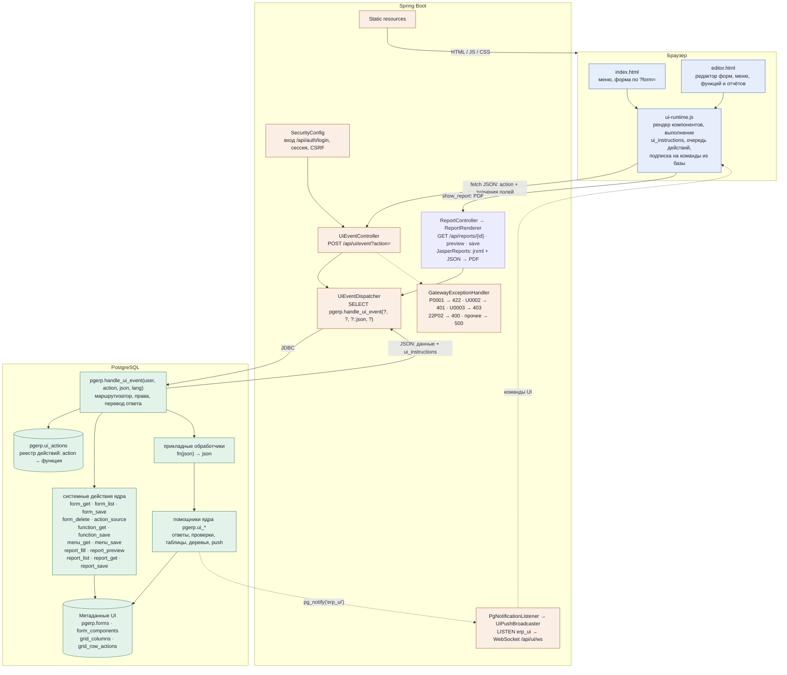
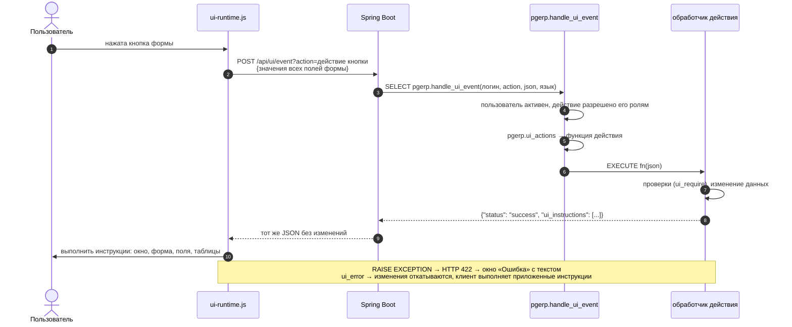
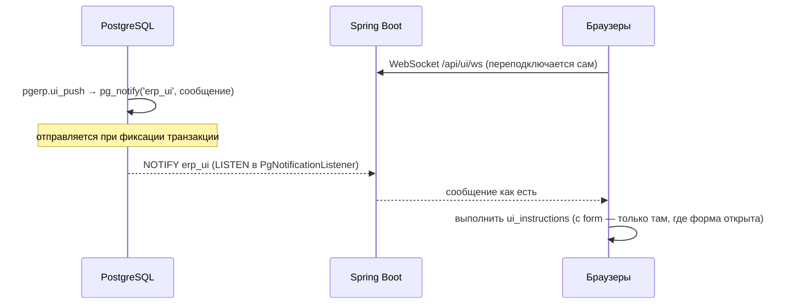
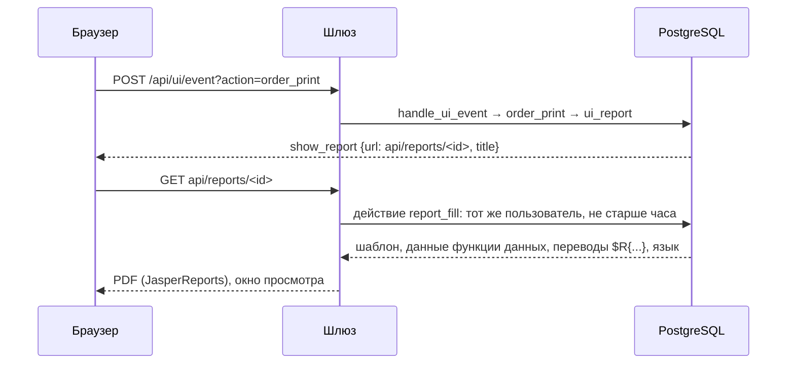
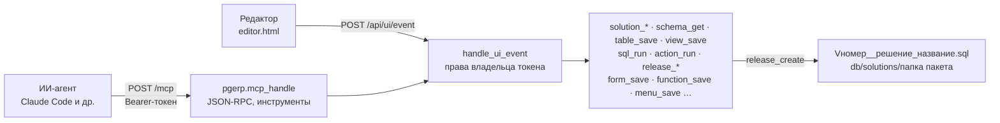
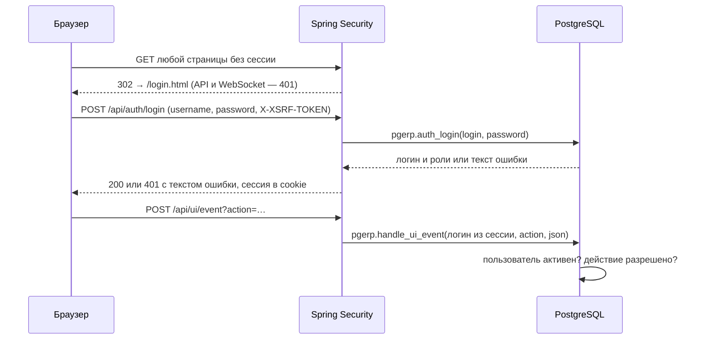
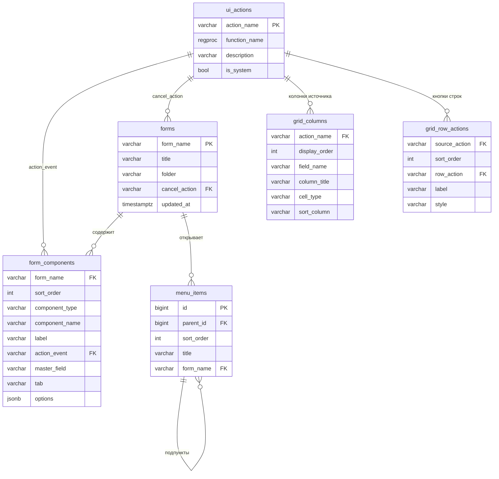

[English](ARCHITECTURE.md) · **Русский**

# Архитектура PgERP — ядро платформы

Data-Driven UI в архитектуре SmartDB: бизнес-логика и описание интерфейса живут в PostgreSQL.
Java-сервер — тонкий шлюз, браузер — универсальный рендерер форм, который выполняет инструкции,
присланные из базы. Документ описывает только ядро платформы; прикладные решения (формы, таблицы
и обработчики конкретных задач) строятся поверх него и здесь не рассматриваются.

**Стек:** HTML + ES modules · Java 25 · Spring Boot 4.1.2 · JdbcClient / HikariCP · WebSocket ·
PostgreSQL 18 / PL/pgSQL · Flyway (`db/migration/V1__core.sql` — ядро) · пакеты решений (`db/solutions/<папка>`: CRM,
примеры и решения, созданные в редакторе; у каждого — своя схема базы) · MCP (Streamable HTTP) для ИИ-агентов

## Слои и компоненты



Java не разбирает JSON и не знает предметной области: он передаёт логин из сессии, язык браузера, имя действия и данные формы
в одну функцию базы и возвращает её ответ как есть. Новая форма или кнопка — это строки
в метаданных и PL/pgSQL-функция, зарегистрированная в `pgerp.ui_actions`; Java при этом не меняется.

| Где | Файл |
|---|---|
| Вход, сессия, CSRF | <nobr>`src/main/java/com/erp/gateway/security/`</nobr> — <nobr>`SecurityConfig`</nobr>, <nobr>`DatabaseAuthenticationProvider`</nobr>, <nobr>`CsrfCookieFilter`</nobr> |
| Контроллер действий | `src/main/java/com/erp/gateway/web/UiEventController.java` |
| Диспетчер | `src/main/java/com/erp/gateway/dispatcher/UiEventDispatcher.java`, <nobr>`DispatcherProperties.java`</nobr> |
| Обработка ошибок | `src/main/java/com/erp/gateway/web/GatewayExceptionHandler.java` |
| Команды из базы | <nobr>`src/main/java/com/erp/gateway/push/`</nobr> — <nobr>`PgNotificationListener`</nobr>, <nobr>`UiPushBroadcaster`</nobr>, <nobr>`UiPushWebSocketConfig`</nobr>, <nobr>`UiPushProperties`</nobr> |
| Клиент | <nobr>`src/main/resources/static/js/ui-runtime.js`</nobr>, <nobr>`js/menu-editor.js`</nobr>, <nobr>`js/i18n.js`</nobr>, <nobr>`js/theme.js`</nobr>, <nobr>`index.html`</nobr>, <nobr>`editor.html`</nobr>, <nobr>`login.html`</nobr>, <nobr>`css/app.css`</nobr> |
| Разработка решений в редакторе | <nobr>`js/solution-editor.js`</nobr> (решения и выпуски), <nobr>`js/schema-editor.js`</nobr> (схема данных), <nobr>`js/sql-console.js`</nobr> (SQL-консоль), <nobr>`js/mcp-access.js`</nobr> (доступ MCP), <nobr>`js/solution-packages.js`</nobr> (установка решений), <nobr>`js/editor-kit.js`</nobr> (общие элементы); <nobr>`src/main/java/com/erp/gateway/dev/`</nobr> — <nobr>`DevController`</nobr> (выпуск с сохранением файла, установка пакетов), <nobr>`SolutionPackages`</nobr>, <nobr>`SolutionUpgradeRunner`</nobr>, <nobr>`MigrationWriter`</nobr>, <nobr>`DevProperties`</nobr> |
| MCP-сервер | <nobr>`src/main/java/com/erp/gateway/mcp/`</nobr> — <nobr>`McpController`</nobr> (<nobr>`POST /mcp`</nobr>), <nobr>`McpSecurityConfig`</nobr> и <nobr>`McpTokenFilter`</nobr> (вход по токену), <nobr>`McpGateway`</nobr>, <nobr>`McpProperties`</nobr> |
| Схема, функции и метаданные | <nobr>`src/main/resources/db/migration/V1__core.sql`</nobr> — ядро; <nobr>`db/solutions/crm/`</nobr>, <nobr>`db/solutions/examples/`</nobr> — пакеты решений |
| Настройки | <nobr>`src/main/resources/application.properties`</nobr> — <nobr>`erp.dispatcher.function-name`</nobr>, <nobr>`erp.push.channel`</nobr>, <nobr>`spring.flyway.init-sqls`</nobr>, <nobr>`erp.dev.solutions-dir`</nobr>, <nobr>`erp.dev.auto-update`</nobr>, <nobr>`erp.mcp.allowed-origins`</nobr> |

## Путь одного события



Действия одной формы выполняются по очереди: следующее получает значения полей, уже обновлённые
предыдущим. Поэтому таймер, горячие клавиши и кнопки не мешают друг другу.

## Контракт между базой и браузером

### Компоненты формы

| Тип | Назначение |
|---|---|
| <nobr>`label`</nobr> | Текст |
| <nobr>`input`</nobr> | Поле ввода; значение уходит в действия кнопок и в источники таблиц |
| <nobr>`date`</nobr> | Дата с календарём браузера; значение <nobr>`ГГГГ-ММ-ДД`</nobr> |
| <nobr>`hidden`</nobr> | Скрытое поле, например id записи |
| <nobr>`display`</nobr> | Значение только для чтения, задаёт база |
| <nobr>`lookup`</nobr> | Выбор из справочника: кнопка «...» вызывает действие, которое открывает форму в режиме выбора; ✕ очищает. Значение — в поле <nobr>`<имя>`</nobr>, текст — в <nobr>`<имя>__display`</nobr> |
| <nobr>`combobox`</nobr> | Выпадающий список: элементы возвращает действие-источник; значение — id выбранного элемента; первый пункт пустой. При выборе перечитывает таблицы с <nobr>`master`</nobr> = имя списка и компонент <nobr>`refresh`</nobr>; может быть мастером таблицы |
| <nobr>`button`</nobr> | Вызывает действие со значениями всех полей формы; первая кнопка ряда — основная |
| <nobr>`grid`</nobr> | Таблица: пагинация, сортировка, действия строк; с <nobr>`master`</nobr> — таблица-детали, источник получает <nobr>`master_id`</nobr> |
| <nobr>`tree`</nobr> | Дерево: уровни подгружаются при раскрытии; значение — id выбранного узла; может быть мастером таблицы и источником выбора для <nobr>`lookup`</nobr> |
| <nobr>`board`</nobr> | Поле из клеток: строки через <nobr>`/`</nobr>, <nobr>`#`</nobr> — занятая клетка, <nobr>`@`</nobr> — активная, <nobr>`.`</nobr> — пустая |
| <nobr>`timer`</nobr> | Вызывает своё действие каждые <nobr>`interval`</nobr> мс, пока его значение не пустое; включает и выключает база через <nobr>`set_values`</nobr> |
| <nobr>`chart`</nobr> | График: гистограмма, тренд, область или круговая диаграмма по данным действия-источника; SVG без библиотек, при наведении — подсказка со значениями; перечитывается <nobr>`refresh_grid`</nobr> |

**Параметры компонента** — `options` (JSON):

| Параметр | Компонент | Значение |
|---|---|---|
| <nobr>`column`</nobr> | любой видимый | Номер колонки (1, 2, …): компоненты с одним номером стоят друг под другом, колонки — рядом; первая колонка уже остальных |
| <nobr>`type`</nobr> | <nobr>`input`</nobr> | <nobr>`password`</nobr> — скрытый ввод пароля |
| <nobr>`refresh`</nobr> | <nobr>`input`</nobr> | Поле-фильтр: имена таблиц или деревьев формы через запятую, которые перечитываются при вводе (пауза 300 мс) |
| <nobr>`refresh`</nobr> | <nobr>`combobox`</nobr> | Имена таблиц, деревьев или других списков формы через запятую, которые перечитываются при выборе — фильтры и зависимые списки |
| <nobr>`placeholder`</nobr> | <nobr>`combobox`</nobr> | Текст пустого пункта, например «Все группы»; по умолчанию «Не выбрано» |
| <nobr>`hotkey`</nobr> | <nobr>`button`</nobr> | Горячая клавиша: <nobr>`event.code`</nobr> или <nobr>`event.key`</nobr> (<nobr>`ArrowLeft`</nobr>, <nobr>`Space`</nobr>, <nobr>`KeyP`</nobr>) |
| <nobr>`interval`</nobr> | <nobr>`timer`</nobr> | Период вызова действия, мс |
| <nobr>`page_size`</nobr> | <nobr>`grid`</nobr> | Строк на странице: 1–100, по умолчанию 10 (источник получает его как <nobr>`limit`</nobr>) |
| <nobr>`rows`</nobr>, <nobr>`cols`</nobr> | <nobr>`board`</nobr> | Размер пустого поля |
| <nobr>`chart`</nobr> | <nobr>`chart`</nobr> | Вид: <nobr>`bar`</nobr> — гистограмма (по умолчанию), <nobr>`line`</nobr> — тренд, <nobr>`area`</nobr> — область, <nobr>`pie`</nobr> — круговая по первому ряду |
| <nobr>`stacked`</nobr> | <nobr>`chart`</nobr> | <nobr>`true`</nobr> — ряды столбцов и областей ставятся друг на друга |
| <nobr>`height`</nobr> | <nobr>`chart`</nobr> | Высота, px (по умолчанию 260) |

**Раскладка и поведение формы:** свойство `tab` компонента раскладывает компоненты по вкладкам;
`master_field` связывает таблицу с полем-мастером; `pgerp.forms.cancel_action` — действие, которое
клиент вызывает при закрытии модального окна крестиком или Escape, как кнопку «Отмена»;
`pgerp.forms.folder` — папка формы в списках.

**Источник таблицы** (действие компонента `grid`) получает значения полей формы (фильтры), `page`, `limit`,
`sort_field`, `sort_dir`, `master_id` и возвращает `{status, meta, columns, rows, row_actions}` — обычно через `pgerp.ui_grid_page`.
Кнопки строк вызывают свои действия с `{id}` строки. В режиме выбора у строк появляется «Выбрать».

**Источник дерева** (действие компонента `tree`) получает значения полей формы и `parent_id`
(пусто — корни) и возвращает уровень `{status, nodes: [{id, label, has_children, icon?, ...}]}` —
обычно через `pgerp.ui_tree_level`. `"icon": "file"` — конечный элемент вместо папки.

**Источник выпадающего списка** (действие компонента `combobox`) получает значения полей формы и
возвращает `{status, items: [{id, label}]}` — обычно через `pgerp.ui_combo_items`. Значение, пришедшее
до загрузки элементов (`data` в `open_form`, `set_values`), ставится после загрузки; `refresh_grid`
перечитывает элементы с сохранением выбора.

**Источник графика** (действие компонента `chart`) получает значения полей формы и возвращает
`{status, labels: [...], series: [{name, values: [...]}], format}` — обычно через `pgerp.ui_chart`:
подписи — ось X (категории или даты), ряд — набор значений, `format` — `number`, `money` или `percent`
(на оси — сокращённо, в подсказке — полностью, по правилам языка интерфейса). `type` в ответе важнее
параметра `chart`. Пример — «Воронка продаж» CRM: сумма и сумма с учётом вероятности по стадиям.

### Инструкции UI (`ui_instructions`)

| Команда | Параметры | Что делает клиент |
|---|---|---|
| <nobr>`show_message`</nobr> | <nobr>`text`</nobr> | Окно сообщения |
| <nobr>`confirm`</nobr> | <nobr>`text`</nobr>, <nobr>`action`</nobr>, <nobr>`data`</nobr>, <nobr>`confirm_label`</nobr> | Подтверждение; при согласии вызывает <nobr>`action`</nobr> с <nobr>`data`</nobr> |
| <nobr>`open_form`</nobr> | <nobr>`form`</nobr>, <nobr>`modal`</nobr>, <nobr>`title`</nobr>, <nobr>`data`</nobr>, <nobr>`select`</nobr> | Открыть форму; <nobr>`data`</nobr> — значения полей; <nobr>`select`</nobr> — режим выбора (<nobr>`value_field`</nobr>, <nobr>`display_field`</nobr>, <nobr>`fill`</nobr>) |
| <nobr>`close_form`</nobr> | — | Закрыть окно формы |
| <nobr>`clear_form`</nobr> | — | Сбросить поля к исходным значениям |
| <nobr>`set_values`</nobr> | <nobr>`values`</nobr>, <nobr>`form`</nobr> | Заполнить поля этой или другой открытой формы |
| <nobr>`set_title`</nobr> | <nobr>`title`</nobr> | Сменить заголовок формы |
| <nobr>`logout`</nobr> | — | Завершить сеанс и открыть страницу входа |
| <nobr>`refresh_grid`</nobr> | <nobr>`grid`</nobr>, <nobr>`keep_page`</nobr> | Перечитать таблицу, дерево или выпадающий список; <nobr>`keep_page`</nobr> — остаться на странице |
| <nobr>`show_report`</nobr> | <nobr>`url`</nobr>, <nobr>`title`</nobr> | Загрузить отчёт PDF по <nobr>`url`</nobr> и показать в окне (см. «Отчёты PDF») |

Ответ действия: `{"status": "success", "ui_instructions": [...]}`, инструкции выполняются по порядку.
Ошибка: HTTP 422 и `{"status": "error", "message"}`; при `pgerp.ui_error` — с `ui_instructions`, которые
клиент выполняет перед показом текста.

### Команды из базы в UI

База может сама, без запроса пользователя, отправить инструкции открытым вкладкам браузера:

```sql
SELECT ui_push(ui_message('Через 5 минут сервер будет перезапущен'));      -- во все вкладки
PERFORM ui_push_to('my_form', ui_refresh_grid('my_grid', TRUE));           -- где открыта форма
```



Сообщение — `{"form": имя формы или null, "ui_instructions": [...], "users"?: [логины]}`, не больше 8000 байт (ограничение
NOTIFY). Откаченная транзакция ничего не отправляет; одинаковые сообщения одной транзакции
приходят один раз. Сообщения не хранятся: вкладка, закрытая в момент отправки, его не получит.
`ui_push` можно вызывать из обработчиков, триггеров, заданий и консоли. Подписаться могут только вошедшие
пользователи; с полем `users` (`ui_push_to_user`, `ui_push_to_role`) сообщение получают только вкладки
этих пользователей. При выходе подписки вкладок этой сессии закрываются.

## Окно сообщений

Функция выводит текст в панель внизу экрана, не прерывая работу и не открывая окон.

```sql
PERFORM ui_print('Начинаю пересчёт');
PERFORM ui_print(format('Обработано строк: %s', v_count));
PERFORM ui_print('Остаток товара меньше нуля', 'warning');   -- info | warning | error
```

`ui_print` отправляет `RAISE NOTICE` со своим кодом: U0010 — информация, U0011 — предупреждение, U0012 — ошибка
(только вид строки, выполнение продолжается). Шлюз собирает такие NOTICE из ответа на запрос и добавляет в JSON
массив `"messages": [{"text", "kind"}]`; ответ без сообщений не меняется. NOTICE не откатывается вместе
с транзакцией, поэтому при ошибке действия ответ с ошибкой тоже несёт сообщения, выведенные до неё. Прочие NOTICE
(например, от `CREATE ... IF NOT EXISTS`) в панель не попадают. Текст переводится по таблице переводов, как `ui_message`.

Новое сообщение открывает панель само: время, текст, цвет по виду; ✕ скрывает её, «Очистить» — очищает, лог не
длиннее 500 строк. Кнопка «Сообщения» в шапке (рядом — число сообщений) показывает и скрывает панель в любой момент.
Сообщения и открытость панели хранятся в `sessionStorage` вкладки: при переходе к другой форме или в редактор они
сохраняются, при выходе и истечении сеанса — стираются. Если открыта модальная форма, панель встраивается внизу неё (всё вне модального окна браузер
блокирует), после закрытия формы возвращается вниз страницы. Сообщения через WebSocket (`ui_push`) в панель не
идут — это ответ на собственное действие пользователя.

## Отчёты PDF

Отчёты строятся JasperReports 7 (`jasperreports`, `-pdf`, `-jdt`, `-fonts` в `pom.xml`). Шаблон (jrxml), функция
данных и права — в базе; шлюз только компилирует шаблон и заполняет его. Показ — инструкция из любого действия:

```sql
CREATE FUNCTION order_print(p_data JSON) RETURNS JSON AS $$
BEGIN
    RETURN ui_ok(ui_report('order_invoice', jsonb_build_object('order_id', ui_parse_id(p_data->>'id'))));
END;
$$ LANGUAGE plpgsql;
```



**Данные.** Функция данных — обычная функция действия `fn(p_data JSON) RETURNS JSON`, получает параметры из
`ui_report` и возвращает JSON-объект: ключи верхнего уровня — параметры отчёта (`$P{...}`), массив `rows` —
строки (`$F{...}`; поле берёт значение по `<description>` — путь через точку, иначе по имени). Значения
приводятся к классам из jrxml: `String`, `Integer`, `Long`, `BigDecimal` (без потери точности), `Double`,
`Boolean`, `java.util.Date`, `LocalDate`, `Timestamp`…; вложенный массив в параметр `JRDataSource` — источник
для подотчёта или таблицы. Без `rows` отчёт заполняется один раз (только параметры); пустой `rows` — отчёт
с шапкой и итогами без строк.

**Тексты и формат.** `$R{текст}` — перевод текста на язык пользователя из `pgerp.translations`; такие тексты и
названия отчётов появляются в форме «Переводы». Числа и даты (`pattern`) форматируются по языку пользователя.
Шрифт по умолчанию — DejaVu Sans со встраиванием в PDF (`jasperreports.properties`): кириллица без настройки.

**Права.** Отчёт показывает только действие, на которое у пользователя есть право; адрес `api/reports/<id>`
работает только для того же пользователя и час. Редактор отчётов и `api/reports/preview`, `api/reports/save` —
только администратору. Выражения jrxml — код Java, выполняемый на сервере приложения: право править отчёты
равно праву выполнять код на сервере, как и правка функций в редакторе — в базе.

**Редактор** (`editor.html?reports=<имя>`): отчёты перечислены в боковой панели редактора под пунктом «Отчёты»
(пункт открывает первый отчёт, «+ Новый отчёт» — заготовку); у отчёта — имя, название, действие
с функцией данных (`{ }` — её код или заготовка `<отчёт>_data`), параметры предпросмотра; шаблон jrxml
с подсветкой. «Предпросмотр» (Ctrl+Enter) заполняет несохранённый шаблон, «Сохранить» (Ctrl+S) сначала
компилирует его — ошибка показывается над шаблоном и не сохраняется. «Загрузить jrxml» / «Скачать jrxml» —
обмен с Jaspersoft Studio; формат — JasperReports 7 (`<element kind="textField">`), шаблоны 6.x нужно
сконвертировать в Studio 7. Скомпилированные шаблоны кешируются по имени и времени изменения.

## Колонки таблиц в редакторе форм

В свойствах таблицы — кнопка «Колонки…» (нужно выбранное действие-источник). Окно показывает колонки
источника (`pgerp.grid_columns`): поле, заголовок, формат (`text`, `number`, `money`, `datetime`, `badge` — метка с цветом из данных, см. `ui_badge`),
сортировку; колонки можно добавлять («+ Колонка», «Добавить все поля»), убирать и переставлять. Ниже — пример
первых строк источника с новыми заголовками. Сохраняется сразу (действие `grid_columns_save`), отдельно от формы.

Поля для выбора: столбцы таблицы или представления из вызова `ui_grid_page('<действие>', p_data, '<источник>', …)`
в коде функции-источника, иначе — поля строк пробного вызова. Пробный вызов (`page: 1, limit: 3`) выполняется
в подтранзакции и откатывается: источник ничего не изменит. Колонки и сортировка принимаются только по полям
источника, если их удалось определить.

Колонки принадлежат источнику, а не форме: таблицы с одним источником в разных формах меняются вместе —
окно перечисляет такие формы. Заголовки переводятся в форме «Переводы» («Колонка таблицы»). Изменения
живут в базе; в новые установки их переносит выпуск решения (см. «Разработка решений»).

## Редактор функций

Кнопка `{ }` у поля «Действие» в редакторе форм открывает функцию действия:

- **действие выбрано** — код функции для правки; функции ядра (`pgerp`) и функции с особыми свойствами
  (не `имя(JSON) RETURNS JSON`, `SET`, `SECURITY DEFINER`, `STRICT`) — только для чтения, с причиной;
- **действия нет** — заготовка под тип компонента (`pgerp.function_templates`): обработчик кнопки или
  таймера с переменными для полей формы (`ui_text`, `ui_parse_date`, `ui_parse_id`), проверкой первого
  поля и ответом `ui_ok`; источник таблицы (`ui_grid_page`), дерева (`ui_tree_level`), выпадающего
  списка (`ui_combo_items`), графика (`ui_chart`); открытие формы-списка для поля выбора. Имя — `форма_компонент`.

Правятся имя (только у новой), описание, язык (`plpgsql`, `sql`), изменчивость и тело; Ctrl+S — сохранить, Tab — отступ. Код подсвечивается (комментарии, строки, `$$`-кавычки, числа, типы, ключевые слова, вызовы функций) без внешних библиотек: прозрачный `textarea` лежит поверх `<pre>` с раскрашенной копией текста.
Сохранение (`function_save`) создаёт или заменяет `имя(p_data JSON) RETURNS JSON` (новую — в схеме её решения
по префиксу имени, иначе в `public`) и регистрирует действие с тем же именем; новая функция сразу становится действием компонента. Ошибка компиляции
показывается в окне, прежняя версия функции остаётся.

Клиент присылает не SQL, а имя, язык, изменчивость и тело: заголовок `CREATE FUNCTION` собирает база
(`%I`, ограничитель тела, которого нет в самом теле), поэтому дописать к нему второй оператор нельзя.
Действия редактора системные — только для администратора. Функции, созданные в редакторе, как и формы
из редактора форм, живут в базе: в новую установку их переносит выпуск решения (см. «Разработка решений»).

## Разработка решений

Пошаговый пример со скриншотами — [приложение «Список дел» с нуля](docs/tutorial-todo.ru.md).

Полный цикл разработки прикладного решения — в редакторе (`editor.html`) или ИИ-агентом через MCP-сервер:
модель данных → функции действий → формы, колонки таблиц, меню, роли, переводы, отчёты → проверка → выпуск
(файл пакета решения для других установок). Всё это — системные действия базы (только администратору); редактор
и MCP вызывают одни и те же действия через маршрутизатор.



### Решения

Решение — прикладной модуль (`pgerp.solutions`): название, **префикс** имён объектов (`crm_`), папка меню
верхнего уровня, папка пакета и **схема базы** (`db_schema`) для его таблиц, представлений и функций. Объект (таблица, представление, последовательность, функция, перечисление,
форма, действие, отчёт, роль) входит в решение, если его имя начинается с префикса (из нескольких — с самым
длинным) или он добавлен явно (`pgerp.solution_objects`: объекты без префикса, как в примерах). Объекты ядра
(схема `pgerp`, формы администрирования, роль `admin`) — в решении `core`, оно только для чтения. Таблицы-справочники,
строки которых нужны на любой установке (стадии, типы), отмечаются в `pgerp.solution_data`.

Миграция ядра создаёт только решение `core`. CRM и примеры — **пакеты решений** (см. «Миграции и пакеты решений»):
установка пакета создаёт решение, его схему и объекты и записывает его выпуски. Новое решение из редактора получает
схему при создании (по умолчанию — имя решения).

В редакторе: фильтр «Решение» в боковой панели (формы, отчёты, схема данных — только этого решения; новая форма
получает его префикс и папку меню), пункт «Решения» — свойства, состав (явное включение и исключение объектов,
отметка «Данные» у таблиц), выпуск и история выпусков; «Установить решения» — пакеты из приложения.

### Схема данных

Пункт «Схема данных» — таблицы и представления решения. **Конструктор таблицы** (`table_get` / `table_save`):
колонки (имя, тип, обязательность, значение по умолчанию, комментарий), первичный ключ, внешние ключи,
уникальность, проверки, индексы. Существующие ограничения и индексы можно удалить, новые — добавить; сложное
(триггеры, вычисляемые колонки, партиции) — SQL-консолью. «Сохранить» сначала показывает SQL изменений
(`apply: false`), «Применить» выполняет его. Переименования таблиц и колонок конструктор записывает
в `pgerp.solution_renames`: выпуск переименует объект, а не удалит и создаст заново (переименование в SQL-консоли
выпуск увидит как удаление и добавление — и предупредит об этом). **Представление** (`view_get` / `view_save`):
запрос с подсветкой; если колонки убраны или сменили тип, представление пересоздаётся. Удаление (`object_drop`)
сначала показывает зависимые объекты; удалить с ними — CASCADE.

### SQL-консоль

`sql_run` — запрос или скрипт от имени базы (60 с на запрос): строки результата (до `max_rows`) или число
затронутых строк; «Откатить после выполнения» выполняет и откатывает. Ошибка (текст, подробности, подсказка,
SQLSTATE) приходит полем ответа. Вкладка «Проверка действия» (`action_run`) вызывает действие так, как его вызывает
форма: со значениями полей и **правами выбранного пользователя**; по умолчанию изменения откатываются. Последние
запросы хранятся в браузере. Консоль работает с правами роли базы, под которой подключено приложение: в рабочей
установке давать её только тем, кому можно менять базу напрямую.

### Выпуск

Выпуск (`release_preview`, `release_create`) — файл пакета решения, который собирает база. Снимок решения
(`pgerp.solution_state`) — структура таблиц (колонки, ограничения, индексы, триггеры, комментарии), представления
в порядке зависимостей, функции (`pg_get_functiondef`), перечисления, последовательности, строки справочников и SQL
метаданных по разделам (действия, формы, компоненты, колонки и кнопки таблиц, отчёты, роли с выданными формами,
папка меню, переводы текстов решения). Выпуск — разница между текущим снимком и снимком прошлого выпуска
(`pgerp.solution_releases`); первый выпуск (и «Полный скрипт») — решение целиком.

| Изменение | В выпуске |
|---|---|
| Новая таблица / колонка | <nobr>`CREATE TABLE IF NOT EXISTS`</nobr> / <nobr>`ADD COLUMN IF NOT EXISTS`</nobr> |
| Тип, значение по умолчанию, обязательность колонки | <nobr>`ALTER COLUMN … TYPE … USING`</nobr>, <nobr>`SET/DROP DEFAULT`</nobr>, <nobr>`SET/DROP NOT NULL`</nobr> |
| Ограничения, индексы, триггеры | изменённые удаляются и создаются заново |
| Удалённые колонка, таблица, функция, тип | <nobr>`DROP … IF EXISTS`</nobr> — с предупреждением |
| Функции | <nobr>`CREATE OR REPLACE`</nobr>; сменился тип результата — <nobr>`DROP`</nobr> и создание |
| Представления | при любом изменении представлений или колонок таблиц — все представления решения пересоздаются в порядке зависимостей |
| Справочники | вставка с обновлением по первичному ключу, сдвиг последовательностей |
| Метаданные | раздел целиком, если он изменился; удалённые формы, отчёты, роли, действия — <nobr>`DELETE`</nobr> |

Файл выпуска — `V<номер>__<решение>_<название>.sql` в папке `db/solutions/<папка пакета>/`; номера — свои у каждого
решения (1, 2, …). Внутри — вызов `pgerp.solution_release_apply('решение', номер, 'название', $release$ … SQL … $release$)`
и сводка изменений в комментарии. В SQL нет имён схем: он выполняется, когда схема решения первая в пути поиска, поэтому
пакет можно установить в любую схему. Функция выполняет SQL **один раз на базу**: на базе, где выпуск создан, он уже
записан в `pgerp.solution_releases` — более поздние правки разработчика не откатываются. На другой установке выпуск
применяется при установке или обновлении решения (см. «Миграции и пакеты решений»). Рядом с выпусками лежит
`solution.json` — описание пакета (имя, название, описание, схема по умолчанию); его создаёт первый сохранённый выпуск.

Если задана папка пакетов проекта (`ERP_DEV_SOLUTIONS_DIR`, например `…/erp-gateway/src/main/resources/db/solutions`),
«Создать выпуск» сохраняет файл туда (шлюз проверяет имя и что версия в пакете не занята); иначе файл скачивается.
Последний выпуск можно отменить (`release_delete`) — следующий снова соберёт его изменения.

Предупреждения выпуска: обязательная колонка без значения по умолчанию, смена типа, удаление колонок и таблиц,
справочник, ссылающийся на таблицу без переносимых строк. Выпуск не переносит права (`GRANT`), политики RLS,
изменения вычисляемых колонок, identity и правил сортировки, пользователей и их роли.

## MCP-сервер

`POST /mcp` — сервер [Model Context Protocol](https://modelcontextprotocol.io) (транспорт Streamable HTTP, ответы
JSON без потока SSE, без сеанса): ИИ-агент получает инструменты полного цикла разработки решений.

**Вход** — заголовок `Authorization: Bearer <токен>`. Токены выдаёт администратор в редакторе («Доступ MCP»):
назначение, пользователь, срок; токен показывается один раз, в базе — только SHA-256 (`pgerp.mcp_tokens`).
Агент работает **с правами владельца токена**: инструменты — действия, разрешённые его ролям (`tools/list`
показывает только их); разработка — только администратору. Цепочка безопасности `/mcp` своя
(`McpSecurityConfig`): без сессии и CSRF, cookie и вход по паролю здесь не работают, а токен не открывает
остальное приложение. Запрос с чужим заголовком `Origin` отклоняется (`ERP_MCP_ALLOWED_ORIGINS` — исключения).

**Протокол** реализует база: `pgerp.mcp_handle(логин, запрос, язык)` — `initialize` (с подсказкой начать с
`platform_guide`), `ping`, `tools/list`, `tools/call`, пакеты запросов; уведомления — `202 Accepted`. Инструмент —
строка `pgerp.mcp_tools`: имя → действие, описание и JSON Schema аргументов; вызов идёт через `handle_ui_event`,
ошибка возвращается результатом с `isError`, изменения при ошибке откатываются. Новый инструмент — строка в таблице,
Java не меняется. Шлюз добавляет только то, чего нет в базе: компиляцию шаблона перед `report_save`
(`hook = compile_jrxml`), запись файла выпуска в пакет (`write_migration`), инструменты пакетов (`packages`: файлы
лежат в приложении, а не в базе) и сообщения `ui_print`. Без `Accept-Language`
ответы — на языке пользователя или исходном.

| Группа | Инструменты |
|---|---|
| Справочник | <nobr>`platform_guide`</nobr> — устройство платформы, правила, порядок работы, помощники ядра, формат форм (<nobr>`pgerp.dev_guide()`</nobr>) |
| Решения | <nobr>`solution_list`</nobr>, <nobr>`solution_get`</nobr>, <nobr>`solution_save`</nobr>, <nobr>`solution_object_set`</nobr>, <nobr>`solution_data_set`</nobr>, <nobr>`solution_packages`</nobr>, <nobr>`solution_install`</nobr> |
| Схема данных | <nobr>`schema_get`</nobr>, <nobr>`table_get`</nobr>, <nobr>`table_save`</nobr>, <nobr>`view_get`</nobr>, <nobr>`view_save`</nobr>, <nobr>`object_drop`</nobr>, <nobr>`function_source`</nobr> |
| Действия | <nobr>`function_get`</nobr> (код или заготовка), <nobr>`function_save`</nobr> |
| Интерфейс | <nobr>`form_list`</nobr>, <nobr>`form_get`</nobr>, <nobr>`form_save`</nobr>, <nobr>`form_delete`</nobr>, <nobr>`grid_columns_get`</nobr>, <nobr>`grid_columns_save`</nobr>, <nobr>`menu_get`</nobr>, <nobr>`menu_save`</nobr> |
| Права и тексты | <nobr>`role_list`</nobr>, <nobr>`role_set`</nobr>, <nobr>`translation_list`</nobr>, <nobr>`translation_save`</nobr> |
| Отчёты | <nobr>`report_list`</nobr>, <nobr>`report_get`</nobr>, <nobr>`report_save`</nobr> |
| Проверка | <nobr>`sql_run`</nobr>, <nobr>`action_run`</nobr> |
| Выпуск | <nobr>`release_preview`</nobr>, <nobr>`release_create`</nobr>, <nobr>`release_get`</nobr> |

**Подключение Claude Code** (команду с токеном показывает редактор при выдаче токена):

```bash
claude mcp add --transport http pgerp https://erp.example.com/mcp --header "Authorization: Bearer <токен>"
```

## Аутентификация и авторизация

Пользователи, роли, пароли и права хранятся и проверяются в базе. Spring Security держит только
сессию (cookie) и защиту от CSRF.



**Вход.** `pgerp.auth_login` сверяет пароль с bcrypt-хешем (`crypt` из pgcrypto). После 5 неудачных
попыток подряд вход закрыт на 5 минут. Отключённый пользователь войти не может, а уже открытая сессия
перестаёт работать при следующем действии (HTTP 401). Если в учётной записи стоит `must_change_password`
(первый вход, пароль задан администратором), доступны только действия с `everyone`: клиент сразу
открывает форму `password_change`, отмена в ней — выход. Первый администратор — **admin / admin**,
пароль нужно сменить при первом входе. После этого администратор выбирает, какие решения установить
(см. «Миграции и пакеты решений»).

**Права: роль → формы.** Администратор выдаёт роли формы (`pgerp.role_forms`, форма «Роли»). Какие
действия можно вызывать, база выводит сама:

- действия компонентов разрешённых форм (кнопки, источники таблиц, деревьев, списков, таймеры, поля
  выбора), кнопки строк их таблиц и действие отмены формы — представление `pgerp.form_actions`;
- формы, которые открывают эти действия, разрешаются автоматически вместе со своими действиями. Ссылки
  находятся по вызовам `ui_open_form('имя', …)` в коде функции (`pgerp.action_forms`). Поэтому карточки
  и окна выбора отдельно выдавать не нужно, но и действия этих форм становятся доступны (например, окно
  выбора товара даёт и кнопку «Новый товар»). Форму, имя которой вычисляется во время работы, или
  действие, вызванное из `ui_confirm` с другим именем, роль получает только явно.

В меню попадают только формы, выданные ролям напрямую. Роль `admin` — все формы и действия, в том числе
системные (редактор форм и меню); страница `editor.html` открыта только ей. Действия с
`ui_actions.everyone` (`form_get`, `menu_get`, `session_get`, смена пароля) доступны любому вошедшему;
`form_get` при этом отдаёт только разрешённую форму.

**Ошибки доступа:** SQLSTATE `U0002` (пользователь отключён или удалён) → HTTP 401, клиент переходит на
страницу входа; `U0003` (нет прав) → HTTP 403 с текстом. 403 без JSON базы — отклонённый токен CSRF
(например, после выхода в другой вкладке), клиент тоже переходит на вход.

**CSRF:** сервер кладёт токен в cookie `XSRF-TOKEN`, клиент отправляет его в заголовке `X-XSRF-TOKEN`
с каждым POST (`csrfHeaders()` в `ui-runtime.js`).

**Администрирование** (меню «Администрирование», только `admin`): «Пользователи» — логин, имя,
состояние, новый пароль (пользователь сменит его при входе), роли; «Роли» — код, название, формы.
Нельзя отключить себя, удалить роль `admin` или оставить систему без активного администратора.


## Мультиязычность

Английский — и исходный язык (на нём написаны метаданные форм и сообщения обработчиков), и язык **по умолчанию**
(его видит каждый, кто сам не выбрал другой). Языки перечислены в `pgerp.languages` (`en` — исходный и по умолчанию,
`is_source` и `is_default`; `ru` — перевод); добавить язык — строка в этой таблице и переводы. Без перевода текст
показывается на исходном языке, поэтому у новых текстов нужен русский перевод (форма «Переводы», вкладка
«Без перевода»).

**Что переводится и где**

| Что | Где переводится | Чем |
|---|---|---|
| Тексты клиента: вход, шапка, таблицы, редакторы | браузер | <nobr>`js/i18n.js`</nobr>: словарь по исходному тексту, <nobr>`t('Page {0} of {1} · {2} total', …)`</nobr>; статичный HTML — атрибуты <nobr>`data-i18n`</nobr>, <nobr>`data-i18n-attrs`</nobr> |
| Форма: заголовок, подписи, вкладки, пустой пункт списка | <nobr>`ui_form_open`</nobr> (<nobr>`form_get`</nobr>) | <nobr>`pgerp.translations`</nobr>, точное совпадение |
| Меню | <nobr>`ui_menu_get`</nobr> | то же |
| Ответ действия: текст ошибки, инструкции (<nobr>`text`</nobr>, <nobr>`title`</nobr>, <nobr>`confirm_label`</nobr>), колонки и кнопки строк таблиц, элементы списков | маршрутизатор, <nobr>`i18n_response`</nobr> | точное совпадение или шаблон |

Перевод ищется по исходному тексту, как в gettext, поэтому код обработчиков менять не нужно. Сообщение
с подстановками («Product “Table” already exists») переводится по шаблону: исходный текст `Product “%s” already exists`
с плейсхолдерами `format()` (`%s`, `%I`, `%L`, `%1$s`) или `RAISE` (`%`) превращается в регулярное
выражение, подставленные значения переносятся в перевод (`%s` или `%1$s`, `%2$s` — по порядку исходного
текста) и сами переводятся, если для них есть точный перевод. Перевод, не подходящий к числу
подстановок, форма «Перевод» не сохранит.

Не переводятся данные: строки таблиц, узлы деревьев, значения полей (`set_values`), а также команды из
базы (`ui_push`). Текст с подстановками обработчик может перевести явно: сначала шаблон, потом значения —
`format(ui_t('Hello, %s'), v_name)` (так сделан `hello_run`). Склеивать фразу из кусков
(`'Hello, ' || имя`) не стоит: переводчик увидит только кусок. Редакторы форм и меню получают исходные тексты
(`"source": true` в `form_get` и `menu_get`), иначе перевод сохранился бы вместо оригинала.

**Язык пользователя:** `pgerp.users.lang` — переключатель в шапке (действие `session_lang_set`), иначе
язык, выбранный в браузере (`localStorage`; клиент отправляет его в `Accept-Language`), иначе язык по умолчанию —
английский (`pgerp.i18n_default_lang()`; в клиенте — `DEFAULT` в `js/i18n.js`). Язык браузера не учитывается.
Запросы без языка (MCP без `Accept-Language`, консоль, задания) — на языке по умолчанию. Маршрутизатор
ставит `pgerp.lang` до конца транзакции; ошибки входа — на языке пользователя или страницы входа.
Клиент запоминает язык в `localStorage` и перезагружает страницу, если в базе выбран другой.

**Форма «Переводы»** (Администрирование): вкладка «Переводы» — правка и удаление, вкладка «Без перевода»
— тексты без перевода на каждый язык (`pgerp.translation_missing_v`). Тексты собирает
`pgerp.translatable_texts`: метаданные (формы, папки, подписи, вкладки, колонки, кнопки строк, меню,
описания действий, роли) и строковые литералы, похожие на фразу (заглавная буква, за ней строчная), из кода
функций прикладных схем и `pgerp`. Русские переводы текстов ядра — в миграции ядра, текстов решений — в выпусках
их пакетов.


## Темы оформления

Темы — светлая (`light`) и тёмная (`dark`), список — `pgerp.themes`. Оформление темы — набор
CSS-переменных цветов: светлая задана в `:root` (`css/app.css`), тёмная — в `:root[data-theme="dark"]`
(вместе с `color-scheme: dark` для календаря, списков и полос прокрутки браузера). Компоненты используют
только переменные, поэтому новая тема — блок `:root[data-theme="<код>"]` с теми же переменными и строка
в `pgerp.themes` (название переводится через `pgerp.translations`).

Выбор пользователя — `pgerp.users.theme` (переключатель в шапке, действие `session_theme_set`); по умолчанию —
светлая (`light`), `NULL` — «Как в системе»: тема следует `prefers-color-scheme` и меняется вместе с темой ОС. `js/theme.js`
подключается обычным `<script>` в `<head>` и ставит `data-theme` у `<html>` до отрисовки (без мигания
светлой темы); выбор хранится и в `localStorage`, поэтому страница входа открывается в той же теме,
а смена в одной вкладке применяется в остальных. Тема меняется сразу, без перезагрузки.

## Схемы

Ядро лежит в схеме `pgerp`: маршрутизатор, системные действия, все помощники `ui_*` и таблицы
метаданных. Каждое прикладное решение — в **своей схеме** (`pgerp.solutions.db_schema`): её выбирают при установке
пакета (по умолчанию — из пакета, например `crm`) или при создании решения в редакторе; можно и `public`.
Имя `pg_erp` недопустимо: префикс `pg_` PostgreSQL резервирует для системных схем.

Маршрутизатор ставит путь поиска в каждом действии: `public`, схемы установленных решений, `pgerp`
(`pgerp.app_search_path()`); установка записывает его и в настройки базы (для psql и заданий). Поэтому прикладной код
вызывает помощники и объекты любого решения без схемы: `ui_ok(...)`, `crm_deals`. Значит, имена объектов должны быть
уникальны во всех решениях — для этого и нужен префикс. Объекты ядра создаются и указываются со схемой:
`CREATE FUNCTION pgerp.ui_...`, `INSERT INTO pgerp.ui_actions ...`; без неё функция попадёт в первую схему пути,
а прикладная таблица с тем же именем подменит таблицу ядра.

## Модель данных ядра



| Таблица | Содержимое |
|---|---|
| <nobr>`pgerp.forms`</nobr> | Формы: имя, заголовок, папка, действие отмены |
| <nobr>`pgerp.form_components`</nobr> | Компоненты формы по порядку <nobr>`sort_order`</nobr>; тип проверяется по <nobr>`ui_component_types()`</nobr> |
| <nobr>`pgerp.ui_actions`</nobr> | Реестр действий — белый список функций, которые можно вызвать из браузера. <nobr>`is_system`</nobr> — системные действия ядра, не показываются в редакторе; <nobr>`everyone`</nobr> — доступно любому вошедшему без выдачи формы |
| <nobr>`pgerp.users`</nobr> | Пользователи: логин (в нижнем регистре), имя, bcrypt-хеш пароля, <nobr>`is_active`</nobr>, <nobr>`must_change_password`</nobr>, счётчик неудачных попыток и <nobr>`locked_until`</nobr>, время последнего входа, язык <nobr>`lang`</nobr> (пусто — выбранный в браузере или по умолчанию), тема <nobr>`theme`</nobr> (пусто — как в системе) |
| <nobr>`pgerp.roles`</nobr>, <nobr>`pgerp.user_roles`</nobr> | Роли (код, название) и их назначение пользователям; роль <nobr>`admin`</nobr> — полный доступ |
| <nobr>`pgerp.role_forms`</nobr> | Формы роли; при удалении формы строка удаляется |
| <nobr>`pgerp.function_templates`</nobr> | Заготовки тел функций для редактора по типу компонента (<nobr>`handler`</nobr> — кнопка, таймер; <nobr>`report`</nobr> — функция данных отчёта); подстановки <nobr>`{name}`</nobr>, <nobr>`{label}`</nobr>, <nobr>`{declare}`</nobr>, <nobr>`{require}`</nobr> |
| <nobr>`pgerp.reports`</nobr> | Отчёты PDF: имя, название, <nobr>`data_action`</nobr> — действие с функцией данных, <nobr>`sample_params`</nobr> — параметры предпросмотра, <nobr>`jrxml`</nobr> — шаблон JasperReports 7 |
| <nobr>`pgerp.report_requests`</nobr> | Запросы <nobr>`ui_report`</nobr>: пользователь, отчёт, параметры, заголовок; адрес <nobr>`api/reports/<id>`</nobr> действует час, записи старше суток удаляются |
| <nobr>`pgerp.themes`</nobr> | Темы оформления: код (значение <nobr>`data-theme`</nobr>), название, порядок в переключателе |
| <nobr>`pgerp.languages`</nobr> | Языки: код, название, <nobr>`is_source`</nobr> — исходный (один), <nobr>`is_default`</nobr> — по умолчанию (один), порядок в переключателе |
| <nobr>`pgerp.translations`</nobr> | Переводы: язык, исходный текст → перевод; <nobr>`is_template`</nobr> — исходный текст с плейсхолдерами |
| <nobr>`pgerp.grid_columns`</nobr> | Колонки источника таблицы: поле, заголовок, тип ячейки (<nobr>`text`</nobr>, <nobr>`number`</nobr>, <nobr>`money`</nobr>, <nobr>`datetime`</nobr>, <nobr>`badge`</nobr>), колонка сортировки (<nobr>`NULL`</nobr> — без сортировки). Правится в редакторе форм: свойства таблицы → «Колонки…» |
| <nobr>`pgerp.menu_items`</nobr> | Меню приложения: пункты с произвольной вложенностью (<nobr>`parent_id`</nobr>), порядок <nobr>`sort_order`</nobr>, форма пункта (необязательна; при удалении формы пункт остаётся без неё) |
| <nobr>`pgerp.grid_row_actions`</nobr> | Кнопки в строках таблицы: действие, подпись, стиль <nobr>`default`</nobr> / <nobr>`danger`</nobr> |

## Функции ядра

Все функции — в схеме `pgerp`. «Действие» — функция зарегистрирована в `pgerp.ui_actions` под этим
именем и вызывается из браузера.

### Маршрутизатор и системные действия

| Функция | Возвращает | Описание |
|---|---|---|
| `handle_ui_event(p_user VARCHAR, p_action VARCHAR, p_form_data JSON, p_lang VARCHAR DEFAULT NULL)` | <nobr>`JSON`</nobr> | Единственная точка входа из Java; <nobr>`p_user`</nobr> — логин из сессии сервера, <nobr>`p_lang`</nobr> — язык браузера. Ставит язык действия <nobr>`pgerp.lang`</nobr> (настройка пользователя важнее браузера); переводит ответ (<nobr>`i18n_response`</nobr>) и тексты ошибок <nobr>`RAISE`</nobr>, <nobr>`U0002`</nobr>, <nobr>`U0003`</nobr>. Пользователь не найден или отключён — ошибка <nobr>`U0002`</nobr>. Ставит <nobr>`pgerp.user`</nobr> до конца транзакции (<nobr>`ui_user()`</nobr>). Пока нужно сменить пароль — только действия с <nobr>`everyone`</nobr>; остальные проверяет <nobr>`auth_action_allowed`</nobr>, иначе ошибка <nobr>`U0003`</nobr>. Находит <nobr>`p_action`</nobr> в <nobr>`pgerp.ui_actions`</nobr> (иначе ошибка «Неизвестное действие») и вызывает зарегистрированную функцию с <nobr>`p_form_data`</nobr> через <nobr>`regproc`</nobr>. Ошибку <nobr>`ui_error`</nobr> (SQLSTATE <nobr>`U0001`</nobr>) перехватывает: изменения обработчика откатываются (подтранзакция), возвращается `{"status": "error", "message", "ui_instructions"}`. Остальные ошибки пробрасывает. Ставит путь поиска <nobr>`public`, схемы решений, `pgerp`</nobr> (<nobr>`app_search_path()`</nobr>) до конца транзакции |
| <nobr>`ui_form_open(p_data JSON)`</nobr> | <nobr>`JSON`</nobr> | Действие <nobr>`form_get`</nobr> (системное, <nobr>`everyone`</nobr>): проверяет доступ пользователя к форме (<nobr>`U0003`</nobr>) и возвращает <nobr>`ui_form_get`</nobr> на языке пользователя; <nobr>`"source": true`</nobr> — исходные тексты для редактора |
| <nobr>`ui_form_get(p_data JSON)`</nobr> | <nobr>`JSON`</nobr> | Структура формы <nobr>`p_data->>'form'`</nobr>: `{name, title, folder, cancel, components: [{type, name, label, action, master, tab, options}]}` по порядку компонентов. Ошибка, если формы нет |
| <nobr>`ui_form_list(p_data JSON)`</nobr> | <nobr>`JSON`</nobr> | Действие <nobr>`form_list`</nobr> (системное). Все формы <nobr>`{name, title, folder}`</nobr> — по папке (без папки в конце) и заголовку — и несистемные действия <nobr>`{name, description}`</nobr> для выбора в редакторе |
| <nobr>`ui_form_save(p_data JSON)`</nobr> | <nobr>`JSON`</nobr> | Действие <nobr>`form_save`</nobr> (системное). Сохраняет форму целиком из редактора: проверяет имена формы и компонентов, типы, обязательные действия у <nobr>`grid`</nobr>, <nobr>`tree`</nobr>, <nobr>`combobox`</nobr>, <nobr>`lookup`</nobr>, <nobr>`timer`</nobr>, <nobr>`chart`</nobr>, регистрацию действий, поле-мастер таблицы, <nobr>`options`</nobr>-объект и уникальность имён; затем заменяет компоненты. Действие отмены формы не трогает |
| <nobr>`ui_form_delete(p_data JSON)`</nobr> | <nobr>`JSON`</nobr> | Действие <nobr>`form_delete`</nobr> (системное). Удаляет форму <nobr>`p_data->>'form'`</nobr> вместе с компонентами; ошибка, если формы нет |
| <nobr>`ui_action_source(p_data JSON)`</nobr> | <nobr>`JSON`</nobr> | Действие <nobr>`action_source`</nobr> (системное). Для действия <nobr>`p_data->>'action'`</nobr> возвращает имя функции, описание и исходный код (<nobr>`pg_get_functiondef`</nobr>) |
| <nobr>`ui_function_get(p_data JSON)`</nobr> | <nobr>`JSON`</nobr> | Действие <nobr>`function_get`</nobr> (системное): <nobr>`{action}`</nobr> — код функции действия и можно ли её править; без <nobr>`action`</nobr> — заготовка для компонента <nobr>`{form, component, type, label, fields}`</nobr> (<nobr>`ui_function_template`</nobr>) |
| <nobr>`ui_function_save(p_data JSON)`</nobr> | <nobr>`JSON`</nobr> | Действие <nobr>`function_save`</nobr> (системное): `{name, description, language, volatility, body, is_new}` — создать или заменить <nobr>`name(p_data JSON) RETURNS JSON`</nobr> (новую — в схеме решения) и зарегистрировать действие |
| <nobr>`ui_form_close(p_data JSON)`</nobr> | <nobr>`JSON`</nobr> | Действие <nobr>`form_close`</nobr>: универсальная кнопка «Закрыть» / «Отмена» модальной формы — инструкция <nobr>`close_form`</nobr> |
| <nobr>`ui_menu_get(p_data JSON)`</nobr> | <nobr>`JSON`</nobr> | Действие <nobr>`menu_get`</nobr> (системное, <nobr>`everyone`</nobr>). Меню деревом: <nobr>`{items: [{id, title, form, items: [...]}]}`</nobr> — через рекурсивную <nobr>`ui_menu_level(p_parent, p_forms)`</nobr>. Не администратору — только пункты с формами, выданными его ролям напрямую; пустые группы скрываются. Названия — на языке пользователя; <nobr>`"source": true`</nobr> — исходные для редактора меню |
| <nobr>`ui_session_get(p_data JSON)`</nobr> | <nobr>`JSON`</nobr> | Действие <nobr>`session_get`</nobr> (системное, <nobr>`everyone`</nobr>): `{user: {login, full_name, roles, is_admin, must_change_password, lang, theme}, languages: [{code, title}], themes: [{code, title}]}` |
| <nobr>`ui_session_theme_set(p_data JSON)`</nobr> | <nobr>`JSON`</nobr> | Действие <nobr>`session_theme_set`</nobr> (системное, <nobr>`everyone`</nobr>): тема пользователя <nobr>`p_data->>'theme'`</nobr>, пусто — как в системе |
| <nobr>`ui_session_lang_set(p_data JSON)`</nobr> | <nobr>`JSON`</nobr> | Действие <nobr>`session_lang_set`</nobr> (системное, <nobr>`everyone`</nobr>): язык пользователя <nobr>`p_data->>'lang'`</nobr> |
| <nobr>`ui_password_change(p_data JSON)`</nobr> | <nobr>`JSON`</nobr> | Действие <nobr>`password_change`</nobr> (<nobr>`everyone`</nobr>): <nobr>`old_password`</nobr>, <nobr>`new_password`</nobr>, <nobr>`new_password_repeat`</nobr>; снимает <nobr>`must_change_password`</nobr> |
| <nobr>`ui_menu_save(p_data JSON)`</nobr> | <nobr>`JSON`</nobr> | Действие <nobr>`menu_save`</nobr> (системное). Заменяет меню целиком деревом <nobr>`{items: [{title, form, items}]}`</nobr> из редактора: проверяет названия и существование форм (в тексте ошибки — путь к пункту); вставка уровня — рекурсивная <nobr>`ui_menu_insert`</nobr> |
| <nobr>`ui_component_types()`</nobr> | <nobr>`VARCHAR[]`</nobr> | Допустимые типы компонентов; используется в ограничении таблицы <nobr>`form_components`</nobr> и в <nobr>`ui_form_save`</nobr> |

### Ответы и инструкции UI

| Функция | Возвращает | Описание |
|---|---|---|
| <nobr>`ui_ok(VARIADIC p_instructions JSONB[])`</nobr> | <nobr>`JSONB`</nobr> | Успешный ответ `{"status": "success", "ui_instructions": [...]}`. Принимает любое число инструкций; <nobr>`NULL`</nobr> пропускается, массив инструкций разворачивается — удобно для условных групп. Без аргументов — пустой список |
| `ui_instruction(p_command TEXT, p_params JSONB DEFAULT '{}')` | <nobr>`JSONB`</nobr> | Инструкция <nobr>`{"command": p_command, ...p_params}`</nobr>; параметры со значением <nobr>`NULL`</nobr> не передаются. Основа остальных помощников |
| <nobr>`ui_message(p_text TEXT)`</nobr> | <nobr>`JSONB`</nobr> | <nobr>`show_message`</nobr> — окно с текстом |
| `ui_report(p_report VARCHAR, p_params JSONB DEFAULT '{}', p_title TEXT DEFAULT NULL)` | <nobr>`JSONB`</nobr> | <nobr>`show_report`</nobr> — показать отчёт PDF: параметры уходят в функцию данных отчёта, <nobr>`p_title`</nobr> — заголовок окна и имя файла вместо названия отчёта. См. «Отчёты PDF» |
| `ui_print(p_text TEXT, p_kind VARCHAR DEFAULT 'info')` | <nobr>`VOID`</nobr> | Строка в панель сообщений внизу экрана; <nobr>`p_kind`</nobr> — <nobr>`info`</nobr>, <nobr>`warning`</nobr> или <nobr>`error`</nobr>. Вызывается через <nobr>`PERFORM`</nobr> откуда угодно — из действия, вложенной функции, триггера; сообщения, выведенные до ошибки, тоже показываются. См. «Окно сообщений» |
| `ui_confirm(p_text TEXT, p_action VARCHAR, p_data JSONB, p_confirm_label TEXT DEFAULT NULL)` | <nobr>`JSONB`</nobr> | <nobr>`confirm`</nobr> — окно подтверждения; при согласии клиент вызывает <nobr>`p_action`</nobr> с <nobr>`p_data`</nobr> (обычно с <nobr>`"confirmed": true`</nobr>). <nobr>`p_confirm_label`</nobr> — подпись кнопки согласия |
| `ui_open_form(p_form VARCHAR, p_data JSONB DEFAULT NULL, p_title TEXT DEFAULT NULL, p_select JSONB DEFAULT NULL, p_modal BOOLEAN DEFAULT TRUE)` | <nobr>`JSONB`</nobr> | <nobr>`open_form`</nobr> — открыть форму, модально по умолчанию. <nobr>`p_data`</nobr> — значения полей, <nobr>`p_title`</nobr> — заголовок вместо заданного в форме, <nobr>`p_select`</nobr> — режим выбора для <nobr>`lookup`</nobr>: `{value_field, display_field, fill: {поле формы: поле строки}}` |
| <nobr>`ui_close_form()`</nobr> | <nobr>`JSONB`</nobr> | <nobr>`close_form`</nobr> — закрыть окно формы, из которой вызвано действие |
| <nobr>`ui_clear_form()`</nobr> | <nobr>`JSONB`</nobr> | <nobr>`clear_form`</nobr> — сбросить поля формы к исходным значениям |
| `ui_set_values(p_values JSONB, p_form VARCHAR DEFAULT NULL)` | <nobr>`JSONB`</nobr> | <nobr>`set_values`</nobr> — заполнить поля по именам; <nobr>`p_form`</nobr> — другая открытая форма (последняя с таким именем) |
| <nobr>`ui_clear_fields(VARIADIC p_fields TEXT[])`</nobr> | <nobr>`JSONB`</nobr> | <nobr>`set_values`</nobr> с пустыми значениями для перечисленных полей |
| <nobr>`ui_set_title(p_title TEXT)`</nobr> | <nobr>`JSONB`</nobr> | <nobr>`set_title`</nobr> — сменить заголовок формы |
| `ui_refresh_grid(p_grid VARCHAR, p_keep_page BOOLEAN DEFAULT FALSE)` | <nobr>`JSONB`</nobr> | <nobr>`refresh_grid`</nobr> — перечитать таблицу или дерево с этим именем в любой открытой форме; <nobr>`p_keep_page`</nobr> — остаться на текущей странице (у дерева — сохранить раскрытые узлы) |

### Ошибки и проверки ввода

| Функция | Возвращает | Описание |
|---|---|---|
| <nobr>`ui_require(p_ok BOOLEAN, p_message TEXT)`</nobr> | <nobr>`VOID`</nobr> | Ошибка ввода <nobr>`p_message`</nobr> (<nobr>`RAISE EXCEPTION`</nobr>, HTTP 422), если условие ложно или <nobr>`NULL`</nobr>. Для правил «должно быть так»: `PERFORM ui_require(v_name IS NOT NULL, 'Укажите наименование')` |
| `ui_error(p_message TEXT, VARIADIC p_instructions JSONB[] DEFAULT '{}')` | <nobr>`VOID`</nobr> | Ошибка с инструкциями UI: <nobr>`RAISE EXCEPTION`</nobr> с SQLSTATE <nobr>`U0001`</nobr>, инструкции — в <nobr>`DETAIL`</nobr>. Маршрутизатор откатывает изменения обработчика, клиент выполняет инструкции (например, <nobr>`ui_clear_fields`</nobr>) и показывает текст |

### Перевод

| Функция | Возвращает | Описание |
|---|---|---|
| <nobr>`ui_t(p_text TEXT)`</nobr> | <nobr>`TEXT`</nobr> | Текст на языке действия: точный перевод, иначе по шаблону с подстановками, иначе исходный текст |
| <nobr>`ui_t_exact(p_text TEXT)`</nobr> | <nobr>`TEXT`</nobr> | Только точный перевод — для подписей и заголовков |
| <nobr>`ui_lang()`</nobr> | <nobr>`VARCHAR`</nobr> | Язык действия; не задан (вне маршрутизатора, запрос без языка) — язык по умолчанию |
| <nobr>`i18n_response(p_result JSON)`</nobr> | <nobr>`JSON`</nobr> | Перевод ответа действия: <nobr>`message`</nobr>, инструкции, <nobr>`columns`</nobr>, <nobr>`row_actions`</nobr>, <nobr>`items`</nobr> |
| <nobr>`i18n_template_regex(p_source TEXT)`</nobr> | <nobr>`TEXT`</nobr> | Регулярное выражение шаблона: плейсхолдеры <nobr>`format()`</nobr> и <nobr>`RAISE`</nobr> → группы |

### Пользователь и права

| Функция | Возвращает | Описание |
|---|---|---|
| <nobr>`ui_user()`</nobr> | <nobr>`VARCHAR`</nobr> | Логин пользователя, вызвавшего действие; вне маршрутизатора (консоль, задания) — <nobr>`NULL`</nobr> |
| <nobr>`ui_user_id()`</nobr> | <nobr>`BIGINT`</nobr> | id этого пользователя в <nobr>`pgerp.users`</nobr> |
| <nobr>`ui_user_name()`</nobr> | <nobr>`VARCHAR`</nobr> | Имя пользователя для показа: имя из учётной записи, иначе логин (например, автор сообщения в чате) |
| <nobr>`ui_has_role(p_role VARCHAR)`</nobr> | <nobr>`BOOLEAN`</nobr> | У пользователя есть роль <nobr>`p_role`</nobr> — для проверок внутри обработчика |
| <nobr>`ui_logout()`</nobr> | <nobr>`JSONB`</nobr> | Инструкция <nobr>`logout`</nobr> |
| `auth_login(p_login VARCHAR, p_password TEXT, p_lang VARCHAR DEFAULT NULL)` | <nobr>`TABLE(user_login, user_roles, error_message)`</nobr> | Проверка входа (вызывает сервер): логин и роли или текст ошибки; считает неудачные попытки |
| <nobr>`auth_user_forms(p_user_id BIGINT)`</nobr> | <nobr>`SETOF VARCHAR`</nobr> | Формы пользователя: выданные его ролям и открываемые из них, транзитивно; администратору — все |
| `auth_action_allowed(p_user_id BIGINT, p_action VARCHAR)` | <nobr>`BOOLEAN`</nobr> | Действие разрешено: администратор, <nobr>`everyone`</nobr> или действие одной из форм <nobr>`auth_user_forms`</nobr> |
| <nobr>`auth_hash(p_password TEXT)`</nobr>, <nobr>`auth_check_password(p_login, p_password)`</nobr> | | bcrypt-хеш пароля; требования к новому паролю — от 8 до 72 символов, не совпадает с логином |

### Чтение значений формы

| Функция | Возвращает | Описание |
|---|---|---|
| <nobr>`ui_text(p_data JSON, p_field TEXT)`</nobr> | <nobr>`TEXT`</nobr> | Текст поля без пробелов по краям; пустое поле — <nobr>`NULL`</nobr> |
| <nobr>`ui_is_new(p_data JSON)`</nobr> | <nobr>`BOOLEAN`</nobr> | В форме нет <nobr>`id`</nobr> — создаётся новая запись |
| <nobr>`ui_confirmed(p_data JSON)`</nobr> | <nobr>`BOOLEAN`</nobr> | Пользователь согласился в окне подтверждения (<nobr>`"confirmed": true`</nobr> из <nobr>`ui_confirm`</nobr>) |
| <nobr>`ui_parse_id(p_text TEXT)`</nobr> | <nobr>`BIGINT`</nobr> | Идентификатор из текста: 1–18 цифр, иначе <nobr>`NULL`</nobr> |
| <nobr>`ui_parse_money(p_text TEXT)`</nobr> | <nobr>`NUMERIC`</nobr> | Денежная сумма из текста: пробелы-разделители и запятая допускаются (<nobr>`"1 500,50"`</nobr>, <nobr>`"99.9"`</nobr>), до 10 цифр и 2 знаков после запятой; иначе <nobr>`NULL`</nobr> |
| <nobr>`ui_parse_date(p_text TEXT)`</nobr> | <nobr>`DATE`</nobr> | Дата <nobr>`ГГГГ-ММ-ДД`</nobr> (поле <nobr>`date`</nobr>) или <nobr>`ДД.ММ.ГГГГ`</nobr>; несуществующая или неверная дата — <nobr>`NULL`</nobr> |
| `ui_page_param(p_data JSON, p_key VARCHAR, p_default INT, p_max INT)` | <nobr>`INT`</nobr> | Целый параметр запроса (страница, размер страницы) в пределах 1…<nobr>`p_max`</nobr>; нет или неверный — <nobr>`p_default`</nobr> |

### Форматирование

| Функция | Возвращает | Описание |
|---|---|---|
| <nobr>`ui_format_money(p_value NUMERIC)`</nobr> | <nobr>`TEXT`</nobr> | Сумма для показа: разряды через пробел, два знака после запятой — <nobr>`12 800,00`</nobr> |
| <nobr>`ui_money_input(p_value NUMERIC)`</nobr> | <nobr>`TEXT`</nobr> | Сумма для поля ввода: без разделителей разрядов, запятая — <nobr>`12800,00`</nobr> |
| <nobr>`ui_badge(p_label TEXT, p_tone TEXT DEFAULT 'neutral')`</nobr> | <nobr>`JSONB`</nobr> | Значение колонки <nobr>`badge`</nobr>: <nobr>`{label, tone}`</nobr>, подпись — на языке пользователя. Цвет задают данные: тоны <nobr>`neutral`</nobr> (без цвета), <nobr>`accent`</nobr> (синий), <nobr>`attention`</nobr> (жёлтый), <nobr>`success`</nobr> (зелёный), <nobr>`done`</nobr> (фиолетовый), <nobr>`danger`</nobr> (красный); неизвестный тон — <nobr>`neutral`</nobr>. Тон хранят в прикладном справочнике (как <nobr>`crm_stages.tone`</nobr>) или вычисляют в представлении. Цвета для обеих тем — <nobr>`.badge-tone-*`</nobr> в <nobr>`css/app.css`</nobr> |

### Таблицы

| Функция | Возвращает | Описание |
|---|---|---|
| `ui_grid_page(p_action VARCHAR, p_data JSON, p_source REGCLASS, p_master_column VARCHAR DEFAULT NULL, p_default_sort VARCHAR DEFAULT 'id', p_default_dir VARCHAR DEFAULT 'desc', p_search_column VARCHAR DEFAULT NULL, p_search TEXT DEFAULT NULL)` | <nobr>`JSON`</nobr> | Страница таблицы-источника <nobr>`p_source`</nobr> (таблица или представление): `{status, meta: {current_page, limit, total_rows, total_pages, sort}, columns, row_actions, rows}`. Размер страницы — <nobr>`limit`</nobr> (до 100, по умолчанию 10); <nobr>`p_master_column`</nobr> — фильтр таблицы-деталей по <nobr>`master_id`</nobr>; <nobr>`p_search_column`</nobr>, <nobr>`p_search`</nobr> — строки, где колонка содержит текст без учёта регистра (пустой — без фильтра); сортировка — только по колонкам из <nobr>`grid_columns`</nobr>, имена подставляются через <nobr>`%I`</nobr>; для стабильности добавляется сортировка по <nobr>`id`</nobr> |
| <nobr>`ui_grid_columns(p_action VARCHAR)`</nobr> | <nobr>`JSON`</nobr> | Колонки источника по порядку: <nobr>`[{field, title, type, sortable}]`</nobr> |
| <nobr>`ui_grid_row_actions(p_action VARCHAR)`</nobr> | <nobr>`JSON`</nobr> | Кнопки строк источника: <nobr>`[{action, label, style}]`</nobr> |
| `ui_grid_sort(p_action VARCHAR, p_data JSON, p_default_field VARCHAR, p_default_dir VARCHAR)` | <nobr>`TABLE(field, dir, sort_column)`</nobr> | Выбор сортировки: запрошенное поле <nobr>`sort_field`</nobr>, если оно сортируемое, иначе <nobr>`p_default_field`</nobr>; направление — <nobr>`sort_dir`</nobr> (<nobr>`asc`</nobr>/<nobr>`desc`</nobr>) для запрошенного поля, иначе <nobr>`p_default_dir`</nobr> |

### Деревья

| Функция | Возвращает | Описание |
|---|---|---|
| `ui_tree_level(p_data JSON, p_source REGCLASS, p_label_column VARCHAR DEFAULT 'name', p_parent_column VARCHAR DEFAULT 'parent_id')` | <nobr>`JSON`</nobr> | Один уровень дерева по любой таблице со ссылкой на родителя: дети узла <nobr>`p_data->>'parent_id'`</nobr> (пусто — корни), по алфавиту. Узел — строка таблицы целиком и поля <nobr>`label`</nobr>, <nobr>`has_children`</nobr>. Ответ — <nobr>`{status, nodes}`</nobr> |

### Выпадающие списки

| Функция | Возвращает | Описание |
|---|---|---|
| `ui_combo_items(p_source REGCLASS, p_label_column VARCHAR DEFAULT 'name', p_value_column VARCHAR DEFAULT 'id')` | <nobr>`JSON`</nobr> | Элементы выпадающего списка из таблицы или представления: <nobr>`{status, items: [{id, label}]}`</nobr> по алфавиту подписи |
| `ui_chart(p_source REGCLASS, p_label_column VARCHAR, p_value_columns VARCHAR[], p_series_names VARCHAR[] DEFAULT NULL, p_order_column VARCHAR DEFAULT NULL, p_format VARCHAR DEFAULT 'number')` | <nobr>`JSON`</nobr> | Данные графика из таблицы или представления: <nobr>`{status, format, labels, series: [{name, values}]}`</nobr>; ряд — на каждую колонку значений, названия рядов на исходном языке переводятся; точки — по <nobr>`p_order_column`</nobr> (по умолчанию по подписи) |

### Команды из базы в UI

| Функция | Возвращает | Описание |
|---|---|---|
| <nobr>`ui_push(VARIADIC p_instructions JSONB[])`</nobr> | <nobr>`VOID`</nobr> | Отправить инструкции во все открытые вкладки браузера |
| `ui_push_to_user(p_user VARCHAR, VARIADIC p_instructions JSONB[])` | <nobr>`VOID`</nobr> | Отправить инструкции во вкладки пользователя с логином <nobr>`p_user`</nobr> |
| `ui_push_to_role(p_role VARCHAR, VARIADIC p_instructions JSONB[])` | <nobr>`VOID`</nobr> | Отправить инструкции во вкладки активных пользователей с ролью <nobr>`p_role`</nobr>; нет таких — ничего не отправляется |
| `ui_push_to(p_form VARCHAR, VARIADIC p_instructions JSONB[])` | <nobr>`VOID`</nobr> | Отправить инструкции во вкладки, где открыта форма <nobr>`p_form`</nobr> (<nobr>`NULL`</nobr> — во все); выполняются в контексте этой формы. Через <nobr>`pg_notify('erp_ui', ...)`</nobr>: уходит при фиксации транзакции; сообщение длиннее 8000 байт — ошибка |

## Как подключить прикладную форму

1. Таблицы и функции прикладного решения — в его схеме: их создают в редакторе или агентом, а на другие установки
   переносят выпуски пакета решения (см. «Разработка решений»).
2. Обработчик действия — `fn(p_data JSON) RETURNS JSON`: читает поля (`ui_text`, `ui_parse_*`),
   проверяет (`ui_require`), меняет данные и отвечает `ui_ok(...)` с инструкциями.
3. Регистрация: `INSERT INTO pgerp.ui_actions (action_name, function_name, description)`.
4. Форма — строки в `pgerp.forms` и `pgerp.form_components` (или в редакторе форм);
   для таблиц — источник через `ui_grid_page` и колонки в `pgerp.grid_columns`.

```sql
CREATE FUNCTION item_save(p_data JSON)
RETURNS JSON AS $$
DECLARE
    v_name TEXT := ui_text(p_data, 'name');
BEGIN
    PERFORM ui_require(v_name IS NOT NULL, 'Укажите наименование');
    INSERT INTO items (name) VALUES (v_name);
    RETURN ui_ok(
        ui_close_form(),
        ui_refresh_grid('items_grid'),
        ui_message('Сохранено'));
END;
$$ LANGUAGE plpgsql;

INSERT INTO pgerp.ui_actions (action_name, function_name, description)
VALUES ('item_save', 'item_save', 'Сохранение элемента');
```

## Миграции и пакеты решений

**Ядро** ставит Flyway при старте приложения: одна миграция `db/migration/V1__core.sql` — схема `pgerp`, `pgcrypto`,
таблицы, функции и представления ядра, системные действия, формы администрирования и пункт меню «Администрирование»,
языки, темы, роль `admin` и первый администратор, переводы текстов ядра, средства разработки решений и MCP-сервер.
Изменение ядра — следующая миграция в `db/migration`; применённые миграции не меняются. Ядро (база, Java, клиент)
ничего не знает о конкретных решениях: ни имён, ни текстов, ни цветов и стилей CRM или примеров — всё, что нужно
решению, лежит в его пакете.

**Прикладные решения** — пакеты в `src/main/resources/db/solutions/<папка>/`:

| Пакет | Схема по умолчанию | Состав |
|---|---|---|
| <nobr>`crm`</nobr> | <nobr>`crm`</nobr> | Компании и контакты, сделки по воронке с товарами, задачи и напоминания, журнал сделки, закрытие сделки без сохранения (снимок сделки), роли <nobr>`crm_manager`</nobr> / <nobr>`crm_head`</nobr> с видимостью своих и всех сделок, уведомления <nobr>`ui_push_to_user`</nobr> / <nobr>`ui_push_to_role`</nobr>, отчёты PDF «Коммерческое предложение» и «Воронка продаж», цвета стадий — в справочнике стадий (<nobr>`crm_stages.tone`</nobr>, выпуск 2). Демо-данные; демо-пользователи ivanov, petrova, sidorov — без пароля, его задаёт администратор |
| <nobr>`examples`</nobr> | <nobr>`examples`</nobr> | Hello World, деление с проверкой ввода, игра «Падающие блоки», чат во всех вкладках |
| ваши решения | имя решения | Выпуски из редактора или MCP (см. «Разработка решений») |

Пакет — это `solution.json` (`name`, `title` и `description` — строка или `{"en": …, "ru": …}`, `schema` — схема
по умолчанию) и файлы выпусков `V<n>__….sql`, каждый — вызов `pgerp.solution_release_apply`. Пакеты читаются из
приложения (`classpath:db/solutions`) и, при разработке, из `ERP_DEV_SOLUTIONS_DIR` (она важнее для той же папки).

**Установка** (только администратор):
- **первый вход** — после смены пароля администратор видит окно «Какие решения установить?»: пакеты с отметками
  и схемой для каждого; «Установить выбранные» или «Пропустить» (`pgerp.settings`, ключ `solutions_setup` — окно
  показывается один раз);
- **редактор** — «Решения → Установить решения»: установка любого пакета и обновление установленного;
- **MCP** — инструменты `solution_packages` и `solution_install`;
- **запуск приложения** — установленные решения обновляются до последнего выпуска их пакетов
  (`ERP_SOLUTIONS_AUTO_UPDATE=false` — отключить); ошибка пишется в журнал, решение остаётся на своей версии.

Шлюз (`SolutionPackages`) ставит решение одной транзакцией: `pgerp.solution_install_begin` (права, схема нового
решения, установленная версия) → файлы выпусков с номерами больше по порядку → `pgerp.solution_install_end` (путь
поиска базы). Уже записанный выпуск пропускается, поэтому повторная установка ничего не меняет.

**Чистая установка.** Флажок «Удалить схему» в окне установки (после подтверждения) ставит решение заново:
`pgerp.solution_reset` удаляет его формы, действия, отчёты, роли, папку меню и выпуски, а схему — со всеми таблицами
и данными (`DROP SCHEMA … CASCADE`; в `public` — только объекты решения); затем в той же транзакции применяются все
выпуски пакета. Помогает и когда схема осталась от прежней установки (например, после чистого старта, удалившего
только `pgerp` и `public`). Переводы и пользователи остаются.

Ядро, CRM и примеры объединяют прежнюю историю (V1–V39 — `migrations-history-V1-V39.tar.gz` в корне проекта, затем
V1–V15 раскладки по папкам). База, созданная прежней историей, с новой миграцией несовместима (другие версии
и контрольные суммы): её пересоздают — приложение ставит ядро, а решения администратор выбирает при первом входе.

**Чистый старт (разработка).** Чтобы начать с нуля на конкретной базе — если данные не важны и их не страшно
потерять, — выполните в этой базе:

```sql
drop schema public cascade;
drop schema pgerp cascade;
create schema public;
```

Схемы установленных решений удалите тоже (`drop schema crm cascade;`, `drop schema examples cascade;` и т. д.),
иначе повторная установка наткнётся на оставшиеся объекты. История Flyway (`flyway_schema_history`) лежит в `public`
и удаляется вместе с ней. При следующем запуске приложение заново поставит ядро (с первым администратором
**admin / admin**), а решения администратор выберет при первом входе.

> ⚠ Все данные этих схем удаляются безвозвратно. На рабочей базе так делать нельзя.

## Развёртывание

**Первый запуск.** Приложение ставит ядро в существующую базу, но саму базу не создаёт. Перед первым запуском
создайте её (по умолчанию `erp` на `localhost:5432`, пользователь `postgres`):

```sql
create database erp;
```

Например, из командной строки: `psql -h localhost -U postgres -c "create database erp"`. PostgreSQL в Docker
создаёт её при запуске контейнера через `POSTGRES_DB`:

```bash
docker run -d --name pgerp-db -p 5432:5432 \
  -e POSTGRES_PASSWORD=postgres -e POSTGRES_DB=erp postgres:18
```

Пароль передаётся приложению в `ERP_DB_PASSWORD`. Затем запустите приложение: Flyway поставит ядро,
войдите как **admin / admin**.

**Docker.** `Dockerfile` собирает образ (Maven на JDK 25, запуск на JRE 25 от пользователя без прав root; тесты не
запускаются — им нужна база), `compose.yaml` запускает приложение вместе с PostgreSQL 18 — базу `erp` создаёт контейнер:

```bash
docker compose up -d --build      # http://localhost:8080, admin / admin
docker compose logs -f app
docker compose down               # остановить; данные остаются в томе db-data (down -v удаляет их)
```

Настройки compose — переменные окружения или файл `.env` рядом с `compose.yaml`: `ERP_PORT` (порт на хосте,
по умолчанию `8080`), `ERP_DB_PASSWORD` (по умолчанию `postgres`), `ERP_CONTEXT_PATH`, `ERP_ALLOWED_ORIGINS`,
`ERP_MCP_ALLOWED_ORIGINS`. Порт базы наружу не открыт; для psql раскомментируйте `ports` у сервиса `db`.
Только образ: `docker build -t pgerp .`, затем `docker run -p 8080:8080 -e ERP_DB_URL=… -e ERP_DB_PASSWORD=… pgerp`.

Сервер слушает все сетевые интерфейсы; клиент обращается к серверу относительными путями (`api/ui/event`,
`api/ui/ws`), поэтому работает по любому адресу, в том числе не в корне сайта. Настройки — переменными
окружения:

| Переменная | По умолчанию | Назначение |
|---|---|---|
| <nobr>`ERP_DB_URL`</nobr>, <nobr>`ERP_DB_USER`</nobr>, <nobr>`ERP_DB_PASSWORD`</nobr> | <nobr>`jdbc:postgresql://localhost:5432/erp`</nobr>, <nobr>`postgres`</nobr>, пусто | База данных |
| <nobr>`SERVER_PORT`</nobr> | <nobr>`8080`</nobr> | Порт приложения |
| <nobr>`SERVER_SERVLET_CONTEXT_PATH`</nobr> | пусто (корень) | Путь приложения, например <nobr>`/erp`</nobr> → <nobr>`https://host/erp/`</nobr> |
| <nobr>`ERP_FORWARD_HEADERS`</nobr> | <nobr>`native`</nobr> | Учитывать <nobr>`X-Forwarded-Proto/Host/Port`</nobr> от обратного прокси (<nobr>`none`</nobr> — не учитывать) |
| <nobr>`ERP_ALLOWED_ORIGINS`</nobr> | пусто | Адреса в браузере, с которых разрешена подписка на WebSocket, если они не совпадают с адресом запроса |
| <nobr>`ERP_FLYWAY_LOCATIONS`</nobr> | <nobr>`classpath:db/migration`</nobr> | Миграции ядра |
| <nobr>`ERP_DEV_SOLUTIONS_DIR`</nobr> | пусто | Папка пакетов проекта (<nobr>`…/src/main/resources/db/solutions`</nobr>): туда «Создать выпуск» и MCP сохраняют файлы выпусков, установка берёт пакеты из неё раньше, чем из приложения; пусто — файл скачивается |
| <nobr>`ERP_SOLUTIONS_AUTO_UPDATE`</nobr> | <nobr>`true`</nobr> | Обновлять установленные решения до последнего выпуска их пакетов при запуске |
| <nobr>`ERP_MCP_ALLOWED_ORIGINS`</nobr> | пусто | Страницы, которым разрешено обращаться к <nobr>`/mcp`</nobr> из браузера (клиенты MCP <nobr>`Origin`</nobr> не присылают) |

**За обратным прокси с HTTPS** (nginx, Traefik) прокси передаёт `X-Forwarded-Proto`, `X-Forwarded-Host`,
`X-Forwarded-Port` и заголовки WebSocket. Tomcat (`native`) по ним восстанавливает адрес, открытый в браузере:
перенаправление на вход ведёт на `https://…`, cookie сессии и CSRF получают `Secure`, а проверка `Origin`
у WebSocket проходит. Заголовки принимаются только от прокси из внутренних сетей (10.*, 172.16–31.*,
192.168.*, 127.*); прокси с другим адресом указывают в `server.tomcat.remoteip.internal-proxies`. Без
`X-Forwarded-*` подписка на команды из базы отклоняется (403): браузер присылает `Origin` с адресом
прокси, а приложение видит свой. Если прокси эти заголовки не передаёт — `ERP_ALLOWED_ORIGINS=https://erp.example.com`.

```nginx
location /erp/ {
    proxy_pass http://127.0.0.1:8080/erp/;          # SERVER_SERVLET_CONTEXT_PATH=/erp
    proxy_set_header Host              $host;
    proxy_set_header X-Forwarded-Proto $scheme;
    proxy_set_header X-Forwarded-Host  $host;
    proxy_set_header X-Forwarded-Port  $server_port;
    proxy_set_header X-Forwarded-For   $proxy_add_x_forwarded_for;
    proxy_http_version 1.1;                         # WebSocket /erp/api/ui/ws
    proxy_set_header Upgrade    $http_upgrade;
    proxy_set_header Connection "upgrade";
    proxy_read_timeout 60s;                         # сервер шлёт ping каждые 25 с
}
```

## Сборка

| Вариант | Команда | Результат |
|---|---|---|
| JVM | <nobr>`./mvnw package`</nobr> | <nobr>`target/erp-gateway-0.0.1-SNAPSHOT.jar`</nobr>, запуск <nobr>`java -jar`</nobr> |
| Образ Docker | <nobr>`docker build -t pgerp .`</nobr> | Образ на JRE 25 (`Dockerfile`) |

## Принципы

1. Один эндпоинт `POST /api/ui/event` на все действия и один WebSocket `/api/ui/ws` для команд из
   базы; Java не меняется при добавлении форм. Оба доступны только после входа. MCP-сервер `POST /mcp` — тот же
   путь через маршрутизатор, вход по токену; новый инструмент — строка в `pgerp.mcp_tools`.
2. Права проверяет база при каждом действии: роль → формы → действия форм. Логин в базу передаёт
   сервер из сессии, браузер его задать не может.
3. Каждое действие — PL/pgSQL-функция `fn(json) → json` в реестре `pgerp.ui_actions`; вызывается
   внутри одной транзакции. Реестр — белый список: из браузера нельзя вызвать незарегистрированную функцию.
4. Проверки ввода — `RAISE EXCEPTION` в базе (`ui_require`); текст ошибки показывается пользователю как есть.
5. Имена колонок сортировки, источников и функций берутся только из метаданных и подставляются через
   `%I`, `REGCLASS` и `REGPROC`, а не из запроса клиента.
6. Ядро версионируется миграциями Flyway, прикладные решения — выпусками их пакетов; каждый применяется один раз
   на базу и не меняется — изменения идут новыми. Каждое решение — в своей схеме.
