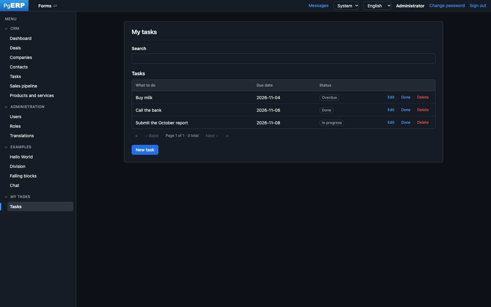

**English** · [Русский](README.ru.md)

# PgERP

A data-driven UI platform in the SmartDB style: business logic and the description of the user interface live in
PostgreSQL. The Java server is a thin gateway, and the browser is a universal form renderer that executes instructions
sent by the database. Forms, menus, permissions and handlers are created in the built-in editor (or by an AI agent over
MCP) and released as solution packages — without changing Java.



**Stack:** Java 25 · Spring Boot 4 · PostgreSQL 18 / PL/pgSQL · Flyway · WebSocket · JasperReports · HTML + ES modules

## Quick start

With Docker — the application and PostgreSQL 18:

```bash
docker compose up -d --build
```

Open http://localhost:8080 and sign in as **admin / admin** (the password must be changed at first sign-in). The
administrator then chooses which solutions to install: CRM and examples are included.

Without Docker — PostgreSQL with an `erp` database and Java 25:

```bash
psql -h localhost -U postgres -c "create database erp"
ERP_DB_PASSWORD=<password> ./mvnw spring-boot:run
```

Settings (database address, port, path behind a reverse proxy, MCP) are environment variables — see
[Deployment](ARCHITECTURE.md#deployment).

## Documentation

- [ARCHITECTURE.md](ARCHITECTURE.md) — the platform core: layers, the database–browser contract, solution development,
  MCP server, authentication, translations, themes, migrations and solution packages, deployment
- [docs/tutorial-hello.md](docs/tutorial-hello.md) — the first step: Hello World, a form with a name field and a button
- [docs/tutorial-todo.md](docs/tutorial-todo.md) — step by step: a to-do list application from scratch in the editor

## License

Copyright 2026 Sergei Demin. Licensed under the [Apache License 2.0](LICENSE).
