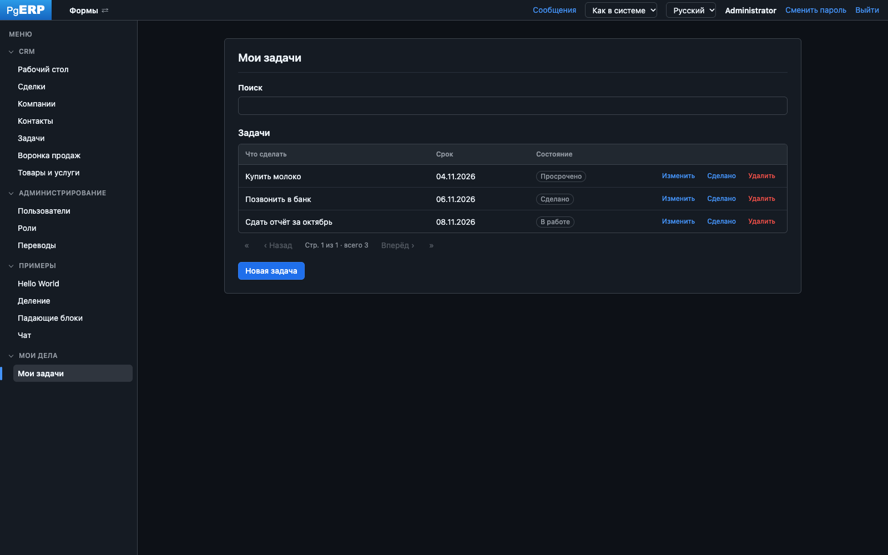

[English](README.md) · **Русский**

# PgERP

Платформа Data-Driven UI в архитектуре SmartDB: бизнес-логика и описание интерфейса живут в PostgreSQL. Java-сервер —
тонкий шлюз, браузер — универсальный отрисовщик форм, который выполняет инструкции базы данных. Формы, меню, права
и обработчики создаются во встроенном редакторе (или ИИ-агентом через MCP) и выпускаются пакетами решений — без
изменения Java.



**Стек:** Java 25 · Spring Boot 4 · PostgreSQL 18 / PL/pgSQL · Flyway · WebSocket · JasperReports · HTML + ES modules

## Быстрый старт

В Docker — готовый образ приложения и PostgreSQL 18, исходники не нужны:

```bash
curl -O https://raw.githubusercontent.com/sdbrother0/pgerp/main/compose.yaml
docker compose up -d
```

Образ `ghcr.io/sdbrother0/pgerp` скачивается из GitHub Container Registry. Конкретная версия вместо последней —
`ERP_VERSION=0.3.0 docker compose up -d`, обновление — `docker compose pull && docker compose up -d`. Собрать образ
из исходников (в клоне репозитория) — `docker compose up -d --build`.

Откройте http://localhost:8099 и войдите как **admin / admin** (при первом входе пароль нужно сменить). Затем
администратор выбирает решения для установки: в комплекте CRM и примеры.

Приложение доступно только с этого компьютера. Чтобы открыть его в сеть, сначала смените пароль admin, затем
запустите `ERP_BIND=0.0.0.0 docker compose up -d` (или впишите `ERP_BIND=0.0.0.0` в `.env`).

Начать с чистого листа — удалить контейнеры вместе с базой (том `db-data`; все данные будут потеряны) и запустить
заново:

```bash
docker compose down -v
docker compose pull
docker compose up -d
```

Без Docker — PostgreSQL с базой `erp` и Java 25:

```bash
psql -h localhost -U postgres -c "create database erp"
ERP_DB_PASSWORD=<пароль> ./mvnw spring-boot:run
```

Настройки (адрес базы, порт, путь за обратным прокси, MCP) — переменные окружения, см.
[Развёртывание](ARCHITECTURE.ru.md#развёртывание).

## Документация

- [ARCHITECTURE.ru.md](ARCHITECTURE.ru.md) — ядро платформы: слои, контракт базы и браузера, разработка решений,
  MCP-сервер, вход и права, переводы, темы, миграции и пакеты решений, развёртывание
- [docs/tutorial-hello.ru.md](docs/tutorial-hello.ru.md) — первый шаг: Hello World, форма с полем для имени и кнопкой
- [docs/tutorial-todo.ru.md](docs/tutorial-todo.ru.md) — по шагам: приложение «Список дел» с нуля в редакторе

## Лицензия

Copyright 2026 Sergei Demin. Распространяется по лицензии [Apache License 2.0](LICENSE).
