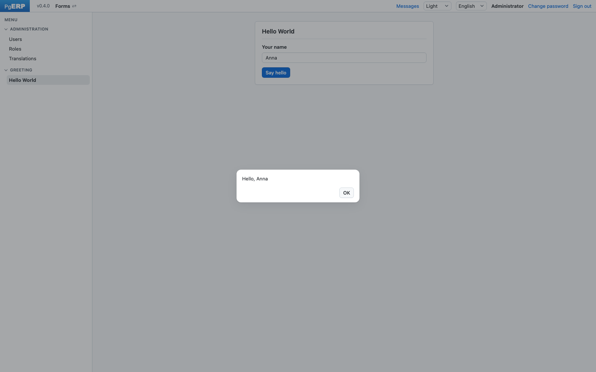
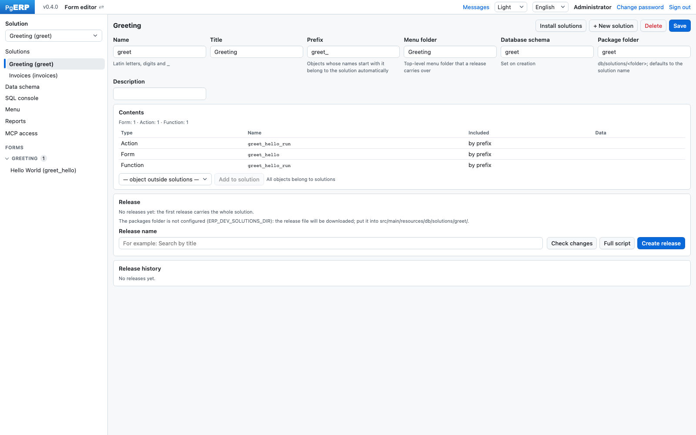
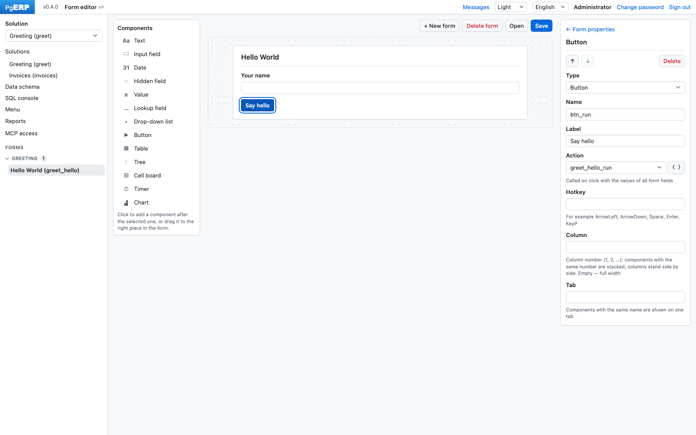
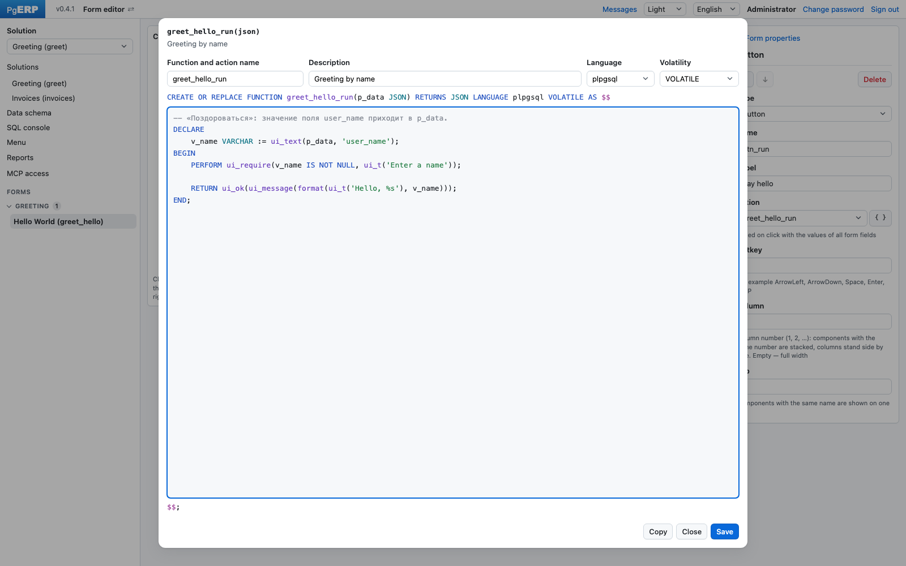
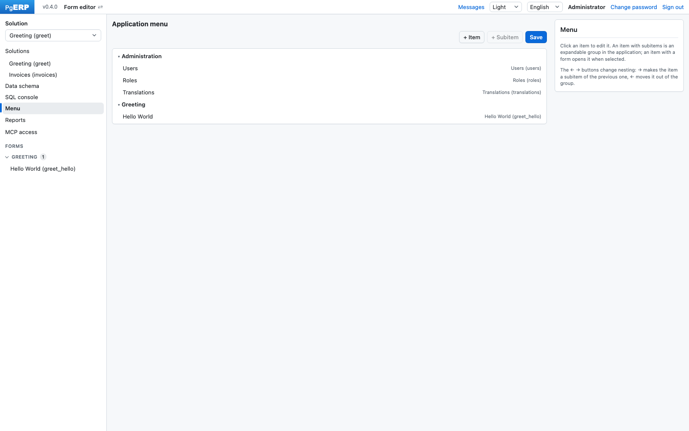
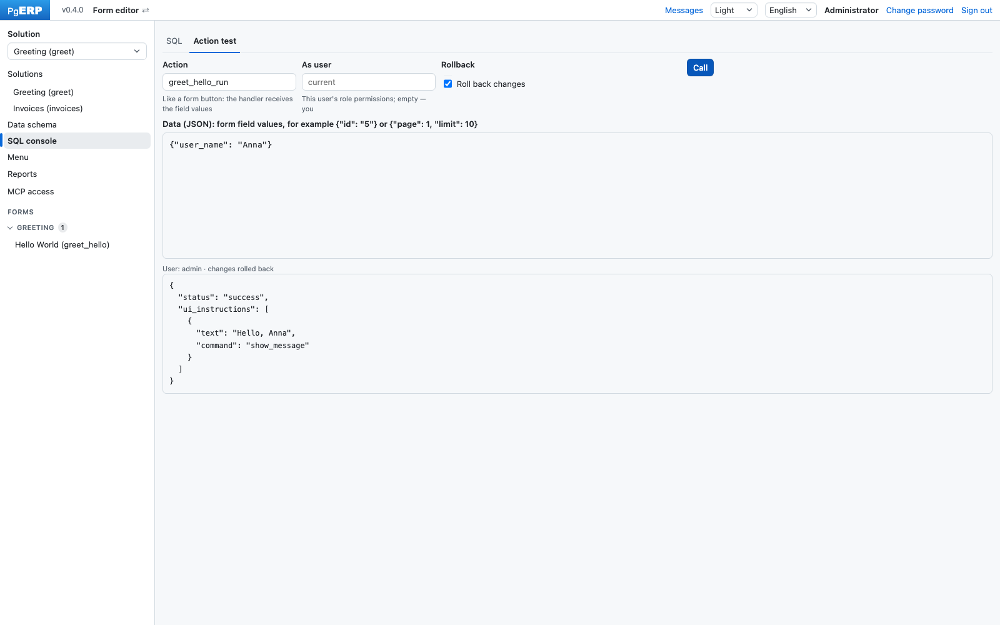
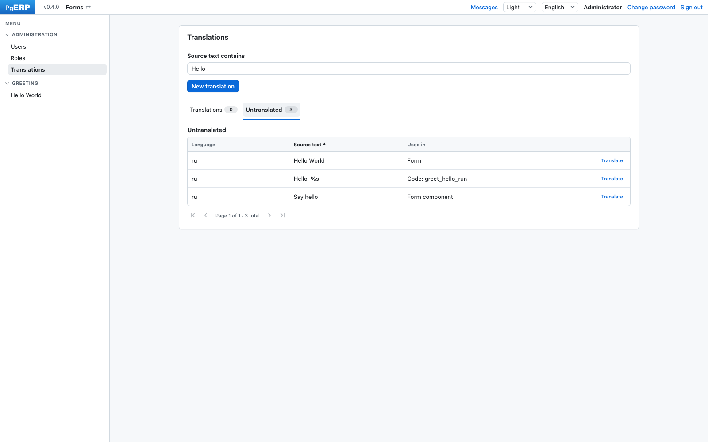
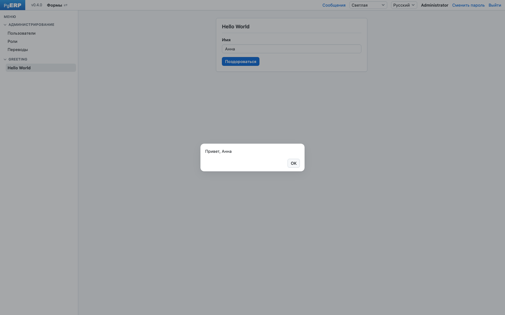

**English** · [Русский](tutorial-hello.ru.md)

# Example: Hello World

The smallest PgERP application: a form with a name field and a button. You type a name, press the button — and see
"Hello, <name>". One form, one function, a menu item — about ten minutes in the editor, no Java.

The finished version of this example ships with the platform: **Examples → Hello World** (the "Examples" solution,
installed by the administrator). Here we build the same thing from scratch. Next step — a full application with a table,
a list and permissions: [a to-do list from scratch](tutorial-todo.md).



| Step | Where | What we create |
|---|---|---|
| 1 | Sign-in | the form editor |
| 2 | Solutions | solution <nobr>`greet`</nobr> with prefix <nobr>`greet_`</nobr> |
| 3 | Form editor | form <nobr>`greet_hello`</nobr>: field and button |
| 4 | Form editor | function <nobr>`greet_hello_run`</nobr> — the button code |
| 5 | Menu | a menu item |
| 6 | Application | testing |
| 7 | Translations | "Hello, %s" in another language |
| — | MCP access | [the same with an AI agent](#the-same-over-mcp) |

## How it works

A form is metadata rows: a field and a button. The button calls an **action** — a function
<nobr>`name(p_data JSON) RETURNS JSON`</nobr> in the database. <nobr>`p_data`</nobr> holds the values of the form fields,
and the function responds with instructions for the browser — here, "show a message".

```
"Say hello" button → POST /api/ui/event?action=greet_hello_run {"user_name": "Anna"}
                   → greet_hello_run(p_data)
                   ← {"status": "success", "ui_instructions": [show_message "Hello, Anna"]}
```

## 1. Sign in

Open the application and sign in as an administrator (first sign-in — **admin / admin**, you will be asked to change
the password). The "Forms ⇄ Form editor" switch in the header leads to the editor.

## 2. Solution

**Solutions → "+ New solution".** A solution groups everything that belongs to the application; objects whose names
start with the **prefix** join it automatically.

| Field | Value |
|---|---|
| Name | <nobr>`greet`</nobr> |
| Title | Greeting |
| Prefix | <nobr>`greet_`</nobr> |
| Menu folder | Greeting |

"Save", then select **Solution: Greeting** in the sidebar.



> Why not <nobr>`hello_`</nobr>: the built-in example already uses the names <nobr>`hello_world`</nobr> and
> <nobr>`hello_run`</nobr>.

## 3. Form

**Form editor → "+ New form".** Form properties (on the right): name <nobr>`greet_hello`</nobr>, title "Hello World".
Add two components from the palette on the left:

| Component | Name | Label | Action |
|---|---|---|---|
| Input field | <nobr>`user_name`</nobr> | Your name | |
| Button | <nobr>`btn_run`</nobr> | Say hello | <nobr>`greet_hello_run`</nobr> — created in the next step |

**The field name** is the key under which its value reaches the function: <nobr>`p_data->>'user_name'`</nobr>.



## 4. The button code

Select the <nobr>`btn_run`</nobr> button and press **"{ }"** next to the "Action" field. The editor offers a template with
the form fields already declared. Name — <nobr>`greet_hello_run`</nobr>, description — "Greeting by name". Body:

```sql
-- "Say hello": the user_name field value arrives in p_data.
DECLARE
    v_name VARCHAR := ui_text(p_data, 'user_name');
BEGIN
    PERFORM ui_require(v_name IS NOT NULL, ui_t('Enter a name'));

    RETURN ui_ok(ui_message(format(ui_t('Hello, %s'), v_name)));
END;
```

Line by line:

- <nobr>`ui_text(p_data, 'user_name')`</nobr> — the field value, trimmed; an empty field is <nobr>`NULL`</nobr>;
- <nobr>`ui_require(condition, text)`</nobr> — if the name is empty, the user sees "Enter a name" in a dialog and
  the function stops;
- <nobr>`ui_message(text)`</nobr> — the "show a message" instruction; <nobr>`ui_ok(...)`</nobr> wraps the instructions
  into a response;
- <nobr>`format(ui_t('Hello, %s'), v_name)`</nobr> — first the template is translated into the user's language, then
  the name is substituted. Do not glue a phrase from pieces (<nobr>`'Hello, ' || v_name`</nobr>): a translator would
  only see the piece.

"Save" in the code window: the database creates the function and registers the action — it becomes the button's action
right away. A compilation error is shown in the window. Then "Save" the form.



## 5. Menu

**Menu → "+ Item"** — title "Greeting" (a folder); **"+ Sub-item"** — "Hello World", form <nobr>`greet_hello`</nobr>.
"Save".



An administrator sees all forms. To give the form to other users, add it to a role in **Administration → Roles** — see
[step 9 of the to-do tutorial](tutorial-todo.md#9-permissions).

## 6. Try it

Switch to "Forms" (or press "Open" in the form editor): **Greeting → Hello World**. Type a name and press "Say hello" —
a dialog shows "Hello, Anna". Press the button with an empty field — you get "Enter a name": that is the
<nobr>`ui_require`</nobr>.


The same without the interface: **SQL console → "Action test"**, action <nobr>`greet_hello_run`</nobr>, data
<nobr>`{"user_name": "Anna"}`</nobr> — the response shows the <nobr>`show_message`</nobr> instruction.



## 7. Translation

Texts in the form and in <nobr>`ui_t(...)`</nobr> are source texts in English. **Administration → Translations →
"Untranslated"** lists them for each language; add, for example for Russian:

| Source | Translation |
|---|---|
| Your name | Имя |
| Say hello | Поздороваться |
| Enter a name | Введите имя |
| Hello, %s | Привет, %s |



Switch the language in the header: the form and the message are now in Russian — "Привет, Anna". The
<nobr>`%s`</nobr> placeholder must stay in the translation. If the "Examples" solution is installed, "Enter a name" and
"Hello, %s" are already translated — the built-in example uses the same texts.



## The same over MCP

An AI agent can do all of this through the application's MCP server. How to issue a token and connect Claude Code is
explained step by step in [the invoices guide, step 0](tutorial-invoices.md#0-connecting-mcp); in short:
**MCP access → "Issue token"** (the user is an administrator whose initial password has been changed), then

```bash
claude mcp add --transport http pgerp http://localhost:8080/mcp --header "Authorization: Bearer <token>"
```

and ask, for example:

> Create a PgERP solution greet "Greeting" (prefix greet_, menu folder Greeting): a form greet_hello "Hello World"
> with a user_name field "Your name" and a "Say hello" button that shows "Hello, <name>", and the error "Enter a name"
> without a name; a menu item Greeting → Hello World; Russian translations. Test the action with action_run.

The guide's steps and the tools the agent uses for them:

| Step | MCP tool |
|---|---|
| 2. Solution | <nobr>`solution_save`</nobr> |
| 3. Form | <nobr>`form_save`</nobr> — the whole form with all components |
| 4. Button code | <nobr>`function_save`</nobr> — the function and the action; before the form, because the form refers to the action |
| 5. Menu | <nobr>`menu_get`</nobr>, then <nobr>`menu_save`</nobr> — the **whole** menu with the new item |
| 6. Testing | <nobr>`action_run`</nobr> — like the form button, rolled back |
| 7. Translation | <nobr>`translation_save`</nobr> — one text at a time |

The calls look like this (tool name and arguments; this example was built and tested with them):

```
solution_save {"name": "greet", "title": "Greeting", "is_new": true, "prefix": "greet_", "menu_folder": "Greeting"}
function_save {"name": "greet_hello_run", "description": "Greeting by name", "is_new": true, "body": "DECLARE\n    v_name VARCHAR := ui_text(p_data, 'user_name');\nBEGIN\n    PERFORM ui_require(v_name IS NOT NULL, ui_t('Enter a name'));\n    RETURN ui_ok(ui_message(format(ui_t('Hello, %s'), v_name)));\nEND;"}
form_save {"name": "greet_hello", "title": "Hello World", "folder": "Greeting", "components": [{"type": "input", "name": "user_name", "label": "Your name"}, {"type": "button", "name": "btn_run", "label": "Say hello", "action": "greet_hello_run"}]}
menu_get {}
menu_save {"items": [ …items from menu_get…, {"title": "Greeting", "items": [{"title": "Hello World", "form": "greet_hello"}]}]}
translation_save {"lang": "ru", "source": "Your name", "translation": "Имя"}
translation_save {"lang": "ru", "source": "Say hello", "translation": "Поздороваться"}
translation_save {"lang": "ru", "source": "Enter a name", "translation": "Введите имя"}
translation_save {"lang": "ru", "source": "Hello, %s", "translation": "Привет, %s"}
action_run {"action": "greet_hello_run", "data": {"user_name": "Anna"}}
```

The <nobr>`action_run`</nobr> response is a <nobr>`show_message`</nobr> instruction "Hello, Anna"; for a user with the Russian language —
"Привет, Anna". The agent starts with <nobr>`platform_guide`</nobr>: it holds the platform rules and the form format. The result opens
in the same editor.

## Next

- [A to-do list from scratch](tutorial-todo.md) — a table, a list with search, row buttons, permissions and a release
  of the solution package.
- [Invoices for goods and services](tutorial-invoices.md) — a document with lines (master-detail), selection windows, totals, statuses, translations, MCP
- [ARCHITECTURE.md](../ARCHITECTURE.md) — all <nobr>`ui_*`</nobr> functions and how the platform works.
