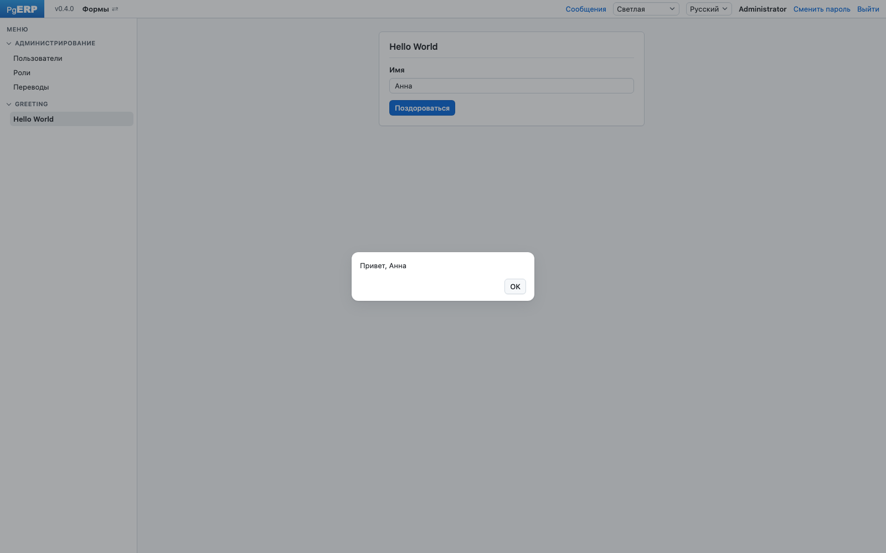
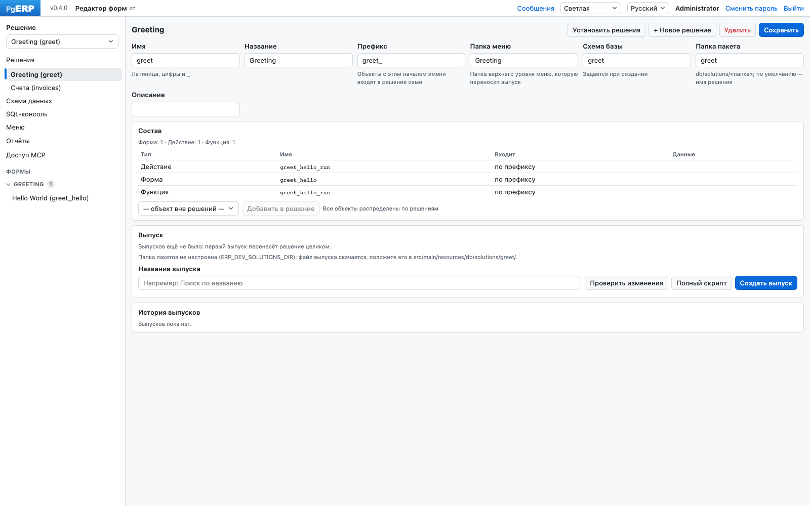
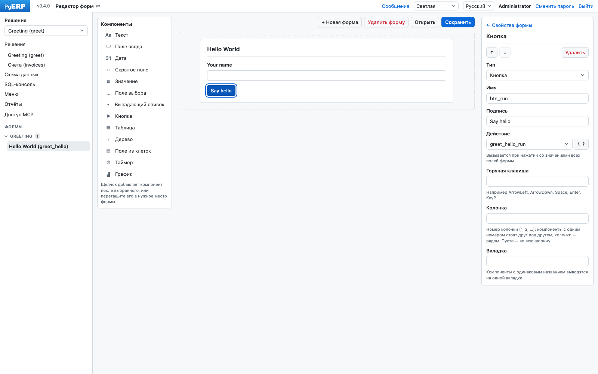
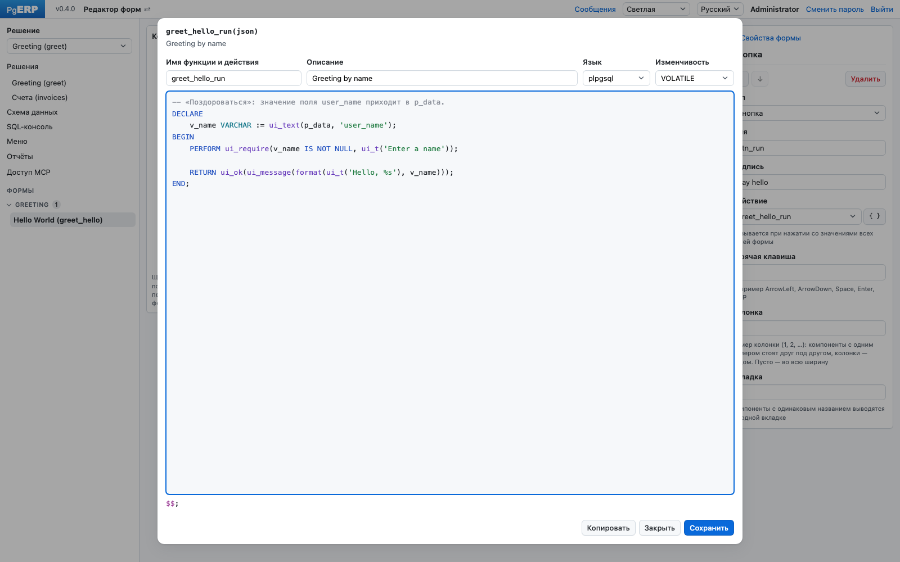
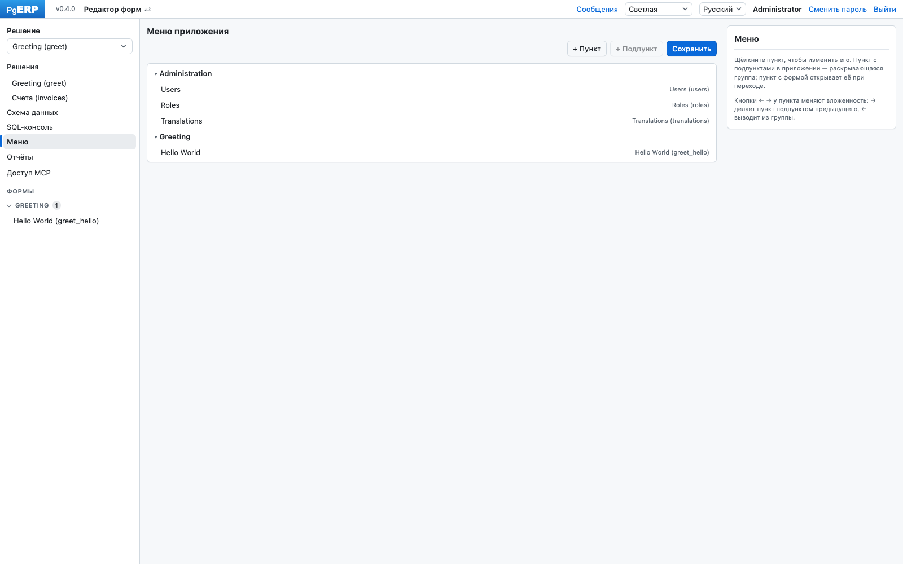
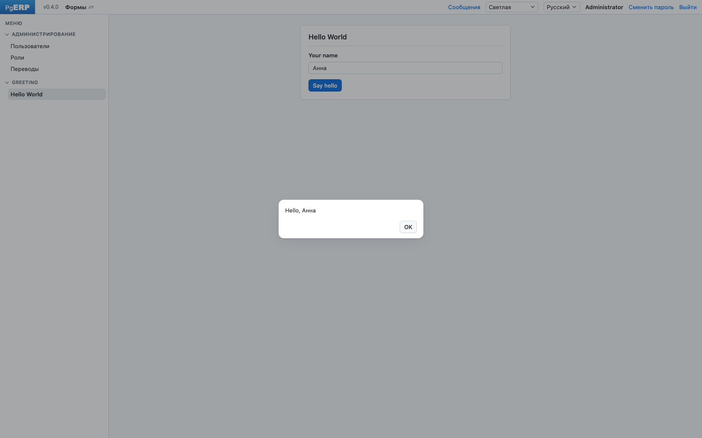
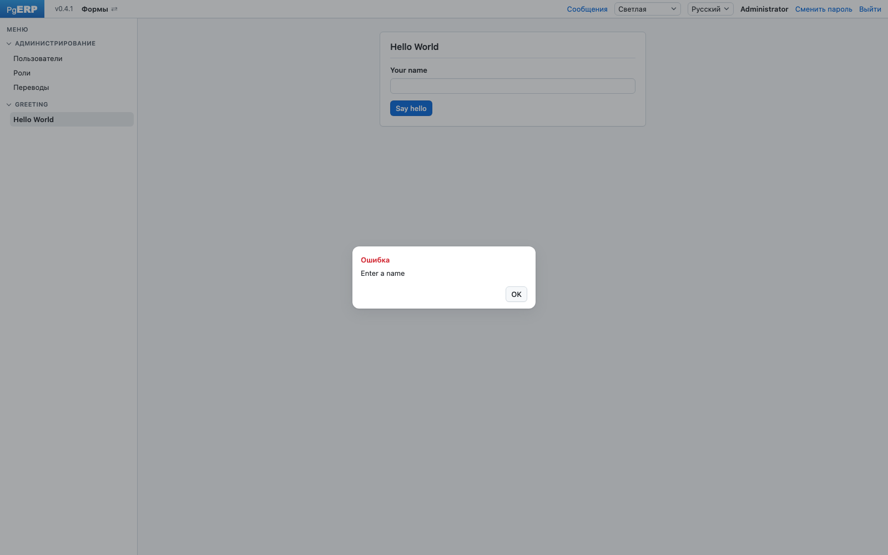
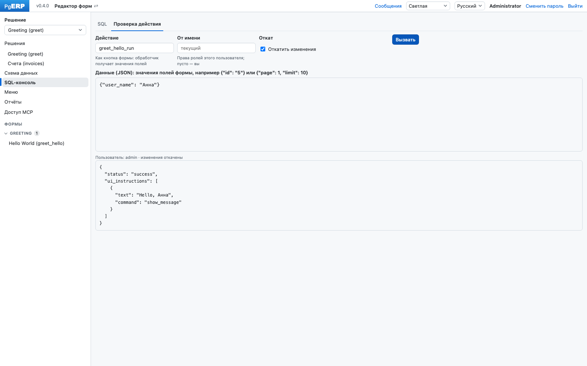
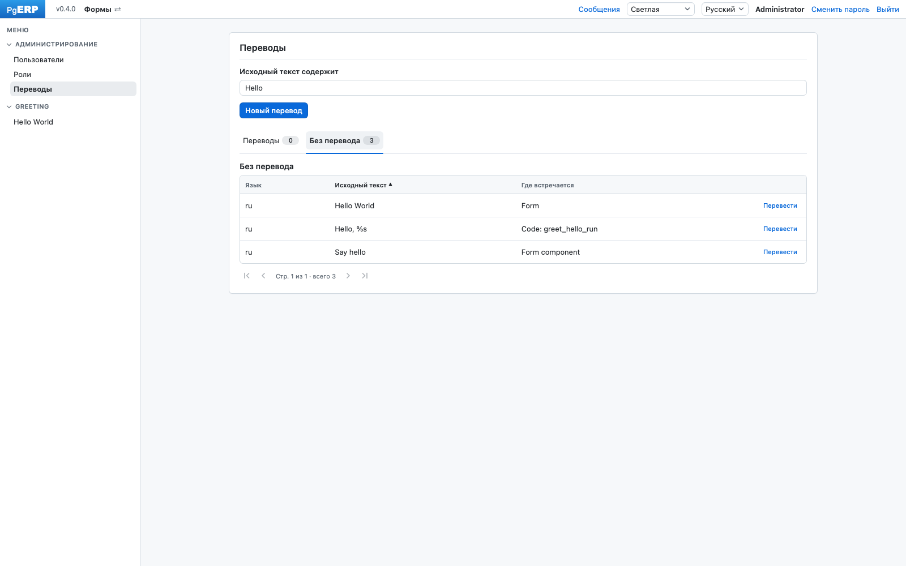

[English](tutorial-hello.md) · **Русский**

# Пример: Hello World

Самое маленькое приложение PgERP: форма с полем для имени и кнопкой. Вводите имя, нажимаете кнопку — и видите
«Привет, <имя>». Одна форма, одна функция, пункт меню — минут десять в редакторе, без Java.

Готовая версия этого примера поставляется с платформой: **Примеры → Hello World** (решение «Примеры», его устанавливает
администратор). Здесь мы соберём то же самое с нуля. Следующий шаг — полноценное приложение с таблицей, списком и
правами: [список дел с нуля](tutorial-todo.ru.md).



| Шаг | Где | Что создаём |
|---|---|---|
| 1 | Вход | редактор форм |
| 2 | Решения | решение <nobr>`greet`</nobr> с префиксом <nobr>`greet_`</nobr> |
| 3 | Редактор форм | форма <nobr>`greet_hello`</nobr>: поле и кнопка |
| 4 | Редактор форм | функция <nobr>`greet_hello_run`</nobr> — код кнопки |
| 5 | Меню | пункт меню |
| 6 | Приложение | проверка |
| 7 | Переводы | «Hello, %s» на другом языке |
| — | Доступ MCP | [то же силами ИИ-агента](#то-же--через-mcp) |

## Как это работает

Форма — это строки метаданных: поле и кнопка. Кнопка вызывает **действие** — функцию
<nobr>`имя(p_data JSON) RETURNS JSON`</nobr> в базе. В <nobr>`p_data`</nobr> приходят значения полей формы, а функция
отвечает инструкциями для браузера — здесь «показать сообщение».

```
Кнопка «Поздороваться» → POST /api/ui/event?action=greet_hello_run {"user_name": "Анна"}
                       → greet_hello_run(p_data)
                       ← {"status": "success", "ui_instructions": [show_message "Привет, Анна"]}
```

## 1. Вход

Откройте приложение и войдите администратором (первый вход — **admin / admin**, пароль попросят сменить).
Переключатель «Формы ⇄ Редактор форм» в шапке ведёт в редактор.

## 2. Решение

**Решения → «+ Новое решение».** Решение объединяет всё, что относится к приложению; объекты, чьи имена начинаются
с **префикса**, входят в него сами.

| Поле | Значение |
|---|---|
| Имя | <nobr>`greet`</nobr> |
| Название | Greeting |
| Префикс | <nobr>`greet_`</nobr> |
| Папка меню | Greeting |

«Сохранить», затем выберите **Решение: Greeting** в боковой панели.



> Почему не <nobr>`hello_`</nobr>: встроенный пример уже занимает имена <nobr>`hello_world`</nobr> и
> <nobr>`hello_run`</nobr>.

## 3. Форма

**Редактор форм → «+ Новая форма».** Свойства формы (справа): имя <nobr>`greet_hello`</nobr>, заголовок «Hello World».
Добавьте два компонента из палитры слева:

| Компонент | Имя | Подпись | Действие |
|---|---|---|---|
| Поле ввода | <nobr>`user_name`</nobr> | Your name | |
| Кнопка | <nobr>`btn_run`</nobr> | Say hello | <nobr>`greet_hello_run`</nobr> — создадим на следующем шаге |

**Имя поля** — ключ, под которым его значение придёт в функцию: <nobr>`p_data->>'user_name'`</nobr>.



> Исходный язык платформы — английский, поэтому подписи пишем по-английски, а на русский переводим на шаге 7.

## 4. Код кнопки

Выделите кнопку <nobr>`btn_run`</nobr> и нажмите **«{ }»** рядом с полем «Действие». Редактор предложит шаблон, где поля
формы уже объявлены. Имя — <nobr>`greet_hello_run`</nobr>, описание — «Greeting by name». Тело:

```sql
-- «Поздороваться»: значение поля user_name приходит в p_data.
DECLARE
    v_name VARCHAR := ui_text(p_data, 'user_name');
BEGIN
    PERFORM ui_require(v_name IS NOT NULL, ui_t('Enter a name'));

    RETURN ui_ok(ui_message(format(ui_t('Hello, %s'), v_name)));
END;
```

По строкам:

- <nobr>`ui_text(p_data, 'user_name')`</nobr> — значение поля без пробелов по краям; пустое поле — <nobr>`NULL`</nobr>;
- <nobr>`ui_require(условие, текст)`</nobr> — если имя пустое, пользователь увидит «Введите имя» в окне, и функция
  остановится;
- <nobr>`ui_message(текст)`</nobr> — инструкция «показать сообщение»; <nobr>`ui_ok(...)`</nobr> собирает инструкции
  в ответ;
- <nobr>`format(ui_t('Hello, %s'), v_name)`</nobr> — сначала шаблон переводится на язык пользователя, потом
  подставляется имя. Не склеивайте фразу из кусков (<nobr>`'Hello, ' || v_name`</nobr>): переводчик увидит только кусок.

«Сохранить» в окне кода: база создаст функцию и зарегистрирует действие — оно сразу станет действием кнопки. Ошибка
компиляции показывается в окне. Затем «Сохранить» форму.



## 5. Меню

**Меню → «+ Пункт»** — заголовок «Greeting» (папка); **«+ Подпункт»** — «Hello World», форма
<nobr>`greet_hello`</nobr>. «Сохранить».



Администратор видит все формы. Чтобы дать форму другим пользователям, добавьте её в роль в **Администрирование →
Роли** — см. [шаг 9 примера со списком дел](tutorial-todo.ru.md#9-права).

## 6. Проверка

Переключитесь в «Формы» (или нажмите «Открыть» в редакторе форм): **Greeting → Hello World**. Введите имя и нажмите
«Say hello» — появится окно «Hello, Анна». Нажмите кнопку с пустым полем — будет «Enter a name»: это
<nobr>`ui_require`</nobr>.





То же без интерфейса: **SQL-консоль → «Проверка действия»**, действие <nobr>`greet_hello_run`</nobr>, данные
<nobr>`{"user_name": "Анна"}`</nobr> — в ответе видна инструкция <nobr>`show_message`</nobr>.



## 7. Перевод

Тексты формы и <nobr>`ui_t(...)`</nobr> — исходные, на английском. **Администрирование → Переводы → «Без перевода»**
показывает их для каждого языка; добавьте для русского:

| Исходный текст | Перевод |
|---|---|
| Your name | Имя |
| Say hello | Поздороваться |
| Enter a name | Введите имя |
| Hello, %s | Привет, %s |



Переключите язык в шапке: форма и сообщение теперь по-русски — «Привет, Анна». Подстановка <nobr>`%s`</nobr> должна
остаться в переводе. Если решение «Примеры» установлено, «Enter a name» и «Hello, %s» уже переведены — встроенный
пример использует те же тексты.


## То же — через MCP

Всё это может сделать ИИ-агент через MCP-сервер приложения. Как выдать токен и подключить Claude Code — по шагам
в [руководстве по счетам, шаг 0](tutorial-invoices.ru.md#0-подключение-mcp); коротко: **Доступ MCP → «Выдать токен»**
(пользователь — администратор, начальный пароль должен быть сменён), затем

```bash
claude mcp add --transport http pgerp http://localhost:8080/mcp --header "Authorization: Bearer <токен>"
```

и попросите, например:

> Создай в PgERP решение greet «Greeting» (префикс greet_, папка меню Greeting): форма greet_hello «Hello World»
> с полем user_name «Your name» и кнопкой «Say hello», которая показывает «Hello, <имя>», а без имени — ошибку
> «Enter a name»; пункт меню Greeting → Hello World; русские переводы. Проверь действие через action_run.

Шаги руководства и инструменты, которыми их выполнит агент:

| Шаг | Инструмент MCP |
|---|---|
| 2. Решение | <nobr>`solution_save`</nobr> |
| 3. Форма | <nobr>`form_save`</nobr> — форма целиком, со всеми компонентами |
| 4. Код кнопки | <nobr>`function_save`</nobr> — функция и действие; до формы, потому что форма ссылается на действие |
| 5. Меню | <nobr>`menu_get`</nobr>, затем <nobr>`menu_save`</nobr> — меню **целиком** с новым пунктом |
| 6. Проверка | <nobr>`action_run`</nobr> — как кнопка формы, с откатом |
| 7. Перевод | <nobr>`translation_save`</nobr> — по одному тексту |

Так выглядят вызовы (имя инструмента и аргументы; этот пример ими собран и проверен):

```
solution_save {"name": "greet", "title": "Greeting", "is_new": true, "prefix": "greet_", "menu_folder": "Greeting"}
function_save {"name": "greet_hello_run", "description": "Greeting by name", "is_new": true, "body": "DECLARE\n    v_name VARCHAR := ui_text(p_data, 'user_name');\nBEGIN\n    PERFORM ui_require(v_name IS NOT NULL, ui_t('Enter a name'));\n    RETURN ui_ok(ui_message(format(ui_t('Hello, %s'), v_name)));\nEND;"}
form_save {"name": "greet_hello", "title": "Hello World", "folder": "Greeting", "components": [{"type": "input", "name": "user_name", "label": "Your name"}, {"type": "button", "name": "btn_run", "label": "Say hello", "action": "greet_hello_run"}]}
menu_get {}
menu_save {"items": [ …пункты из menu_get…, {"title": "Greeting", "items": [{"title": "Hello World", "form": "greet_hello"}]}]}
translation_save {"lang": "ru", "source": "Your name", "translation": "Имя"}
translation_save {"lang": "ru", "source": "Say hello", "translation": "Поздороваться"}
translation_save {"lang": "ru", "source": "Enter a name", "translation": "Введите имя"}
translation_save {"lang": "ru", "source": "Hello, %s", "translation": "Привет, %s"}
action_run {"action": "greet_hello_run", "data": {"user_name": "Anna"}}
```

Ответ <nobr>`action_run`</nobr> — инструкция <nobr>`show_message`</nobr> «Hello, Anna»; для пользователя с русским языком — «Привет, Anna».
Агент начинает с <nobr>`platform_guide`</nobr>: там правила платформы и формат форм. Результат открывается в том же редакторе.

## Дальше

- [Список дел с нуля](tutorial-todo.ru.md) — таблица, список с поиском, кнопки в строках, права и выпуск пакета
  решения.
- [Счета на товары и услуги](tutorial-invoices.ru.md) — документ со строками (master-detail), окна выбора, итоги, статусы, переводы, MCP
- [ARCHITECTURE.ru.md](../ARCHITECTURE.ru.md) — все функции <nobr>`ui_*`</nobr> и устройство платформы.
