**English** · [Русский](tutorial-invoices.ru.md)

# Example: invoices for goods and services (master-detail)

A step-by-step guide: the "Invoices" solution — a catalogue of goods, services and customers, an invoice with lines,
totals with VAT, statuses, a draft (closing without saving), printing to PDF and permissions. The main topic is **master-detail**: a document card (the master) and the
table of its lines (the details), which are edited in a separate form and update the card total right away. The solution
depends on nothing: neither CRM nor the examples are needed.

> The finished result ships with the application — the **Billing** package (<nobr>`billing`</nobr>, prefix
> <nobr>`bill_`</nobr>, role <nobr>`bill_accountant`</nobr>): "Solutions → Install solutions". Its names differ so that the package and the
> solution built with this guide (<nobr>`invoices`</nobr>, <nobr>`inv_`</nobr>) do not get in each other's way and can be compared.

The basics — table, card, list, row buttons, menu, role, release — are covered in detail in the
[to-do list](tutorial-todo.md); here they are brief, and what a document with lines needs is explained in more depth.

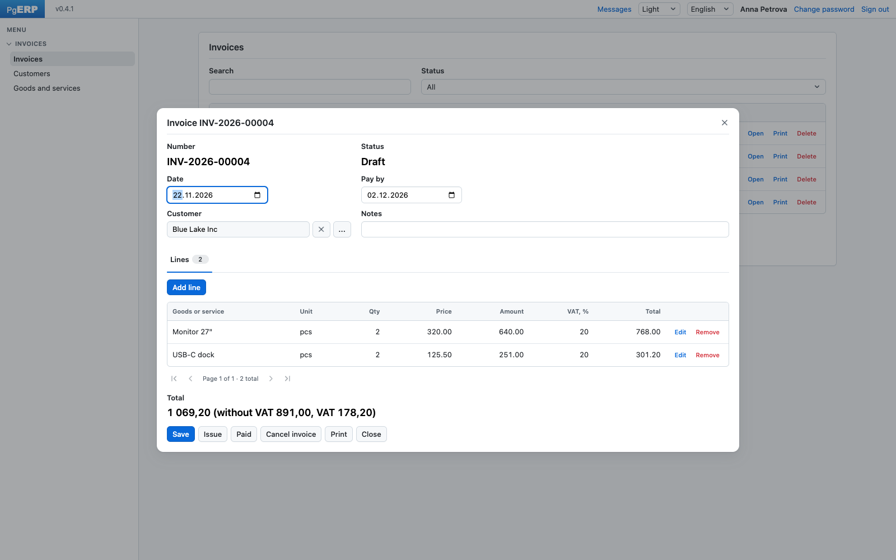

| Step | Where | What we create |
|---|---|---|
| 0 | MCP access | connecting an AI agent — if it builds the solution |
| 1 | Solutions | solution <nobr>`invoices`</nobr> with prefix <nobr>`inv_`</nobr> |
| 2–3 | Data schema | five tables and four views |
| 4 | SQL console | helper functions and catalogue actions |
| 5 | Form editor | goods, services and customers: lists and cards |
| 6 | Console, form editor | invoice list |
| 7–8 | Console, form editor | invoice card (master) and invoice line (details) |
| 9–10 | Console, form editor, reports | a draft (closing without saving) and printing the invoice to PDF |
| 11–12 | Form editor, console | table columns and row buttons |
| 13–15 | Menu, roles, translations | menu items, role <nobr>`inv_accountant`</nobr>, Russian interface |
| 16–17 | Application | working and testing |
| 18 | Solutions | release — the solution package |

## 0. Connecting MCP

You can build the solution by hand following steps 1–18, or hand it to an AI agent: the application's MCP server gives
the agent the same actions as the editor, with the rights of the token owner. This whole example was built and tested by
an agent over MCP. If you build by hand, skip this step.

1. Sign in as an administrator (the first sign-in is **admin / admin**, you will be asked to change the password: MCP
   tools do not work until it is changed). In the editor (`editor.html`) open **MCP access**.
2. Under "Issue token" enter the purpose, the user (for development — an administrator: development tools are available
   only to administrators) and the validity, and click **"Issue token"**. The token is shown **once** — copy it, or the
   ready-made connect command right away. The database keeps only its hash; to revoke a token use "Revoke" in the list.

   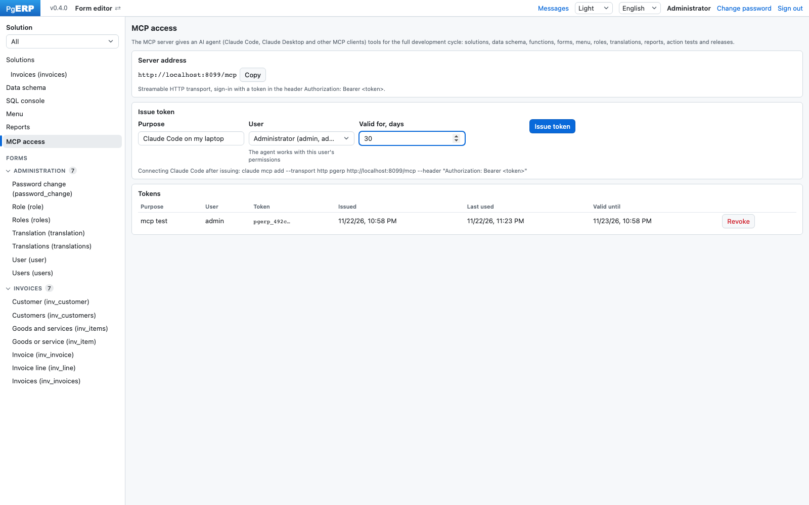

3. Connect Claude Code. Take the address from "Server address" of your installation:

   ```bash
   claude mcp add --transport http pgerp http://localhost:8099/mcp --header "Authorization: Bearer <token>"
   ```

4. Check: in Claude Code the `/mcp` command shows the `pgerp` server as connected, and the request "call
   platform_guide" returns the platform guide. Other MCP clients connect the same way: Streamable HTTP transport, the
   <nobr>`…/mcp`</nobr> address, header <nobr>`Authorization: Bearer <token>`</nobr>.

Good to know:

- the agent works **with the rights of the token's user**: a regular user gets only the actions of their roles,
  development is for administrators only;
- changing a user's password revokes all their tokens — issue a new one;
- a browser request with a foreign <nobr>`Origin`</nobr> header is rejected (<nobr>`ERP_MCP_ALLOWED_ORIGINS`</nobr> lists exceptions);
- to have releases saved straight into the project package, start the application with
  <nobr>`ERP_DEV_SOLUTIONS_DIR=…/src/main/resources/db/solutions`</nobr>.

A ready-made request for the agent is [at the end](#the-same-with-an-ai-agent-mcp).

## How master-detail works

```
 Invoice card inv_invoice (master)          Invoice line inv_line (details)
┌────────────────────────────────────┐     ┌────────────────────────────────┐
│ id (hidden)                        │     │ invoice_id (hidden)            │
│ Number, date, customer             │     │ Goods or service [...]         │
│                                    │     │ Quantity, price, VAT           │
│ [Add line]                         │---->│                                │
│                                    │     │ [Save]                         │
│ Table inv_lines_grid,              │<----│ ui_refresh_grid                │
│   Master = id -> master_id         │     │                                │
│ Total: ...                         │<----│ ui_set_values(..., p_form =>   │
│                                    │     │   'inv_invoice')               │
└────────────────────────────────────┘     └────────────────────────────────┘
```

- **Details table.** The lines table in the card has the **"Master"** property = <nobr>`id`</nobr> — the name of a card field.
  When loading rows, the table passes the source <nobr>`master_id`</nobr> — the value of that field, and
  <nobr>`ui_grid_page(..., 'invoice_id')`</nobr> keeps only rows with <nobr>`invoice_id = master_id`</nobr>.
- **A new document.** A new invoice has no <nobr>`id`</nobr> yet — lines have nothing to link to. The "Add line" button
  first saves the invoice header (the draft gets a number), fills the card fields (<nobr>`ui_set_values`</nobr>) and only
  then opens the line.
- **A response to another form.** The line is saved in its own window, and its action responds with instructions for
  the card underneath as well: reload the lines table (<nobr>`ui_refresh_grid`</nobr> finds a table by name in any open form)
  and update the total field (<nobr>`ui_set_values(..., p_form => 'inv_invoice')`</nobr>).
- **Document rules live in the database.** Only a draft can be changed; only an invoice with lines can be issued; only
  a draft can be deleted. The checks are in the functions, so neither a form nor MCP can bypass them.

> Interface texts (titles, labels, messages) are written in English — the platform's source language. Step 15
> "Translations" adds the Russian interface; skip it if you need English only.

## 1. Solution

Sign in as an administrator and open the editor (`editor.html`). **Solutions → "+ New solution"**:

| Field | Value |
|---|---|
| Name | <nobr>`invoices`</nobr> |
| Title | Invoices |
| Prefix | <nobr>`inv_`</nobr> |
| Menu folder | Invoices |
| Description | Invoices for goods and services: customers, catalogue, invoice with lines |

"Save", then choose **Solution: Invoices (invoices)** in the sidebar — new forms get the prefix and the folder.

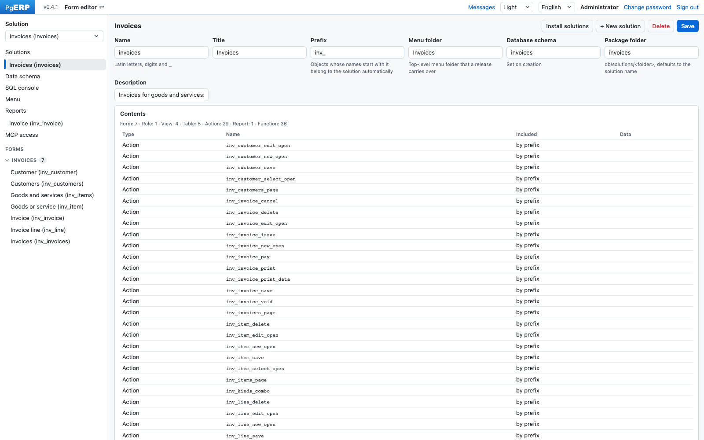

## 2. Tables

**Data schema → "+ Table".** The <nobr>`id bigserial`</nobr> column with the "Key" checkbox is already there. Create the
tables in this order: foreign keys refer to tables that already exist.

**<nobr>`inv_customers`</nobr>** — customers, comment "Customers (payers)":

| Name | Type | Required | Default | Comment |
|---|---|---|---|---|
| <nobr>`name`</nobr> | <nobr>`varchar(200)`</nobr> | ✓ |  | Name |
| <nobr>`tax_id`</nobr> | <nobr>`varchar(20)`</nobr> |  |  | Tax ID |
| <nobr>`address`</nobr> | <nobr>`text`</nobr> |  |  | Address |
| <nobr>`email`</nobr> | <nobr>`varchar(200)`</nobr> |  |  | E-mail |

Constraints:

- unique: <nobr>`name`</nobr>
- check: <nobr>`trim(name) <> ''`</nobr>

**<nobr>`inv_items`</nobr>** — goods and services, comment "Goods and services":

| Name | Type | Required | Default | Comment |
|---|---|---|---|---|
| <nobr>`name`</nobr> | <nobr>`varchar(200)`</nobr> | ✓ |  | Name |
| <nobr>`kind`</nobr> | <nobr>`varchar(10)`</nobr> | ✓ | <nobr>`'goods'`</nobr> | goods or service |
| <nobr>`unit`</nobr> | <nobr>`varchar(20)`</nobr> | ✓ | <nobr>`'pcs'`</nobr> | Unit of measure |
| <nobr>`price`</nobr> | <nobr>`numeric(14,2)`</nobr> | ✓ | <nobr>`0`</nobr> | Price without VAT |
| <nobr>`vat_rate`</nobr> | <nobr>`numeric(5,2)`</nobr> | ✓ | <nobr>`20`</nobr> | VAT, % |

Constraints:

- unique: <nobr>`name`</nobr>
- check: <nobr>`kind IN ('goods', 'service')`</nobr>
- check: <nobr>`price >= 0`</nobr>
- check: <nobr>`vat_rate BETWEEN 0 AND 100`</nobr>

**<nobr>`inv_invoices`</nobr>** — invoices (master), comment "Invoices (master)":

| Name | Type | Required | Default | Comment |
|---|---|---|---|---|
| <nobr>`number`</nobr> | <nobr>`varchar(30)`</nobr> | ✓ |  | Invoice number |
| <nobr>`invoice_date`</nobr> | <nobr>`date`</nobr> | ✓ | <nobr>`current_date`</nobr> | Invoice date |
| <nobr>`due_date`</nobr> | <nobr>`date`</nobr> |  |  | Pay by |
| <nobr>`customer_id`</nobr> | <nobr>`bigint`</nobr> | ✓ |  | Customer |
| <nobr>`status`</nobr> | <nobr>`varchar(10)`</nobr> | ✓ | <nobr>`'draft'`</nobr> | draft, issued, paid, cancelled |
| <nobr>`notes`</nobr> | <nobr>`text`</nobr> |  |  | Notes |
| <nobr>`created_by`</nobr> | <nobr>`varchar(50)`</nobr> | ✓ |  | Author login |
| <nobr>`created_at`</nobr> | <nobr>`timestamptz`</nobr> | ✓ | <nobr>`now()`</nobr> |  |

Constraints:

- unique: <nobr>`number`</nobr>
- foreign key: <nobr>`customer_id → inv_customers(id) ON DELETE RESTRICT`</nobr>
- check: <nobr>`status IN ('draft', 'issued', 'paid', 'cancelled')`</nobr>
- check: <nobr>`due_date IS NULL OR due_date >= invoice_date`</nobr>
- index: <nobr>`customer_id`</nobr>
- index: <nobr>`invoice_date`</nobr>

**<nobr>`inv_invoice_lines`</nobr>** — invoice lines (details), comment "Invoice lines (details)":

| Name | Type | Required | Default | Comment |
|---|---|---|---|---|
| <nobr>`invoice_id`</nobr> | <nobr>`bigint`</nobr> | ✓ |  | Invoice |
| <nobr>`item_id`</nobr> | <nobr>`bigint`</nobr> | ✓ |  | Goods or service |
| <nobr>`quantity`</nobr> | <nobr>`numeric(14,3)`</nobr> | ✓ | <nobr>`1`</nobr> | Quantity |
| <nobr>`price`</nobr> | <nobr>`numeric(14,2)`</nobr> | ✓ |  | Price without VAT |
| <nobr>`vat_rate`</nobr> | <nobr>`numeric(5,2)`</nobr> | ✓ |  | VAT, % |

Constraints:

- foreign key: <nobr>`invoice_id → inv_invoices(id) ON DELETE CASCADE`</nobr>
- foreign key: <nobr>`item_id → inv_items(id) ON DELETE RESTRICT`</nobr>
- check: <nobr>`quantity > 0`</nobr>
- check: <nobr>`price >= 0`</nobr>
- check: <nobr>`vat_rate BETWEEN 0 AND 100`</nobr>
- index: <nobr>`invoice_id`</nobr>
- index: <nobr>`item_id`</nobr>

**<nobr>`inv_invoice_snapshots`</nobr>** — snapshots of open cards for the draft (step 9), comment "Saved state of an invoice
open in its card; state NULL — created in the card". The key is <nobr>`invoice_id`</nobr> itself; delete the <nobr>`id`</nobr> column:

| Name | Type | Required | Default | Comment |
|---|---|---|---|---|
| <nobr>`invoice_id`</nobr> | <nobr>`bigint`</nobr> | ✓ |  | Invoice |
| <nobr>`state`</nobr> | <nobr>`jsonb`</nobr> |  |  | Header and lines when the card was opened; NULL — a new invoice |
| <nobr>`created_at`</nobr> | <nobr>`timestamptz`</nobr> | ✓ | <nobr>`now()`</nobr> |  |

Constraints:

- foreign key: <nobr>`invoice_id → inv_invoices(id) ON DELETE CASCADE`</nobr>

The foreign key from lines to the invoice is <nobr>`ON DELETE CASCADE`</nobr>: a deleted draft takes its lines with it. The key to
the item is <nobr>`RESTRICT`</nobr>: an item used in an invoice cannot be deleted. Price and VAT rate are stored in the line rather
than taken from the catalogue — changing an item's price does not change invoices already issued.

All five tables in SQL — for reference or to run in the SQL console (in this order, because of the foreign keys):

```sql
CREATE TABLE inv_customers (
    id      bigserial PRIMARY KEY,
    name    varchar(200) NOT NULL UNIQUE CHECK (trim(name) <> ''),
    tax_id  varchar(20),
    address text,
    email   varchar(200)
);

CREATE TABLE inv_items (
    id       bigserial PRIMARY KEY,
    name     varchar(200)  NOT NULL UNIQUE,
    kind     varchar(10)   NOT NULL DEFAULT 'goods' CHECK (kind IN ('goods', 'service')),
    unit     varchar(20)   NOT NULL DEFAULT 'pcs',
    price    numeric(14,2) NOT NULL DEFAULT 0 CHECK (price >= 0),
    vat_rate numeric(5,2)  NOT NULL DEFAULT 20 CHECK (vat_rate BETWEEN 0 AND 100)
);

CREATE TABLE inv_invoices (
    id           bigserial PRIMARY KEY,
    number       varchar(30) NOT NULL UNIQUE,
    invoice_date date        NOT NULL DEFAULT current_date,
    due_date     date,
    customer_id  bigint      NOT NULL REFERENCES inv_customers (id) ON DELETE RESTRICT,
    status       varchar(10) NOT NULL DEFAULT 'draft'
                 CHECK (status IN ('draft', 'issued', 'paid', 'cancelled')),
    notes        text,
    created_by   varchar(50) NOT NULL,
    created_at   timestamptz NOT NULL DEFAULT now(),
    CHECK (due_date IS NULL OR due_date >= invoice_date)
);
CREATE INDEX inv_invoices_customer_id_idx ON inv_invoices (customer_id);
CREATE INDEX inv_invoices_invoice_date_idx ON inv_invoices (invoice_date);

CREATE TABLE inv_invoice_lines (
    id         bigserial PRIMARY KEY,
    invoice_id bigint        NOT NULL REFERENCES inv_invoices (id) ON DELETE CASCADE,
    item_id    bigint        NOT NULL REFERENCES inv_items (id) ON DELETE RESTRICT,
    quantity   numeric(14,3) NOT NULL DEFAULT 1 CHECK (quantity > 0),
    price      numeric(14,2) NOT NULL CHECK (price >= 0),
    vat_rate   numeric(5,2)  NOT NULL CHECK (vat_rate BETWEEN 0 AND 100)
);
CREATE INDEX inv_invoice_lines_invoice_id_idx ON inv_invoice_lines (invoice_id);
CREATE INDEX inv_invoice_lines_item_id_idx ON inv_invoice_lines (item_id);

CREATE TABLE inv_invoice_snapshots (
    invoice_id bigint      PRIMARY KEY REFERENCES inv_invoices (id) ON DELETE CASCADE,
    state      jsonb,
    created_at timestamptz NOT NULL DEFAULT now()
);

COMMENT ON TABLE inv_customers IS 'Customers (payers)';
COMMENT ON COLUMN inv_customers.name IS 'Name';
COMMENT ON COLUMN inv_customers.tax_id IS 'Tax ID';
COMMENT ON COLUMN inv_customers.address IS 'Address';
COMMENT ON COLUMN inv_customers.email IS 'E-mail';

COMMENT ON TABLE inv_items IS 'Goods and services';
COMMENT ON COLUMN inv_items.name IS 'Name';
COMMENT ON COLUMN inv_items.kind IS 'goods or service';
COMMENT ON COLUMN inv_items.unit IS 'Unit of measure';
COMMENT ON COLUMN inv_items.price IS 'Price without VAT';
COMMENT ON COLUMN inv_items.vat_rate IS 'VAT, %';

COMMENT ON TABLE inv_invoices IS 'Invoices (master)';
COMMENT ON COLUMN inv_invoices.number IS 'Invoice number';
COMMENT ON COLUMN inv_invoices.invoice_date IS 'Invoice date';
COMMENT ON COLUMN inv_invoices.due_date IS 'Pay by';
COMMENT ON COLUMN inv_invoices.customer_id IS 'Customer';
COMMENT ON COLUMN inv_invoices.status IS 'draft, issued, paid, cancelled';
COMMENT ON COLUMN inv_invoices.notes IS 'Notes';
COMMENT ON COLUMN inv_invoices.created_by IS 'Author login';

COMMENT ON TABLE inv_invoice_lines IS 'Invoice lines (details)';
COMMENT ON COLUMN inv_invoice_lines.invoice_id IS 'Invoice';
COMMENT ON COLUMN inv_invoice_lines.item_id IS 'Goods or service';
COMMENT ON COLUMN inv_invoice_lines.quantity IS 'Quantity';
COMMENT ON COLUMN inv_invoice_lines.price IS 'Price without VAT';
COMMENT ON COLUMN inv_invoice_lines.vat_rate IS 'VAT, %';

COMMENT ON TABLE inv_invoice_snapshots IS 'Saved state of an invoice open in its card; state NULL — created in the card';
COMMENT ON COLUMN inv_invoice_snapshots.invoice_id IS 'Invoice';
COMMENT ON COLUMN inv_invoice_snapshots.state IS 'Header and lines when the card was opened; NULL — a new invoice';
```

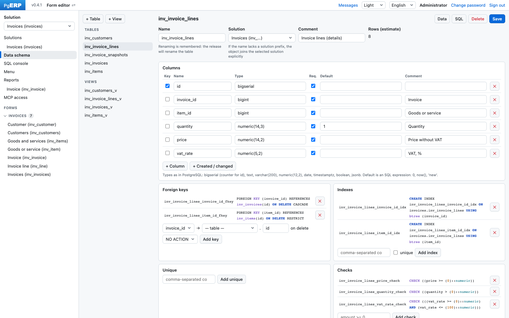

## 3. Views

**"+ View"** — four of them. Form tables show view rows: the views prepare everything for display.

<nobr>`inv_customers_v`</nobr> — customers and a search string:

```sql
SELECT c.id, c.name, c.tax_id, c.address, c.email,
       lower(concat_ws(' ', c.name, c.tax_id, c.email)) AS search_text
FROM inv_customers c
```

<nobr>`inv_items_v`</nobr> — goods and services. <nobr>`kind_badge`</nobr> is the value for a "Badge" column
(<nobr>`ui_badge(text, tone)`</nobr>; tones: <nobr>`neutral`</nobr>, <nobr>`accent`</nobr>, <nobr>`attention`</nobr>, <nobr>`success`</nobr>, <nobr>`done`</nobr>, <nobr>`danger`</nobr>).
<nobr>`price_input`</nobr> and <nobr>`vat_input`</nobr> are values in the form input fields expect: when an item is chosen they fill
the invoice line:

```sql
SELECT i.id, i.name, i.kind, i.unit, i.price, i.vat_rate,
       CASE i.kind WHEN 'service' THEN ui_badge('Service', 'accent') ELSE ui_badge('Goods', 'done') END AS kind_badge,
       ui_money_input(i.price) AS price_input,
       trim_scale(i.vat_rate)::TEXT AS vat_input,
       lower(i.name) AS search_text
FROM inv_items i
```

<nobr>`inv_invoice_lines_v`</nobr> — lines with amounts. Amount and VAT are rounded per line, the invoice total is the sum of lines:

```sql
SELECT l.id, l.invoice_id, l.item_id, i.name AS item, i.unit,
       l.quantity, l.price, l.vat_rate,
       a.amount, a.vat, a.amount + a.vat AS total
FROM inv_invoice_lines l
JOIN inv_items i ON i.id = l.item_id
CROSS JOIN LATERAL (
    SELECT round(l.quantity * l.price, 2) AS amount,
           round(round(l.quantity * l.price, 2) * l.vat_rate / 100, 2) AS vat) a
```

<nobr>`inv_invoices_v`</nobr> — invoices with customer, totals and status; an issued invoice past its payment date is shown
as overdue:

```sql
SELECT v.id, v.number, v.invoice_date, to_char(v.invoice_date, 'DD.MM.YYYY') AS date_text,
       v.due_date, to_char(v.due_date, 'DD.MM.YYYY') AS due_text,
       v.customer_id, c.name AS customer, v.status, v.notes,
       CASE v.status
           WHEN 'draft'     THEN ui_badge('Draft', 'neutral')
           WHEN 'issued'    THEN CASE WHEN v.due_date < current_date THEN ui_badge('Overdue', 'danger')
                                      ELSE ui_badge('Issued', 'accent') END
           WHEN 'paid'      THEN ui_badge('Paid', 'success')
           WHEN 'cancelled' THEN ui_badge('Cancelled', 'done')
       END AS status_badge,
       COALESCE(t.lines, 0) AS lines, COALESCE(t.amount, 0) AS amount,
       COALESCE(t.vat, 0) AS vat, COALESCE(t.total, 0) AS total,
       lower(concat_ws(' ', v.number, c.name)) AS search_text,
       EXISTS (SELECT 1 FROM inv_invoice_snapshots s WHERE s.invoice_id = v.id AND s.state IS NULL) AS is_new
FROM inv_invoices v
JOIN inv_customers c ON c.id = v.customer_id
LEFT JOIN (SELECT invoice_id, count(*) AS lines, sum(amount) AS amount, sum(vat) AS vat, sum(total) AS total
           FROM inv_invoice_lines_v GROUP BY invoice_id) t ON t.invoice_id = v.id
```

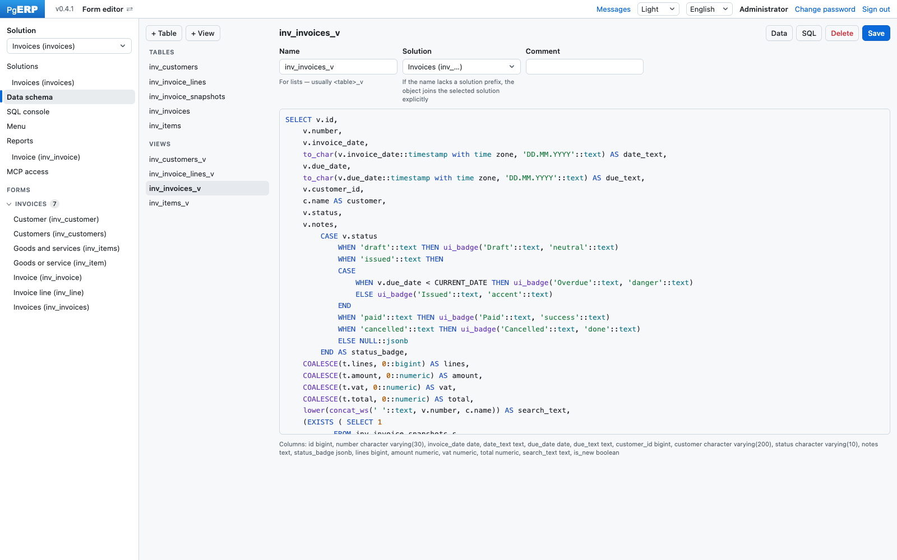

## 4. Code: helper functions and the catalogue

Actions are functions <nobr>`name(p_data JSON) RETURNS JSON`</nobr>; you can write them one by one with the **"{ }"** button next
to an action in the form editor (as in step 7), or as a script in the **SQL console**: the functions and rows of
<nobr>`pgerp.ui_actions`</nobr>. An action must exist before it is chosen in a form, so each part's code comes before its forms.

> Functions created in the console go to the <nobr>`public`</nobr> schema and belong to the solution by prefix; a release on
> another installation creates them in the solution schema. The scripts below can be run again: <nobr>`CREATE OR REPLACE`</nobr>
> and <nobr>`ON CONFLICT DO NOTHING`</nobr>.

**Invoice helper functions** — not actions; button code calls them:

- <nobr>`inv_invoice_totals`</nobr> and <nobr>`inv_invoice_card`</nobr> — card field values (the total and all fields);
- <nobr>`inv_invoice_require_draft`</nobr> — an error if the invoice is no longer a draft;
- <nobr>`inv_invoice_upsert`</nobr> — save the header from the card fields: checks, a new invoice's number from its
  <nobr>`id`</nobr> (<nobr>`INV-2026-00001`</nobr>), editing only of a draft;
- <nobr>`inv_invoice_changed`</nobr> — the response after a status change: refresh the card and the list.

```sql
-- Invoice helper functions (not actions)
-- Invoice total for the card field: "3,754.80 (without VAT 3,129.00, VAT 625.80)"
CREATE OR REPLACE FUNCTION inv_invoice_totals(p_id BIGINT) RETURNS JSONB AS $$
    SELECT jsonb_build_object('totals', format(ui_t('%s (without VAT %s, VAT %s)'),
                              ui_format_money(v.total), ui_format_money(v.amount), ui_format_money(v.vat)))
    FROM inv_invoices_v v WHERE v.id = p_id;
$$ LANGUAGE sql STABLE;

-- Invoice card field values from the database
CREATE OR REPLACE FUNCTION inv_invoice_card(p_id BIGINT) RETURNS JSONB AS $$
    SELECT jsonb_build_object(
        'id',                   v.id::TEXT,
        'number',               v.number,
        'status_text',          v.status_badge->>'label',
        'invoice_date',         to_char(v.invoice_date, 'YYYY-MM-DD'),
        'due_date',             COALESCE(to_char(v.due_date, 'YYYY-MM-DD'), ''),
        'customer_id',          v.customer_id::TEXT,
        'customer_id__display', v.customer,
        'notes',                COALESCE(v.notes, '')) || inv_invoice_totals(p_id)
    FROM inv_invoices_v v WHERE v.id = p_id;
$$ LANGUAGE sql STABLE;

-- Only a draft can be changed
CREATE OR REPLACE FUNCTION inv_invoice_require_draft(p_id BIGINT) RETURNS VOID AS $$
DECLARE
    v_status TEXT;
BEGIN
    SELECT status INTO v_status FROM inv_invoices WHERE id = p_id;
    PERFORM ui_require(FOUND, 'Invoice not found — it may have been deleted');
    PERFORM ui_require(v_status = 'draft', 'Only a draft invoice can be changed');
END;
$$ LANGUAGE plpgsql STABLE;

-- The card draft: the whole invoice (header and lines) — a snapshot on opening, compared on closing
CREATE OR REPLACE FUNCTION inv_invoice_state(p_id BIGINT) RETURNS JSONB AS $$
    SELECT jsonb_build_object(
        'invoice', to_jsonb(i) - 'created_at',
        'lines', COALESCE((SELECT jsonb_agg(to_jsonb(l) ORDER BY l.id)
                           FROM inv_invoice_lines l WHERE l.invoice_id = i.id), '[]'::JSONB))
    FROM inv_invoices i WHERE i.id = p_id;
$$ LANGUAGE sql STABLE;

-- Return an invoice to its snapshot: header and lines
CREATE OR REPLACE FUNCTION inv_invoice_restore(p_id BIGINT, p_state JSONB) RETURNS VOID AS $$
BEGIN
    UPDATE inv_invoices i
    SET invoice_date = s.invoice_date, due_date = s.due_date, customer_id = s.customer_id,
        status = s.status, notes = s.notes
    FROM jsonb_populate_record(NULL::inv_invoices, p_state->'invoice') s
    WHERE i.id = p_id;
    DELETE FROM inv_invoice_lines WHERE invoice_id = p_id;
    INSERT INTO inv_invoice_lines
    SELECT * FROM jsonb_populate_recordset(NULL::inv_invoice_lines, p_state->'lines');
END;
$$ LANGUAGE plpgsql;

-- Save the invoice header from the card fields; a new invoice gets a number. Returns the id
CREATE OR REPLACE FUNCTION inv_invoice_upsert(p_data JSON) RETURNS BIGINT AS $$
DECLARE
    v_id       BIGINT := ui_parse_id(p_data->>'id');
    v_date     DATE   := ui_parse_date(p_data->>'invoice_date');
    v_due      DATE   := ui_parse_date(p_data->>'due_date');
    v_customer BIGINT := ui_parse_id(p_data->>'customer_id');
    v_notes    TEXT   := ui_text(p_data, 'notes');
BEGIN
    PERFORM ui_require(v_date IS NOT NULL, 'Enter the invoice date');
    PERFORM ui_require(EXISTS (SELECT 1 FROM inv_customers WHERE id = v_customer), 'Choose a customer');
    PERFORM ui_require(v_due IS NULL OR v_due >= v_date, 'The payment date cannot be earlier than the invoice date');
    IF ui_is_new(p_data) THEN
        -- The number comes from the invoice id: INV-2026-00001
        v_id := nextval(pg_get_serial_sequence('inv_invoices', 'id'));
        INSERT INTO inv_invoices (id, number, invoice_date, due_date, customer_id, notes, created_by)
        VALUES (v_id, format('INV-%s-%s', to_char(v_date, 'YYYY'), lpad(v_id::TEXT, 5, '0')),
                v_date, v_due, v_customer, v_notes, ui_user());
        -- The invoice is created in the card: a snapshot without state — closing without "Save" deletes it
        INSERT INTO inv_invoice_snapshots (invoice_id, state) VALUES (v_id, NULL);
    ELSE
        PERFORM inv_invoice_require_draft(v_id);
        UPDATE inv_invoices SET invoice_date = v_date, due_date = v_due, customer_id = v_customer, notes = v_notes
        WHERE id = v_id;
    END IF;
    RETURN v_id;
END;
$$ LANGUAGE plpgsql;

-- Response after a status change: refresh the card and the list
CREATE OR REPLACE FUNCTION inv_invoice_changed(p_id BIGINT) RETURNS JSONB AS $$
    SELECT jsonb_build_array(ui_set_values(inv_invoice_card(p_id), p_form => 'inv_invoice'),
                             ui_refresh_grid('inv_invoices_grid', p_keep_page => TRUE));
$$ LANGUAGE sql STABLE;
```

**The catalogue** — list, card, saving and deleting goods and customers. The same techniques as in the to-do list:
<nobr>`ui_grid_page`</nobr> with search, <nobr>`ui_require`</nobr> with an error text, deletion with <nobr>`ui_confirm`</nobr>.
<nobr>`inv_kinds_combo`</nobr> — items of the "Kind" drop-down list:

```sql
-- Reference data: goods and services, customers. An action is a function name(p_data JSON) RETURNS JSON
-- registered in pgerp.ui_actions.

CREATE OR REPLACE FUNCTION inv_items_page(p_data JSON) RETURNS JSON AS $$
SELECT ui_grid_page('inv_items_page', p_data, 'inv_items_v', NULL, 'name', 'asc',
                    p_search_column => 'search_text', p_search => lower(p_data->>'search'));
$$ LANGUAGE sql STABLE;

CREATE OR REPLACE FUNCTION inv_kinds_combo(p_data JSON) RETURNS JSON AS $$
SELECT json_build_object('status', 'success', 'items', json_build_array(
    json_build_object('id', 'goods',   'label', ui_t('Goods')),
    json_build_object('id', 'service', 'label', ui_t('Service'))));
$$ LANGUAGE sql STABLE;

CREATE OR REPLACE FUNCTION inv_item_new_open(p_data JSON) RETURNS JSON AS $$
BEGIN
    RETURN ui_ok(ui_open_form('inv_item', p_title => 'New goods or service',
        p_data => jsonb_build_object('kind', 'goods', 'unit', 'pcs', 'price', '0', 'vat_rate', '20')));
END;
$$ LANGUAGE plpgsql;

CREATE OR REPLACE FUNCTION inv_item_edit_open(p_data JSON) RETURNS JSON AS $$
DECLARE
    v_item inv_items_v%ROWTYPE;
BEGIN
    SELECT * INTO v_item FROM inv_items_v WHERE id = ui_parse_id(p_data->>'id');
    PERFORM ui_require(FOUND, 'Not found — it may have been deleted');
    RETURN ui_ok(ui_open_form('inv_item', p_title => v_item.name,
        p_data => jsonb_build_object('id', v_item.id::TEXT, 'name', v_item.name, 'kind', v_item.kind,
                                     'unit', v_item.unit, 'price', v_item.price_input, 'vat_rate', v_item.vat_input)));
END;
$$ LANGUAGE plpgsql;

CREATE OR REPLACE FUNCTION inv_item_save(p_data JSON) RETURNS JSON AS $$
DECLARE
    v_id    BIGINT  := ui_parse_id(p_data->>'id');
    v_name  TEXT    := ui_text(p_data, 'name');
    v_kind  TEXT    := COALESCE(ui_text(p_data, 'kind'), 'goods');
    v_unit  TEXT    := COALESCE(ui_text(p_data, 'unit'), 'pcs');
    v_price NUMERIC := ui_parse_money(p_data->>'price');
    v_vat   NUMERIC := ui_parse_money(p_data->>'vat_rate');
BEGIN
    PERFORM ui_require(v_name IS NOT NULL, 'Enter the name');
    PERFORM ui_require(v_price IS NOT NULL, 'Price must be a number, e.g. 1500 or 99.90');
    PERFORM ui_require(v_vat IS NOT NULL AND v_vat <= 100, 'VAT must be from 0 to 100 %');
    PERFORM ui_require(NOT EXISTS (SELECT 1 FROM inv_items WHERE name = v_name AND id IS DISTINCT FROM v_id),
                       'There is already an item with this name');
    IF ui_is_new(p_data) THEN
        INSERT INTO inv_items (name, kind, unit, price, vat_rate) VALUES (v_name, v_kind, v_unit, v_price, v_vat);
    ELSE
        UPDATE inv_items SET name = v_name, kind = v_kind, unit = v_unit, price = v_price, vat_rate = v_vat
        WHERE id = v_id;
        PERFORM ui_require(FOUND, 'Not found — it may have been deleted');
    END IF;
    RETURN ui_ok(ui_close_form(), ui_refresh_grid('inv_items_grid', p_keep_page => TRUE));
END;
$$ LANGUAGE plpgsql;

CREATE OR REPLACE FUNCTION inv_item_delete(p_data JSON) RETURNS JSON AS $$
DECLARE
    v_item inv_items%ROWTYPE;
BEGIN
    SELECT * INTO v_item FROM inv_items WHERE id = ui_parse_id(p_data->>'id');
    PERFORM ui_require(FOUND, 'Not found — it may have been deleted');
    PERFORM ui_require(NOT EXISTS (SELECT 1 FROM inv_invoice_lines WHERE item_id = v_item.id),
                       'It is used in invoices and cannot be deleted');
    IF NOT ui_confirmed(p_data) THEN
        RETURN ui_ok(ui_confirm(format(ui_t('Delete “%s”?'), v_item.name), 'inv_item_delete',
                                jsonb_build_object('id', v_item.id, 'confirmed', TRUE), p_confirm_label => 'Delete'));
    END IF;
    DELETE FROM inv_items WHERE id = v_item.id;
    RETURN ui_ok(ui_refresh_grid('inv_items_grid', p_keep_page => TRUE));
END;
$$ LANGUAGE plpgsql;

CREATE OR REPLACE FUNCTION inv_customers_page(p_data JSON) RETURNS JSON AS $$
SELECT ui_grid_page('inv_customers_page', p_data, 'inv_customers_v', NULL, 'name', 'asc',
                    p_search_column => 'search_text', p_search => lower(p_data->>'search'));
$$ LANGUAGE sql STABLE;

CREATE OR REPLACE FUNCTION inv_customer_new_open(p_data JSON) RETURNS JSON AS $$
BEGIN
    RETURN ui_ok(ui_open_form('inv_customer', p_title => 'New customer'));
END;
$$ LANGUAGE plpgsql;

CREATE OR REPLACE FUNCTION inv_customer_edit_open(p_data JSON) RETURNS JSON AS $$
DECLARE
    v_customer inv_customers%ROWTYPE;
BEGIN
    SELECT * INTO v_customer FROM inv_customers WHERE id = ui_parse_id(p_data->>'id');
    PERFORM ui_require(FOUND, 'Customer not found — it may have been deleted');
    RETURN ui_ok(ui_open_form('inv_customer', p_title => v_customer.name,
        p_data => jsonb_build_object('id', v_customer.id::TEXT, 'name', v_customer.name,
                                     'tax_id', COALESCE(v_customer.tax_id, ''), 'email', COALESCE(v_customer.email, ''),
                                     'address', COALESCE(v_customer.address, ''))));
END;
$$ LANGUAGE plpgsql;

CREATE OR REPLACE FUNCTION inv_customer_save(p_data JSON) RETURNS JSON AS $$
DECLARE
    v_id   BIGINT := ui_parse_id(p_data->>'id');
    v_name TEXT   := ui_text(p_data, 'name');
BEGIN
    PERFORM ui_require(v_name IS NOT NULL, 'Enter the customer name');
    PERFORM ui_require(NOT EXISTS (SELECT 1 FROM inv_customers WHERE name = v_name AND id IS DISTINCT FROM v_id),
                       'There is already a customer with this name');
    IF ui_is_new(p_data) THEN
        INSERT INTO inv_customers (name, tax_id, email, address)
        VALUES (v_name, ui_text(p_data, 'tax_id'), ui_text(p_data, 'email'), ui_text(p_data, 'address'));
    ELSE
        UPDATE inv_customers SET name = v_name, tax_id = ui_text(p_data, 'tax_id'), email = ui_text(p_data, 'email'),
                                 address = ui_text(p_data, 'address')
        WHERE id = v_id;
        PERFORM ui_require(FOUND, 'Customer not found — it may have been deleted');
    END IF;
    RETURN ui_ok(ui_close_form(), ui_refresh_grid('inv_customers_grid', p_keep_page => TRUE));
END;
$$ LANGUAGE plpgsql;

INSERT INTO pgerp.ui_actions (action_name, function_name, description) VALUES
    ('inv_items_page',         'inv_items_page',         'Invoices: goods and services list'),
    ('inv_kinds_combo',        'inv_kinds_combo',        'Invoices: goods or service'),
    ('inv_item_new_open',      'inv_item_new_open',      'Invoices: new goods or service'),
    ('inv_item_edit_open',     'inv_item_edit_open',     'Invoices: open goods or service'),
    ('inv_item_save',          'inv_item_save',          'Invoices: save goods or service'),
    ('inv_item_delete',        'inv_item_delete',        'Invoices: delete goods or service'),
    ('inv_customers_page',     'inv_customers_page',     'Invoices: customers list'),
    ('inv_customer_new_open',  'inv_customer_new_open',  'Invoices: new customer'),
    ('inv_customer_edit_open', 'inv_customer_edit_open', 'Invoices: open customer'),
    ('inv_customer_save',      'inv_customer_save',      'Invoices: save customer')
ON CONFLICT (action_name) DO NOTHING;
```

**Selection windows** for lookup fields (the "Lookup field" component): the "…" button opens a list in selection mode,
and the chosen row returns to the field. <nobr>`fill`</nobr> also fills neighbouring fields from the chosen row — price and VAT rate:

```sql
-- Lookup fields: the "…" button opens a list in selection mode

CREATE OR REPLACE FUNCTION inv_customer_select_open(p_data JSON) RETURNS JSON AS $$
BEGIN
    RETURN ui_ok(ui_open_form('inv_customers', p_title => 'Choose a customer',
        p_select => jsonb_build_object('value_field', 'id', 'display_field', 'name')));
END;
$$ LANGUAGE plpgsql;

CREATE OR REPLACE FUNCTION inv_item_select_open(p_data JSON) RETURNS JSON AS $$
BEGIN
    -- The chosen row also fills price and VAT rate: {"form field": "list row field"}
    RETURN ui_ok(ui_open_form('inv_items', p_title => 'Choose goods or service',
        p_select => jsonb_build_object('value_field', 'id', 'display_field', 'name',
                                       'fill', jsonb_build_object('price', 'price_input', 'vat_rate', 'vat_input'))));
END;
$$ LANGUAGE plpgsql;

INSERT INTO pgerp.ui_actions (action_name, function_name, description) VALUES
    ('inv_customer_select_open', 'inv_customer_select_open', 'Invoices: choose a customer'),
    ('inv_item_select_open',     'inv_item_select_open',     'Invoices: choose goods or service')
ON CONFLICT (action_name) DO NOTHING;
```

## 5. Catalogue: forms

**Form editor → "+ New form"**, folder "Invoices". Lists and cards work as in the to-do list.

<nobr>`inv_items`</nobr> — "Goods and services":

| Component | Name | Label | Action | Properties |
|---|---|---|---|---|
| Input field | <nobr>`search`</nobr> | Search |  | Table filter: <nobr>`inv_items_grid`</nobr> |
| Table | <nobr>`inv_items_grid`</nobr> |  | <nobr>`inv_items_page`</nobr> |  |
| Button | <nobr>`btn_new`</nobr> | Add | <nobr>`inv_item_new_open`</nobr> |  |

<nobr>`inv_item`</nobr> — "Goods or service":

| Component | Name | Label | Action | Properties |
|---|---|---|---|---|
| Hidden field | <nobr>`id`</nobr> |  |  |  |
| Input field | <nobr>`name`</nobr> | Name |  |  |
| Drop-down list | <nobr>`kind`</nobr> | Kind | <nobr>`inv_kinds_combo`</nobr> |  |
| Input field | <nobr>`unit`</nobr> | Unit |  |  |
| Input field | <nobr>`price`</nobr> | Price without VAT |  |  |
| Input field | <nobr>`vat_rate`</nobr> | VAT, % |  |  |
| Button | <nobr>`btn_save`</nobr> | Save | <nobr>`inv_item_save`</nobr> |  |
| Button | <nobr>`btn_cancel`</nobr> | Cancel | <nobr>`form_close`</nobr> |  |

<nobr>`inv_customers`</nobr> — "Customers":

| Component | Name | Label | Action | Properties |
|---|---|---|---|---|
| Input field | <nobr>`search`</nobr> | Search |  | Table filter: <nobr>`inv_customers_grid`</nobr> |
| Table | <nobr>`inv_customers_grid`</nobr> |  | <nobr>`inv_customers_page`</nobr> |  |
| Button | <nobr>`btn_new`</nobr> | New customer | <nobr>`inv_customer_new_open`</nobr> |  |

<nobr>`inv_customer`</nobr> — "Customer":

| Component | Name | Label | Action | Properties |
|---|---|---|---|---|
| Hidden field | <nobr>`id`</nobr> |  |  |  |
| Input field | <nobr>`name`</nobr> | Name |  |  |
| Input field | <nobr>`tax_id`</nobr> | Tax ID |  |  |
| Input field | <nobr>`email`</nobr> | E-mail |  |  |
| Input field | <nobr>`address`</nobr> | Address |  |  |
| Button | <nobr>`btn_save`</nobr> | Save | <nobr>`inv_customer_save`</nobr> |  |
| Button | <nobr>`btn_cancel`</nobr> | Cancel | <nobr>`form_close`</nobr> |  |

The goods list also serves as the selection window for an invoice line: in selection mode its rows get a "Select" button.

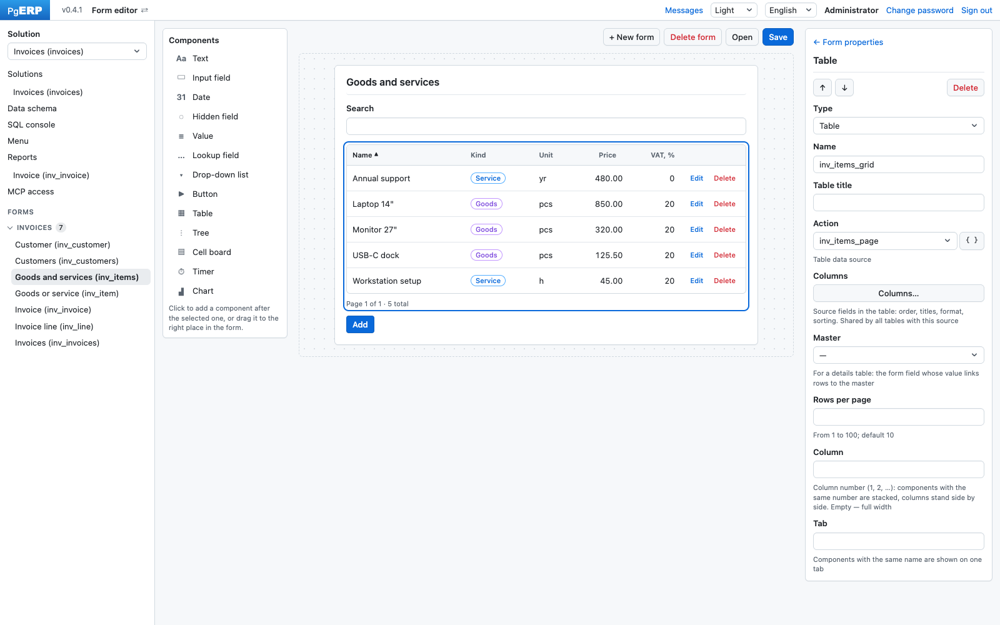

## 6. Invoice list

The list code: a table source with search and a <nobr>`p_filters`</nobr> filter by the value of the <nobr>`status_filter`</nobr>
drop-down list, the items of that list, opening a new and an existing invoice, deleting a draft.

```sql
-- Invoice list: table source, status filter, new invoice, open and delete

CREATE OR REPLACE FUNCTION inv_invoices_page(p_data JSON) RETURNS JSON AS $$
SELECT ui_grid_page('inv_invoices_page', p_data, 'inv_invoices_v', NULL, 'date_text', 'desc',
                    p_search_column => 'search_text', p_search => lower(p_data->>'search'),
                    p_filters => jsonb_build_object('status', p_data->>'status_filter', 'is_new', 'false'));
$$ LANGUAGE sql STABLE;

CREATE OR REPLACE FUNCTION inv_statuses_combo(p_data JSON) RETURNS JSON AS $$
SELECT json_build_object('status', 'success', 'items', json_build_array(
    json_build_object('id', 'draft',     'label', ui_t('Draft')),
    json_build_object('id', 'issued',    'label', ui_t('Issued')),
    json_build_object('id', 'paid',      'label', ui_t('Paid')),
    json_build_object('id', 'cancelled', 'label', ui_t('Cancelled'))));
$$ LANGUAGE sql STABLE;

CREATE OR REPLACE FUNCTION inv_invoice_new_open(p_data JSON) RETURNS JSON AS $$
BEGIN
    RETURN ui_ok(ui_open_form('inv_invoice', p_title => 'New invoice',
        p_data => jsonb_build_object('invoice_date', to_char(current_date, 'YYYY-MM-DD'),
                                     'due_date',     to_char(current_date + 10, 'YYYY-MM-DD'),
                                     'status_text',  ui_t('Draft'))));
END;
$$ LANGUAGE plpgsql;

CREATE OR REPLACE FUNCTION inv_invoice_edit_open(p_data JSON) RETURNS JSON AS $$
DECLARE
    v_id   BIGINT := ui_parse_id(p_data->>'id');
    v_card JSONB  := inv_invoice_card(v_id);
BEGIN
    PERFORM ui_require(v_card IS NOT NULL, 'Invoice not found — it may have been deleted');
    -- Remember the saved version: closing without "Save" returns to it. The snapshot is overwritten —
    -- one left by a window closed together with its browser tab would take the invoice back in time
    INSERT INTO inv_invoice_snapshots (invoice_id, state) VALUES (v_id, inv_invoice_state(v_id))
    ON CONFLICT (invoice_id) DO UPDATE SET state = EXCLUDED.state, created_at = now();
    RETURN ui_ok(ui_open_form('inv_invoice', p_title => format(ui_t('Invoice %s'), v_card->>'number'), p_data => v_card));
END;
$$ LANGUAGE plpgsql;

CREATE OR REPLACE FUNCTION inv_invoice_delete(p_data JSON) RETURNS JSON AS $$
DECLARE
    v_invoice inv_invoices%ROWTYPE;
BEGIN
    SELECT * INTO v_invoice FROM inv_invoices WHERE id = ui_parse_id(p_data->>'id');
    PERFORM ui_require(FOUND, 'Invoice not found — it may have been deleted');
    PERFORM ui_require(v_invoice.status = 'draft', 'Only a draft can be deleted; cancel an issued invoice instead');
    IF NOT ui_confirmed(p_data) THEN
        RETURN ui_ok(ui_confirm(format(ui_t('Delete invoice %s?'), v_invoice.number), 'inv_invoice_delete',
                                jsonb_build_object('id', v_invoice.id, 'confirmed', TRUE), p_confirm_label => 'Delete'));
    END IF;
    DELETE FROM inv_invoices WHERE id = v_invoice.id;   -- lines are deleted by cascade
    RETURN ui_ok(ui_refresh_grid('inv_invoices_grid', p_keep_page => TRUE));
END;
$$ LANGUAGE plpgsql;

INSERT INTO pgerp.ui_actions (action_name, function_name, description) VALUES
    ('inv_invoices_page',     'inv_invoices_page',     'Invoices: invoice list'),
    ('inv_statuses_combo',    'inv_statuses_combo',    'Invoices: invoice statuses'),
    ('inv_invoice_new_open',  'inv_invoice_new_open',  'Invoices: new invoice'),
    ('inv_invoice_edit_open', 'inv_invoice_edit_open', 'Invoices: open invoice'),
    ('inv_invoice_delete',    'inv_invoice_delete',    'Invoices: delete a draft invoice')
ON CONFLICT (action_name) DO NOTHING;
```

The default sorting is the <nobr>`'date_text'`</nobr> argument: it is a **table column field** with sorting set (step 11), not a
view column; an unknown field is silently replaced by <nobr>`id`</nobr>.

Form <nobr>`inv_invoices`</nobr> — "Invoices". The drop-down list's "Empty item" is "All": with nothing chosen
the filter does not apply.

| Component | Name | Label | Action | Properties |
|---|---|---|---|---|
| Input field | <nobr>`search`</nobr> | Search |  | Table filter: <nobr>`inv_invoices_grid`</nobr>; Column: 1 |
| Drop-down list | <nobr>`status_filter`</nobr> | Status | <nobr>`inv_statuses_combo`</nobr> | Refresh: <nobr>`inv_invoices_grid`</nobr>; Empty item: All; Column: 2 |
| Table | <nobr>`inv_invoices_grid`</nobr> |  | <nobr>`inv_invoices_page`</nobr> |  |
| Button | <nobr>`btn_new`</nobr> | New invoice | <nobr>`inv_invoice_new_open`</nobr> |  |

## 7. Invoice card — the master

First the code of the card buttons and of invoice lines:

```sql
-- Invoice card (master) buttons

CREATE OR REPLACE FUNCTION inv_invoice_save(p_data JSON) RETURNS JSON AS $$
DECLARE
    v_id BIGINT := inv_invoice_upsert(p_data);
BEGIN
    DELETE FROM inv_invoice_snapshots WHERE invoice_id = v_id;   -- the changes are accepted
    RETURN ui_ok(ui_close_form(), ui_refresh_grid('inv_invoices_grid', p_keep_page => TRUE),
                 ui_message(format(ui_t('Invoice %s saved'), (SELECT number FROM inv_invoices WHERE id = v_id))));
END;
$$ LANGUAGE plpgsql;

CREATE OR REPLACE FUNCTION inv_invoice_issue(p_data JSON) RETURNS JSON AS $$
DECLARE
    v_id BIGINT := inv_invoice_upsert(p_data);
BEGIN
    PERFORM ui_require(EXISTS (SELECT 1 FROM inv_invoice_lines WHERE invoice_id = v_id),
                       'Add at least one line before issuing the invoice');
    UPDATE inv_invoices SET status = 'issued' WHERE id = v_id;
    DELETE FROM inv_invoice_snapshots WHERE invoice_id = v_id;
    PERFORM ui_print(format(ui_t('Invoice %s issued'), (SELECT number FROM inv_invoices WHERE id = v_id)));
    RETURN ui_ok(inv_invoice_changed(v_id));
END;
$$ LANGUAGE plpgsql;

CREATE OR REPLACE FUNCTION inv_invoice_pay(p_data JSON) RETURNS JSON AS $$
DECLARE
    v_id BIGINT := ui_parse_id(p_data->>'id');
BEGIN
    UPDATE inv_invoices SET status = 'paid' WHERE id = v_id AND status = 'issued';
    PERFORM ui_require(FOUND, 'Only an issued invoice can be marked as paid');
    DELETE FROM inv_invoice_snapshots WHERE invoice_id = v_id;
    RETURN ui_ok(inv_invoice_changed(v_id));
END;
$$ LANGUAGE plpgsql;

CREATE OR REPLACE FUNCTION inv_invoice_void(p_data JSON) RETURNS JSON AS $$
DECLARE
    v_id BIGINT := ui_parse_id(p_data->>'id');
BEGIN
    PERFORM ui_require(v_id IS NOT NULL AND NOT EXISTS (SELECT 1 FROM inv_invoice_snapshots
                                                        WHERE invoice_id = v_id AND state IS NULL),
                       'The invoice is not saved yet — just close it');
    IF NOT ui_confirmed(p_data) THEN
        RETURN ui_ok(ui_confirm('Cancel this invoice? It cannot be changed afterwards.', 'inv_invoice_void',
                                jsonb_build_object('id', v_id, 'confirmed', TRUE), p_confirm_label => 'Cancel invoice'));
    END IF;
    UPDATE inv_invoices SET status = 'cancelled' WHERE id = v_id AND status IN ('draft', 'issued');
    PERFORM ui_require(FOUND, 'Only a draft or an issued invoice can be cancelled');
    DELETE FROM inv_invoice_snapshots WHERE invoice_id = v_id;
    RETURN ui_ok(inv_invoice_changed(v_id));
END;
$$ LANGUAGE plpgsql;

INSERT INTO pgerp.ui_actions (action_name, function_name, description) VALUES
    ('inv_invoice_save',  'inv_invoice_save',  'Invoices: save invoice'),
    ('inv_invoice_issue', 'inv_invoice_issue', 'Invoices: issue invoice'),
    ('inv_invoice_pay',   'inv_invoice_pay',   'Invoices: mark invoice as paid'),
    ('inv_invoice_void',  'inv_invoice_void',  'Invoices: cancel invoice')
ON CONFLICT (action_name) DO NOTHING;
```

```sql
-- Invoice lines (details): table source, add, edit, save, remove

CREATE OR REPLACE FUNCTION inv_lines_page(p_data JSON) RETURNS JSON AS $$
SELECT ui_grid_page('inv_lines_page', p_data, 'inv_invoice_lines_v', 'invoice_id', 'id', 'asc');
$$ LANGUAGE sql STABLE;

CREATE OR REPLACE FUNCTION inv_line_new_open(p_data JSON) RETURNS JSON AS $$
DECLARE
    -- A new invoice is saved first: the line needs the invoice id
    v_id BIGINT := inv_invoice_upsert(p_data);
BEGIN
    PERFORM inv_invoice_require_draft(v_id);
    RETURN ui_ok(ui_set_values(inv_invoice_card(v_id)),
                 ui_set_title(format(ui_t('Invoice %s'), (SELECT number FROM inv_invoices WHERE id = v_id))),
                 ui_refresh_grid('inv_invoices_grid', p_keep_page => TRUE),
                 ui_open_form('inv_line', p_title => 'Invoice line',
                              p_data => jsonb_build_object('invoice_id', v_id::TEXT, 'quantity', '1')));
END;
$$ LANGUAGE plpgsql;

CREATE OR REPLACE FUNCTION inv_line_edit_open(p_data JSON) RETURNS JSON AS $$
DECLARE
    v_line inv_invoice_lines_v%ROWTYPE;
BEGIN
    SELECT * INTO v_line FROM inv_invoice_lines_v WHERE id = ui_parse_id(p_data->>'id');
    PERFORM ui_require(FOUND, 'Line not found — it may have been deleted');
    PERFORM inv_invoice_require_draft(v_line.invoice_id);
    RETURN ui_ok(ui_open_form('inv_line', p_title => v_line.item,
        p_data => jsonb_build_object('id', v_line.id::TEXT, 'invoice_id', v_line.invoice_id::TEXT,
                                     'item_id', v_line.item_id::TEXT, 'item_id__display', v_line.item,
                                     'quantity', trim_scale(v_line.quantity)::TEXT,
                                     'price', ui_money_input(v_line.price),
                                     'vat_rate', trim_scale(v_line.vat_rate)::TEXT)));
END;
$$ LANGUAGE plpgsql;

CREATE OR REPLACE FUNCTION inv_line_save(p_data JSON) RETURNS JSON AS $$
DECLARE
    v_invoice  BIGINT  := ui_parse_id(p_data->>'invoice_id');
    v_item     BIGINT  := ui_parse_id(p_data->>'item_id');
    v_quantity NUMERIC := ui_parse_money(p_data->>'quantity');
    v_price    NUMERIC := ui_parse_money(p_data->>'price');
    v_vat      NUMERIC := ui_parse_money(p_data->>'vat_rate');
BEGIN
    PERFORM inv_invoice_require_draft(v_invoice);
    PERFORM ui_require(EXISTS (SELECT 1 FROM inv_items WHERE id = v_item), 'Choose goods or a service');
    PERFORM ui_require(v_quantity > 0, 'Quantity must be a number greater than zero');
    PERFORM ui_require(v_price IS NOT NULL, 'Price must be a number, e.g. 1500 or 99.90');
    PERFORM ui_require(v_vat IS NOT NULL AND v_vat <= 100, 'VAT must be from 0 to 100 %');
    IF ui_is_new(p_data) THEN
        INSERT INTO inv_invoice_lines (invoice_id, item_id, quantity, price, vat_rate)
        VALUES (v_invoice, v_item, v_quantity, v_price, v_vat);
    ELSE
        UPDATE inv_invoice_lines SET item_id = v_item, quantity = v_quantity, price = v_price, vat_rate = v_vat
        WHERE id = ui_parse_id(p_data->>'id') AND invoice_id = v_invoice;
        PERFORM ui_require(FOUND, 'Line not found — it may have been deleted');
    END IF;
    -- Close the line, reload the lines and update the totals in the invoice card (another open form)
    RETURN ui_ok(ui_close_form(),
                 ui_refresh_grid('inv_lines_grid', p_keep_page => TRUE),
                 ui_set_values(inv_invoice_totals(v_invoice), p_form => 'inv_invoice'),
                 ui_refresh_grid('inv_invoices_grid', p_keep_page => TRUE));
END;
$$ LANGUAGE plpgsql;

CREATE OR REPLACE FUNCTION inv_line_delete(p_data JSON) RETURNS JSON AS $$
DECLARE
    v_line inv_invoice_lines_v%ROWTYPE;
BEGIN
    SELECT * INTO v_line FROM inv_invoice_lines_v WHERE id = ui_parse_id(p_data->>'id');
    PERFORM ui_require(FOUND, 'Line not found — it may have been deleted');
    PERFORM inv_invoice_require_draft(v_line.invoice_id);
    IF NOT ui_confirmed(p_data) THEN
        RETURN ui_ok(ui_confirm(format(ui_t('Remove “%s” from the invoice?'), v_line.item), 'inv_line_delete',
                                jsonb_build_object('id', v_line.id, 'confirmed', TRUE), p_confirm_label => 'Remove'));
    END IF;
    DELETE FROM inv_invoice_lines WHERE id = v_line.id;
    RETURN ui_ok(ui_refresh_grid('inv_lines_grid', p_keep_page => TRUE),
                 ui_set_values(inv_invoice_totals(v_line.invoice_id), p_form => 'inv_invoice'),
                 ui_refresh_grid('inv_invoices_grid', p_keep_page => TRUE));
END;
$$ LANGUAGE plpgsql;

INSERT INTO pgerp.ui_actions (action_name, function_name, description) VALUES
    ('inv_lines_page',     'inv_lines_page',     'Invoices: invoice lines'),
    ('inv_line_new_open',  'inv_line_new_open',  'Invoices: add a line'),
    ('inv_line_edit_open', 'inv_line_edit_open', 'Invoices: open a line'),
    ('inv_line_save',      'inv_line_save',      'Invoices: save a line'),
    ('inv_line_delete',    'inv_line_delete',    'Invoices: delete a line')
ON CONFLICT (action_name) DO NOTHING;
```

What matters here:

- <nobr>`inv_lines_page`</nobr> passes the <nobr>`invoice_id`</nobr> column to <nobr>`ui_grid_page`</nobr> — rows of the current invoice are selected by it;
- <nobr>`inv_line_new_open`</nobr> saves the header (a new invoice gets an <nobr>`id`</nobr> and a number), fills the card with them
  (<nobr>`ui_set_values`</nobr> without <nobr>`p_form`</nobr> — the form the button was clicked in), changes the title, refreshes the
  invoice list and opens the line with <nobr>`invoice_id`</nobr>;
- <nobr>`inv_line_save`</nobr> responds both to its own form (close) and to the card underneath: reload <nobr>`inv_lines_grid`</nobr>
  and update the <nobr>`totals`</nobr> field in the <nobr>`inv_invoice`</nobr> form;
- every change of lines starts with <nobr>`inv_invoice_require_draft`</nobr>: an issued invoice cannot be changed;
- <nobr>`inv_invoice_issue`</nobr> prints a line to the message panel: <nobr>`PERFORM ui_print(...)`</nobr>.

Form <nobr>`inv_invoice`</nobr> — "Invoice":

| Component | Name | Label | Action | Properties |
|---|---|---|---|---|
| Hidden field | <nobr>`id`</nobr> |  |  |  |
| Value (read-only) | <nobr>`number`</nobr> | Number |  | Column: 1 |
| Date | <nobr>`invoice_date`</nobr> | Date |  | Column: 1 |
| Lookup field | <nobr>`customer_id`</nobr> | Customer | <nobr>`inv_customer_select_open`</nobr> | Column: 1 |
| Value (read-only) | <nobr>`status_text`</nobr> | Status |  | Column: 2 |
| Date | <nobr>`due_date`</nobr> | Pay by |  | Column: 2 |
| Input field | <nobr>`notes`</nobr> | Notes |  | Column: 2 |
| Button | <nobr>`btn_add_line`</nobr> | Add line | <nobr>`inv_line_new_open`</nobr> | Tab: Lines |
| Table | <nobr>`inv_lines_grid`</nobr> |  | <nobr>`inv_lines_page`</nobr> | Tab: Lines; Master: <nobr>`id`</nobr> |
| Value (read-only) | <nobr>`totals`</nobr> | Total |  | Tab: Lines |
| Button | <nobr>`btn_save`</nobr> | Save | <nobr>`inv_invoice_save`</nobr> |  |
| Button | <nobr>`btn_issue`</nobr> | Issue | <nobr>`inv_invoice_issue`</nobr> |  |
| Button | <nobr>`btn_pay`</nobr> | Paid | <nobr>`inv_invoice_pay`</nobr> |  |
| Button | <nobr>`btn_void`</nobr> | Cancel invoice | <nobr>`inv_invoice_void`</nobr> |  |
| Button | <nobr>`btn_close`</nobr> | Close | <nobr>`form_close`</nobr> |  |

For now "Close" just closes the window (<nobr>`form_close`</nobr>): in step 9 it becomes closing the draft,
and in step 10 "Print" appears next to it. The screenshot below shows the finished form.

The key part is the <nobr>`inv_lines_grid`</nobr> table property **"Master" = <nobr>`id`</nobr>**: the lines table became the card's
details. Fields with the same "Column" number are stacked, columns stand side by side; components with the "Tab" Lines are
gathered on a tab. The total has no column: columns are laid out across the whole form, and a total with a column would
move up into the header.

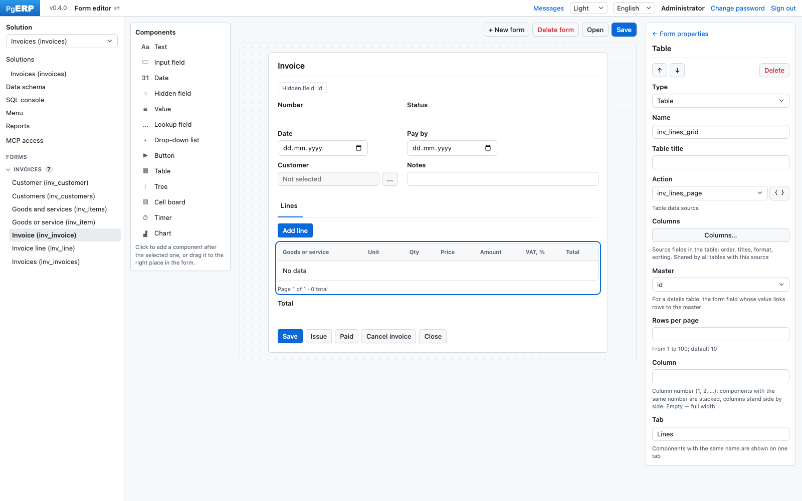

The code of any action opens with the **"{ }"** button next to the component's action — this is also how everything from
the scripts above could be written, one function at a time. For example, "Add line":

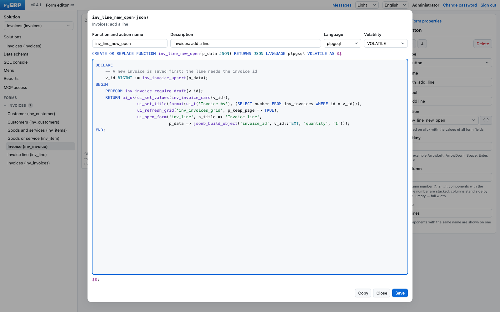

## 8. Invoice line — the details

Form <nobr>`inv_line`</nobr> — "Invoice line":

| Component | Name | Label | Action | Properties |
|---|---|---|---|---|
| Hidden field | <nobr>`id`</nobr> |  |  |  |
| Hidden field | <nobr>`invoice_id`</nobr> |  |  |  |
| Lookup field | <nobr>`item_id`</nobr> | Goods or service | <nobr>`inv_item_select_open`</nobr> |  |
| Input field | <nobr>`quantity`</nobr> | Quantity |  |  |
| Input field | <nobr>`price`</nobr> | Price without VAT |  |  |
| Input field | <nobr>`vat_rate`</nobr> | VAT, % |  |  |
| Button | <nobr>`btn_save`</nobr> | Save | <nobr>`inv_line_save`</nobr> |  |
| Button | <nobr>`btn_cancel`</nobr> | Cancel | <nobr>`form_close`</nobr> |  |

<nobr>`invoice_id`</nobr> is a hidden field: <nobr>`inv_line_new_open`</nobr> fills it, so <nobr>`inv_line_save`</nobr> knows which invoice the line belongs
to. The <nobr>`item_id`</nobr> lookup field stores the item's <nobr>`id`</nobr> and shows its name (<nobr>`item_id__display`</nobr>); on selection
<nobr>`fill`</nobr> from <nobr>`inv_item_select_open`</nobr> sets the price and VAT rate.

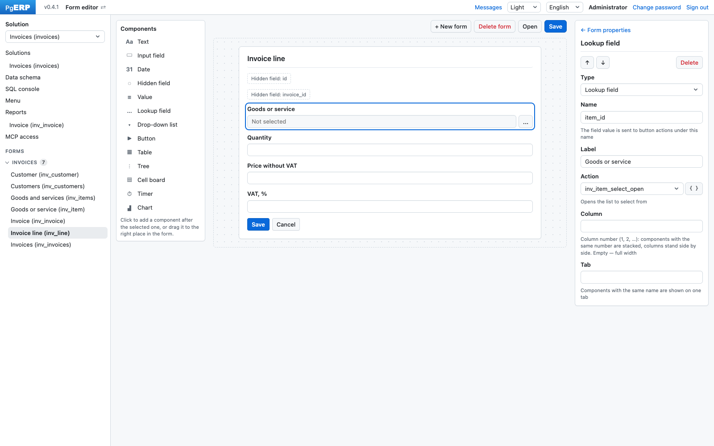

## 9. Draft: closing without saving

"Add line" writes a new invoice to the database — otherwise lines have nothing to link to, and every line is saved at
once too. Without a draft, an invoice with lines would stay in the database even if the card is closed without "Save".
The card draft rests on a **snapshot** — the <nobr>`inv_invoice_snapshots`</nobr> table from step 2:

- opening a saved invoice (<nobr>`inv_invoice_edit_open`</nobr>) remembers it whole — header and lines
  (<nobr>`inv_invoice_state`</nobr>);
- a new invoice created by "Add line" (<nobr>`inv_invoice_upsert`</nobr>) is marked by a snapshot without state;
  the list does not show such invoices — the <nobr>`is_new`</nobr> view column and the filter in <nobr>`inv_invoices_page`</nobr>;
- "Save", "Issue", "Paid", "Cancel invoice" accept the changes — the snapshot is deleted;
- "Close", the close cross and Escape call <nobr>`inv_invoice_cancel`</nobr>: if something changed it asks first, and on
  consent deletes a new invoice with its lines or returns a saved one to its snapshot (<nobr>`inv_invoice_restore`</nobr>).

Everything except closing itself is already in the code of steps 4, 6 and 7. What is left is the closing action —
**SQL console**:

```sql
-- Close the card without saving: delete a new invoice or return a saved one to its snapshot

CREATE OR REPLACE FUNCTION inv_invoice_cancel(p_data JSON) RETURNS JSON AS $$
-- "Close", the close cross and Escape. If something changed — a question first; on consent an invoice created
-- in the card is deleted with its lines, and a saved one returns to its snapshot. The header comes from the form:
-- its edits may not be written yet
DECLARE
    v_id       BIGINT := ui_parse_id(p_data->>'id');
    v_invoice  inv_invoices%ROWTYPE;
    v_snapshot inv_invoice_snapshots%ROWTYPE;
    v_new      BOOLEAN;
    v_close    JSONB := jsonb_build_array(ui_close_form(), ui_refresh_grid('inv_invoices_grid', p_keep_page => TRUE));
BEGIN
    -- The invoice has not been written yet (no lines added): ask only if a customer is chosen
    IF v_id IS NULL THEN
        IF NOT ui_confirmed(p_data) AND ui_parse_id(p_data->>'customer_id') IS NOT NULL THEN
            RETURN ui_ok(ui_confirm('Close without saving? The new invoice will not be created.',
                                    'inv_invoice_cancel', jsonb_build_object('confirmed', TRUE),
                                    p_confirm_label => 'Don''t save'));
        END IF;
        RETURN ui_ok(ui_close_form());
    END IF;

    SELECT * INTO v_invoice FROM inv_invoices WHERE id = v_id;
    IF NOT FOUND THEN
        RETURN ui_ok(v_close);   -- already deleted: nothing to undo
    END IF;
    SELECT * INTO v_snapshot FROM inv_invoice_snapshots WHERE invoice_id = v_id;
    v_new := v_snapshot.invoice_id IS NOT NULL AND v_snapshot.state IS NULL;

    IF NOT ui_confirmed(p_data) THEN
        IF v_new
           OR (v_snapshot.state IS NOT NULL AND v_snapshot.state IS DISTINCT FROM inv_invoice_state(v_id))
           OR (v_invoice.status = 'draft' AND
               jsonb_build_object('invoice_date', v_invoice.invoice_date, 'due_date', v_invoice.due_date,
                                  'customer_id', v_invoice.customer_id, 'notes', v_invoice.notes)
               IS DISTINCT FROM
               jsonb_build_object('invoice_date', ui_parse_date(p_data->>'invoice_date'),
                                  'due_date', ui_parse_date(p_data->>'due_date'),
                                  'customer_id', ui_parse_id(p_data->>'customer_id'), 'notes', ui_text(p_data, 'notes'))) THEN
            RETURN ui_ok(ui_confirm(
                format(CASE WHEN v_new THEN ui_t('Close without saving? Invoice %s with its lines will be deleted.')
                            ELSE ui_t('Close without saving? Changes to invoice %s will be discarded.') END,
                       v_invoice.number),
                'inv_invoice_cancel', jsonb_build_object('id', v_id::TEXT, 'confirmed', TRUE),
                p_confirm_label => 'Don''t save'));
        END IF;
        -- Nothing changed: nothing to return
        DELETE FROM inv_invoice_snapshots WHERE invoice_id = v_id;
        RETURN ui_ok(ui_close_form());
    END IF;

    IF v_new THEN
        DELETE FROM inv_invoices WHERE id = v_id;   -- lines and the snapshot are deleted by cascade
    ELSIF v_snapshot.state IS NOT NULL THEN
        PERFORM inv_invoice_restore(v_id, v_snapshot.state);
        DELETE FROM inv_invoice_snapshots WHERE invoice_id = v_id;
    END IF;
    RETURN ui_ok(v_close);
END;
$$ LANGUAGE plpgsql;

INSERT INTO pgerp.ui_actions (action_name, function_name, description) VALUES
    ('inv_invoice_cancel', 'inv_invoice_cancel', 'Invoices: close the invoice card')
ON CONFLICT (action_name) DO NOTHING;

-- The close cross and Escape close the card with the same action as the "Close" button
UPDATE pgerp.forms SET cancel_action = 'inv_invoice_cancel' WHERE form_name = 'inv_invoice';
```

In the form editor choose the <nobr>`inv_invoice_cancel`</nobr> action for the <nobr>`btn_close`</nobr> button of the
<nobr>`inv_invoice`</nobr> card. The last line of the script does the same for the close cross and Escape: it is the form's
cancel action (<nobr>`pgerp.forms.cancel_action`</nobr>), which the editor does not have — only SQL or MCP.

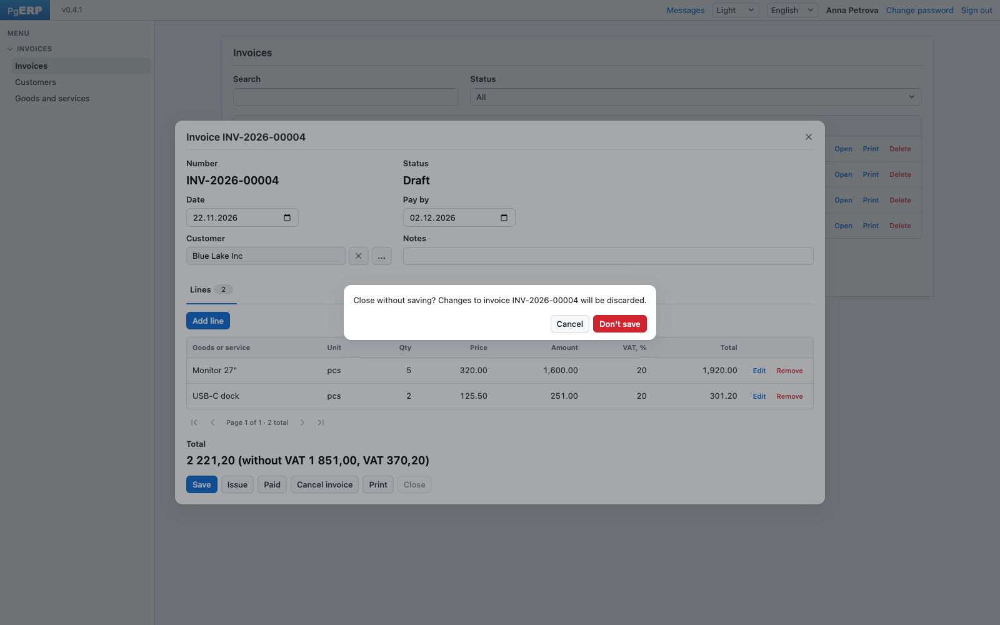

> Why a snapshot rather than a transaction: every click is a separate database request, a transaction does not live
> between them. A snapshot left by a tab closed together with the browser is overwritten by the next opening of the
> invoice. New invoices abandoned the same way are not shown in the list; delete them with
> <nobr>`DELETE FROM inv_invoices WHERE id IN (SELECT invoice_id FROM inv_invoice_snapshots WHERE state IS NULL AND created_at < now() - interval '1 day')`</nobr>.

## 10. Printing an invoice

A PDF report is a jrxml template (JasperReports) and a **data function**: it returns JSON whose top-level keys are the
template parameters <nobr>`$P{...}`</nobr> and whose <nobr>`rows`</nobr> array holds the rows <nobr>`$F{...}`</nobr>. The
<nobr>`ui_report(report, parameters, title)`</nobr> instruction from any action shows the report. The button code and the data
function — **SQL console**:

```sql
-- Printing an invoice: the button and the data function of report inv_invoice

CREATE OR REPLACE FUNCTION inv_invoice_print(p_data JSON) RETURNS JSON AS $$
-- "Print": from the card the draft header is written first, from a list row only the id comes
DECLARE
    v_id     BIGINT := ui_parse_id(p_data->>'id');
    v_number TEXT;
BEGIN
    IF p_data->>'invoice_date' IS NOT NULL
       AND (v_id IS NULL OR (SELECT status FROM inv_invoices WHERE id = v_id) = 'draft') THEN
        v_id := inv_invoice_upsert(p_data);
    END IF;
    SELECT number INTO v_number FROM inv_invoices WHERE id = v_id;
    PERFORM ui_require(FOUND, 'Invoice not found — it may have been deleted');
    PERFORM ui_require(EXISTS (SELECT 1 FROM inv_invoice_lines WHERE invoice_id = v_id),
                       'Add at least one line before printing the invoice');
    RETURN ui_ok(ui_report('inv_invoice', jsonb_build_object('invoice_id', v_id), format(ui_t('Invoice %s'), v_number)));
END;
$$ LANGUAGE plpgsql;

CREATE OR REPLACE FUNCTION inv_invoice_print_data(p_data JSON) RETURNS JSON AS $$
-- Data of report inv_invoice: top-level keys are parameters $P{...}, rows are the rows $F{...}
DECLARE
    v_invoice  inv_invoices_v%ROWTYPE;
    v_customer inv_customers%ROWTYPE;
BEGIN
    SELECT * INTO v_invoice FROM inv_invoices_v WHERE id = ui_parse_id(p_data->>'invoice_id');
    PERFORM ui_require(FOUND, 'Invoice not found — it may have been deleted');
    SELECT * INTO v_customer FROM inv_customers WHERE id = v_invoice.customer_id;
    RETURN json_build_object(
        'title', format(ui_t('Invoice %s'), v_invoice.number),
        'invoice_date', v_invoice.invoice_date,
        'due_date', v_invoice.due_date,
        'status', v_invoice.status_badge->>'label',
        'customer', v_customer.name,
        'customer_details', concat_ws(' · ', CASE WHEN v_customer.tax_id IS NOT NULL THEN format(ui_t('Tax ID %s'), v_customer.tax_id) END,
                                      v_customer.address, v_customer.email),
        'notes', v_invoice.notes,
        'amount', v_invoice.amount, 'vat', v_invoice.vat, 'total', v_invoice.total,
        'rows', COALESCE((
            SELECT json_agg(json_build_object(
                       'line_no', n, 'item', item, 'unit', unit, 'quantity', quantity, 'price', price,
                       'amount', amount, 'vat_rate', vat_rate, 'total', total) ORDER BY n)
            FROM (SELECT row_number() OVER (ORDER BY id) AS n, * FROM inv_invoice_lines_v
                  WHERE invoice_id = v_invoice.id) l), '[]'));
END;
$$ LANGUAGE plpgsql STABLE;

INSERT INTO pgerp.ui_actions (action_name, function_name, description) VALUES
    ('inv_invoice_print',      'inv_invoice_print',      'Invoices: print invoice (PDF)'),
    ('inv_invoice_print_data', 'inv_invoice_print_data', 'Invoices: invoice report data')
ON CONFLICT (action_name) DO NOTHING;
```

<nobr>`inv_invoice_print`</nobr> works both from the card (it writes the draft header first) and from a list row (only the
<nobr>`id`</nobr> comes). The data function need not be granted in a role: the report opens from an action the user already
has the right to.

**Reports → "+ New report"**: name <nobr>`inv_invoice`</nobr>, title "Invoice", data — <nobr>`inv_invoice_print_data`</nobr>,
preview parameters <nobr>`{"invoice_id": 1}`</nobr>, the template — below. "Preview" builds the PDF right in the editor,
"Save" compiles the template and stores the report.

<details>
<summary>Template of report <code>inv_invoice</code> (jrxml)</summary>

```xml
<jasperReport name="inv_invoice" pageWidth="595" pageHeight="842" columnWidth="515" leftMargin="40" rightMargin="40" topMargin="40" bottomMargin="30">
	<!-- Invoice: parameters come from inv_invoice_print_data, rows are the invoice lines -->
	<parameter name="title" class="java.lang.String"/>
	<parameter name="invoice_date" class="java.util.Date"/>
	<parameter name="due_date" class="java.util.Date"/>
	<parameter name="status" class="java.lang.String"/>
	<parameter name="customer" class="java.lang.String"/>
	<parameter name="customer_details" class="java.lang.String"/>
	<parameter name="notes" class="java.lang.String"/>
	<parameter name="amount" class="java.math.BigDecimal"/>
	<parameter name="vat" class="java.math.BigDecimal"/>
	<parameter name="total" class="java.math.BigDecimal"/>
	<field name="line_no" class="java.lang.Integer"/>
	<field name="item" class="java.lang.String"/>
	<field name="unit" class="java.lang.String"/>
	<field name="quantity" class="java.math.BigDecimal"/>
	<field name="price" class="java.math.BigDecimal"/>
	<field name="amount" class="java.math.BigDecimal"/>
	<field name="vat_rate" class="java.math.BigDecimal"/>
	<field name="total" class="java.math.BigDecimal"/>
	<title height="120">
		<element kind="rectangle" x="0" y="0" width="515" height="4" mode="Opaque" backcolor="#0969DA">
			<pen lineWidth="0.0"/>
		</element>
		<element kind="textField" x="0" y="14" width="380" height="30" fontSize="20.0" bold="true">
			<expression><![CDATA[$P{title}]]></expression>
		</element>
		<element kind="textField" x="380" y="20" width="135" height="20" hTextAlign="Right" forecolor="#59636E">
			<expression><![CDATA[$P{status}]]></expression>
		</element>
		<element kind="textField" x="0" y="44" width="515" height="18" forecolor="#59636E">
			<expression><![CDATA[$R{dated} + " " + new java.text.SimpleDateFormat("dd.MM.yyyy").format($P{invoice_date})
				+ ($P{due_date} == null ? "" : " · " + $R{Pay by} + " " + new java.text.SimpleDateFormat("dd.MM.yyyy").format($P{due_date}))]]></expression>
		</element>
		<element kind="textField" x="0" y="72" width="90" height="18" forecolor="#59636E">
			<expression><![CDATA[$R{Customer}]]></expression>
		</element>
		<element kind="textField" x="90" y="72" width="425" height="18" bold="true">
			<expression><![CDATA[$P{customer}]]></expression>
		</element>
		<element kind="textField" x="90" y="90" width="425" height="16" fontSize="8.0" forecolor="#59636E" textAdjust="StretchHeight">
			<expression><![CDATA[$P{customer_details}]]></expression>
		</element>
	</title>
	<columnHeader height="24">
		<element kind="frame" x="0" y="0" width="515" height="22" mode="Opaque" backcolor="#F6F8FA">
			<element kind="textField" x="4" y="0" width="24" height="22" vTextAlign="Middle" bold="true" fontSize="9.0">
				<expression><![CDATA["№"]]></expression>
			</element>
			<element kind="textField" x="28" y="0" width="165" height="22" vTextAlign="Middle" bold="true" fontSize="9.0">
				<expression><![CDATA[$R{Goods or service}]]></expression>
			</element>
			<element kind="textField" x="193" y="0" width="65" height="22" hTextAlign="Right" vTextAlign="Middle" bold="true" fontSize="9.0">
				<expression><![CDATA[$R{Qty}]]></expression>
			</element>
			<element kind="textField" x="258" y="0" width="70" height="22" hTextAlign="Right" vTextAlign="Middle" bold="true" fontSize="9.0">
				<expression><![CDATA[$R{Price}]]></expression>
			</element>
			<element kind="textField" x="328" y="0" width="75" height="22" hTextAlign="Right" vTextAlign="Middle" bold="true" fontSize="9.0">
				<expression><![CDATA[$R{Amount}]]></expression>
			</element>
			<element kind="textField" x="403" y="0" width="45" height="22" hTextAlign="Right" vTextAlign="Middle" bold="true" fontSize="9.0">
				<expression><![CDATA[$R{VAT, %}]]></expression>
			</element>
			<element kind="textField" x="448" y="0" width="63" height="22" hTextAlign="Right" vTextAlign="Middle" bold="true" fontSize="9.0">
				<expression><![CDATA[$R{Total}]]></expression>
			</element>
		</element>
	</columnHeader>
	<detail>
		<band height="22">
			<element kind="textField" x="4" y="2" width="24" height="18" fontSize="9.0">
				<expression><![CDATA[$F{line_no}]]></expression>
			</element>
			<element kind="textField" x="28" y="2" width="165" height="18" fontSize="9.0" textAdjust="StretchHeight">
				<expression><![CDATA[$F{item}]]></expression>
			</element>
			<element kind="textField" x="193" y="2" width="65" height="18" hTextAlign="Right" fontSize="9.0">
				<expression><![CDATA[new java.text.DecimalFormat("#,##0.###", java.text.DecimalFormatSymbols.getInstance($P{REPORT_LOCALE})).format($F{quantity}) + " " + $F{unit}]]></expression>
			</element>
			<element kind="textField" x="258" y="2" width="70" height="18" hTextAlign="Right" fontSize="9.0" pattern="#,##0.00">
				<expression><![CDATA[$F{price}]]></expression>
			</element>
			<element kind="textField" x="328" y="2" width="75" height="18" hTextAlign="Right" fontSize="9.0" pattern="#,##0.00">
				<expression><![CDATA[$F{amount}]]></expression>
			</element>
			<element kind="textField" x="403" y="2" width="45" height="18" hTextAlign="Right" fontSize="9.0">
				<expression><![CDATA[new java.text.DecimalFormat("#,##0.##", java.text.DecimalFormatSymbols.getInstance($P{REPORT_LOCALE})).format($F{vat_rate})]]></expression>
			</element>
			<element kind="textField" x="448" y="2" width="63" height="18" hTextAlign="Right" fontSize="9.0" pattern="#,##0.00">
				<expression><![CDATA[$F{total}]]></expression>
			</element>
			<element kind="line" x="0" y="21" width="515" height="1" forecolor="#EFF2F5"/>
		</band>
	</detail>
	<pageFooter height="20">
		<element kind="textField" x="0" y="0" width="315" height="20" forecolor="#59636E" fontSize="8.0">
			<expression><![CDATA[$P{title} + " · " + $P{customer}]]></expression>
		</element>
		<element kind="textField" x="315" y="0" width="200" height="20" hTextAlign="Right" forecolor="#59636E" fontSize="8.0">
			<expression><![CDATA[$R{Page} + " " + $V{PAGE_NUMBER}]]></expression>
		</element>
	</pageFooter>
	<summary height="110">
		<element kind="textField" x="195" y="10" width="195" height="18" hTextAlign="Right">
			<expression><![CDATA[$R{Amount without VAT}]]></expression>
		</element>
		<element kind="textField" x="395" y="10" width="116" height="18" hTextAlign="Right" pattern="#,##0.00">
			<expression><![CDATA[$P{amount}]]></expression>
		</element>
		<element kind="textField" x="195" y="28" width="195" height="18" hTextAlign="Right">
			<expression><![CDATA[$R{VAT}]]></expression>
		</element>
		<element kind="textField" x="395" y="28" width="116" height="18" hTextAlign="Right" pattern="#,##0.00">
			<expression><![CDATA[$P{vat}]]></expression>
		</element>
		<element kind="textField" x="195" y="48" width="195" height="22" hTextAlign="Right" bold="true" fontSize="12.0">
			<expression><![CDATA[$R{Total due}]]></expression>
		</element>
		<element kind="textField" x="395" y="48" width="116" height="22" hTextAlign="Right" bold="true" fontSize="12.0" pattern="#,##0.00">
			<expression><![CDATA[$P{total}]]></expression>
		</element>
		<element kind="textField" x="0" y="80" width="515" height="26" fontSize="9.0" forecolor="#59636E" textAdjust="StretchHeight">
			<expression><![CDATA[$P{notes} == null ? "" : $R{Notes} + ": " + $P{notes}]]></expression>
		</element>
	</summary>
</jasperReport>
```

</details>

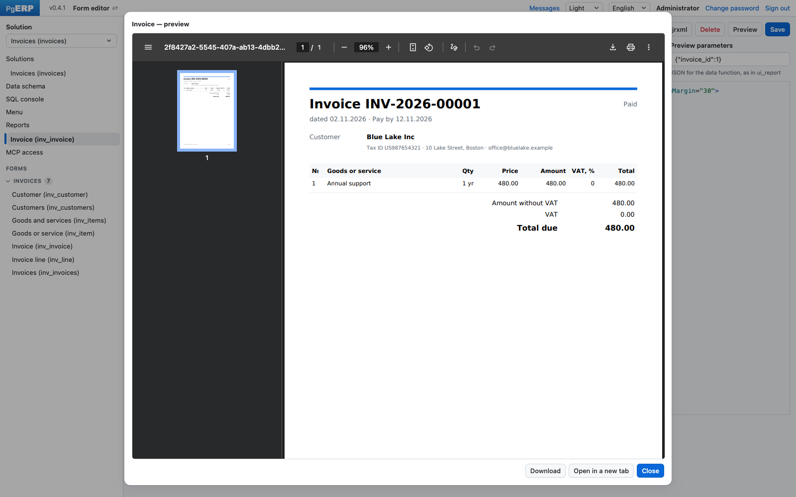

<nobr>`$R{text}`</nobr> in the template is the text translated into the user's language: such texts appear in the
"Translations" form (step 15). Numbers with a <nobr>`pattern`</nobr> are formatted for the user's language.

What is left is the button: in the <nobr>`inv_invoice`</nobr> card add a <nobr>`btn_print`</nobr> "Print" button before "Close" with
the <nobr>`inv_invoice_print`</nobr> action. The "Print" button in list rows comes in step 12.

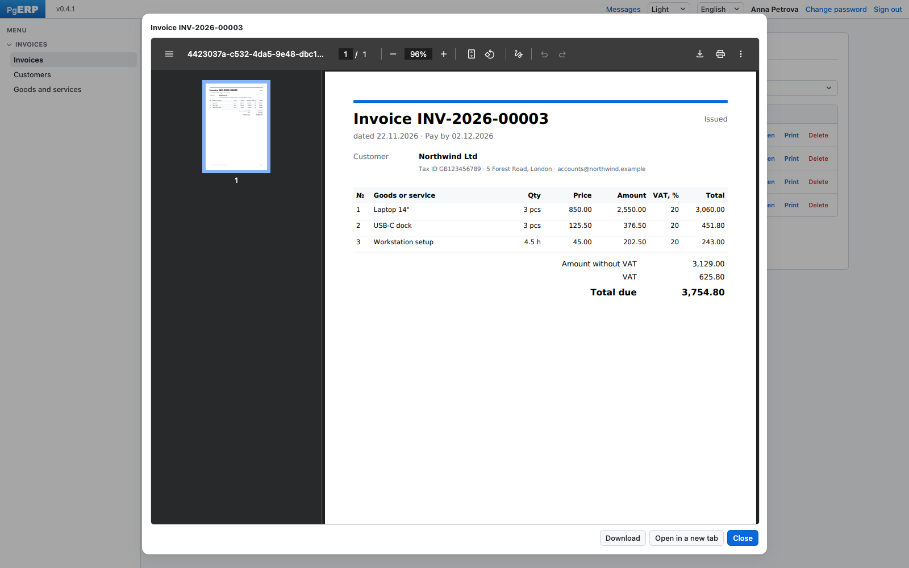

## 11. Table columns

Select a table in the form and click **"Columns…"**. Columns belong to the source and are the same in every form using it.

<nobr>`inv_lines_page`</nobr> — invoice lines:

| Field | Title | Format | Sorting |
|---|---|---|---|
| <nobr>`item`</nobr> | Goods or service | Text |  |
| <nobr>`unit`</nobr> | Unit | Text |  |
| <nobr>`quantity`</nobr> | Qty | Number |  |
| <nobr>`price`</nobr> | Price | Money |  |
| <nobr>`amount`</nobr> | Amount | Money |  |
| <nobr>`vat_rate`</nobr> | VAT, % | Number |  |
| <nobr>`total`</nobr> | Total | Money |  |

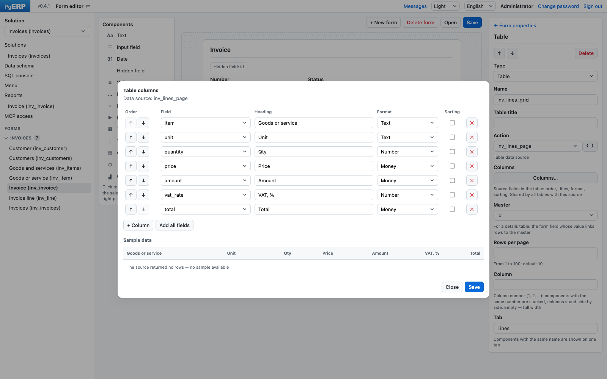

<nobr>`inv_invoices_page`</nobr> — invoice list:

| Field | Title | Format | Sorting |
|---|---|---|---|
| <nobr>`number`</nobr> | Number | Text | <nobr>`number`</nobr> |
| <nobr>`date_text`</nobr> | Date | Text | <nobr>`invoice_date`</nobr> |
| <nobr>`customer`</nobr> | Customer | Text | <nobr>`customer`</nobr> |
| <nobr>`total`</nobr> | Total | Money | <nobr>`total`</nobr> |
| <nobr>`due_text`</nobr> | Pay by | Text | <nobr>`due_date`</nobr> |
| <nobr>`status_badge`</nobr> | Status | Badge | <nobr>`status`</nobr> |

<nobr>`inv_items_page`</nobr> — goods and services:

| Field | Title | Format | Sorting |
|---|---|---|---|
| <nobr>`name`</nobr> | Name | Text | <nobr>`name`</nobr> |
| <nobr>`kind_badge`</nobr> | Kind | Badge | <nobr>`kind`</nobr> |
| <nobr>`unit`</nobr> | Unit | Text |  |
| <nobr>`price`</nobr> | Price | Money | <nobr>`price`</nobr> |
| <nobr>`vat_rate`</nobr> | VAT, % | Number |  |

<nobr>`inv_customers_page`</nobr> — customers:

| Field | Title | Format | Sorting |
|---|---|---|---|
| <nobr>`name`</nobr> | Name | Text | <nobr>`name`</nobr> |
| <nobr>`tax_id`</nobr> | Tax ID | Text |  |
| <nobr>`email`</nobr> | E-mail | Text |  |

## 12. Row buttons

Row buttons are set for a table source in <nobr>`pgerp.grid_row_actions`</nobr> — **SQL console → "Run"**:

```sql
-- Row buttons: the action receives {"id": row id}
INSERT INTO pgerp.grid_row_actions (source_action, sort_order, row_action, label, style) VALUES
    ('inv_items_page',     1, 'inv_item_edit_open',     'Edit',   'default'),
    ('inv_items_page',     2, 'inv_item_delete',        'Delete', 'danger'),
    ('inv_customers_page', 1, 'inv_customer_edit_open', 'Edit',   'default'),
    ('inv_invoices_page',  1, 'inv_invoice_edit_open',  'Open',   'default'),
    ('inv_invoices_page',  2, 'inv_invoice_print',      'Print',  'default'),
    ('inv_invoices_page',  3, 'inv_invoice_delete',     'Delete', 'danger'),
    ('inv_lines_page',     1, 'inv_line_edit_open',     'Edit',   'default'),
    ('inv_lines_page',     2, 'inv_line_delete',        'Remove', 'danger');
```

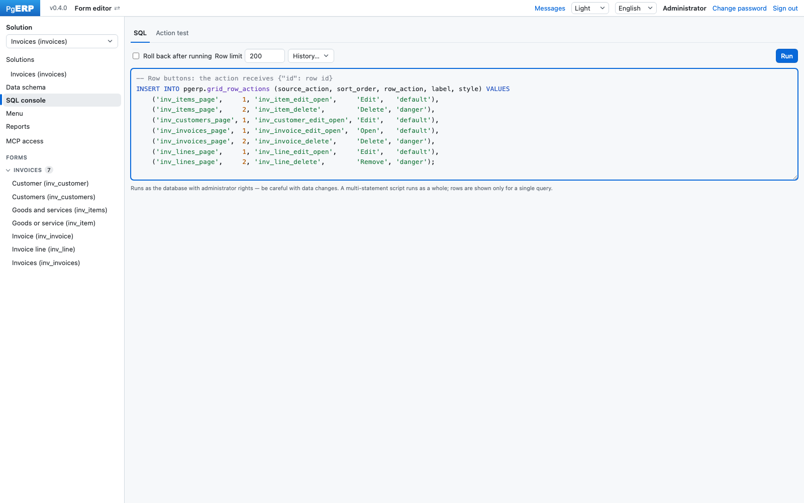

## 13. Menu

**Menu → "+ Item"** "Invoices" (a folder) and three **"+ Subitem"**: "Invoices" — form <nobr>`inv_invoices`</nobr>, "Customers" —
<nobr>`inv_customers`</nobr>, "Goods and services" — <nobr>`inv_items`</nobr>. "Save".

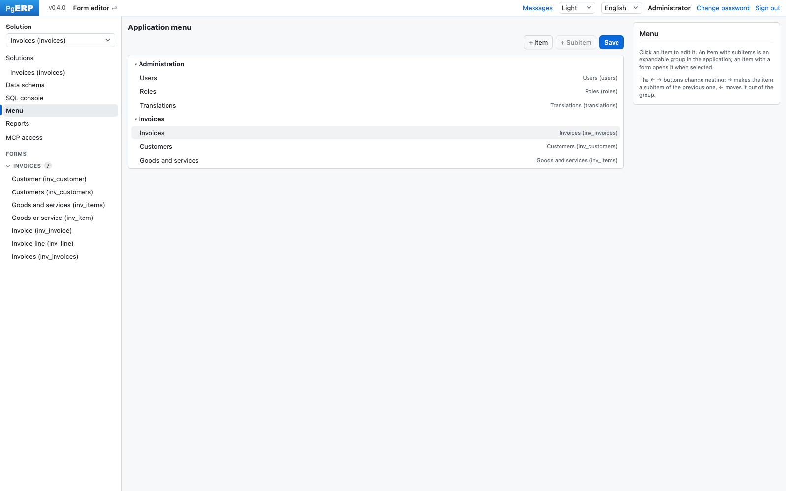

## 14. Permissions

In the application: **Administration → Roles → "New role"**: code <nobr>`inv_accountant`</nobr>, title "Invoices: accountant";
add the forms <nobr>`inv_invoices`</nobr>, <nobr>`inv_customers`</nobr>, <nobr>`inv_items`</nobr>. Cards, the invoice line and selection windows need not
be granted: they open from granted forms and are available automatically. Assign the role to a user in
**Administration → Users**.

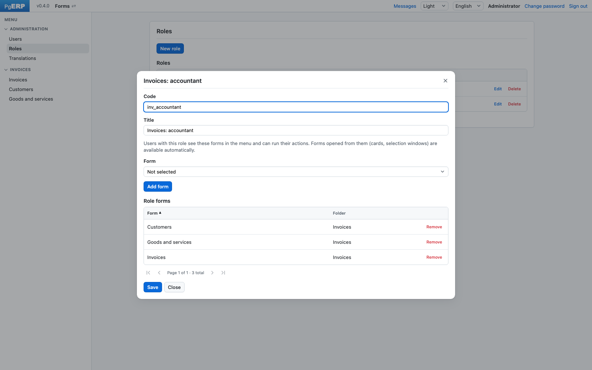

## 15. Translations

Translations of the source texts make the interface Russian for users who choose Russian. The key is the source text;
templates with <nobr>`%s`</nobr> are translated as templates. Enter them one by one in **Administration → Translations**, or with one
console script:

```sql
-- Russian translations of the Invoices solution texts. The key is the source (English) text.
INSERT INTO pgerp.translations (lang, source, translation) VALUES
    ('ru', 'Invoices',                 'Счета'),
    ('ru', 'Invoice',                  'Счёт'),
    ('ru', 'Invoice %s',               'Счёт %s'),
    ('ru', 'New invoice',              'Новый счёт'),
    ('ru', 'Invoice line',             'Строка счёта'),
    ('ru', 'Lines',                    'Строки'),
    ('ru', 'Add line',                 'Добавить строку'),
    ('ru', 'Customers',                'Покупатели'),
    ('ru', 'Customer',                 'Покупатель'),
    ('ru', 'New customer',             'Новый покупатель'),
    ('ru', 'Choose a customer',        'Выберите покупателя'),
    ('ru', 'Goods and services',       'Товары и услуги'),
    ('ru', 'Goods or service',         'Товар или услуга'),
    ('ru', 'New goods or service',     'Новый товар или услуга'),
    ('ru', 'Choose goods or service',  'Выберите товар или услугу'),
    ('ru', 'Choose goods or a service', 'Выберите товар или услугу'),
    ('ru', 'Goods',                    'Товар'),
    ('ru', 'Service',                  'Услуга'),
    ('ru', 'Kind',                     'Вид'),
    ('ru', 'Name',                     'Название'),
    ('ru', 'Unit',                     'Ед. изм.'),
    ('ru', 'Price',                    'Цена'),
    ('ru', 'Price without VAT',        'Цена без НДС'),
    ('ru', 'VAT',                      'НДС'),
    ('ru', 'VAT, %',                   'НДС, %'),
    ('ru', 'Qty',                      'Кол-во'),
    ('ru', 'Quantity',                 'Количество'),
    ('ru', 'Amount',                   'Сумма'),
    ('ru', 'Amount without VAT',       'Сумма без НДС'),
    ('ru', 'Total',                    'Итого'),
    ('ru', 'Tax ID',                   'ИНН'),
    ('ru', 'E-mail',                   'Эл. почта'),
    ('ru', 'Address',                  'Адрес'),
    ('ru', 'Number',                   'Номер'),
    ('ru', 'Date',                     'Дата'),
    ('ru', 'Pay by',                   'Оплатить до'),
    ('ru', 'Notes',                    'Примечание'),
    ('ru', 'Search',                   'Поиск'),
    ('ru', 'All',                      'Все'),
    ('ru', 'Add',                      'Добавить'),
    ('ru', 'Open',                     'Открыть'),
    ('ru', 'Issue',                    'Выставить'),
    ('ru', 'Paid',                     'Оплачен'),
    ('ru', 'Cancel invoice',           'Аннулировать'),
    ('ru', 'Draft',                    'Черновик'),
    ('ru', 'Issued',                   'Выставлен'),
    ('ru', 'Overdue',                  'Просрочен'),
    ('ru', 'Cancelled',                'Аннулирован'),
    ('ru', 'Invoices: accountant',     'Счета: бухгалтер'),
    ('ru', 'Invoice %s saved',         'Счёт %s сохранён'),
    ('ru', 'Invoice %s issued',        'Счёт %s выставлен'),
    ('ru', 'Delete invoice %s?',       'Удалить счёт %s?'),
    ('ru', 'Delete “%s”?',             'Удалить «%s»?'),
    ('ru', 'Remove “%s” from the invoice?', 'Убрать «%s» из счёта?'),
    ('ru', 'Cancel this invoice? It cannot be changed afterwards.', 'Аннулировать счёт? После этого его нельзя изменить.'),
    ('ru', 'Add at least one line before issuing the invoice', 'Добавьте в счёт хотя бы одну строку'),
    ('ru', 'Only a draft invoice can be changed', 'Изменить можно только черновик счёта'),
    ('ru', 'Only a draft can be deleted; cancel an issued invoice instead', 'Удалить можно только черновик; выставленный счёт аннулируйте'),
    ('ru', 'Only a draft or an issued invoice can be cancelled', 'Аннулировать можно только черновик или выставленный счёт'),
    ('ru', 'Only an issued invoice can be marked as paid', 'Оплаченным можно отметить только выставленный счёт'),
    ('ru', 'The invoice is not saved yet — just close it', 'Счёт ещё не сохранён — просто закройте его'),
    ('ru', 'The payment date cannot be earlier than the invoice date', 'Срок оплаты не может быть раньше даты счёта'),
    ('ru', 'Enter the invoice date',   'Укажите дату счёта'),
    ('ru', 'Enter the customer name',  'Укажите название покупателя'),
    ('ru', 'Enter the name',           'Укажите название'),
    ('ru', 'There is already a customer with this name', 'Покупатель с таким названием уже есть'),
    ('ru', 'There is already an item with this name',    'Товар или услуга с таким названием уже есть'),
    ('ru', 'It is used in invoices and cannot be deleted', 'Используется в счетах — удалить нельзя'),
    ('ru', 'Price must be a number, e.g. 1500 or 99.90', 'Цена — число, например 1500 или 99,90'),
    ('ru', 'VAT must be from 0 to 100 %', 'НДС — от 0 до 100 %'),
    ('ru', 'Quantity must be a number greater than zero', 'Количество — число больше нуля'),
    ('ru', 'Invoice not found — it may have been deleted',  'Счёт не найден — возможно, его удалили'),
    ('ru', 'Customer not found — it may have been deleted', 'Покупатель не найден — возможно, его удалили'),
    ('ru', 'Line not found — it may have been deleted',     'Строка не найдена — возможно, её удалили'),
    ('ru', 'Not found — it may have been deleted',          'Не найдено — возможно, удалено'),
    -- Черновик: закрытие без сохранения
    ('ru', 'Don''t save',              'Не сохранять'),
    ('ru', 'Close without saving? The new invoice will not be created.', 'Закрыть без сохранения? Новый счёт не будет создан.'),
    ('ru', 'Close without saving? Invoice %s with its lines will be deleted.', 'Закрыть без сохранения? Счёт %s со строками будет удалён.'),
    ('ru', 'Close without saving? Changes to invoice %s will be discarded.', 'Закрыть без сохранения? Изменения счёта %s будут отменены.'),
    -- Печать
    ('ru', 'Print',                    'Печать'),
    ('ru', 'Add at least one line before printing the invoice', 'Добавьте в счёт хотя бы одну строку, чтобы его напечатать'),
    ('ru', 'Tax ID %s',                'ИНН %s'),
    ('ru', 'dated',                    'от'),
    ('ru', 'Total due',                'Итого к оплате'),
    ('ru', 'Page',                     'Стр.')
ON CONFLICT (lang, source) DO NOTHING;
-- …and the card total template
INSERT INTO pgerp.translations (lang, source, translation) VALUES
    ('ru', '%s (without VAT %s, VAT %s)', '%s (без НДС %s, НДС %s)')
ON CONFLICT (lang, source) DO NOTHING;
```

To check nothing is missed: the "Translations" form, "Untranslated" tab — or the MCP tool <nobr>`translation_list`</nobr> with
<nobr>`missing: true`</nobr>. Action descriptions ("Invoices: add a line") are shown only in the editor, translating them is optional.
Translations of the solution's texts go into the release.

## 16. Working in the application

Sign in as a user with the <nobr>`inv_accountant`</nobr> role. Add customers, goods and services — then **Invoices →
"New invoice"**. The "Overdue" status comes from the view: an issued invoice past its payment date.

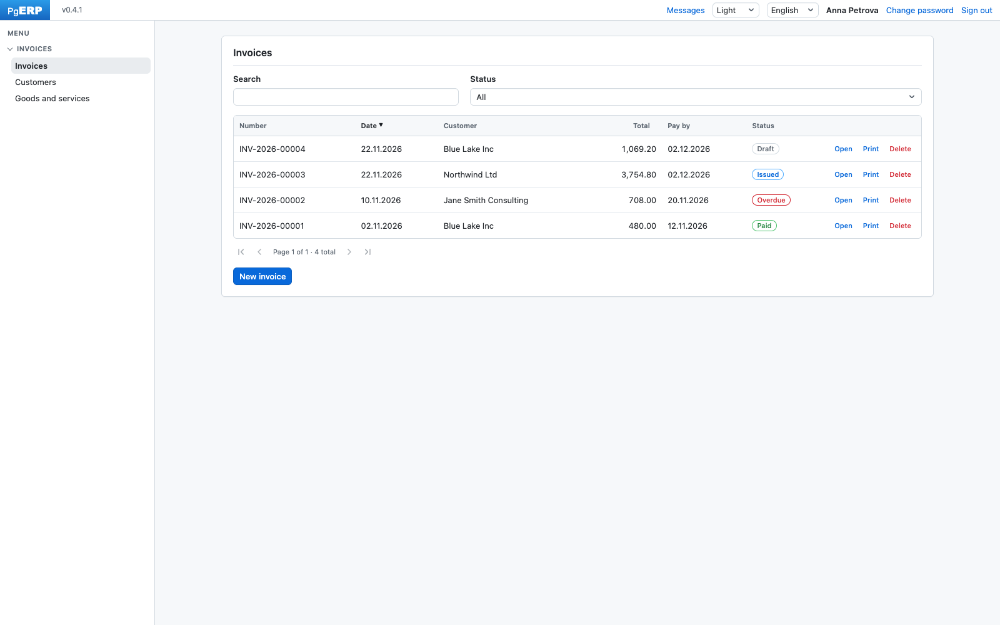

In the card "Add line" opens the line on top of the card, "Edit" in a table row opens the same form with its values:

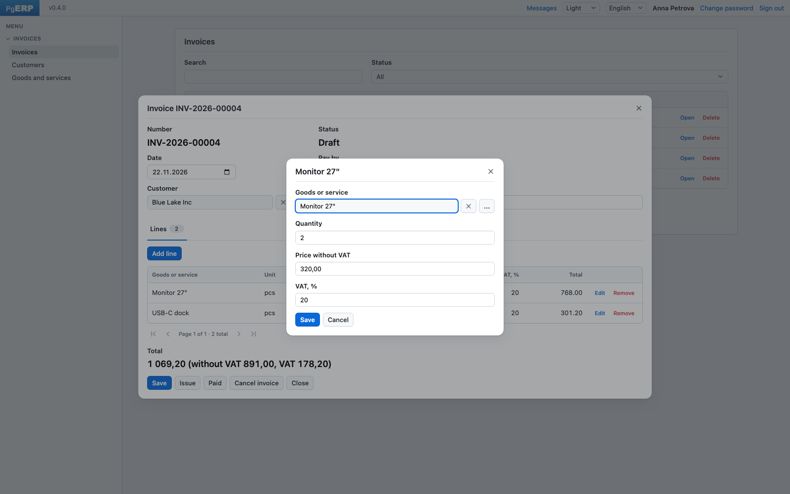

The "…" button of the "Goods or service" field opens the goods list in selection mode; "Select" returns the item to
the field and sets its price and VAT rate:

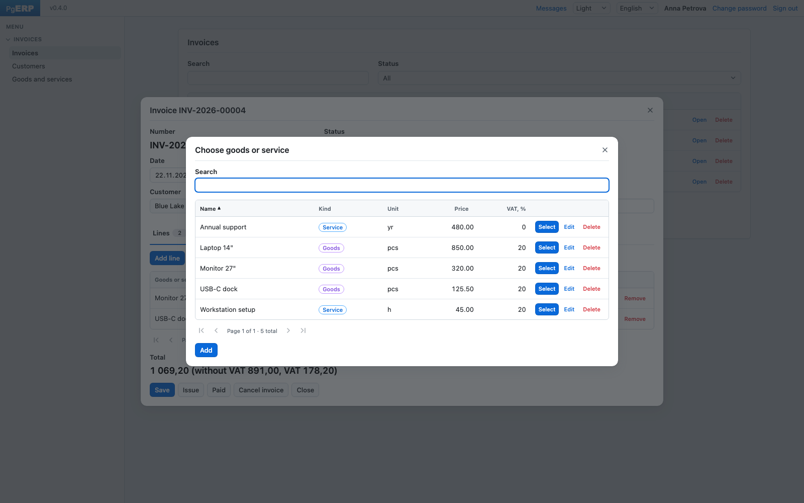

After "Save" in the line, the lines table and the card total update at once, without reloading. The checks work for a
new invoice too — a line cannot be added without a customer:

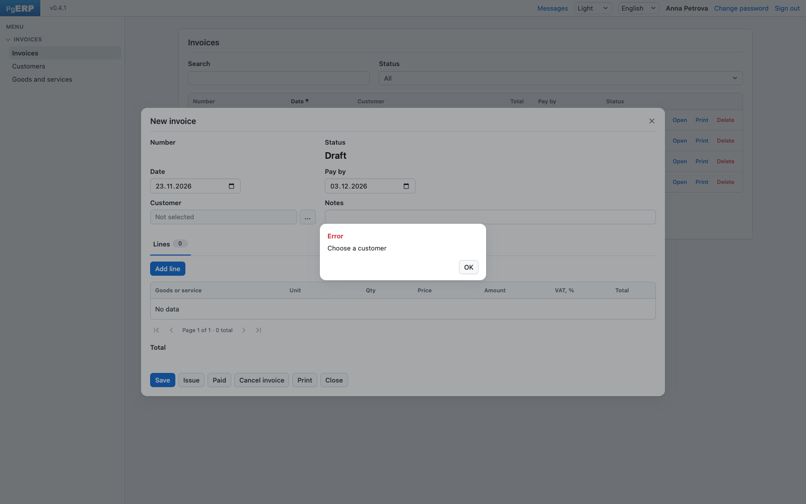

"Issue" saves the header, checks that there are lines, changes the status and writes a line to the message panel
(<nobr>`ui_print`</nobr>). After that the invoice and its lines do not change — the functions answer "Only a draft invoice can be
changed"; next come "Paid" or "Cancel invoice".

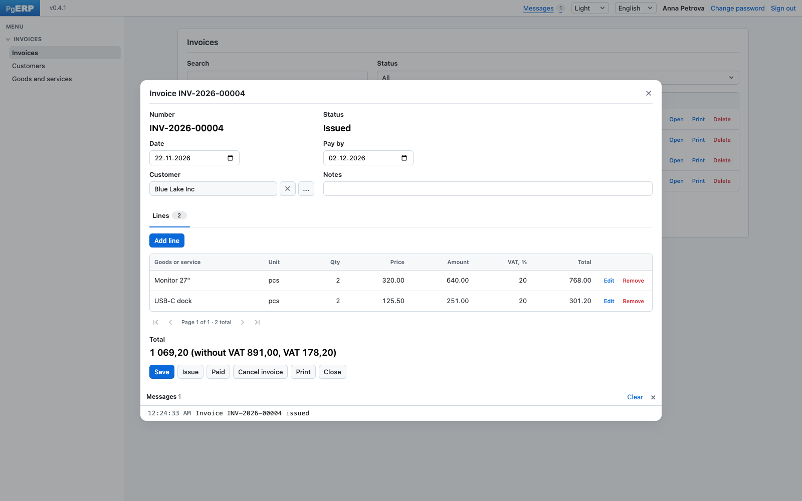

## 17. Testing without the interface

**SQL console → "Action test"** calls an action with field values on behalf of the chosen user, rolled back by default.
For example, <nobr>`inv_line_save`</nobr> on behalf of the accountant with <nobr>`{"invoice_id": "1", "item_id": "1", "quantity": "0",
"price": "1", "vat_rate": "20"}`</nobr> returns the error "Quantity must be a number greater than zero", and for an issued
invoice — "Only a draft invoice can be changed".

## 18. Release

**Solutions → Invoices**: a release name, "Check changes" — the list of everything the first release carries: tables,
functions, views, forms, columns and row buttons, the report, the role, the menu, translations.

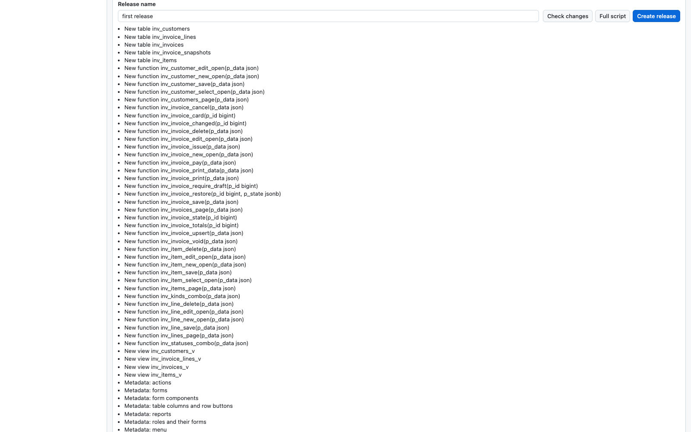

"Create release" — the file <nobr>`db/solutions/invoices/V1__invoices_<name>.sql`</nobr> (details — in the
[to-do list](tutorial-todo.md#12-release-moving-to-another-installation)). On another installation the solution is
installed via "Solutions → Install solutions" into any schema and works without CRM and the examples.

## The same with an AI agent (MCP)

Connect the agent (step 0) and ask, for example:

> Create a PgERP solution invoices "Invoices" (prefix inv_, menu folder Invoices): a catalogue of goods and services
> (kind, unit, price, VAT rate) and customers; an invoice with a number, date, payment date, customer and status
> (draft, issued, paid, cancelled); invoice lines with an item, quantity, price and VAT. The invoice card is a master
> with a lines table (the master property) and a total; a line is a separate form with an item lookup that fills the
> price and VAT. Only a draft can be changed. Role inv_accountant, a menu, Russian translations. Test the actions with
> action_run on behalf of a user with the role and show release_preview.

The guide's steps and the tools the agent uses for them:

| Step | MCP tool |
|---|---|
| 1. Solution | <nobr>`solution_save`</nobr> |
| 2. Tables | <nobr>`table_save`</nobr>: first <nobr>`apply: false`</nobr> — show the SQL, then <nobr>`apply: true`</nobr> |
| 3. Views | <nobr>`view_save`</nobr> |
| 4, 6, 7, 9, 10. Code | <nobr>`sql_run`</nobr> — the same scripts, or <nobr>`function_save`</nobr> — one action at a time |
| 5–8. Forms | <nobr>`form_save`</nobr> — the whole form; the details table property — <nobr>`"master": "id"`</nobr> |
| 9. Draft | <nobr>`sql_run`</nobr> — the closing action and <nobr>`cancel_action`</nobr>; <nobr>`form_save`</nobr> — the "Close" button |
| 10. Printing | <nobr>`sql_run`</nobr> or <nobr>`function_save`</nobr>; <nobr>`report_save`</nobr> — the template and the data function; <nobr>`form_save`</nobr> — the "Print" button |
| 11. Columns | <nobr>`grid_columns_save`</nobr> |
| 12. Row buttons | <nobr>`sql_run`</nobr> |
| 13. Menu | <nobr>`menu_get`</nobr>, then <nobr>`menu_save`</nobr> — the **whole** menu with the new folder |
| 14. Permissions | <nobr>`role_set`</nobr> |
| 15. Translations | <nobr>`translation_save`</nobr> or a script via <nobr>`sql_run`</nobr>; check — <nobr>`translation_list`</nobr> with <nobr>`missing: true`</nobr> |
| 16–17. Testing | <nobr>`action_run`</nobr> with <nobr>`user`</nobr> — on behalf of the accountant, rolled back |
| 18. Release | <nobr>`release_preview`</nobr>; <nobr>`release_create`</nobr> — when you ask for it |

The agent starts with <nobr>`platform_guide`</nobr> and goes through the same steps with the tools <nobr>`solution_save`</nobr>, <nobr>`table_save`</nobr>,
<nobr>`view_save`</nobr>, <nobr>`sql_run`</nobr>, <nobr>`function_save`</nobr>, <nobr>`form_save`</nobr>, <nobr>`grid_columns_save`</nobr>, <nobr>`menu_save`</nobr>,
<nobr>`role_set`</nobr>, <nobr>`translation_save`</nobr>, <nobr>`action_run`</nobr>, <nobr>`release_preview`</nobr>. The result opens in the same editor; the agent
creates a release (<nobr>`release_create`</nobr>) only when you ask for it.
