[English](tutorial-invoices.md) · **Русский**

# Пример: счета на товары и услуги (master-detail)

Пошаговое руководство: решение «Счета» — справочники товаров, услуг и покупателей, счёт со строками, итоги
с НДС, статусы, черновик (закрыть без сохранения), печать в PDF и права. Главная тема — **master-detail**: карточка документа (мастер) и таблица его строк
(детали), которые редактируются в отдельной форме и сразу пересчитывают итог карточки. Решение ни от чего не зависит:
CRM и примеры для него не нужны.

> Готовый результат есть в комплекте приложения — пакет **«Счета на оплату»** (<nobr>`billing`</nobr>, префикс
> <nobr>`bill_`</nobr>, роль <nobr>`bill_accountant`</nobr>): «Решения → Установить решения». Имена в нём другие, чтобы пакет и решение,
> собранное по этому руководству (<nobr>`invoices`</nobr>, <nobr>`inv_`</nobr>), не мешали друг другу и их можно было сравнить.

Основы — таблица, карточка, список, кнопки строк, меню, роль, выпуск — подробно разобраны
в [списке дел](tutorial-todo.ru.md); здесь они даны короче, а подробнее — то, что нужно для документа со строками.

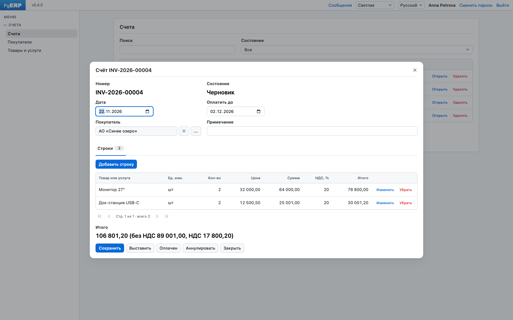

| Шаг | Где | Что создаём |
|---|---|---|
| 0 | Доступ MCP | подключение ИИ-агента — если решение строит он |
| 1 | Решения | решение <nobr>`invoices`</nobr> с префиксом <nobr>`inv_`</nobr> |
| 2–3 | Схема данных | пять таблиц и четыре представления |
| 4 | SQL-консоль | вспомогательные функции и действия справочников |
| 5 | Редактор форм | товары, услуги и покупатели: списки и карточки |
| 6 | Консоль, редактор форм | список счетов |
| 7–8 | Консоль, редактор форм | карточка счёта (мастер) и строка счёта (детали) |
| 9–10 | Консоль, редактор форм, отчёты | черновик (закрыть без сохранения) и печать счёта в PDF |
| 11–12 | Редактор форм, консоль | колонки таблиц и кнопки в строках |
| 13–15 | Меню, роли, переводы | пункты меню, роль <nobr>`inv_accountant`</nobr>, русский интерфейс |
| 16–17 | Приложение | работа и проверка |
| 18 | Решения | выпуск — пакет решения |

## 0. Подключение MCP

Решение можно собрать руками по шагам 1–18 или поручить ИИ-агенту: MCP-сервер приложения даёт ему те же действия,
что и редактору, с правами владельца токена. Этот пример целиком собран и проверен агентом через MCP. Если
строите вручную, этот шаг пропустите.

1. Войдите администратором (первый вход — **admin / admin**, пароль попросят сменить: до смены пароля инструменты
   MCP не работают). В редакторе (`editor.html`) откройте **Доступ MCP**.
2. В «Выдать токен» укажите назначение, пользователя (для разработки — администратор: инструменты разработки
   доступны только ему) и срок, нажмите **«Выдать токен»**. Токен показывается **один раз** — скопируйте его или
   сразу готовую команду подключения. В базе хранится только его хеш; отозвать токен — «Отозвать» в списке.

   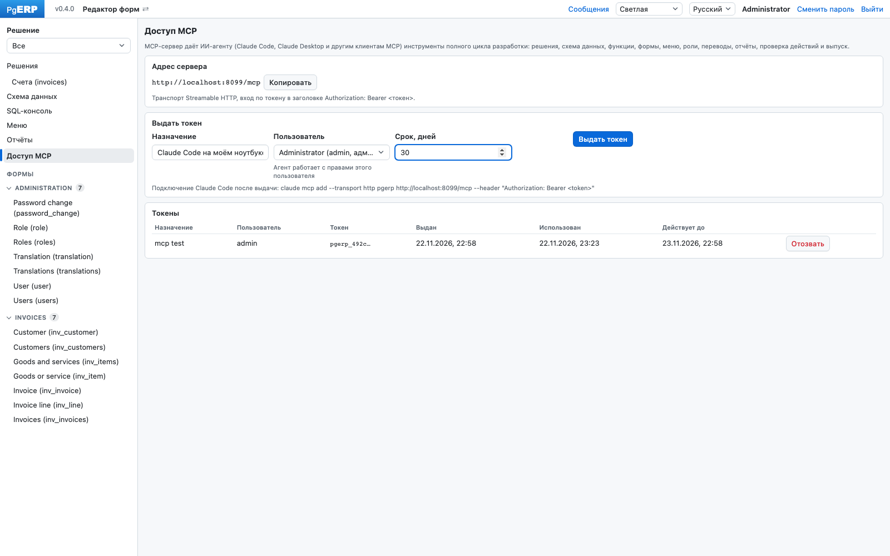

3. Подключите Claude Code. Адрес возьмите из «Адрес сервера» вашей установки:

   ```bash
   claude mcp add --transport http pgerp http://localhost:8099/mcp --header "Authorization: Bearer <токен>"
   ```

4. Проверьте: в Claude Code команда `/mcp` показывает сервер `pgerp` подключённым, а запрос «вызови platform_guide»
   возвращает справочник платформы. Другие клиенты MCP подключаются так же: транспорт Streamable HTTP, адрес
   <nobr>`…/mcp`</nobr>, заголовок <nobr>`Authorization: Bearer <токен>`</nobr>.

Что важно знать:

- агент работает **с правами пользователя токена**: обычному пользователю доступны только действия его ролей,
  разработка — только администратору;
- смена пароля пользователя отзывает все его токены — выдайте новый;
- запрос из браузера с чужим заголовком <nobr>`Origin`</nobr> отклоняется (<nobr>`ERP_MCP_ALLOWED_ORIGINS`</nobr> — исключения);
- чтобы выпуск сохранялся сразу в пакет проекта, запустите приложение с
  <nobr>`ERP_DEV_SOLUTIONS_DIR=…/src/main/resources/db/solutions`</nobr>.

Готовый запрос для агента — [в конце](#то-же--силами-ии-агента-mcp).

## Как устроен master-detail

```
 Карточка счёта inv_invoice (мастер)        Строка счёта inv_line (детали)
┌────────────────────────────────────┐     ┌────────────────────────────────┐
│ id (скрытое)                       │     │ invoice_id (скрытое)           │
│ Номер, дата, покупатель            │     │ Товар или услуга [...]         │
│                                    │     │ Количество, цена, НДС          │
│ [Добавить строку]                  │---->│                                │
│                                    │     │ [Сохранить]                    │
│ Таблица inv_lines_grid,            │<----│ ui_refresh_grid                │
│   Мастер = id -> master_id         │     │                                │
│ Итого: ...                         │<----│ ui_set_values(..., p_form =>   │
│                                    │     │   'inv_invoice')               │
└────────────────────────────────────┘     └────────────────────────────────┘
```

- **Таблица-детали.** У таблицы строк в карточке свойство **«Мастер»** = <nobr>`id`</nobr> — имя поля карточки. Загружая
  строки, таблица передаёт источнику <nobr>`master_id`</nobr> — значение этого поля, а
  <nobr>`ui_grid_page(..., 'invoice_id')`</nobr> оставляет только строки с <nobr>`invoice_id = master_id`</nobr>.
- **Новый документ.** У нового счёта ещё нет <nobr>`id`</nobr> — строкам не к чему привязаться. Кнопка «Добавить строку»
  сначала сохраняет шапку счёта (черновик получает номер), заполняет поля карточки (<nobr>`ui_set_values`</nobr>) и только
  потом открывает строку.
- **Ответ в другую форму.** Строка сохраняется в своём окне, а её действие отвечает инструкциями и для карточки под
  ним: перечитать таблицу строк (<nobr>`ui_refresh_grid`</nobr> находит таблицу по имени в любой открытой форме)
  и обновить поле итога (<nobr>`ui_set_values(..., p_form => 'inv_invoice')`</nobr>).
- **Правила документа — в базе.** Менять можно только черновик; выставить — только счёт со строками; удалить —
  только черновик. Проверки стоят в функциях, поэтому их не обойти ни из формы, ни через MCP.

> Тексты интерфейса (заголовки, подписи, сообщения) здесь английские — это исходный язык платформы. Русский интерфейс
> даёт шаг 15 «Переводы». Если писать сразу по-русски, шаг 15 не нужен, но английским пользователям тексты
> покажутся без перевода.

## 1. Решение

Войдите администратором и откройте редактор (`editor.html`). **Решения → «+ Новое решение»**:

| Поле | Значение |
|---|---|
| Имя | <nobr>`invoices`</nobr> |
| Название | Invoices |
| Префикс | <nobr>`inv_`</nobr> |
| Папка меню | Invoices |
| Описание | Invoices for goods and services: customers, catalogue, invoice with lines |

«Сохранить», затем в боковой панели выберите **Решение: Счета (invoices)** — новые формы получат префикс и папку.

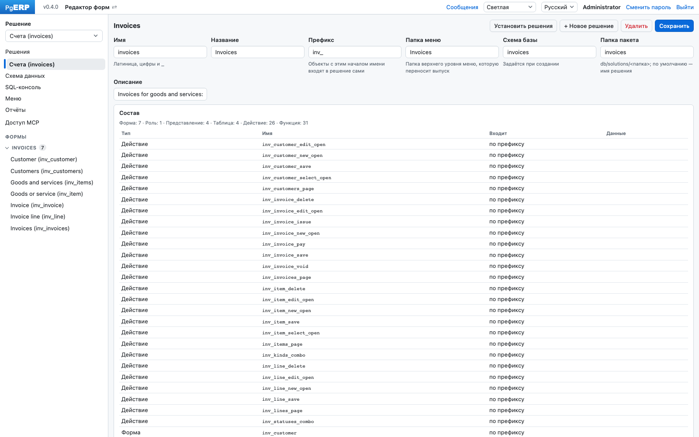

## 2. Таблицы

**Схема данных → «+ Таблица».** Колонка <nobr>`id bigserial`</nobr> с галочкой «Ключ» уже есть. Создавайте таблицы
в этом порядке: внешние ключи ссылаются на уже созданные.

**<nobr>`inv_customers`</nobr>** — покупатели, комментарий «Customers (payers)»:

| Имя | Тип | Обяз. | По умолчанию | Комментарий |
|---|---|---|---|---|
| <nobr>`name`</nobr> | <nobr>`varchar(200)`</nobr> | ✓ |  | Name |
| <nobr>`tax_id`</nobr> | <nobr>`varchar(20)`</nobr> |  |  | Tax ID |
| <nobr>`address`</nobr> | <nobr>`text`</nobr> |  |  | Address |
| <nobr>`email`</nobr> | <nobr>`varchar(200)`</nobr> |  |  | E-mail |

Ограничения:

- уникальность: <nobr>`name`</nobr>
- проверка: <nobr>`trim(name) <> ''`</nobr>

**<nobr>`inv_items`</nobr>** — товары и услуги, комментарий «Goods and services»:

| Имя | Тип | Обяз. | По умолчанию | Комментарий |
|---|---|---|---|---|
| <nobr>`name`</nobr> | <nobr>`varchar(200)`</nobr> | ✓ |  | Name |
| <nobr>`kind`</nobr> | <nobr>`varchar(10)`</nobr> | ✓ | <nobr>`'goods'`</nobr> | goods or service |
| <nobr>`unit`</nobr> | <nobr>`varchar(20)`</nobr> | ✓ | <nobr>`'pcs'`</nobr> | Unit of measure |
| <nobr>`price`</nobr> | <nobr>`numeric(14,2)`</nobr> | ✓ | <nobr>`0`</nobr> | Price without VAT |
| <nobr>`vat_rate`</nobr> | <nobr>`numeric(5,2)`</nobr> | ✓ | <nobr>`20`</nobr> | VAT, % |

Ограничения:

- уникальность: <nobr>`name`</nobr>
- проверка: <nobr>`kind IN ('goods', 'service')`</nobr>
- проверка: <nobr>`price >= 0`</nobr>
- проверка: <nobr>`vat_rate BETWEEN 0 AND 100`</nobr>

**<nobr>`inv_invoices`</nobr>** — счета (мастер), комментарий «Invoices (master)»:

| Имя | Тип | Обяз. | По умолчанию | Комментарий |
|---|---|---|---|---|
| <nobr>`number`</nobr> | <nobr>`varchar(30)`</nobr> | ✓ |  | Invoice number |
| <nobr>`invoice_date`</nobr> | <nobr>`date`</nobr> | ✓ | <nobr>`current_date`</nobr> | Invoice date |
| <nobr>`due_date`</nobr> | <nobr>`date`</nobr> |  |  | Pay by |
| <nobr>`customer_id`</nobr> | <nobr>`bigint`</nobr> | ✓ |  | Customer |
| <nobr>`status`</nobr> | <nobr>`varchar(10)`</nobr> | ✓ | <nobr>`'draft'`</nobr> | draft, issued, paid, cancelled |
| <nobr>`notes`</nobr> | <nobr>`text`</nobr> |  |  | Notes |
| <nobr>`created_by`</nobr> | <nobr>`varchar(50)`</nobr> | ✓ |  | Author login |
| <nobr>`created_at`</nobr> | <nobr>`timestamptz`</nobr> | ✓ | <nobr>`now()`</nobr> |  |

Ограничения:

- уникальность: <nobr>`number`</nobr>
- внешний ключ: <nobr>`customer_id → inv_customers(id) ON DELETE RESTRICT`</nobr>
- проверка: <nobr>`status IN ('draft', 'issued', 'paid', 'cancelled')`</nobr>
- проверка: <nobr>`due_date IS NULL OR due_date >= invoice_date`</nobr>
- индекс: <nobr>`customer_id`</nobr>
- индекс: <nobr>`invoice_date`</nobr>

**<nobr>`inv_invoice_lines`</nobr>** — строки счёта (детали), комментарий «Invoice lines (details)»:

| Имя | Тип | Обяз. | По умолчанию | Комментарий |
|---|---|---|---|---|
| <nobr>`invoice_id`</nobr> | <nobr>`bigint`</nobr> | ✓ |  | Invoice |
| <nobr>`item_id`</nobr> | <nobr>`bigint`</nobr> | ✓ |  | Goods or service |
| <nobr>`quantity`</nobr> | <nobr>`numeric(14,3)`</nobr> | ✓ | <nobr>`1`</nobr> | Quantity |
| <nobr>`price`</nobr> | <nobr>`numeric(14,2)`</nobr> | ✓ |  | Price without VAT |
| <nobr>`vat_rate`</nobr> | <nobr>`numeric(5,2)`</nobr> | ✓ |  | VAT, % |

Ограничения:

- внешний ключ: <nobr>`invoice_id → inv_invoices(id) ON DELETE CASCADE`</nobr>
- внешний ключ: <nobr>`item_id → inv_items(id) ON DELETE RESTRICT`</nobr>
- проверка: <nobr>`quantity > 0`</nobr>
- проверка: <nobr>`price >= 0`</nobr>
- проверка: <nobr>`vat_rate BETWEEN 0 AND 100`</nobr>
- индекс: <nobr>`invoice_id`</nobr>
- индекс: <nobr>`item_id`</nobr>

**<nobr>`inv_invoice_snapshots`</nobr>** — снимки открытых карточек для черновика (шаг 9), комментарий «Saved state of an invoice
open in its card; state NULL — created in the card». Ключ — сам <nobr>`invoice_id`</nobr>, колонку <nobr>`id`</nobr> удалите:

| Имя | Тип | Обяз. | По умолчанию | Комментарий |
|---|---|---|---|---|
| <nobr>`invoice_id`</nobr> | <nobr>`bigint`</nobr> | ✓ |  | Invoice |
| <nobr>`state`</nobr> | <nobr>`jsonb`</nobr> |  |  | Header and lines when the card was opened; NULL — a new invoice |
| <nobr>`created_at`</nobr> | <nobr>`timestamptz`</nobr> | ✓ | <nobr>`now()`</nobr> |  |

Ограничения:

- внешний ключ: <nobr>`invoice_id → inv_invoices(id) ON DELETE CASCADE`</nobr>

Внешний ключ строк на счёт — <nobr>`ON DELETE CASCADE`</nobr>: удалённый черновик уносит свои строки. Ключ на товар —
<nobr>`RESTRICT`</nobr>: товар из счёта не удалить. Цена и ставка НДС хранятся в строке, а не берутся из справочника —
поменяв цену товара, вы не измените уже выставленные счета.

Все пять таблиц на SQL — для сверки или для запуска в SQL-консоли (в этом порядке из-за внешних ключей):

```sql
CREATE TABLE inv_customers (
    id      bigserial PRIMARY KEY,
    name    varchar(200) NOT NULL UNIQUE CHECK (trim(name) <> ''),
    tax_id  varchar(20),
    address text,
    email   varchar(200)
);

CREATE TABLE inv_items (
    id       bigserial PRIMARY KEY,
    name     varchar(200)  NOT NULL UNIQUE,
    kind     varchar(10)   NOT NULL DEFAULT 'goods' CHECK (kind IN ('goods', 'service')),
    unit     varchar(20)   NOT NULL DEFAULT 'pcs',
    price    numeric(14,2) NOT NULL DEFAULT 0 CHECK (price >= 0),
    vat_rate numeric(5,2)  NOT NULL DEFAULT 20 CHECK (vat_rate BETWEEN 0 AND 100)
);

CREATE TABLE inv_invoices (
    id           bigserial PRIMARY KEY,
    number       varchar(30) NOT NULL UNIQUE,
    invoice_date date        NOT NULL DEFAULT current_date,
    due_date     date,
    customer_id  bigint      NOT NULL REFERENCES inv_customers (id) ON DELETE RESTRICT,
    status       varchar(10) NOT NULL DEFAULT 'draft'
                 CHECK (status IN ('draft', 'issued', 'paid', 'cancelled')),
    notes        text,
    created_by   varchar(50) NOT NULL,
    created_at   timestamptz NOT NULL DEFAULT now(),
    CHECK (due_date IS NULL OR due_date >= invoice_date)
);
CREATE INDEX inv_invoices_customer_id_idx ON inv_invoices (customer_id);
CREATE INDEX inv_invoices_invoice_date_idx ON inv_invoices (invoice_date);

CREATE TABLE inv_invoice_lines (
    id         bigserial PRIMARY KEY,
    invoice_id bigint        NOT NULL REFERENCES inv_invoices (id) ON DELETE CASCADE,
    item_id    bigint        NOT NULL REFERENCES inv_items (id) ON DELETE RESTRICT,
    quantity   numeric(14,3) NOT NULL DEFAULT 1 CHECK (quantity > 0),
    price      numeric(14,2) NOT NULL CHECK (price >= 0),
    vat_rate   numeric(5,2)  NOT NULL CHECK (vat_rate BETWEEN 0 AND 100)
);
CREATE INDEX inv_invoice_lines_invoice_id_idx ON inv_invoice_lines (invoice_id);
CREATE INDEX inv_invoice_lines_item_id_idx ON inv_invoice_lines (item_id);

CREATE TABLE inv_invoice_snapshots (
    invoice_id bigint      PRIMARY KEY REFERENCES inv_invoices (id) ON DELETE CASCADE,
    state      jsonb,
    created_at timestamptz NOT NULL DEFAULT now()
);

COMMENT ON TABLE inv_customers IS 'Customers (payers)';
COMMENT ON COLUMN inv_customers.name IS 'Name';
COMMENT ON COLUMN inv_customers.tax_id IS 'Tax ID';
COMMENT ON COLUMN inv_customers.address IS 'Address';
COMMENT ON COLUMN inv_customers.email IS 'E-mail';

COMMENT ON TABLE inv_items IS 'Goods and services';
COMMENT ON COLUMN inv_items.name IS 'Name';
COMMENT ON COLUMN inv_items.kind IS 'goods or service';
COMMENT ON COLUMN inv_items.unit IS 'Unit of measure';
COMMENT ON COLUMN inv_items.price IS 'Price without VAT';
COMMENT ON COLUMN inv_items.vat_rate IS 'VAT, %';

COMMENT ON TABLE inv_invoices IS 'Invoices (master)';
COMMENT ON COLUMN inv_invoices.number IS 'Invoice number';
COMMENT ON COLUMN inv_invoices.invoice_date IS 'Invoice date';
COMMENT ON COLUMN inv_invoices.due_date IS 'Pay by';
COMMENT ON COLUMN inv_invoices.customer_id IS 'Customer';
COMMENT ON COLUMN inv_invoices.status IS 'draft, issued, paid, cancelled';
COMMENT ON COLUMN inv_invoices.notes IS 'Notes';
COMMENT ON COLUMN inv_invoices.created_by IS 'Author login';

COMMENT ON TABLE inv_invoice_lines IS 'Invoice lines (details)';
COMMENT ON COLUMN inv_invoice_lines.invoice_id IS 'Invoice';
COMMENT ON COLUMN inv_invoice_lines.item_id IS 'Goods or service';
COMMENT ON COLUMN inv_invoice_lines.quantity IS 'Quantity';
COMMENT ON COLUMN inv_invoice_lines.price IS 'Price without VAT';
COMMENT ON COLUMN inv_invoice_lines.vat_rate IS 'VAT, %';

COMMENT ON TABLE inv_invoice_snapshots IS 'Saved state of an invoice open in its card; state NULL — created in the card';
COMMENT ON COLUMN inv_invoice_snapshots.invoice_id IS 'Invoice';
COMMENT ON COLUMN inv_invoice_snapshots.state IS 'Header and lines when the card was opened; NULL — a new invoice';
```

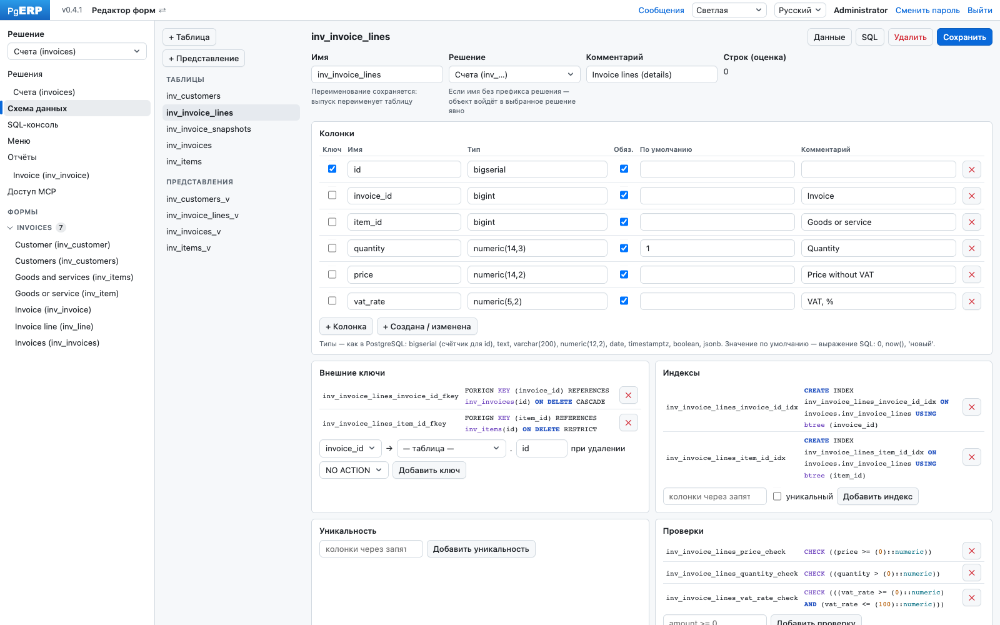

## 3. Представления

**«+ Представление»** — четыре штуки. Таблицы форм показывают строки представлений: в них подготовлено всё для показа.

<nobr>`inv_customers_v`</nobr> — покупатели и строка для поиска:

```sql
SELECT c.id, c.name, c.tax_id, c.address, c.email,
       lower(concat_ws(' ', c.name, c.tax_id, c.email)) AS search_text
FROM inv_customers c
```

<nobr>`inv_items_v`</nobr> — товары и услуги. <nobr>`kind_badge`</nobr> — метка для колонки формата «Метка»
(<nobr>`ui_badge(текст, тон)`</nobr>; тоны: <nobr>`neutral`</nobr>, <nobr>`accent`</nobr>, <nobr>`attention`</nobr>, <nobr>`success`</nobr>, <nobr>`done`</nobr>, <nobr>`danger`</nobr>).
<nobr>`price_input`</nobr> и <nobr>`vat_input`</nobr> — значения в том виде, в каком их ждут поля ввода: при выборе товара они
подставятся в строку счёта:

```sql
SELECT i.id, i.name, i.kind, i.unit, i.price, i.vat_rate,
       CASE i.kind WHEN 'service' THEN ui_badge('Service', 'accent') ELSE ui_badge('Goods', 'done') END AS kind_badge,
       ui_money_input(i.price) AS price_input,
       trim_scale(i.vat_rate)::TEXT AS vat_input,
       lower(i.name) AS search_text
FROM inv_items i
```

<nobr>`inv_invoice_lines_v`</nobr> — строки с суммами. Сумма и НДС округляются в каждой строке, итог счёта — сумма строк:

```sql
SELECT l.id, l.invoice_id, l.item_id, i.name AS item, i.unit,
       l.quantity, l.price, l.vat_rate,
       a.amount, a.vat, a.amount + a.vat AS total
FROM inv_invoice_lines l
JOIN inv_items i ON i.id = l.item_id
CROSS JOIN LATERAL (
    SELECT round(l.quantity * l.price, 2) AS amount,
           round(round(l.quantity * l.price, 2) * l.vat_rate / 100, 2) AS vat) a
```

<nobr>`inv_invoices_v`</nobr> — счета с покупателем, итогами и состоянием; выставленный счёт после срока оплаты
показывается как просроченный:

```sql
SELECT v.id, v.number, v.invoice_date, to_char(v.invoice_date, 'DD.MM.YYYY') AS date_text,
       v.due_date, to_char(v.due_date, 'DD.MM.YYYY') AS due_text,
       v.customer_id, c.name AS customer, v.status, v.notes,
       CASE v.status
           WHEN 'draft'     THEN ui_badge('Draft', 'neutral')
           WHEN 'issued'    THEN CASE WHEN v.due_date < current_date THEN ui_badge('Overdue', 'danger')
                                      ELSE ui_badge('Issued', 'accent') END
           WHEN 'paid'      THEN ui_badge('Paid', 'success')
           WHEN 'cancelled' THEN ui_badge('Cancelled', 'done')
       END AS status_badge,
       COALESCE(t.lines, 0) AS lines, COALESCE(t.amount, 0) AS amount,
       COALESCE(t.vat, 0) AS vat, COALESCE(t.total, 0) AS total,
       lower(concat_ws(' ', v.number, c.name)) AS search_text,
       EXISTS (SELECT 1 FROM inv_invoice_snapshots s WHERE s.invoice_id = v.id AND s.state IS NULL) AS is_new
FROM inv_invoices v
JOIN inv_customers c ON c.id = v.customer_id
LEFT JOIN (SELECT invoice_id, count(*) AS lines, sum(amount) AS amount, sum(vat) AS vat, sum(total) AS total
           FROM inv_invoice_lines_v GROUP BY invoice_id) t ON t.invoice_id = v.id
```

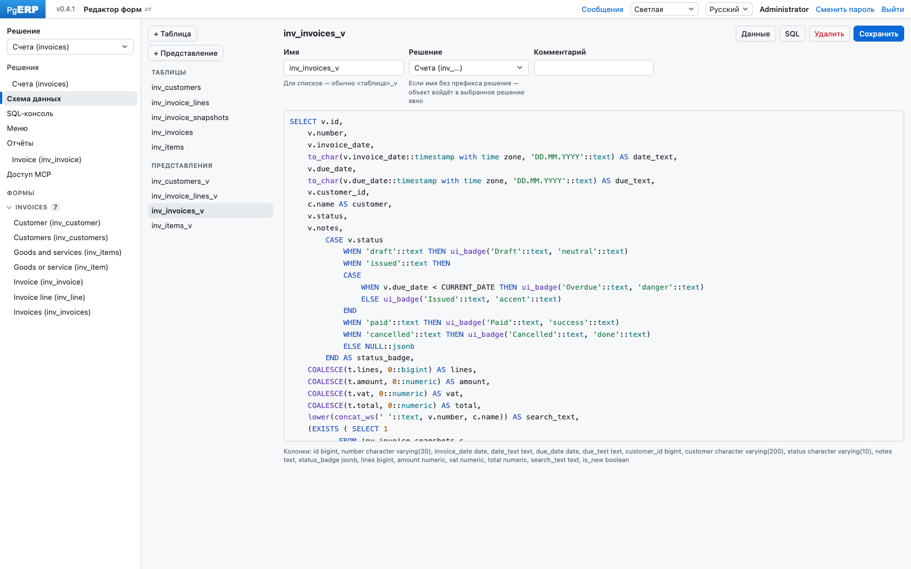

## 4. Код: вспомогательные функции и справочники

Действия — функции <nobr>`имя(p_data JSON) RETURNS JSON`</nobr>; их можно писать по одной кнопкой **«{ }»** у действия
в редакторе форм (так сделано в шаге 7) или скриптом в **SQL-консоли**: функции и строки <nobr>`pgerp.ui_actions`</nobr>.
Действие должно существовать до того, как его выберут в форме, поэтому код каждой части идёт перед её формами.

> Функции из консоли создаются в схеме <nobr>`public`</nobr> и входят в решение по префиксу; выпуск на другой установке
> создаст их в схеме решения. Скрипты ниже можно выполнять повторно: <nobr>`CREATE OR REPLACE`</nobr> и
> <nobr>`ON CONFLICT DO NOTHING`</nobr>.

**Вспомогательные функции счёта** — не действия, их вызывает код кнопок:

- <nobr>`inv_invoice_totals`</nobr> и <nobr>`inv_invoice_card`</nobr> — значения полей карточки (итог и все поля);
- <nobr>`inv_invoice_require_draft`</nobr> — ошибка, если счёт уже не черновик;
- <nobr>`inv_invoice_upsert`</nobr> — сохранить шапку из полей карточки: проверки, номер нового счёта из его
  <nobr>`id`</nobr> (<nobr>`INV-2026-00001`</nobr>), правка — только черновика;
- <nobr>`inv_invoice_changed`</nobr> — ответ после смены состояния: обновить карточку и список.

```sql
-- Вспомогательные функции счёта (не действия)
-- Итог счёта для поля карточки: «367 201,80 (без НДС 306 001,50, НДС 61 200,30)»
CREATE OR REPLACE FUNCTION inv_invoice_totals(p_id BIGINT) RETURNS JSONB AS $$
    SELECT jsonb_build_object('totals', format(ui_t('%s (without VAT %s, VAT %s)'),
                              ui_format_money(v.total), ui_format_money(v.amount), ui_format_money(v.vat)))
    FROM inv_invoices_v v WHERE v.id = p_id;
$$ LANGUAGE sql STABLE;

-- Значения полей карточки счёта из базы
CREATE OR REPLACE FUNCTION inv_invoice_card(p_id BIGINT) RETURNS JSONB AS $$
    SELECT jsonb_build_object(
        'id',                   v.id::TEXT,
        'number',               v.number,
        'status_text',          v.status_badge->>'label',
        'invoice_date',         to_char(v.invoice_date, 'YYYY-MM-DD'),
        'due_date',             COALESCE(to_char(v.due_date, 'YYYY-MM-DD'), ''),
        'customer_id',          v.customer_id::TEXT,
        'customer_id__display', v.customer,
        'notes',                COALESCE(v.notes, '')) || inv_invoice_totals(p_id)
    FROM inv_invoices_v v WHERE v.id = p_id;
$$ LANGUAGE sql STABLE;

-- Менять можно только черновик
CREATE OR REPLACE FUNCTION inv_invoice_require_draft(p_id BIGINT) RETURNS VOID AS $$
DECLARE
    v_status TEXT;
BEGIN
    SELECT status INTO v_status FROM inv_invoices WHERE id = p_id;
    PERFORM ui_require(FOUND, 'Invoice not found — it may have been deleted');
    PERFORM ui_require(v_status = 'draft', 'Only a draft invoice can be changed');
END;
$$ LANGUAGE plpgsql STABLE;

-- Черновик карточки: счёт целиком (шапка и строки) — для снимка при открытии и сравнения при закрытии
CREATE OR REPLACE FUNCTION inv_invoice_state(p_id BIGINT) RETURNS JSONB AS $$
    SELECT jsonb_build_object(
        'invoice', to_jsonb(i) - 'created_at',
        'lines', COALESCE((SELECT jsonb_agg(to_jsonb(l) ORDER BY l.id)
                           FROM inv_invoice_lines l WHERE l.invoice_id = i.id), '[]'::JSONB))
    FROM inv_invoices i WHERE i.id = p_id;
$$ LANGUAGE sql STABLE;

-- Вернуть счёт к снимку: шапку и строки
CREATE OR REPLACE FUNCTION inv_invoice_restore(p_id BIGINT, p_state JSONB) RETURNS VOID AS $$
BEGIN
    UPDATE inv_invoices i
    SET invoice_date = s.invoice_date, due_date = s.due_date, customer_id = s.customer_id,
        status = s.status, notes = s.notes
    FROM jsonb_populate_record(NULL::inv_invoices, p_state->'invoice') s
    WHERE i.id = p_id;
    DELETE FROM inv_invoice_lines WHERE invoice_id = p_id;
    INSERT INTO inv_invoice_lines
    SELECT * FROM jsonb_populate_recordset(NULL::inv_invoice_lines, p_state->'lines');
END;
$$ LANGUAGE plpgsql;

-- Сохранить шапку счёта из полей карточки; новый счёт получает номер. Возвращает id
CREATE OR REPLACE FUNCTION inv_invoice_upsert(p_data JSON) RETURNS BIGINT AS $$
DECLARE
    v_id       BIGINT := ui_parse_id(p_data->>'id');
    v_date     DATE   := ui_parse_date(p_data->>'invoice_date');
    v_due      DATE   := ui_parse_date(p_data->>'due_date');
    v_customer BIGINT := ui_parse_id(p_data->>'customer_id');
    v_notes    TEXT   := ui_text(p_data, 'notes');
BEGIN
    PERFORM ui_require(v_date IS NOT NULL, 'Enter the invoice date');
    PERFORM ui_require(EXISTS (SELECT 1 FROM inv_customers WHERE id = v_customer), 'Choose a customer');
    PERFORM ui_require(v_due IS NULL OR v_due >= v_date, 'The payment date cannot be earlier than the invoice date');
    IF ui_is_new(p_data) THEN
        -- Номер — из id счёта: INV-2026-00001
        v_id := nextval(pg_get_serial_sequence('inv_invoices', 'id'));
        INSERT INTO inv_invoices (id, number, invoice_date, due_date, customer_id, notes, created_by)
        VALUES (v_id, format('INV-%s-%s', to_char(v_date, 'YYYY'), lpad(v_id::TEXT, 5, '0')),
                v_date, v_due, v_customer, v_notes, ui_user());
        -- Счёт создан в карточке: снимок без состояния — закрытие без «Сохранить» его удалит
        INSERT INTO inv_invoice_snapshots (invoice_id, state) VALUES (v_id, NULL);
    ELSE
        PERFORM inv_invoice_require_draft(v_id);
        UPDATE inv_invoices SET invoice_date = v_date, due_date = v_due, customer_id = v_customer, notes = v_notes
        WHERE id = v_id;
    END IF;
    RETURN v_id;
END;
$$ LANGUAGE plpgsql;

-- Ответ после изменения статуса: обновить карточку и список
CREATE OR REPLACE FUNCTION inv_invoice_changed(p_id BIGINT) RETURNS JSONB AS $$
    SELECT jsonb_build_array(ui_set_values(inv_invoice_card(p_id), p_form => 'inv_invoice'),
                             ui_refresh_grid('inv_invoices_grid', p_keep_page => TRUE));
$$ LANGUAGE sql STABLE;
```

**Справочники** — список, карточка, сохранение и удаление товаров и покупателей. Те же приёмы, что в списке дел:
<nobr>`ui_grid_page`</nobr> с поиском, <nobr>`ui_require`</nobr> с текстом ошибки, удаление с <nobr>`ui_confirm`</nobr>.
<nobr>`inv_kinds_combo`</nobr> — пункты выпадающего списка «Вид»:

```sql
-- Справочники: товары и услуги, покупатели. Действие — функция имя(p_data JSON) RETURNS JSON,
-- зарегистрированная в pgerp.ui_actions.

CREATE OR REPLACE FUNCTION inv_items_page(p_data JSON) RETURNS JSON AS $$
SELECT ui_grid_page('inv_items_page', p_data, 'inv_items_v', NULL, 'name', 'asc',
                    p_search_column => 'search_text', p_search => lower(p_data->>'search'));
$$ LANGUAGE sql STABLE;

CREATE OR REPLACE FUNCTION inv_kinds_combo(p_data JSON) RETURNS JSON AS $$
SELECT json_build_object('status', 'success', 'items', json_build_array(
    json_build_object('id', 'goods',   'label', ui_t('Goods')),
    json_build_object('id', 'service', 'label', ui_t('Service'))));
$$ LANGUAGE sql STABLE;

CREATE OR REPLACE FUNCTION inv_item_new_open(p_data JSON) RETURNS JSON AS $$
BEGIN
    RETURN ui_ok(ui_open_form('inv_item', p_title => 'New goods or service',
        p_data => jsonb_build_object('kind', 'goods', 'unit', 'pcs', 'price', '0', 'vat_rate', '20')));
END;
$$ LANGUAGE plpgsql;

CREATE OR REPLACE FUNCTION inv_item_edit_open(p_data JSON) RETURNS JSON AS $$
DECLARE
    v_item inv_items_v%ROWTYPE;
BEGIN
    SELECT * INTO v_item FROM inv_items_v WHERE id = ui_parse_id(p_data->>'id');
    PERFORM ui_require(FOUND, 'Not found — it may have been deleted');
    RETURN ui_ok(ui_open_form('inv_item', p_title => v_item.name,
        p_data => jsonb_build_object('id', v_item.id::TEXT, 'name', v_item.name, 'kind', v_item.kind,
                                     'unit', v_item.unit, 'price', v_item.price_input, 'vat_rate', v_item.vat_input)));
END;
$$ LANGUAGE plpgsql;

CREATE OR REPLACE FUNCTION inv_item_save(p_data JSON) RETURNS JSON AS $$
DECLARE
    v_id    BIGINT  := ui_parse_id(p_data->>'id');
    v_name  TEXT    := ui_text(p_data, 'name');
    v_kind  TEXT    := COALESCE(ui_text(p_data, 'kind'), 'goods');
    v_unit  TEXT    := COALESCE(ui_text(p_data, 'unit'), 'pcs');
    v_price NUMERIC := ui_parse_money(p_data->>'price');
    v_vat   NUMERIC := ui_parse_money(p_data->>'vat_rate');
BEGIN
    PERFORM ui_require(v_name IS NOT NULL, 'Enter the name');
    PERFORM ui_require(v_price IS NOT NULL, 'Price must be a number, e.g. 1500 or 99.90');
    PERFORM ui_require(v_vat IS NOT NULL AND v_vat <= 100, 'VAT must be from 0 to 100 %');
    PERFORM ui_require(NOT EXISTS (SELECT 1 FROM inv_items WHERE name = v_name AND id IS DISTINCT FROM v_id),
                       'There is already an item with this name');
    IF ui_is_new(p_data) THEN
        INSERT INTO inv_items (name, kind, unit, price, vat_rate) VALUES (v_name, v_kind, v_unit, v_price, v_vat);
    ELSE
        UPDATE inv_items SET name = v_name, kind = v_kind, unit = v_unit, price = v_price, vat_rate = v_vat
        WHERE id = v_id;
        PERFORM ui_require(FOUND, 'Not found — it may have been deleted');
    END IF;
    RETURN ui_ok(ui_close_form(), ui_refresh_grid('inv_items_grid', p_keep_page => TRUE));
END;
$$ LANGUAGE plpgsql;

CREATE OR REPLACE FUNCTION inv_item_delete(p_data JSON) RETURNS JSON AS $$
DECLARE
    v_item inv_items%ROWTYPE;
BEGIN
    SELECT * INTO v_item FROM inv_items WHERE id = ui_parse_id(p_data->>'id');
    PERFORM ui_require(FOUND, 'Not found — it may have been deleted');
    PERFORM ui_require(NOT EXISTS (SELECT 1 FROM inv_invoice_lines WHERE item_id = v_item.id),
                       'It is used in invoices and cannot be deleted');
    IF NOT ui_confirmed(p_data) THEN
        RETURN ui_ok(ui_confirm(format(ui_t('Delete “%s”?'), v_item.name), 'inv_item_delete',
                                jsonb_build_object('id', v_item.id, 'confirmed', TRUE), p_confirm_label => 'Delete'));
    END IF;
    DELETE FROM inv_items WHERE id = v_item.id;
    RETURN ui_ok(ui_refresh_grid('inv_items_grid', p_keep_page => TRUE));
END;
$$ LANGUAGE plpgsql;

CREATE OR REPLACE FUNCTION inv_customers_page(p_data JSON) RETURNS JSON AS $$
SELECT ui_grid_page('inv_customers_page', p_data, 'inv_customers_v', NULL, 'name', 'asc',
                    p_search_column => 'search_text', p_search => lower(p_data->>'search'));
$$ LANGUAGE sql STABLE;

CREATE OR REPLACE FUNCTION inv_customer_new_open(p_data JSON) RETURNS JSON AS $$
BEGIN
    RETURN ui_ok(ui_open_form('inv_customer', p_title => 'New customer'));
END;
$$ LANGUAGE plpgsql;

CREATE OR REPLACE FUNCTION inv_customer_edit_open(p_data JSON) RETURNS JSON AS $$
DECLARE
    v_customer inv_customers%ROWTYPE;
BEGIN
    SELECT * INTO v_customer FROM inv_customers WHERE id = ui_parse_id(p_data->>'id');
    PERFORM ui_require(FOUND, 'Customer not found — it may have been deleted');
    RETURN ui_ok(ui_open_form('inv_customer', p_title => v_customer.name,
        p_data => jsonb_build_object('id', v_customer.id::TEXT, 'name', v_customer.name,
                                     'tax_id', COALESCE(v_customer.tax_id, ''), 'email', COALESCE(v_customer.email, ''),
                                     'address', COALESCE(v_customer.address, ''))));
END;
$$ LANGUAGE plpgsql;

CREATE OR REPLACE FUNCTION inv_customer_save(p_data JSON) RETURNS JSON AS $$
DECLARE
    v_id   BIGINT := ui_parse_id(p_data->>'id');
    v_name TEXT   := ui_text(p_data, 'name');
BEGIN
    PERFORM ui_require(v_name IS NOT NULL, 'Enter the customer name');
    PERFORM ui_require(NOT EXISTS (SELECT 1 FROM inv_customers WHERE name = v_name AND id IS DISTINCT FROM v_id),
                       'There is already a customer with this name');
    IF ui_is_new(p_data) THEN
        INSERT INTO inv_customers (name, tax_id, email, address)
        VALUES (v_name, ui_text(p_data, 'tax_id'), ui_text(p_data, 'email'), ui_text(p_data, 'address'));
    ELSE
        UPDATE inv_customers SET name = v_name, tax_id = ui_text(p_data, 'tax_id'), email = ui_text(p_data, 'email'),
                                 address = ui_text(p_data, 'address')
        WHERE id = v_id;
        PERFORM ui_require(FOUND, 'Customer not found — it may have been deleted');
    END IF;
    RETURN ui_ok(ui_close_form(), ui_refresh_grid('inv_customers_grid', p_keep_page => TRUE));
END;
$$ LANGUAGE plpgsql;

INSERT INTO pgerp.ui_actions (action_name, function_name, description) VALUES
    ('inv_items_page',         'inv_items_page',         'Invoices: goods and services list'),
    ('inv_kinds_combo',        'inv_kinds_combo',        'Invoices: goods or service'),
    ('inv_item_new_open',      'inv_item_new_open',      'Invoices: new goods or service'),
    ('inv_item_edit_open',     'inv_item_edit_open',     'Invoices: open goods or service'),
    ('inv_item_save',          'inv_item_save',          'Invoices: save goods or service'),
    ('inv_item_delete',        'inv_item_delete',        'Invoices: delete goods or service'),
    ('inv_customers_page',     'inv_customers_page',     'Invoices: customers list'),
    ('inv_customer_new_open',  'inv_customer_new_open',  'Invoices: new customer'),
    ('inv_customer_edit_open', 'inv_customer_edit_open', 'Invoices: open customer'),
    ('inv_customer_save',      'inv_customer_save',      'Invoices: save customer')
ON CONFLICT (action_name) DO NOTHING;
```

**Окна выбора** для полей-ссылок (компонент «Поле выбора»): кнопка «…» открывает список в режиме выбора, строка
списка возвращается в поле. <nobr>`fill`</nobr> заполняет из выбранной строки и соседние поля — цену и ставку НДС:

```sql
-- Поля-ссылки: кнопка «…» открывает список в режиме выбора

CREATE OR REPLACE FUNCTION inv_customer_select_open(p_data JSON) RETURNS JSON AS $$
BEGIN
    RETURN ui_ok(ui_open_form('inv_customers', p_title => 'Choose a customer',
        p_select => jsonb_build_object('value_field', 'id', 'display_field', 'name')));
END;
$$ LANGUAGE plpgsql;

CREATE OR REPLACE FUNCTION inv_item_select_open(p_data JSON) RETURNS JSON AS $$
BEGIN
    -- Выбранная строка заполняет и цену, и ставку НДС: {"поле формы": "поле строки списка"}
    RETURN ui_ok(ui_open_form('inv_items', p_title => 'Choose goods or service',
        p_select => jsonb_build_object('value_field', 'id', 'display_field', 'name',
                                       'fill', jsonb_build_object('price', 'price_input', 'vat_rate', 'vat_input'))));
END;
$$ LANGUAGE plpgsql;

INSERT INTO pgerp.ui_actions (action_name, function_name, description) VALUES
    ('inv_customer_select_open', 'inv_customer_select_open', 'Invoices: choose a customer'),
    ('inv_item_select_open',     'inv_item_select_open',     'Invoices: choose goods or service')
ON CONFLICT (action_name) DO NOTHING;
```

## 5. Справочники: формы

**Редактор форм → «+ Новая форма»**, папка «Invoices». Списки и карточки устроены как в списке дел.

<nobr>`inv_items`</nobr> — «Goods and services»:

| Компонент | Имя | Подпись | Действие | Свойства |
|---|---|---|---|---|
| Поле ввода | <nobr>`search`</nobr> | Search |  | Фильтр таблицы: <nobr>`inv_items_grid`</nobr> |
| Таблица | <nobr>`inv_items_grid`</nobr> |  | <nobr>`inv_items_page`</nobr> |  |
| Кнопка | <nobr>`btn_new`</nobr> | Add | <nobr>`inv_item_new_open`</nobr> |  |

<nobr>`inv_item`</nobr> — «Goods or service»:

| Компонент | Имя | Подпись | Действие | Свойства |
|---|---|---|---|---|
| Скрытое поле | <nobr>`id`</nobr> |  |  |  |
| Поле ввода | <nobr>`name`</nobr> | Name |  |  |
| Выпадающий список | <nobr>`kind`</nobr> | Kind | <nobr>`inv_kinds_combo`</nobr> |  |
| Поле ввода | <nobr>`unit`</nobr> | Unit |  |  |
| Поле ввода | <nobr>`price`</nobr> | Price without VAT |  |  |
| Поле ввода | <nobr>`vat_rate`</nobr> | VAT, % |  |  |
| Кнопка | <nobr>`btn_save`</nobr> | Save | <nobr>`inv_item_save`</nobr> |  |
| Кнопка | <nobr>`btn_cancel`</nobr> | Cancel | <nobr>`form_close`</nobr> |  |

<nobr>`inv_customers`</nobr> — «Customers»:

| Компонент | Имя | Подпись | Действие | Свойства |
|---|---|---|---|---|
| Поле ввода | <nobr>`search`</nobr> | Search |  | Фильтр таблицы: <nobr>`inv_customers_grid`</nobr> |
| Таблица | <nobr>`inv_customers_grid`</nobr> |  | <nobr>`inv_customers_page`</nobr> |  |
| Кнопка | <nobr>`btn_new`</nobr> | New customer | <nobr>`inv_customer_new_open`</nobr> |  |

<nobr>`inv_customer`</nobr> — «Customer»:

| Компонент | Имя | Подпись | Действие | Свойства |
|---|---|---|---|---|
| Скрытое поле | <nobr>`id`</nobr> |  |  |  |
| Поле ввода | <nobr>`name`</nobr> | Name |  |  |
| Поле ввода | <nobr>`tax_id`</nobr> | Tax ID |  |  |
| Поле ввода | <nobr>`email`</nobr> | E-mail |  |  |
| Поле ввода | <nobr>`address`</nobr> | Address |  |  |
| Кнопка | <nobr>`btn_save`</nobr> | Save | <nobr>`inv_customer_save`</nobr> |  |
| Кнопка | <nobr>`btn_cancel`</nobr> | Cancel | <nobr>`form_close`</nobr> |  |

Список товаров одновременно служит окном выбора для строки счёта: в режиме выбора у строк появляется кнопка «Выбрать».

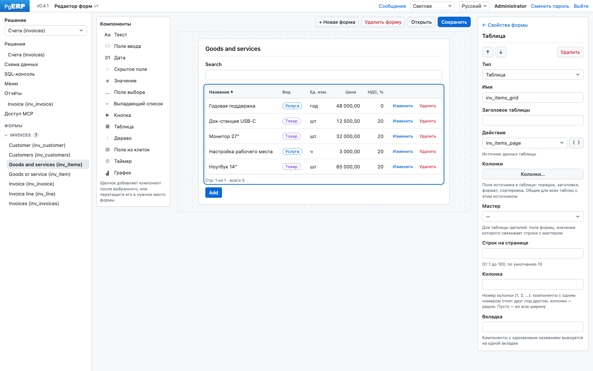

## 6. Список счетов

Код списка: источник таблицы с поиском и фильтром <nobr>`p_filters`</nobr> по значению выпадающего списка
<nobr>`status_filter`</nobr>, пункты этого списка, открытие нового и существующего счёта, удаление черновика.

```sql
-- Список счетов: источник таблицы, фильтр по состоянию, новый счёт, открыть и удалить

CREATE OR REPLACE FUNCTION inv_invoices_page(p_data JSON) RETURNS JSON AS $$
SELECT ui_grid_page('inv_invoices_page', p_data, 'inv_invoices_v', NULL, 'date_text', 'desc',
                    p_search_column => 'search_text', p_search => lower(p_data->>'search'),
                    p_filters => jsonb_build_object('status', p_data->>'status_filter', 'is_new', 'false'));
$$ LANGUAGE sql STABLE;

CREATE OR REPLACE FUNCTION inv_statuses_combo(p_data JSON) RETURNS JSON AS $$
SELECT json_build_object('status', 'success', 'items', json_build_array(
    json_build_object('id', 'draft',     'label', ui_t('Draft')),
    json_build_object('id', 'issued',    'label', ui_t('Issued')),
    json_build_object('id', 'paid',      'label', ui_t('Paid')),
    json_build_object('id', 'cancelled', 'label', ui_t('Cancelled'))));
$$ LANGUAGE sql STABLE;

CREATE OR REPLACE FUNCTION inv_invoice_new_open(p_data JSON) RETURNS JSON AS $$
BEGIN
    RETURN ui_ok(ui_open_form('inv_invoice', p_title => 'New invoice',
        p_data => jsonb_build_object('invoice_date', to_char(current_date, 'YYYY-MM-DD'),
                                     'due_date',     to_char(current_date + 10, 'YYYY-MM-DD'),
                                     'status_text',  ui_t('Draft'))));
END;
$$ LANGUAGE plpgsql;

CREATE OR REPLACE FUNCTION inv_invoice_edit_open(p_data JSON) RETURNS JSON AS $$
DECLARE
    v_id   BIGINT := ui_parse_id(p_data->>'id');
    v_card JSONB  := inv_invoice_card(v_id);
BEGIN
    PERFORM ui_require(v_card IS NOT NULL, 'Invoice not found — it may have been deleted');
    -- Запомнить сохранённую версию: закрытие без «Сохранить» вернёт к ней. Снимок перезаписывается —
    -- оставшийся от окна, закрытого вместе с вкладкой браузера, вернул бы счёт в прошлое
    INSERT INTO inv_invoice_snapshots (invoice_id, state) VALUES (v_id, inv_invoice_state(v_id))
    ON CONFLICT (invoice_id) DO UPDATE SET state = EXCLUDED.state, created_at = now();
    RETURN ui_ok(ui_open_form('inv_invoice', p_title => format(ui_t('Invoice %s'), v_card->>'number'), p_data => v_card));
END;
$$ LANGUAGE plpgsql;

CREATE OR REPLACE FUNCTION inv_invoice_delete(p_data JSON) RETURNS JSON AS $$
DECLARE
    v_invoice inv_invoices%ROWTYPE;
BEGIN
    SELECT * INTO v_invoice FROM inv_invoices WHERE id = ui_parse_id(p_data->>'id');
    PERFORM ui_require(FOUND, 'Invoice not found — it may have been deleted');
    PERFORM ui_require(v_invoice.status = 'draft', 'Only a draft can be deleted; cancel an issued invoice instead');
    IF NOT ui_confirmed(p_data) THEN
        RETURN ui_ok(ui_confirm(format(ui_t('Delete invoice %s?'), v_invoice.number), 'inv_invoice_delete',
                                jsonb_build_object('id', v_invoice.id, 'confirmed', TRUE), p_confirm_label => 'Delete'));
    END IF;
    DELETE FROM inv_invoices WHERE id = v_invoice.id;   -- строки удалятся каскадом
    RETURN ui_ok(ui_refresh_grid('inv_invoices_grid', p_keep_page => TRUE));
END;
$$ LANGUAGE plpgsql;

INSERT INTO pgerp.ui_actions (action_name, function_name, description) VALUES
    ('inv_invoices_page',     'inv_invoices_page',     'Invoices: invoice list'),
    ('inv_statuses_combo',    'inv_statuses_combo',    'Invoices: invoice statuses'),
    ('inv_invoice_new_open',  'inv_invoice_new_open',  'Invoices: new invoice'),
    ('inv_invoice_edit_open', 'inv_invoice_edit_open', 'Invoices: open invoice'),
    ('inv_invoice_delete',    'inv_invoice_delete',    'Invoices: delete a draft invoice')
ON CONFLICT (action_name) DO NOTHING;
```

Сортировка по умолчанию — аргумент <nobr>`'date_text'`</nobr>: это **поле колонки таблицы**, у которой задана сортировка
(шаг 11), а не колонка представления; неизвестное поле молча заменяется на <nobr>`id`</nobr>.

Форма <nobr>`inv_invoices`</nobr> — «Invoices». «Пустой пункт» выпадающего списка — «All»: без выбора
фильтр не действует.

| Компонент | Имя | Подпись | Действие | Свойства |
|---|---|---|---|---|
| Поле ввода | <nobr>`search`</nobr> | Search |  | Фильтр таблицы: <nobr>`inv_invoices_grid`</nobr>; Колонка: 1 |
| Выпадающий список | <nobr>`status_filter`</nobr> | Status | <nobr>`inv_statuses_combo`</nobr> | Обновлять: <nobr>`inv_invoices_grid`</nobr>; Пустой пункт: All; Колонка: 2 |
| Таблица | <nobr>`inv_invoices_grid`</nobr> |  | <nobr>`inv_invoices_page`</nobr> |  |
| Кнопка | <nobr>`btn_new`</nobr> | New invoice | <nobr>`inv_invoice_new_open`</nobr> |  |

## 7. Карточка счёта — мастер

Сначала код кнопок карточки и строк счёта:

```sql
-- Кнопки карточки счёта (мастер)

CREATE OR REPLACE FUNCTION inv_invoice_save(p_data JSON) RETURNS JSON AS $$
DECLARE
    v_id BIGINT := inv_invoice_upsert(p_data);
BEGIN
    DELETE FROM inv_invoice_snapshots WHERE invoice_id = v_id;   -- изменения приняты
    RETURN ui_ok(ui_close_form(), ui_refresh_grid('inv_invoices_grid', p_keep_page => TRUE),
                 ui_message(format(ui_t('Invoice %s saved'), (SELECT number FROM inv_invoices WHERE id = v_id))));
END;
$$ LANGUAGE plpgsql;

CREATE OR REPLACE FUNCTION inv_invoice_issue(p_data JSON) RETURNS JSON AS $$
DECLARE
    v_id BIGINT := inv_invoice_upsert(p_data);
BEGIN
    PERFORM ui_require(EXISTS (SELECT 1 FROM inv_invoice_lines WHERE invoice_id = v_id),
                       'Add at least one line before issuing the invoice');
    UPDATE inv_invoices SET status = 'issued' WHERE id = v_id;
    DELETE FROM inv_invoice_snapshots WHERE invoice_id = v_id;
    PERFORM ui_print(format(ui_t('Invoice %s issued'), (SELECT number FROM inv_invoices WHERE id = v_id)));
    RETURN ui_ok(inv_invoice_changed(v_id));
END;
$$ LANGUAGE plpgsql;

CREATE OR REPLACE FUNCTION inv_invoice_pay(p_data JSON) RETURNS JSON AS $$
DECLARE
    v_id BIGINT := ui_parse_id(p_data->>'id');
BEGIN
    UPDATE inv_invoices SET status = 'paid' WHERE id = v_id AND status = 'issued';
    PERFORM ui_require(FOUND, 'Only an issued invoice can be marked as paid');
    DELETE FROM inv_invoice_snapshots WHERE invoice_id = v_id;
    RETURN ui_ok(inv_invoice_changed(v_id));
END;
$$ LANGUAGE plpgsql;

CREATE OR REPLACE FUNCTION inv_invoice_void(p_data JSON) RETURNS JSON AS $$
DECLARE
    v_id BIGINT := ui_parse_id(p_data->>'id');
BEGIN
    PERFORM ui_require(v_id IS NOT NULL AND NOT EXISTS (SELECT 1 FROM inv_invoice_snapshots
                                                        WHERE invoice_id = v_id AND state IS NULL),
                       'The invoice is not saved yet — just close it');
    IF NOT ui_confirmed(p_data) THEN
        RETURN ui_ok(ui_confirm('Cancel this invoice? It cannot be changed afterwards.', 'inv_invoice_void',
                                jsonb_build_object('id', v_id, 'confirmed', TRUE), p_confirm_label => 'Cancel invoice'));
    END IF;
    UPDATE inv_invoices SET status = 'cancelled' WHERE id = v_id AND status IN ('draft', 'issued');
    PERFORM ui_require(FOUND, 'Only a draft or an issued invoice can be cancelled');
    DELETE FROM inv_invoice_snapshots WHERE invoice_id = v_id;
    RETURN ui_ok(inv_invoice_changed(v_id));
END;
$$ LANGUAGE plpgsql;

INSERT INTO pgerp.ui_actions (action_name, function_name, description) VALUES
    ('inv_invoice_save',  'inv_invoice_save',  'Invoices: save invoice'),
    ('inv_invoice_issue', 'inv_invoice_issue', 'Invoices: issue invoice'),
    ('inv_invoice_pay',   'inv_invoice_pay',   'Invoices: mark invoice as paid'),
    ('inv_invoice_void',  'inv_invoice_void',  'Invoices: cancel invoice')
ON CONFLICT (action_name) DO NOTHING;
```

```sql
-- Строки счёта (детали): источник таблицы, добавить, изменить, сохранить, убрать

CREATE OR REPLACE FUNCTION inv_lines_page(p_data JSON) RETURNS JSON AS $$
SELECT ui_grid_page('inv_lines_page', p_data, 'inv_invoice_lines_v', 'invoice_id', 'id', 'asc');
$$ LANGUAGE sql STABLE;

CREATE OR REPLACE FUNCTION inv_line_new_open(p_data JSON) RETURNS JSON AS $$
DECLARE
    -- Новый счёт сначала сохраняется: строке нужен id счёта
    v_id BIGINT := inv_invoice_upsert(p_data);
BEGIN
    PERFORM inv_invoice_require_draft(v_id);
    RETURN ui_ok(ui_set_values(inv_invoice_card(v_id)),
                 ui_set_title(format(ui_t('Invoice %s'), (SELECT number FROM inv_invoices WHERE id = v_id))),
                 ui_refresh_grid('inv_invoices_grid', p_keep_page => TRUE),
                 ui_open_form('inv_line', p_title => 'Invoice line',
                              p_data => jsonb_build_object('invoice_id', v_id::TEXT, 'quantity', '1')));
END;
$$ LANGUAGE plpgsql;

CREATE OR REPLACE FUNCTION inv_line_edit_open(p_data JSON) RETURNS JSON AS $$
DECLARE
    v_line inv_invoice_lines_v%ROWTYPE;
BEGIN
    SELECT * INTO v_line FROM inv_invoice_lines_v WHERE id = ui_parse_id(p_data->>'id');
    PERFORM ui_require(FOUND, 'Line not found — it may have been deleted');
    PERFORM inv_invoice_require_draft(v_line.invoice_id);
    RETURN ui_ok(ui_open_form('inv_line', p_title => v_line.item,
        p_data => jsonb_build_object('id', v_line.id::TEXT, 'invoice_id', v_line.invoice_id::TEXT,
                                     'item_id', v_line.item_id::TEXT, 'item_id__display', v_line.item,
                                     'quantity', trim_scale(v_line.quantity)::TEXT,
                                     'price', ui_money_input(v_line.price),
                                     'vat_rate', trim_scale(v_line.vat_rate)::TEXT)));
END;
$$ LANGUAGE plpgsql;

CREATE OR REPLACE FUNCTION inv_line_save(p_data JSON) RETURNS JSON AS $$
DECLARE
    v_invoice  BIGINT  := ui_parse_id(p_data->>'invoice_id');
    v_item     BIGINT  := ui_parse_id(p_data->>'item_id');
    v_quantity NUMERIC := ui_parse_money(p_data->>'quantity');
    v_price    NUMERIC := ui_parse_money(p_data->>'price');
    v_vat      NUMERIC := ui_parse_money(p_data->>'vat_rate');
BEGIN
    PERFORM inv_invoice_require_draft(v_invoice);
    PERFORM ui_require(EXISTS (SELECT 1 FROM inv_items WHERE id = v_item), 'Choose goods or a service');
    PERFORM ui_require(v_quantity > 0, 'Quantity must be a number greater than zero');
    PERFORM ui_require(v_price IS NOT NULL, 'Price must be a number, e.g. 1500 or 99.90');
    PERFORM ui_require(v_vat IS NOT NULL AND v_vat <= 100, 'VAT must be from 0 to 100 %');
    IF ui_is_new(p_data) THEN
        INSERT INTO inv_invoice_lines (invoice_id, item_id, quantity, price, vat_rate)
        VALUES (v_invoice, v_item, v_quantity, v_price, v_vat);
    ELSE
        UPDATE inv_invoice_lines SET item_id = v_item, quantity = v_quantity, price = v_price, vat_rate = v_vat
        WHERE id = ui_parse_id(p_data->>'id') AND invoice_id = v_invoice;
        PERFORM ui_require(FOUND, 'Line not found — it may have been deleted');
    END IF;
    -- Закрыть строку, перечитать строки и обновить итоги в карточке счёта (другая открытая форма)
    RETURN ui_ok(ui_close_form(),
                 ui_refresh_grid('inv_lines_grid', p_keep_page => TRUE),
                 ui_set_values(inv_invoice_totals(v_invoice), p_form => 'inv_invoice'),
                 ui_refresh_grid('inv_invoices_grid', p_keep_page => TRUE));
END;
$$ LANGUAGE plpgsql;

CREATE OR REPLACE FUNCTION inv_line_delete(p_data JSON) RETURNS JSON AS $$
DECLARE
    v_line inv_invoice_lines_v%ROWTYPE;
BEGIN
    SELECT * INTO v_line FROM inv_invoice_lines_v WHERE id = ui_parse_id(p_data->>'id');
    PERFORM ui_require(FOUND, 'Line not found — it may have been deleted');
    PERFORM inv_invoice_require_draft(v_line.invoice_id);
    IF NOT ui_confirmed(p_data) THEN
        RETURN ui_ok(ui_confirm(format(ui_t('Remove “%s” from the invoice?'), v_line.item), 'inv_line_delete',
                                jsonb_build_object('id', v_line.id, 'confirmed', TRUE), p_confirm_label => 'Remove'));
    END IF;
    DELETE FROM inv_invoice_lines WHERE id = v_line.id;
    RETURN ui_ok(ui_refresh_grid('inv_lines_grid', p_keep_page => TRUE),
                 ui_set_values(inv_invoice_totals(v_line.invoice_id), p_form => 'inv_invoice'),
                 ui_refresh_grid('inv_invoices_grid', p_keep_page => TRUE));
END;
$$ LANGUAGE plpgsql;

INSERT INTO pgerp.ui_actions (action_name, function_name, description) VALUES
    ('inv_lines_page',     'inv_lines_page',     'Invoices: invoice lines'),
    ('inv_line_new_open',  'inv_line_new_open',  'Invoices: add a line'),
    ('inv_line_edit_open', 'inv_line_edit_open', 'Invoices: open a line'),
    ('inv_line_save',      'inv_line_save',      'Invoices: save a line'),
    ('inv_line_delete',    'inv_line_delete',    'Invoices: delete a line')
ON CONFLICT (action_name) DO NOTHING;
```

Что здесь важно:

- <nobr>`inv_lines_page`</nobr> передаёт в <nobr>`ui_grid_page`</nobr> колонку <nobr>`invoice_id`</nobr> — по ней отбираются строки текущего счёта;
- <nobr>`inv_line_new_open`</nobr> сохраняет шапку (новый счёт получает <nobr>`id`</nobr> и номер), заполняет ими карточку
  (<nobr>`ui_set_values`</nobr> без <nobr>`p_form`</nobr> — форма, из которой нажата кнопка), меняет заголовок, обновляет список счетов
  и открывает строку с <nobr>`invoice_id`</nobr>;
- <nobr>`inv_line_save`</nobr> отвечает и своей форме (закрыть), и карточке под ней: перечитать <nobr>`inv_lines_grid`</nobr>
  и обновить поле <nobr>`totals`</nobr> в форме <nobr>`inv_invoice`</nobr>;
- каждое изменение строк начинается с <nobr>`inv_invoice_require_draft`</nobr>: выставленный счёт не изменить;
- <nobr>`inv_invoice_issue`</nobr> выводит строку в панель сообщений: <nobr>`PERFORM ui_print(...)`</nobr>.

Форма <nobr>`inv_invoice`</nobr> — «Invoice»:

| Компонент | Имя | Подпись | Действие | Свойства |
|---|---|---|---|---|
| Скрытое поле | <nobr>`id`</nobr> |  |  |  |
| Значение | <nobr>`number`</nobr> | Number |  | Колонка: 1 |
| Дата | <nobr>`invoice_date`</nobr> | Date |  | Колонка: 1 |
| Поле выбора | <nobr>`customer_id`</nobr> | Customer | <nobr>`inv_customer_select_open`</nobr> | Колонка: 1 |
| Значение | <nobr>`status_text`</nobr> | Status |  | Колонка: 2 |
| Дата | <nobr>`due_date`</nobr> | Pay by |  | Колонка: 2 |
| Поле ввода | <nobr>`notes`</nobr> | Notes |  | Колонка: 2 |
| Кнопка | <nobr>`btn_add_line`</nobr> | Add line | <nobr>`inv_line_new_open`</nobr> | Вкладка: Lines |
| Таблица | <nobr>`inv_lines_grid`</nobr> |  | <nobr>`inv_lines_page`</nobr> | Вкладка: Lines; Мастер: <nobr>`id`</nobr> |
| Значение | <nobr>`totals`</nobr> | Total |  | Вкладка: Lines |
| Кнопка | <nobr>`btn_save`</nobr> | Save | <nobr>`inv_invoice_save`</nobr> |  |
| Кнопка | <nobr>`btn_issue`</nobr> | Issue | <nobr>`inv_invoice_issue`</nobr> |  |
| Кнопка | <nobr>`btn_pay`</nobr> | Paid | <nobr>`inv_invoice_pay`</nobr> |  |
| Кнопка | <nobr>`btn_void`</nobr> | Cancel invoice | <nobr>`inv_invoice_void`</nobr> |  |
| Кнопка | <nobr>`btn_close`</nobr> | Close | <nobr>`form_close`</nobr> |  |

«Close» пока просто закрывает окно (<nobr>`form_close`</nobr>): в шаге 9 оно станет закрытием черновика,
а в шаге 10 рядом появится «Print». На снимке ниже — уже готовая форма.

Главное — свойство таблицы <nobr>`inv_lines_grid`</nobr> **«Мастер» = <nobr>`id`</nobr>**: таблица строк стала деталями карточки.
Поля с одинаковым номером «Колонки» стоят друг под другом, колонки — рядом; компоненты с «Вкладкой» Lines собраны на
вкладке. Итог стоит без колонки: колонки раскладываются по всей форме, и итог с колонкой поднялся бы в шапку.

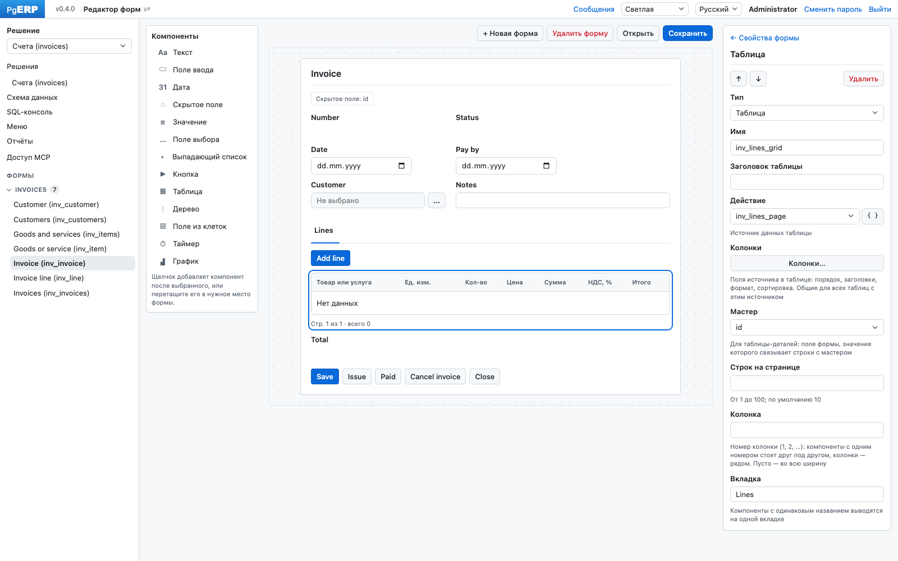

Код любого действия открывается кнопкой **«{ }»** рядом с действием компонента — так можно было написать и всё
из скриптов выше, по одной функции. Например, «Add line»:

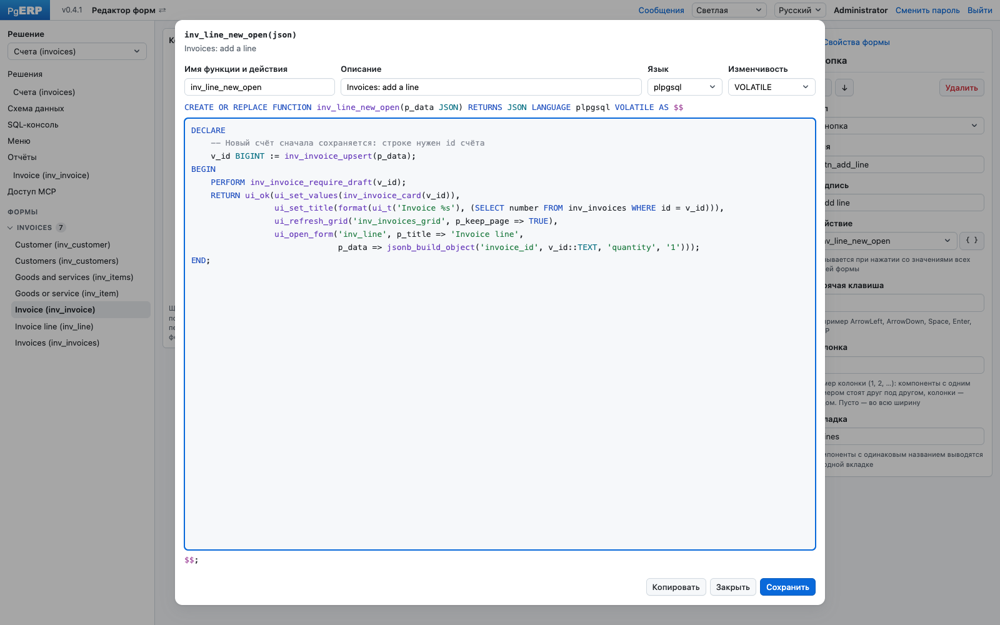

## 8. Строка счёта — детали

Форма <nobr>`inv_line`</nobr> — «Invoice line»:

| Компонент | Имя | Подпись | Действие | Свойства |
|---|---|---|---|---|
| Скрытое поле | <nobr>`id`</nobr> |  |  |  |
| Скрытое поле | <nobr>`invoice_id`</nobr> |  |  |  |
| Поле выбора | <nobr>`item_id`</nobr> | Goods or service | <nobr>`inv_item_select_open`</nobr> |  |
| Поле ввода | <nobr>`quantity`</nobr> | Quantity |  |  |
| Поле ввода | <nobr>`price`</nobr> | Price without VAT |  |  |
| Поле ввода | <nobr>`vat_rate`</nobr> | VAT, % |  |  |
| Кнопка | <nobr>`btn_save`</nobr> | Save | <nobr>`inv_line_save`</nobr> |  |
| Кнопка | <nobr>`btn_cancel`</nobr> | Cancel | <nobr>`form_close`</nobr> |  |

<nobr>`invoice_id`</nobr> — скрытое поле: его заполняет <nobr>`inv_line_new_open`</nobr>, и <nobr>`inv_line_save`</nobr> знает, к какому счёту
относится строка. «Поле выбора» <nobr>`item_id`</nobr> хранит <nobr>`id`</nobr> товара, а показывает его название
(<nobr>`item_id__display`</nobr>); при выборе <nobr>`fill`</nobr> из <nobr>`inv_item_select_open`</nobr> подставит цену и ставку НДС.

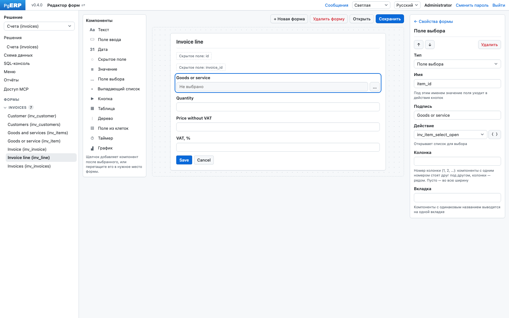

## 9. Черновик: закрыть без сохранения

«Добавить строку» записывает новый счёт в базу — иначе строкам не к чему привязаться, и каждая строка тоже
сохраняется сразу. Без черновика счёт со строками остался бы в базе, даже если закрыть карточку, не нажав
«Сохранить». Черновик карточки держится на **снимке** — таблице <nobr>`inv_invoice_snapshots`</nobr> из шага 2:

- открытие сохранённого счёта (<nobr>`inv_invoice_edit_open`</nobr>) запоминает его целиком — шапку и строки
  (<nobr>`inv_invoice_state`</nobr>);
- новый счёт, созданный кнопкой «Добавить строку» (<nobr>`inv_invoice_upsert`</nobr>), помечается снимком без состояния;
  список такие счета не показывает — колонка <nobr>`is_new`</nobr> представления и фильтр в <nobr>`inv_invoices_page`</nobr>;
- «Сохранить», «Выставить», «Оплачен», «Аннулировать» принимают изменения — снимок удаляется;
- «Закрыть», крестик и Escape вызывают <nobr>`inv_invoice_cancel`</nobr>: если что-то изменено, оно переспрашивает,
  а при согласии удаляет новый счёт со строками или возвращает сохранённый к снимку (<nobr>`inv_invoice_restore`</nobr>).

Всё, кроме самого закрытия, уже есть в коде шагов 4, 6 и 7. Осталось действие закрытия — **SQL-консоль**:

```sql
-- Закрыть карточку без сохранения: удалить новый счёт или вернуть сохранённый к снимку

CREATE OR REPLACE FUNCTION inv_invoice_cancel(p_data JSON) RETURNS JSON AS $$
-- «Закрыть», крестик и Escape. Если что-то изменено — сначала вопрос; при согласии счёт, созданный
-- в карточке, удаляется со строками, а сохранённый возвращается к снимку. Шапку берём из формы:
-- её правки могут быть ещё не записаны
DECLARE
    v_id       BIGINT := ui_parse_id(p_data->>'id');
    v_invoice  inv_invoices%ROWTYPE;
    v_snapshot inv_invoice_snapshots%ROWTYPE;
    v_new      BOOLEAN;
    v_close    JSONB := jsonb_build_array(ui_close_form(), ui_refresh_grid('inv_invoices_grid', p_keep_page => TRUE));
BEGIN
    -- Счёт ещё не записывался (строк не добавляли): спросить, только если выбран покупатель
    IF v_id IS NULL THEN
        IF NOT ui_confirmed(p_data) AND ui_parse_id(p_data->>'customer_id') IS NOT NULL THEN
            RETURN ui_ok(ui_confirm('Close without saving? The new invoice will not be created.',
                                    'inv_invoice_cancel', jsonb_build_object('confirmed', TRUE),
                                    p_confirm_label => 'Don''t save'));
        END IF;
        RETURN ui_ok(ui_close_form());
    END IF;

    SELECT * INTO v_invoice FROM inv_invoices WHERE id = v_id;
    IF NOT FOUND THEN
        RETURN ui_ok(v_close);   -- уже удалён: отменять нечего
    END IF;
    SELECT * INTO v_snapshot FROM inv_invoice_snapshots WHERE invoice_id = v_id;
    v_new := v_snapshot.invoice_id IS NOT NULL AND v_snapshot.state IS NULL;

    IF NOT ui_confirmed(p_data) THEN
        IF v_new
           OR (v_snapshot.state IS NOT NULL AND v_snapshot.state IS DISTINCT FROM inv_invoice_state(v_id))
           OR (v_invoice.status = 'draft' AND
               jsonb_build_object('invoice_date', v_invoice.invoice_date, 'due_date', v_invoice.due_date,
                                  'customer_id', v_invoice.customer_id, 'notes', v_invoice.notes)
               IS DISTINCT FROM
               jsonb_build_object('invoice_date', ui_parse_date(p_data->>'invoice_date'),
                                  'due_date', ui_parse_date(p_data->>'due_date'),
                                  'customer_id', ui_parse_id(p_data->>'customer_id'), 'notes', ui_text(p_data, 'notes'))) THEN
            RETURN ui_ok(ui_confirm(
                format(CASE WHEN v_new THEN ui_t('Close without saving? Invoice %s with its lines will be deleted.')
                            ELSE ui_t('Close without saving? Changes to invoice %s will be discarded.') END,
                       v_invoice.number),
                'inv_invoice_cancel', jsonb_build_object('id', v_id::TEXT, 'confirmed', TRUE),
                p_confirm_label => 'Don''t save'));
        END IF;
        -- Ничего не изменено: возвращать нечего
        DELETE FROM inv_invoice_snapshots WHERE invoice_id = v_id;
        RETURN ui_ok(ui_close_form());
    END IF;

    IF v_new THEN
        DELETE FROM inv_invoices WHERE id = v_id;   -- строки и снимок удалятся каскадом
    ELSIF v_snapshot.state IS NOT NULL THEN
        PERFORM inv_invoice_restore(v_id, v_snapshot.state);
        DELETE FROM inv_invoice_snapshots WHERE invoice_id = v_id;
    END IF;
    RETURN ui_ok(v_close);
END;
$$ LANGUAGE plpgsql;

INSERT INTO pgerp.ui_actions (action_name, function_name, description) VALUES
    ('inv_invoice_cancel', 'inv_invoice_cancel', 'Invoices: close the invoice card')
ON CONFLICT (action_name) DO NOTHING;

-- Крестик и Escape закрывают карточку тем же действием, что и кнопка «Close»
UPDATE pgerp.forms SET cancel_action = 'inv_invoice_cancel' WHERE form_name = 'inv_invoice';
```

В редакторе форм у кнопки <nobr>`btn_close`</nobr> карточки <nobr>`inv_invoice`</nobr> выберите действие <nobr>`inv_invoice_cancel`</nobr>.
Последняя строка скрипта делает то же для крестика и Escape: это действие отмены формы
(<nobr>`pgerp.forms.cancel_action`</nobr>), в редакторе его нет — только SQL или MCP.

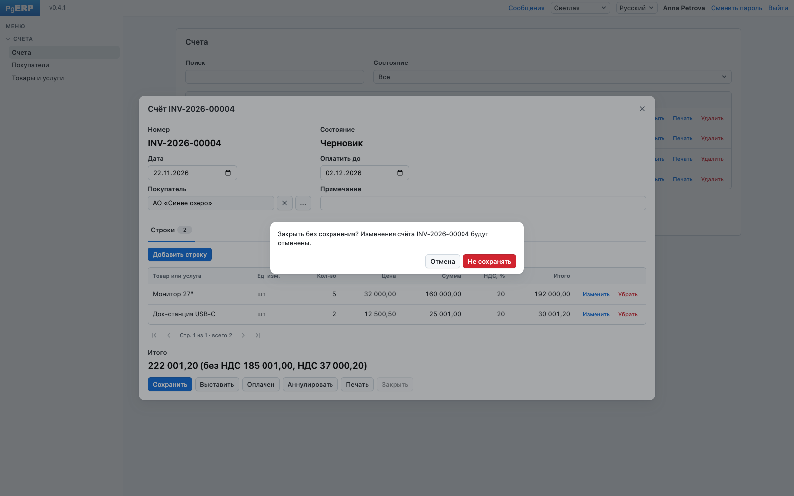

> Почему снимок, а не транзакция: каждое нажатие — отдельный запрос к базе, транзакция между ними не живёт.
> Снимок, оставшийся от вкладки, закрытой вместе с браузером, перезапишет следующее открытие счёта. Новые счета,
> брошенные так же, в списке не видны; удалить их можно запросом
> <nobr>`DELETE FROM inv_invoices WHERE id IN (SELECT invoice_id FROM inv_invoice_snapshots WHERE state IS NULL AND created_at < now() - interval '1 day')`</nobr>.

## 10. Печать счёта

Отчёт PDF — шаблон jrxml (JasperReports) и **функция данных**: она возвращает JSON, ключи верхнего уровня — параметры
<nobr>`$P{...}`</nobr> шаблона, массив <nobr>`rows`</nobr> — строки <nobr>`$F{...}`</nobr>. Показывает отчёт инструкция
<nobr>`ui_report(отчёт, параметры, заголовок)`</nobr> из любого действия. Код кнопки и функции данных — **SQL-консоль**:

```sql
-- Печать счёта: кнопка и функция данных отчёта inv_invoice

CREATE OR REPLACE FUNCTION inv_invoice_print(p_data JSON) RETURNS JSON AS $$
-- «Печать»: из карточки сначала записывается шапка черновика, из строки списка приходит только id
DECLARE
    v_id     BIGINT := ui_parse_id(p_data->>'id');
    v_number TEXT;
BEGIN
    IF p_data->>'invoice_date' IS NOT NULL
       AND (v_id IS NULL OR (SELECT status FROM inv_invoices WHERE id = v_id) = 'draft') THEN
        v_id := inv_invoice_upsert(p_data);
    END IF;
    SELECT number INTO v_number FROM inv_invoices WHERE id = v_id;
    PERFORM ui_require(FOUND, 'Invoice not found — it may have been deleted');
    PERFORM ui_require(EXISTS (SELECT 1 FROM inv_invoice_lines WHERE invoice_id = v_id),
                       'Add at least one line before printing the invoice');
    RETURN ui_ok(ui_report('inv_invoice', jsonb_build_object('invoice_id', v_id), format(ui_t('Invoice %s'), v_number)));
END;
$$ LANGUAGE plpgsql;

CREATE OR REPLACE FUNCTION inv_invoice_print_data(p_data JSON) RETURNS JSON AS $$
-- Данные отчёта inv_invoice: ключи верхнего уровня — параметры $P{...}, rows — строки $F{...}
DECLARE
    v_invoice  inv_invoices_v%ROWTYPE;
    v_customer inv_customers%ROWTYPE;
BEGIN
    SELECT * INTO v_invoice FROM inv_invoices_v WHERE id = ui_parse_id(p_data->>'invoice_id');
    PERFORM ui_require(FOUND, 'Invoice not found — it may have been deleted');
    SELECT * INTO v_customer FROM inv_customers WHERE id = v_invoice.customer_id;
    RETURN json_build_object(
        'title', format(ui_t('Invoice %s'), v_invoice.number),
        'invoice_date', v_invoice.invoice_date,
        'due_date', v_invoice.due_date,
        'status', v_invoice.status_badge->>'label',
        'customer', v_customer.name,
        'customer_details', concat_ws(' · ', CASE WHEN v_customer.tax_id IS NOT NULL THEN format(ui_t('Tax ID %s'), v_customer.tax_id) END,
                                      v_customer.address, v_customer.email),
        'notes', v_invoice.notes,
        'amount', v_invoice.amount, 'vat', v_invoice.vat, 'total', v_invoice.total,
        'rows', COALESCE((
            SELECT json_agg(json_build_object(
                       'line_no', n, 'item', item, 'unit', unit, 'quantity', quantity, 'price', price,
                       'amount', amount, 'vat_rate', vat_rate, 'total', total) ORDER BY n)
            FROM (SELECT row_number() OVER (ORDER BY id) AS n, * FROM inv_invoice_lines_v
                  WHERE invoice_id = v_invoice.id) l), '[]'));
END;
$$ LANGUAGE plpgsql STABLE;

INSERT INTO pgerp.ui_actions (action_name, function_name, description) VALUES
    ('inv_invoice_print',      'inv_invoice_print',      'Invoices: print invoice (PDF)'),
    ('inv_invoice_print_data', 'inv_invoice_print_data', 'Invoices: invoice report data')
ON CONFLICT (action_name) DO NOTHING;
```

<nobr>`inv_invoice_print`</nobr> работает и из карточки (сначала записывает шапку черновика), и из строки списка
(приходит только <nobr>`id`</nobr>). Функцию данных отдельно выдавать в роли не нужно: отчёт открывается из действия,
на которое у пользователя уже есть право.

**Отчёты → «+ Новый отчёт»**: имя <nobr>`inv_invoice`</nobr>, название «Invoice», данные — <nobr>`inv_invoice_print_data`</nobr>,
параметры предпросмотра <nobr>`{"invoice_id": 1}`</nobr>, шаблон — ниже. «Предпросмотр» строит PDF прямо в редакторе,
«Сохранить» компилирует шаблон и записывает отчёт.

<details>
<summary>Шаблон отчёта <code>inv_invoice</code> (jrxml)</summary>

```xml
<jasperReport name="inv_invoice" pageWidth="595" pageHeight="842" columnWidth="515" leftMargin="40" rightMargin="40" topMargin="40" bottomMargin="30">
	<!-- Invoice: parameters come from inv_invoice_print_data, rows are the invoice lines -->
	<parameter name="title" class="java.lang.String"/>
	<parameter name="invoice_date" class="java.util.Date"/>
	<parameter name="due_date" class="java.util.Date"/>
	<parameter name="status" class="java.lang.String"/>
	<parameter name="customer" class="java.lang.String"/>
	<parameter name="customer_details" class="java.lang.String"/>
	<parameter name="notes" class="java.lang.String"/>
	<parameter name="amount" class="java.math.BigDecimal"/>
	<parameter name="vat" class="java.math.BigDecimal"/>
	<parameter name="total" class="java.math.BigDecimal"/>
	<field name="line_no" class="java.lang.Integer"/>
	<field name="item" class="java.lang.String"/>
	<field name="unit" class="java.lang.String"/>
	<field name="quantity" class="java.math.BigDecimal"/>
	<field name="price" class="java.math.BigDecimal"/>
	<field name="amount" class="java.math.BigDecimal"/>
	<field name="vat_rate" class="java.math.BigDecimal"/>
	<field name="total" class="java.math.BigDecimal"/>
	<title height="120">
		<element kind="rectangle" x="0" y="0" width="515" height="4" mode="Opaque" backcolor="#0969DA">
			<pen lineWidth="0.0"/>
		</element>
		<element kind="textField" x="0" y="14" width="380" height="30" fontSize="20.0" bold="true">
			<expression><![CDATA[$P{title}]]></expression>
		</element>
		<element kind="textField" x="380" y="20" width="135" height="20" hTextAlign="Right" forecolor="#59636E">
			<expression><![CDATA[$P{status}]]></expression>
		</element>
		<element kind="textField" x="0" y="44" width="515" height="18" forecolor="#59636E">
			<expression><![CDATA[$R{dated} + " " + new java.text.SimpleDateFormat("dd.MM.yyyy").format($P{invoice_date})
				+ ($P{due_date} == null ? "" : " · " + $R{Pay by} + " " + new java.text.SimpleDateFormat("dd.MM.yyyy").format($P{due_date}))]]></expression>
		</element>
		<element kind="textField" x="0" y="72" width="90" height="18" forecolor="#59636E">
			<expression><![CDATA[$R{Customer}]]></expression>
		</element>
		<element kind="textField" x="90" y="72" width="425" height="18" bold="true">
			<expression><![CDATA[$P{customer}]]></expression>
		</element>
		<element kind="textField" x="90" y="90" width="425" height="16" fontSize="8.0" forecolor="#59636E" textAdjust="StretchHeight">
			<expression><![CDATA[$P{customer_details}]]></expression>
		</element>
	</title>
	<columnHeader height="24">
		<element kind="frame" x="0" y="0" width="515" height="22" mode="Opaque" backcolor="#F6F8FA">
			<element kind="textField" x="4" y="0" width="24" height="22" vTextAlign="Middle" bold="true" fontSize="9.0">
				<expression><![CDATA["№"]]></expression>
			</element>
			<element kind="textField" x="28" y="0" width="165" height="22" vTextAlign="Middle" bold="true" fontSize="9.0">
				<expression><![CDATA[$R{Goods or service}]]></expression>
			</element>
			<element kind="textField" x="193" y="0" width="65" height="22" hTextAlign="Right" vTextAlign="Middle" bold="true" fontSize="9.0">
				<expression><![CDATA[$R{Qty}]]></expression>
			</element>
			<element kind="textField" x="258" y="0" width="70" height="22" hTextAlign="Right" vTextAlign="Middle" bold="true" fontSize="9.0">
				<expression><![CDATA[$R{Price}]]></expression>
			</element>
			<element kind="textField" x="328" y="0" width="75" height="22" hTextAlign="Right" vTextAlign="Middle" bold="true" fontSize="9.0">
				<expression><![CDATA[$R{Amount}]]></expression>
			</element>
			<element kind="textField" x="403" y="0" width="45" height="22" hTextAlign="Right" vTextAlign="Middle" bold="true" fontSize="9.0">
				<expression><![CDATA[$R{VAT, %}]]></expression>
			</element>
			<element kind="textField" x="448" y="0" width="63" height="22" hTextAlign="Right" vTextAlign="Middle" bold="true" fontSize="9.0">
				<expression><![CDATA[$R{Total}]]></expression>
			</element>
		</element>
	</columnHeader>
	<detail>
		<band height="22">
			<element kind="textField" x="4" y="2" width="24" height="18" fontSize="9.0">
				<expression><![CDATA[$F{line_no}]]></expression>
			</element>
			<element kind="textField" x="28" y="2" width="165" height="18" fontSize="9.0" textAdjust="StretchHeight">
				<expression><![CDATA[$F{item}]]></expression>
			</element>
			<element kind="textField" x="193" y="2" width="65" height="18" hTextAlign="Right" fontSize="9.0">
				<expression><![CDATA[new java.text.DecimalFormat("#,##0.###", java.text.DecimalFormatSymbols.getInstance($P{REPORT_LOCALE})).format($F{quantity}) + " " + $F{unit}]]></expression>
			</element>
			<element kind="textField" x="258" y="2" width="70" height="18" hTextAlign="Right" fontSize="9.0" pattern="#,##0.00">
				<expression><![CDATA[$F{price}]]></expression>
			</element>
			<element kind="textField" x="328" y="2" width="75" height="18" hTextAlign="Right" fontSize="9.0" pattern="#,##0.00">
				<expression><![CDATA[$F{amount}]]></expression>
			</element>
			<element kind="textField" x="403" y="2" width="45" height="18" hTextAlign="Right" fontSize="9.0">
				<expression><![CDATA[new java.text.DecimalFormat("#,##0.##", java.text.DecimalFormatSymbols.getInstance($P{REPORT_LOCALE})).format($F{vat_rate})]]></expression>
			</element>
			<element kind="textField" x="448" y="2" width="63" height="18" hTextAlign="Right" fontSize="9.0" pattern="#,##0.00">
				<expression><![CDATA[$F{total}]]></expression>
			</element>
			<element kind="line" x="0" y="21" width="515" height="1" forecolor="#EFF2F5"/>
		</band>
	</detail>
	<pageFooter height="20">
		<element kind="textField" x="0" y="0" width="315" height="20" forecolor="#59636E" fontSize="8.0">
			<expression><![CDATA[$P{title} + " · " + $P{customer}]]></expression>
		</element>
		<element kind="textField" x="315" y="0" width="200" height="20" hTextAlign="Right" forecolor="#59636E" fontSize="8.0">
			<expression><![CDATA[$R{Page} + " " + $V{PAGE_NUMBER}]]></expression>
		</element>
	</pageFooter>
	<summary height="110">
		<element kind="textField" x="195" y="10" width="195" height="18" hTextAlign="Right">
			<expression><![CDATA[$R{Amount without VAT}]]></expression>
		</element>
		<element kind="textField" x="395" y="10" width="116" height="18" hTextAlign="Right" pattern="#,##0.00">
			<expression><![CDATA[$P{amount}]]></expression>
		</element>
		<element kind="textField" x="195" y="28" width="195" height="18" hTextAlign="Right">
			<expression><![CDATA[$R{VAT}]]></expression>
		</element>
		<element kind="textField" x="395" y="28" width="116" height="18" hTextAlign="Right" pattern="#,##0.00">
			<expression><![CDATA[$P{vat}]]></expression>
		</element>
		<element kind="textField" x="195" y="48" width="195" height="22" hTextAlign="Right" bold="true" fontSize="12.0">
			<expression><![CDATA[$R{Total due}]]></expression>
		</element>
		<element kind="textField" x="395" y="48" width="116" height="22" hTextAlign="Right" bold="true" fontSize="12.0" pattern="#,##0.00">
			<expression><![CDATA[$P{total}]]></expression>
		</element>
		<element kind="textField" x="0" y="80" width="515" height="26" fontSize="9.0" forecolor="#59636E" textAdjust="StretchHeight">
			<expression><![CDATA[$P{notes} == null ? "" : $R{Notes} + ": " + $P{notes}]]></expression>
		</element>
	</summary>
</jasperReport>
```

</details>

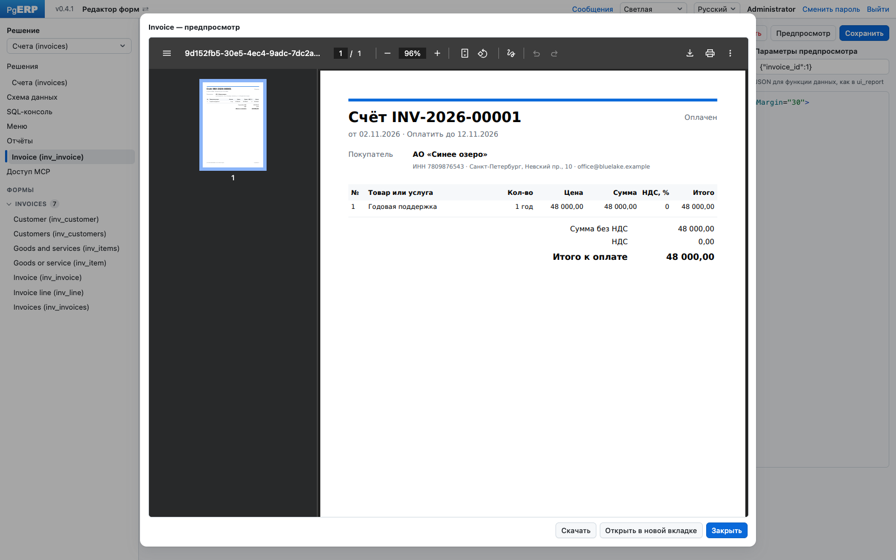

<nobr>`$R{текст}`</nobr> в шаблоне — перевод текста на язык пользователя: такие тексты появляются в форме «Переводы»
(шаг 15). Числа с <nobr>`pattern`</nobr> форматируются по языку пользователя.

Осталась кнопка: в карточке <nobr>`inv_invoice`</nobr> добавьте перед «Close» кнопку <nobr>`btn_print`</nobr> «Print» с действием
<nobr>`inv_invoice_print`</nobr>. Кнопка «Print» в строках списка появится в шаге 12.

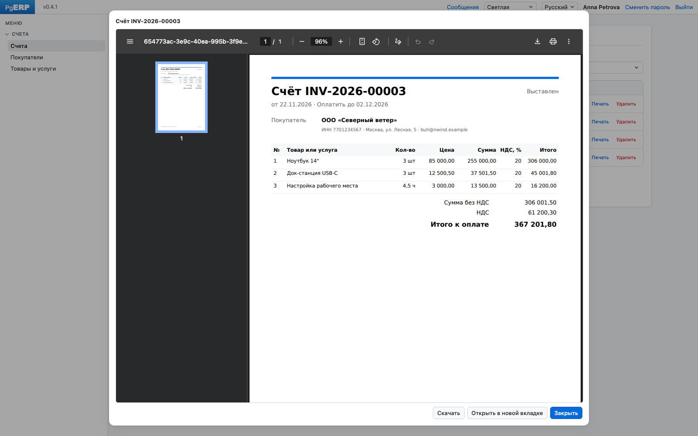

## 11. Колонки таблиц

Выберите таблицу в форме и нажмите **«Колонки…»**. Колонки привязаны к источнику и одинаковы во всех формах с ним.

<nobr>`inv_lines_page`</nobr> — строки счёта:

| Поле | Заголовок | Формат | Сортировка |
|---|---|---|---|
| <nobr>`item`</nobr> | Goods or service | Текст |  |
| <nobr>`unit`</nobr> | Unit | Текст |  |
| <nobr>`quantity`</nobr> | Qty | Число |  |
| <nobr>`price`</nobr> | Price | Деньги |  |
| <nobr>`amount`</nobr> | Amount | Деньги |  |
| <nobr>`vat_rate`</nobr> | VAT, % | Число |  |
| <nobr>`total`</nobr> | Total | Деньги |  |

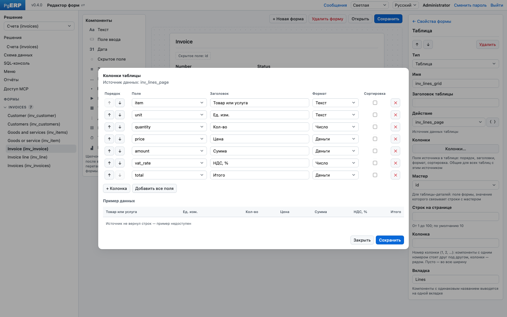

<nobr>`inv_invoices_page`</nobr> — список счетов:

| Поле | Заголовок | Формат | Сортировка |
|---|---|---|---|
| <nobr>`number`</nobr> | Number | Текст | <nobr>`number`</nobr> |
| <nobr>`date_text`</nobr> | Date | Текст | <nobr>`invoice_date`</nobr> |
| <nobr>`customer`</nobr> | Customer | Текст | <nobr>`customer`</nobr> |
| <nobr>`total`</nobr> | Total | Деньги | <nobr>`total`</nobr> |
| <nobr>`due_text`</nobr> | Pay by | Текст | <nobr>`due_date`</nobr> |
| <nobr>`status_badge`</nobr> | Status | Метка | <nobr>`status`</nobr> |

<nobr>`inv_items_page`</nobr> — товары и услуги:

| Поле | Заголовок | Формат | Сортировка |
|---|---|---|---|
| <nobr>`name`</nobr> | Name | Текст | <nobr>`name`</nobr> |
| <nobr>`kind_badge`</nobr> | Kind | Метка | <nobr>`kind`</nobr> |
| <nobr>`unit`</nobr> | Unit | Текст |  |
| <nobr>`price`</nobr> | Price | Деньги | <nobr>`price`</nobr> |
| <nobr>`vat_rate`</nobr> | VAT, % | Число |  |

<nobr>`inv_customers_page`</nobr> — покупатели:

| Поле | Заголовок | Формат | Сортировка |
|---|---|---|---|
| <nobr>`name`</nobr> | Name | Текст | <nobr>`name`</nobr> |
| <nobr>`tax_id`</nobr> | Tax ID | Текст |  |
| <nobr>`email`</nobr> | E-mail | Текст |  |

## 12. Кнопки в строках

Кнопки строк задаются для источника таблицы в <nobr>`pgerp.grid_row_actions`</nobr> — **SQL-консоль → «Выполнить»**:

```sql
-- Кнопки в строках таблиц: действие получает {"id": id строки}
INSERT INTO pgerp.grid_row_actions (source_action, sort_order, row_action, label, style) VALUES
    ('inv_items_page',     1, 'inv_item_edit_open',     'Edit',   'default'),
    ('inv_items_page',     2, 'inv_item_delete',        'Delete', 'danger'),
    ('inv_customers_page', 1, 'inv_customer_edit_open', 'Edit',   'default'),
    ('inv_invoices_page',  1, 'inv_invoice_edit_open',  'Open',   'default'),
    ('inv_invoices_page',  2, 'inv_invoice_print',      'Print',  'default'),
    ('inv_invoices_page',  3, 'inv_invoice_delete',     'Delete', 'danger'),
    ('inv_lines_page',     1, 'inv_line_edit_open',     'Edit',   'default'),
    ('inv_lines_page',     2, 'inv_line_delete',        'Remove', 'danger');
```

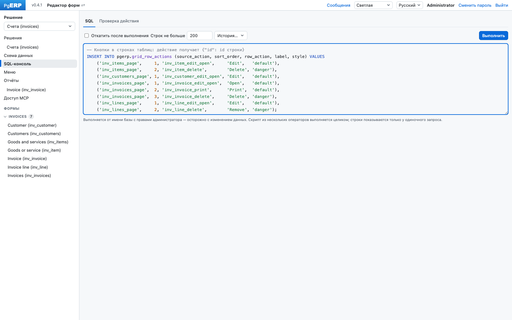

## 13. Меню

**Меню → «+ Пункт»** «Invoices» (папка) и три **«+ Подпункт»**: «Invoices» — форма <nobr>`inv_invoices`</nobr>, «Customers» —
<nobr>`inv_customers`</nobr>, «Goods and services» — <nobr>`inv_items`</nobr>. «Сохранить».

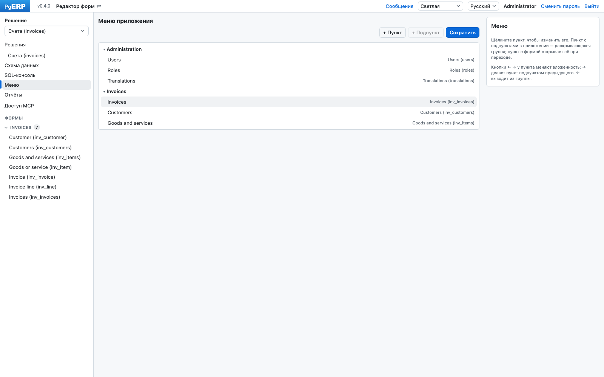

## 14. Права

В приложении: **Администрирование → Роли → «Новая роль»**: код <nobr>`inv_accountant`</nobr>, название «Invoices: accountant»;
добавьте формы <nobr>`inv_invoices`</nobr>, <nobr>`inv_customers`</nobr>, <nobr>`inv_items`</nobr>. Карточки, строку счёта и окна выбора
выдавать не нужно: они открываются из выданных форм и доступны автоматически. Назначьте роль пользователю
в **Администрирование → Пользователи**.

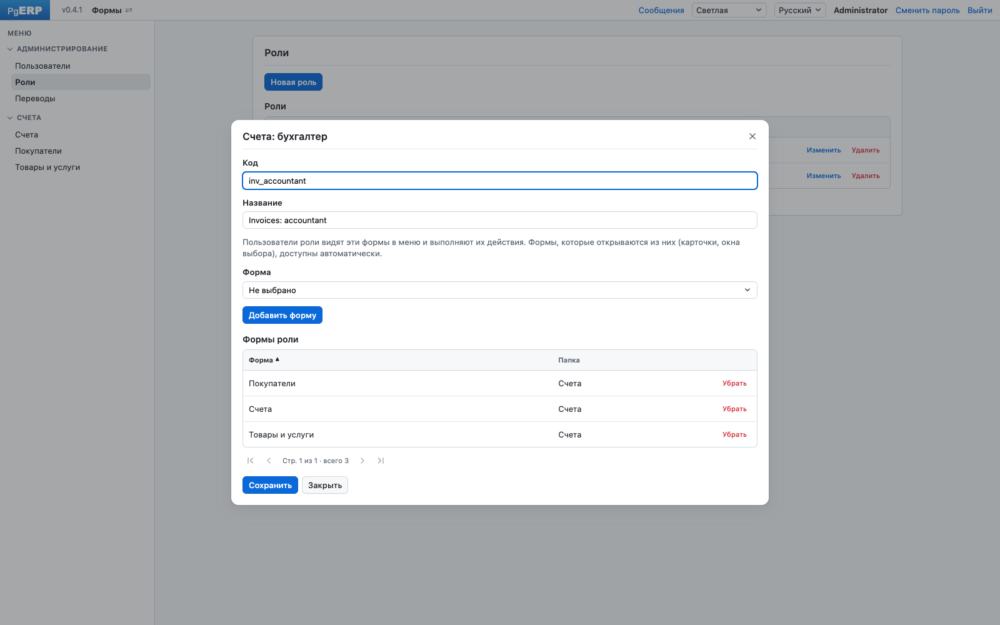

## 15. Переводы

Русские тексты — переводы исходных английских: ключ — исходный текст, шаблоны с <nobr>`%s`</nobr> переводятся по шаблону.
Их можно ввести по одному в **Администрирование → Переводы** или одним скриптом в консоли:

```sql
-- Русские переводы текстов решения «Счета». Ключ — исходный (английский) текст.
INSERT INTO pgerp.translations (lang, source, translation) VALUES
    ('ru', 'Invoices',                 'Счета'),
    ('ru', 'Invoice',                  'Счёт'),
    ('ru', 'Invoice %s',               'Счёт %s'),
    ('ru', 'New invoice',              'Новый счёт'),
    ('ru', 'Invoice line',             'Строка счёта'),
    ('ru', 'Lines',                    'Строки'),
    ('ru', 'Add line',                 'Добавить строку'),
    ('ru', 'Customers',                'Покупатели'),
    ('ru', 'Customer',                 'Покупатель'),
    ('ru', 'New customer',             'Новый покупатель'),
    ('ru', 'Choose a customer',        'Выберите покупателя'),
    ('ru', 'Goods and services',       'Товары и услуги'),
    ('ru', 'Goods or service',         'Товар или услуга'),
    ('ru', 'New goods or service',     'Новый товар или услуга'),
    ('ru', 'Choose goods or service',  'Выберите товар или услугу'),
    ('ru', 'Choose goods or a service', 'Выберите товар или услугу'),
    ('ru', 'Goods',                    'Товар'),
    ('ru', 'Service',                  'Услуга'),
    ('ru', 'Kind',                     'Вид'),
    ('ru', 'Name',                     'Название'),
    ('ru', 'Unit',                     'Ед. изм.'),
    ('ru', 'Price',                    'Цена'),
    ('ru', 'Price without VAT',        'Цена без НДС'),
    ('ru', 'VAT',                      'НДС'),
    ('ru', 'VAT, %',                   'НДС, %'),
    ('ru', 'Qty',                      'Кол-во'),
    ('ru', 'Quantity',                 'Количество'),
    ('ru', 'Amount',                   'Сумма'),
    ('ru', 'Amount without VAT',       'Сумма без НДС'),
    ('ru', 'Total',                    'Итого'),
    ('ru', 'Tax ID',                   'ИНН'),
    ('ru', 'E-mail',                   'Эл. почта'),
    ('ru', 'Address',                  'Адрес'),
    ('ru', 'Number',                   'Номер'),
    ('ru', 'Date',                     'Дата'),
    ('ru', 'Pay by',                   'Оплатить до'),
    ('ru', 'Notes',                    'Примечание'),
    ('ru', 'Search',                   'Поиск'),
    ('ru', 'All',                      'Все'),
    ('ru', 'Add',                      'Добавить'),
    ('ru', 'Open',                     'Открыть'),
    ('ru', 'Issue',                    'Выставить'),
    ('ru', 'Paid',                     'Оплачен'),
    ('ru', 'Cancel invoice',           'Аннулировать'),
    ('ru', 'Draft',                    'Черновик'),
    ('ru', 'Issued',                   'Выставлен'),
    ('ru', 'Overdue',                  'Просрочен'),
    ('ru', 'Cancelled',                'Аннулирован'),
    ('ru', 'Invoices: accountant',     'Счета: бухгалтер'),
    ('ru', 'Invoice %s saved',         'Счёт %s сохранён'),
    ('ru', 'Invoice %s issued',        'Счёт %s выставлен'),
    ('ru', 'Delete invoice %s?',       'Удалить счёт %s?'),
    ('ru', 'Delete “%s”?',             'Удалить «%s»?'),
    ('ru', 'Remove “%s” from the invoice?', 'Убрать «%s» из счёта?'),
    ('ru', 'Cancel this invoice? It cannot be changed afterwards.', 'Аннулировать счёт? После этого его нельзя изменить.'),
    ('ru', 'Add at least one line before issuing the invoice', 'Добавьте в счёт хотя бы одну строку'),
    ('ru', 'Only a draft invoice can be changed', 'Изменить можно только черновик счёта'),
    ('ru', 'Only a draft can be deleted; cancel an issued invoice instead', 'Удалить можно только черновик; выставленный счёт аннулируйте'),
    ('ru', 'Only a draft or an issued invoice can be cancelled', 'Аннулировать можно только черновик или выставленный счёт'),
    ('ru', 'Only an issued invoice can be marked as paid', 'Оплаченным можно отметить только выставленный счёт'),
    ('ru', 'The invoice is not saved yet — just close it', 'Счёт ещё не сохранён — просто закройте его'),
    ('ru', 'The payment date cannot be earlier than the invoice date', 'Срок оплаты не может быть раньше даты счёта'),
    ('ru', 'Enter the invoice date',   'Укажите дату счёта'),
    ('ru', 'Enter the customer name',  'Укажите название покупателя'),
    ('ru', 'Enter the name',           'Укажите название'),
    ('ru', 'There is already a customer with this name', 'Покупатель с таким названием уже есть'),
    ('ru', 'There is already an item with this name',    'Товар или услуга с таким названием уже есть'),
    ('ru', 'It is used in invoices and cannot be deleted', 'Используется в счетах — удалить нельзя'),
    ('ru', 'Price must be a number, e.g. 1500 or 99.90', 'Цена — число, например 1500 или 99,90'),
    ('ru', 'VAT must be from 0 to 100 %', 'НДС — от 0 до 100 %'),
    ('ru', 'Quantity must be a number greater than zero', 'Количество — число больше нуля'),
    ('ru', 'Invoice not found — it may have been deleted',  'Счёт не найден — возможно, его удалили'),
    ('ru', 'Customer not found — it may have been deleted', 'Покупатель не найден — возможно, его удалили'),
    ('ru', 'Line not found — it may have been deleted',     'Строка не найдена — возможно, её удалили'),
    ('ru', 'Not found — it may have been deleted',          'Не найдено — возможно, удалено'),
    -- Черновик: закрытие без сохранения
    ('ru', 'Don''t save',              'Не сохранять'),
    ('ru', 'Close without saving? The new invoice will not be created.', 'Закрыть без сохранения? Новый счёт не будет создан.'),
    ('ru', 'Close without saving? Invoice %s with its lines will be deleted.', 'Закрыть без сохранения? Счёт %s со строками будет удалён.'),
    ('ru', 'Close without saving? Changes to invoice %s will be discarded.', 'Закрыть без сохранения? Изменения счёта %s будут отменены.'),
    -- Печать
    ('ru', 'Print',                    'Печать'),
    ('ru', 'Add at least one line before printing the invoice', 'Добавьте в счёт хотя бы одну строку, чтобы его напечатать'),
    ('ru', 'Tax ID %s',                'ИНН %s'),
    ('ru', 'dated',                    'от'),
    ('ru', 'Total due',                'Итого к оплате'),
    ('ru', 'Page',                     'Стр.')
ON CONFLICT (lang, source) DO NOTHING;
-- …и шаблон итога карточки
INSERT INTO pgerp.translations (lang, source, translation) VALUES
    ('ru', '%s (without VAT %s, VAT %s)', '%s (без НДС %s, НДС %s)')
ON CONFLICT (lang, source) DO NOTHING;
```

Проверить, что ничего не забыто: форма «Переводы», вкладка «Без перевода» — или MCP-инструмент
<nobr>`translation_list`</nobr> с <nobr>`missing: true`</nobr>. Описания действий («Invoices: add a line») видны только в редакторе,
их переводить не обязательно. Переводы текстов решения войдут в выпуск.

## 16. Работа в приложении

Войдите пользователем с ролью <nobr>`inv_accountant`</nobr>. Заведите покупателей, товары и услуги — и **Счета →
«Новый счёт»**. Состояние «Просрочен» показывает представление: выставленный счёт после срока оплаты.

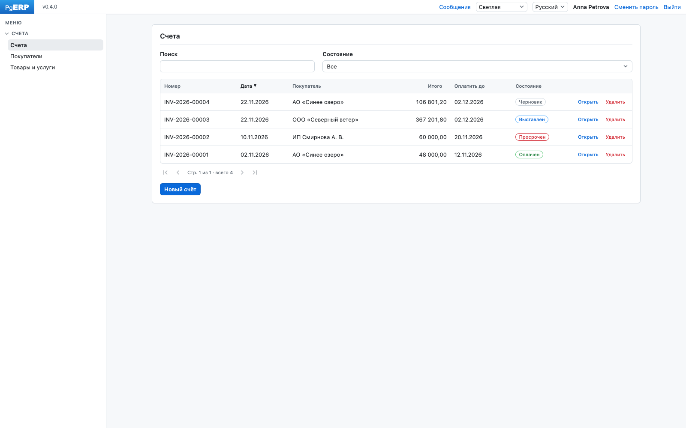

В карточке «Добавить строку» открывает строку поверх карточки, «Изменить» в строке таблицы — ту же форму
с её значениями:

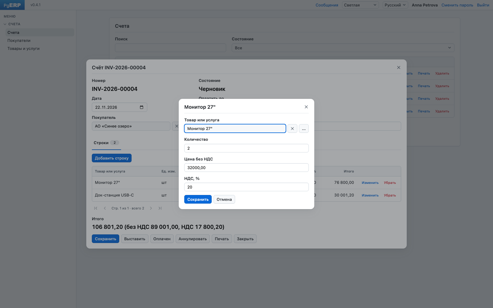

Кнопка «…» у поля «Товар или услуга» открывает список товаров в режиме выбора; «Выбрать» вернёт товар в поле
и подставит его цену и ставку НДС:

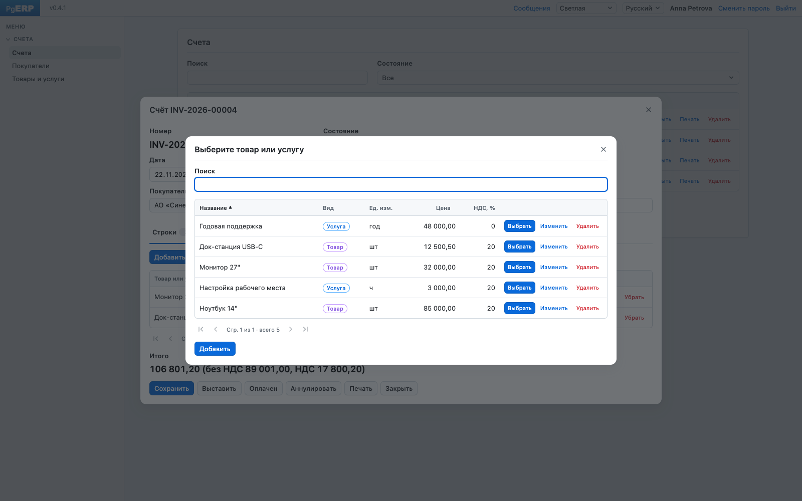

После «Сохранить» в строке таблица строк и итог в карточке обновляются сразу, без перезагрузки. Проверки
работают и для нового счёта — без покупателя строку не добавить:

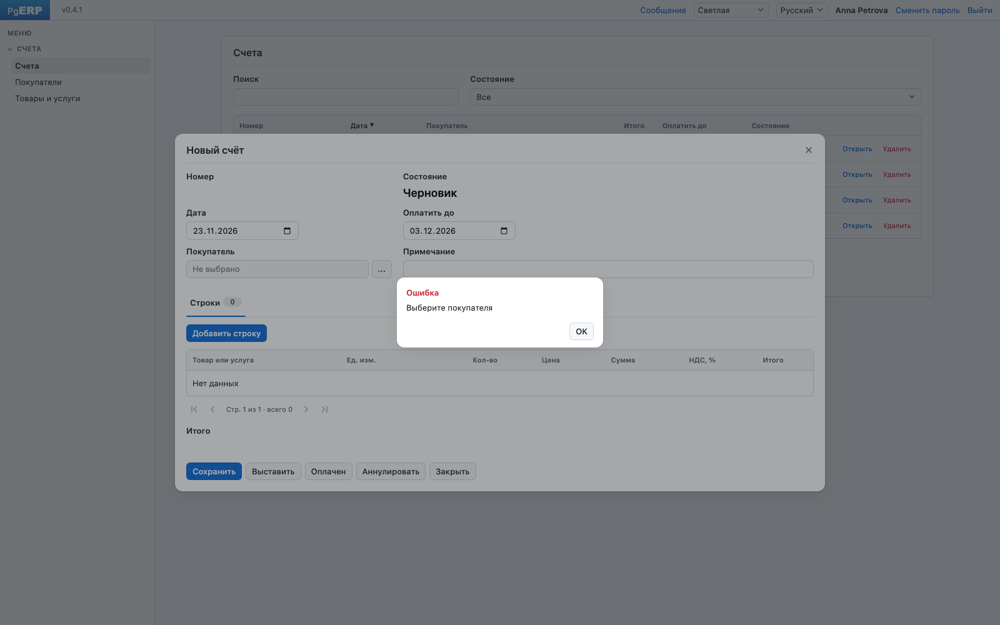

«Выставить» сохраняет шапку, проверяет, что строки есть, меняет состояние и пишет строку в панель сообщений
(<nobr>`ui_print`</nobr>). После этого счёт и его строки не меняются — функции отвечают «Изменить можно только черновик
счёта»; дальше — «Оплачен» или «Аннулировать».

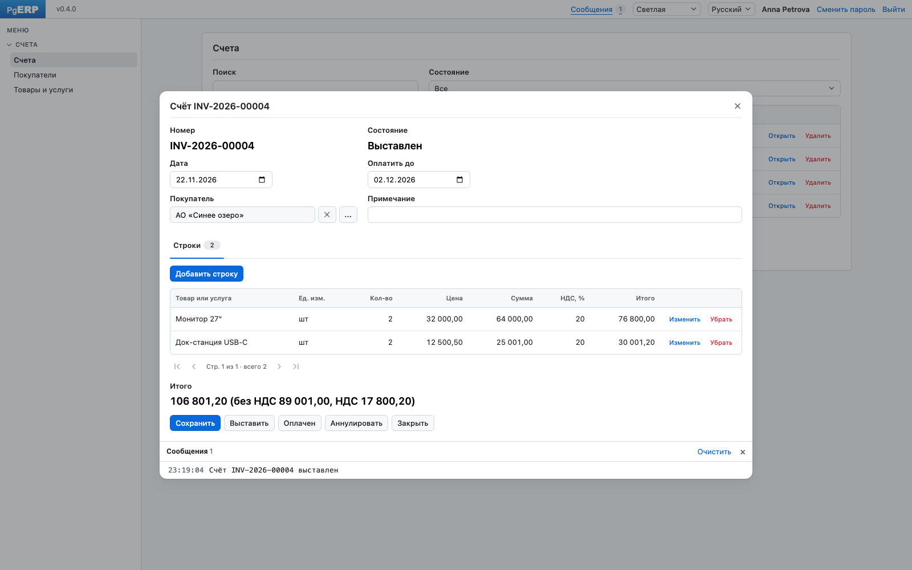

## 17. Проверка без интерфейса

**SQL-консоль → «Проверка действия»** вызывает действие с данными полей от имени выбранного пользователя, по умолчанию
с откатом. Например, <nobr>`inv_line_save`</nobr> от имени бухгалтера с <nobr>`{"invoice_id": "1", "item_id": "1", "quantity": "0",
"price": "1", "vat_rate": "20"}`</nobr> вернёт ошибку «Количество — число больше нуля», а для выставленного счёта — «Изменить
можно только черновик счёта».

## 18. Выпуск

**Решения → Счета**: название выпуска, «Проверить изменения» — список всего, что войдёт в первый выпуск:
таблицы, функции, представления, формы, колонки и кнопки строк, отчёт, роль, меню, переводы.

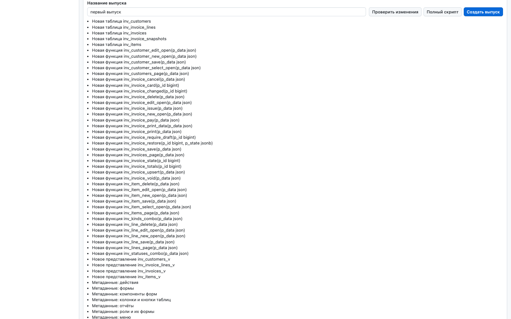

«Создать выпуск» — файл <nobr>`db/solutions/invoices/V1__invoices_<название>.sql`</nobr> (подробнее — в
[списке дел](tutorial-todo.ru.md#12-выпуск-перенос-на-другую-установку)). На другой установке решение ставится
в «Решения → Установить решения» в любую схему и работает без CRM и примеров.

## То же — силами ИИ-агента (MCP)

Подключите агента (шаг 0) и попросите, например:

> Создай в PgERP решение invoices «Invoices» (префикс inv_, папка меню Invoices): справочники товаров и услуг
> (вид, единица, цена, ставка НДС) и покупателей; счёт с номером, датой, сроком оплаты, покупателем и состоянием
> (черновик, выставлен, оплачен, аннулирован); строки счёта с товаром, количеством, ценой и НДС. Карточка счёта —
> мастер с таблицей строк (свойство master) и итогом; строка — отдельная форма с выбором товара, который подставляет
> цену и НДС. Менять можно только черновик. Роль inv_accountant, меню, русские переводы. Проверь действия через
> action_run от имени пользователя с ролью и покажи release_preview.

Шаги руководства и инструменты, которыми их выполнит агент:

| Шаг | Инструмент MCP |
|---|---|
| 1. Решение | <nobr>`solution_save`</nobr> |
| 2. Таблицы | <nobr>`table_save`</nobr>: сначала <nobr>`apply: false`</nobr> — показать SQL, затем <nobr>`apply: true`</nobr> |
| 3. Представления | <nobr>`view_save`</nobr> |
| 4, 6, 7, 9, 10. Код | <nobr>`sql_run`</nobr> — те же скрипты, или <nobr>`function_save`</nobr> — по одному действию |
| 5–8. Формы | <nobr>`form_save`</nobr> — форма целиком; свойство таблицы-деталей — <nobr>`"master": "id"`</nobr> |
| 9. Черновик | <nobr>`sql_run`</nobr> — действие закрытия и <nobr>`cancel_action`</nobr>; <nobr>`form_save`</nobr> — кнопка «Close» |
| 10. Печать | <nobr>`sql_run`</nobr> или <nobr>`function_save`</nobr>; <nobr>`report_save`</nobr> — шаблон и функция данных; <nobr>`form_save`</nobr> — кнопка «Print» |
| 11. Колонки | <nobr>`grid_columns_save`</nobr> |
| 12. Кнопки в строках | <nobr>`sql_run`</nobr> |
| 13. Меню | <nobr>`menu_get`</nobr>, затем <nobr>`menu_save`</nobr> — меню **целиком** с новой папкой |
| 14. Права | <nobr>`role_set`</nobr> |
| 15. Переводы | <nobr>`translation_save`</nobr> или скрипт через <nobr>`sql_run`</nobr>; проверка — <nobr>`translation_list`</nobr> с <nobr>`missing: true`</nobr> |
| 16–17. Проверка | <nobr>`action_run`</nobr> с <nobr>`user`</nobr> — от имени бухгалтера, с откатом |
| 18. Выпуск | <nobr>`release_preview`</nobr>; <nobr>`release_create`</nobr> — когда вы попросите |

Агент начнёт с <nobr>`platform_guide`</nobr> и пройдёт те же шаги инструментами <nobr>`solution_save`</nobr>, <nobr>`table_save`</nobr>,
<nobr>`view_save`</nobr>, <nobr>`sql_run`</nobr>, <nobr>`function_save`</nobr>, <nobr>`form_save`</nobr>, <nobr>`grid_columns_save`</nobr>, <nobr>`menu_save`</nobr>,
<nobr>`role_set`</nobr>, <nobr>`translation_save`</nobr>, <nobr>`action_run`</nobr>, <nobr>`release_preview`</nobr>. Результат открывается в том же редакторе;
выпуск агент создаёт (<nobr>`release_create`</nobr>), только когда вы об этом попросите.
