**English** · [Русский](tutorial-todo.ru.md)

# Example: a to-do list from scratch

A step-by-step guide: a "To-do list" application is built entirely in the PgERP editor — table, code, forms, menu,
permissions — and released as a solution package for other installations. Java does not change: everything lives in PostgreSQL.
The platform design is described in [ARCHITECTURE.md](../ARCHITECTURE.md); this guide is pure practice.

The result: every user has their own task list with due dates, search, a "Done" mark, editing and deletion with
confirmation; overdue tasks are highlighted.

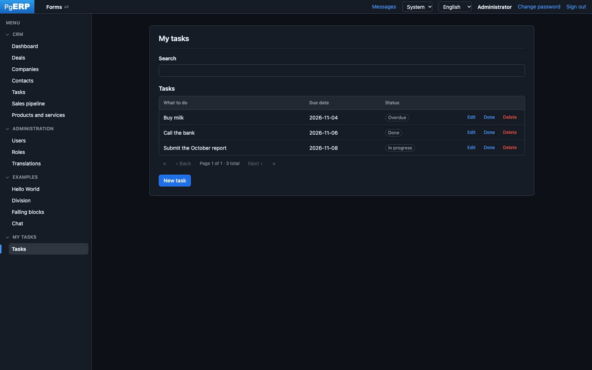

| Step | Where | What we create |
|---|---|---|
| 1 | Sign-in | the form editor |
| 2 | Solutions | solution <nobr>`todo`</nobr> with prefix <nobr>`todo_`</nobr> |
| 3–4 | Data schema | table <nobr>`todo_tasks`</nobr>, view <nobr>`todo_tasks_v`</nobr> |
| 5 | Form editor | card <nobr>`todo_task`</nobr> and function <nobr>`todo_task_save`</nobr> |
| 6 | Form editor | list <nobr>`todo_tasks`</nobr>, source <nobr>`todo_tasks_page`</nobr>, columns, "New task" button |
| 7 | SQL console | row buttons: "Edit", "Done", "Delete" |
| 8–9 | Menu, Roles | a menu item and the role <nobr>`todo_user`</nobr> |
| 10–11 | Application, console | testing |
| 12 | Solutions | release — a file of the solution package |

## How it works (in short)

A form is metadata rows (components: fields, buttons, a table). A button calls an **action** — a function
<nobr>`name(p_data JSON) RETURNS JSON`</nobr> in the solution's database schema. <nobr>`p_data`</nobr> holds the values of all form fields; the function changes data and
responds with instructions for the browser: close the window, reload the table, show a message. Permissions, checks
and error texts live in the database too.

```
"Save" button → POST /api/ui/event?action=todo_task_save {"title": "…", "due_on": "…"}
              → pgerp.handle_ui_event → todo_task_save(p_data)
              ← {"status": "success", "ui_instructions": [close_form, refresh_grid, show_message]}
```

> Texts you type (form titles, labels, messages in code) become the **source texts** of the application. The platform's
> source language is English; texts are translated into other languages through the "Translations" form.


## 1. Sign in

Open the application and sign in as an administrator (first sign-in — **admin / admin**, you will be asked to change
the password). The interface is in English by default; the language switcher in the header changes it. The
"Forms ⇄ Form editor" switch in the header leads to the editor: `editor.html`.

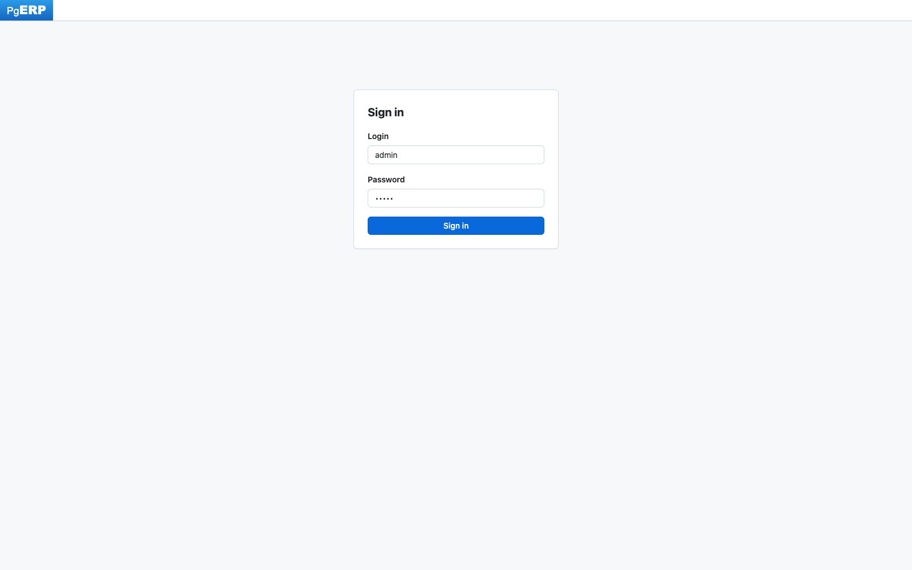

## 2. Solution

**Solutions → "+ New solution".** A solution groups everything that belongs to the application. Objects whose names
start with the **prefix** join the solution automatically — that is why all names below start with `todo_`.

| Field | Value | Why |
|---|---|---|
| Name | <nobr>`todo`</nobr> | solution code; also the database schema and the package folder by default |
| Title | To-do list | for people |
| Prefix | <nobr>`todo_`</nobr> | what belongs to the solution |
| Menu folder | My tasks | the menu folder a release carries over |

"Save". Then select **Solution: To-do list** in the sidebar — forms, reports and the data schema of this solution only
will be shown, and new forms get its prefix and folder.

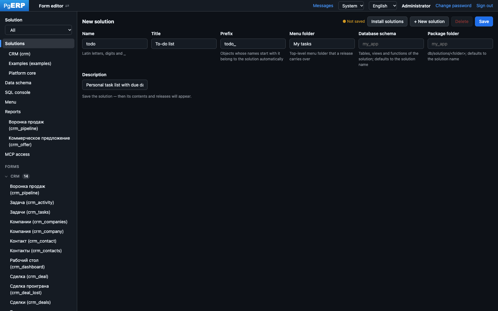

## 3. Table

**Data schema → "+ Table".** Name <nobr>`todo_tasks`</nobr>, comment "To-do list tasks". The column <nobr>`id bigserial`</nobr> with the "Key"
mark is already there. Add columns with "+ Column":

| Name | Type | Req. | Default | Comment |
|---|---|---|---|---|
| <nobr>`title`</nobr> | <nobr>`varchar(200)`</nobr> | ✓ | | What to do |
| <nobr>`notes`</nobr> | <nobr>`text`</nobr> | | | Notes |
| <nobr>`due_on`</nobr> | <nobr>`date`</nobr> | | | Due date |
| <nobr>`done`</nobr> | <nobr>`boolean`</nobr> | ✓ | <nobr>`false`</nobr> | Done |
| <nobr>`owner_login`</nobr> | <nobr>`varchar(50)`</nobr> | ✓ | | Whose task |
| <nobr>`created_at`</nobr> | <nobr>`timestamptz`</nobr> | ✓ | <nobr>`now()`</nobr> | |

In "Indexes" add an index on <nobr>`owner_login, due_on`</nobr> — the list is always selected by owner and due date.

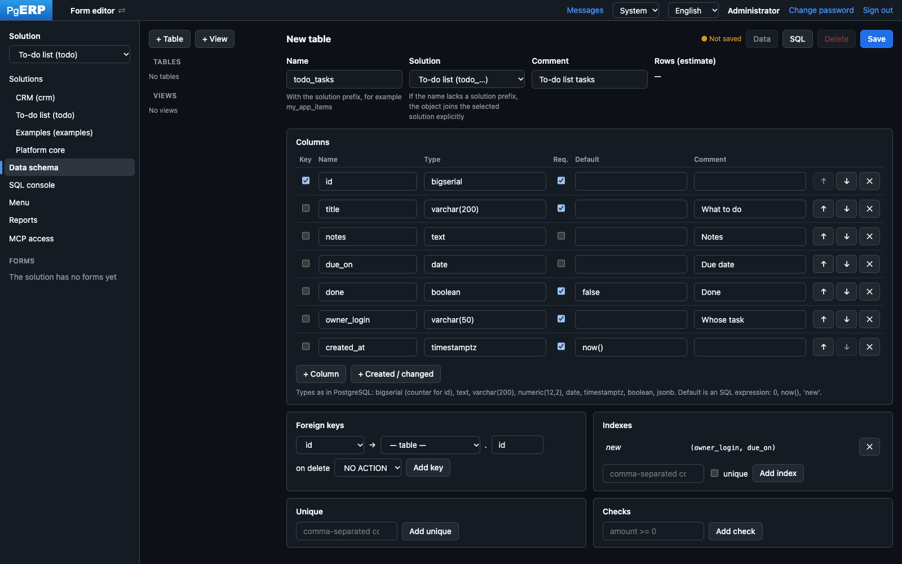

"Save" shows the SQL that will be executed — check it and press "Apply".

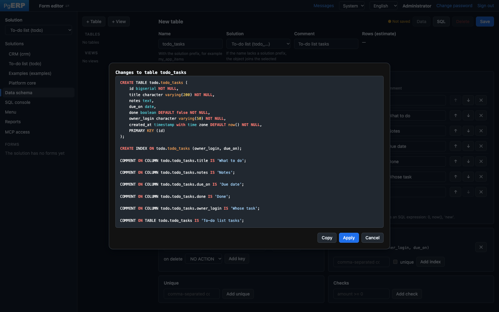

> Rename columns and tables here, in the designer: it remembers the rename, and a release renames the column on another
> database instead of dropping it with its data.

## 4. A view for the list

**"+ View"**, name <nobr>`todo_tasks_v`</nobr>. The form table shows the view's rows — the view is the place to prepare
everything for display: the due date as text, the status as a badge, a search string, and **only the current user's
tasks** (<nobr>`ui_user()`</nobr> is the login of whoever called the action):

```sql
SELECT t.id,
       t.title,
       t.notes,
       t.due_on,
       to_char(t.due_on, 'YYYY-MM-DD') AS due,
       t.done,
       jsonb_build_object(
           'code',  CASE WHEN t.done THEN 'done' WHEN t.due_on < current_date THEN 'overdue' ELSE 'new' END,
           'label', CASE WHEN t.done THEN 'Done' WHEN t.due_on < current_date THEN 'Overdue' ELSE 'In progress' END) AS state,
       lower(t.title) AS search_text
FROM todo_tasks t
WHERE t.owner_login = ui_user()
```

The <nobr>`state`</nobr> column is a value for the "Badge" format: <nobr>`code`</nobr> picks the colour (<nobr>`done`</nobr> — green, <nobr>`overdue`</nobr> — red,
<nobr>`new`</nobr> — blue), <nobr>`label`</nobr> is the text. "Save" → "Apply".

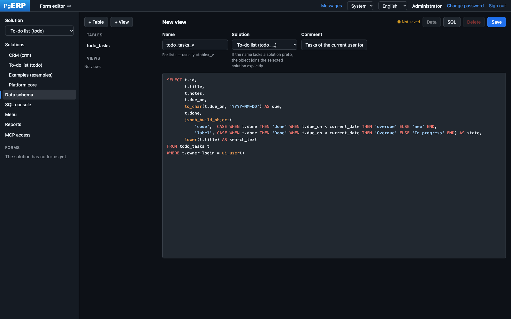

## 5. Task card

**Form editor → "+ New form".** Form properties (on the right): name <nobr>`todo_task`</nobr>, title "Task", folder "My tasks".
Add components by clicking the palette on the left and set their properties on the right:

| Component | Name | Label | Action |
|---|---|---|---|
| Hidden field | <nobr>`id`</nobr> | | |
| Input field | <nobr>`title`</nobr> | What to do | |
| Date | <nobr>`due_on`</nobr> | Due date | |
| Input field | <nobr>`notes`</nobr> | Notes | |
| Button | <nobr>`btn_save`</nobr> | Save | <nobr>`todo_task_save`</nobr> — created below |
| Button | <nobr>`btn_cancel`</nobr> | Cancel | <nobr>`form_close`</nobr> — a ready core action |

**The field name** is the key under which its value reaches the function: <nobr>`p_data->>'title'`</nobr>. The hidden field
<nobr>`id`</nobr> is empty for a new task and filled for an existing one — this is how the function decides whether to create or
update. The first button of a row is the primary (blue) one.

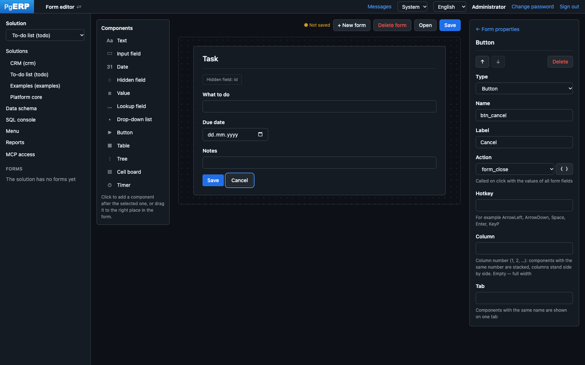

**The "Save" button code.** Select the <nobr>`btn_save`</nobr> button and press **"{ }"** next to the "Action" field. The editor
offers a template: variables for the form fields are declared, a check of the first field is written.

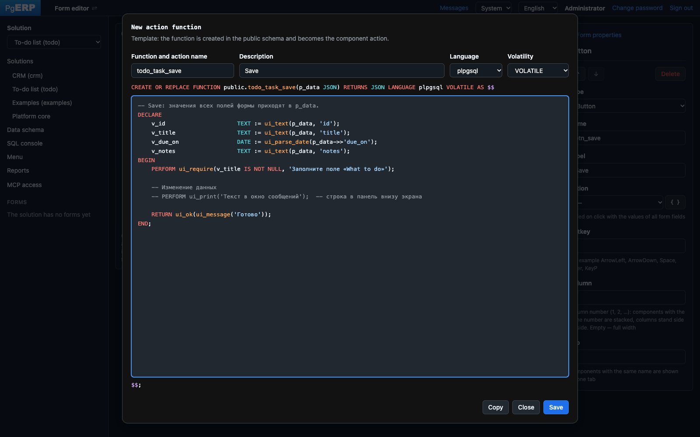

Name — <nobr>`todo_task_save`</nobr>, description — "To-do list: save a task". Replace the body with:

```sql
-- "Save" in the task card: the values of all form fields arrive in p_data.
DECLARE
    v_id     BIGINT := ui_parse_id(p_data->>'id');
    v_title  TEXT   := ui_text(p_data, 'title');
    v_due_on DATE   := ui_parse_date(p_data->>'due_on');
    v_notes  TEXT   := ui_text(p_data, 'notes');
BEGIN
    PERFORM ui_require(v_title IS NOT NULL, 'Write what needs to be done');

    IF ui_is_new(p_data) THEN
        INSERT INTO todo_tasks (title, due_on, notes, owner_login)
        VALUES (v_title, v_due_on, v_notes, ui_user());
    ELSE
        UPDATE todo_tasks SET title = v_title, due_on = v_due_on, notes = v_notes
        WHERE id = v_id AND owner_login = ui_user();
        PERFORM ui_require(FOUND, 'Task not found — it may have been deleted');
    END IF;

    RETURN ui_ok(
        ui_close_form(),
        ui_refresh_grid('todo_tasks_grid', p_keep_page => TRUE),
        ui_message(format('Task "%s" saved', v_title)));
END;
```

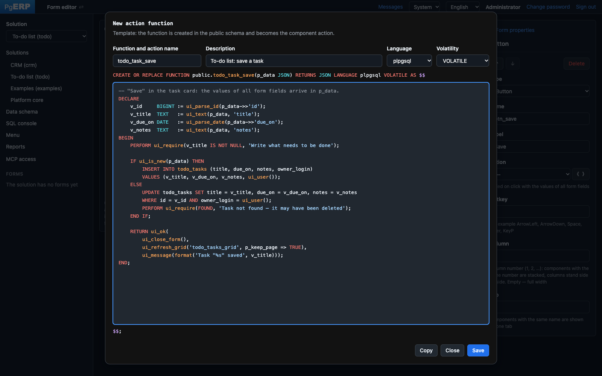

What matters here:

- <nobr>`ui_text`</nobr>, <nobr>`ui_parse_id`</nobr>, <nobr>`ui_parse_date`</nobr> read form fields (an empty field — <nobr>`NULL`</nobr>, an invalid date — <nobr>`NULL`</nobr>);
- <nobr>`ui_require(condition, 'text')`</nobr> is an error for the user: the text is shown in a dialog, changes are rolled back;
- <nobr>`ui_is_new(p_data)`</nobr> — the form has no <nobr>`id`</nobr>, so the task is new;
- <nobr>`owner_login = ui_user()`</nobr> in the <nobr>`UPDATE`</nobr> prevents changing someone else's task even with a forged <nobr>`id`</nobr>;
- <nobr>`ui_ok(...)`</nobr> is the response: close the card, reload the list table (it is in another form — found by the name
  <nobr>`todo_tasks_grid`</nobr>), show a message.

"Save" in the code window: the database creates the function and registers the action — it becomes the button's action
right away. A compilation error is shown in the window, and the previous version of the function stays. Then "Save" the form.

## 6. Task list

**"+ New form":** name <nobr>`todo_tasks`</nobr>, title "My tasks". Components:

| Component | Name | Label | Action / parameters |
|---|---|---|---|
| Input field | <nobr>`search`</nobr> | Search | "Table filter": <nobr>`todo_tasks_grid`</nobr> — the table reloads while typing |
| Table | <nobr>`todo_tasks_grid`</nobr> | Tasks | <nobr>`todo_tasks_page`</nobr> — the row source |
| Button | <nobr>`btn_new`</nobr> | New task | <nobr>`todo_task_new_open`</nobr> |

**Table source.** Select the table and press "{ }": the template for a table is a <nobr>`ui_grid_page`</nobr> call.

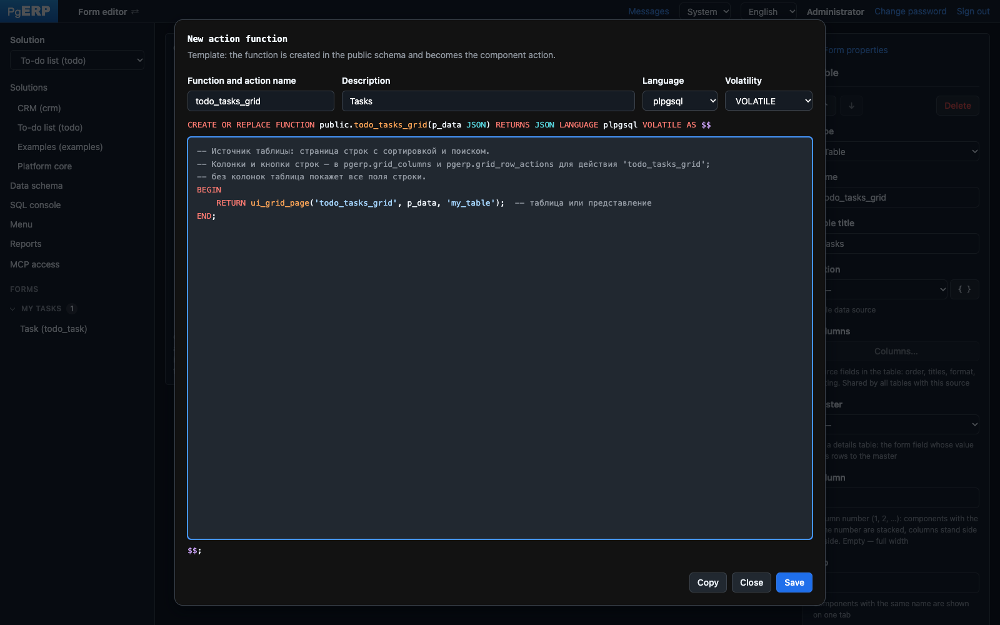

Name <nobr>`todo_tasks_page`</nobr>, language <nobr>`sql`</nobr>, volatility <nobr>`STABLE`</nobr> (it only reads), body:

```sql
-- Table source: a page of the current user's tasks, search by title, ordered by due date by default.
SELECT ui_grid_page('todo_tasks_page', p_data, 'todo_tasks_v', NULL, 'due_on', 'asc',
                    p_search_column => 'search_text', p_search => lower(p_data->>'search'));
```

<nobr>`ui_grid_page`</nobr> does paging, sorting and search by itself: it receives <nobr>`page`</nobr>, <nobr>`limit`</nobr>, <nobr>`sort_field`</nobr> and the form field
values (<nobr>`search`</nobr>), reads the view and responds with rows, columns and row buttons.

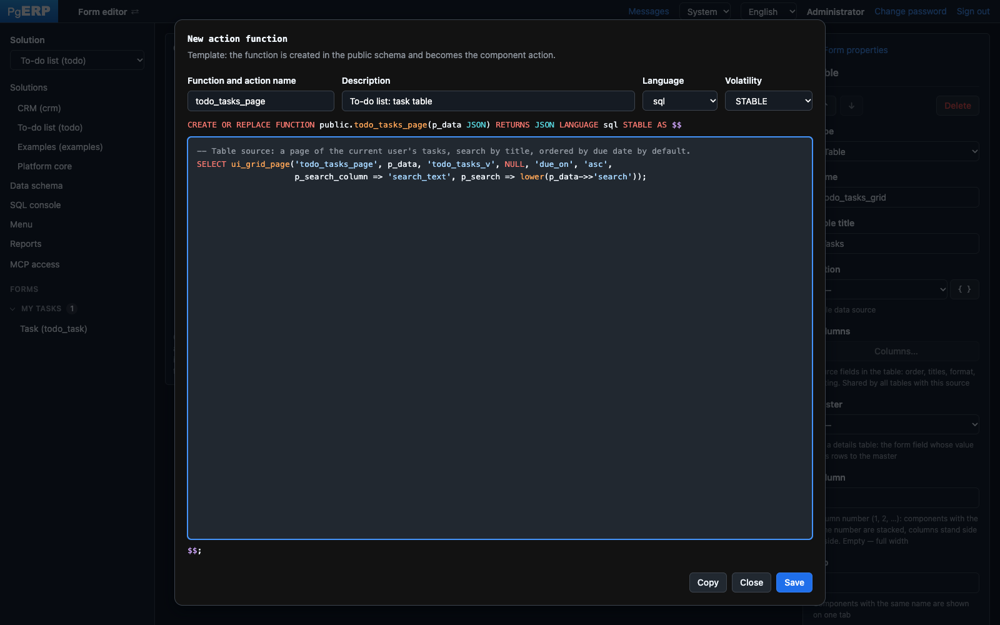

**Columns.** The "Columns…" button in the table properties: which source fields to show, with which titles and formats.

| Field | Title | Format | Sorting |
|---|---|---|---|
| <nobr>`title`</nobr> | What to do | Text | ✓ |
| <nobr>`due`</nobr> | Due date | Text | ✓ (an ISO date sorts correctly as text) |
| <nobr>`state`</nobr> | Status | Badge | |

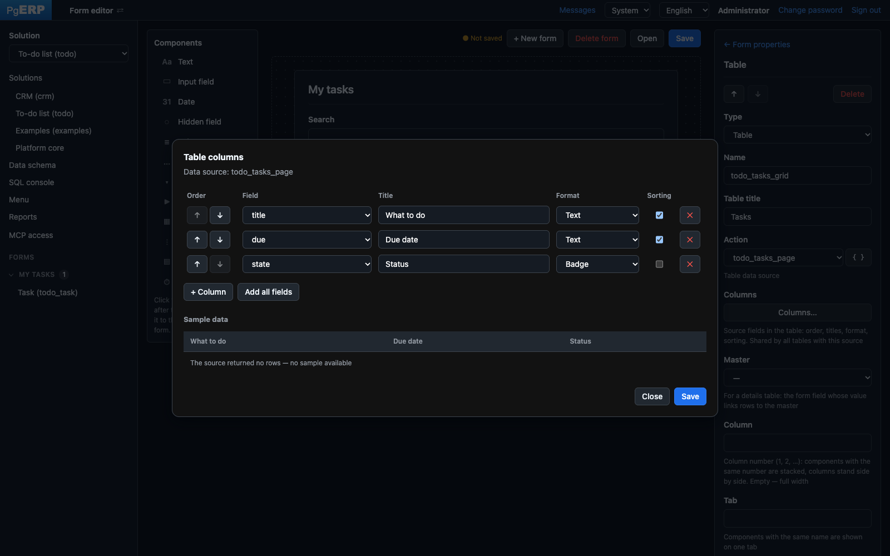

**The "New task" button** — "{ }", name <nobr>`todo_task_new_open`</nobr>:

```sql
-- "New task": open an empty card, due tomorrow by default.
BEGIN
    RETURN ui_ok(ui_open_form('todo_task',
        p_title => 'New task',
        p_data  => jsonb_build_object('due_on', to_char(current_date + 1, 'YYYY-MM-DD'))));
END;
```

<nobr>`ui_open_form`</nobr> opens the card in a window; <nobr>`p_data`</nobr> holds the initial field values (a date in the <nobr>`YYYY-MM-DD`</nobr> format).
"Save" the form.

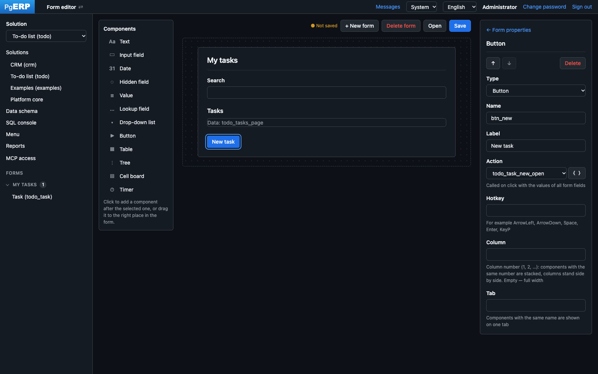

## 7. Row buttons — via the SQL console

Table row buttons ("Edit", "Done", "Delete" on every task) are defined for the table source in
<nobr>`pgerp.grid_row_actions`</nobr>; a button calls its action with <nobr>`{"id": row id}`</nobr>. Three functions and their registration are
easiest to run as one script: **SQL console → SQL tab → "Run"** (Ctrl+Enter).

```sql
-- Buttons in the task table rows: open, mark as done, delete.
-- A row button calls its action with {"id": row id}.
CREATE FUNCTION todo_task_edit_open(p_data JSON) RETURNS JSON AS $$
DECLARE
    v_task todo_tasks%ROWTYPE;
BEGIN
    SELECT * INTO v_task FROM todo_tasks WHERE id = ui_parse_id(p_data->>'id') AND owner_login = ui_user();
    PERFORM ui_require(FOUND, 'Task not found — it may have been deleted');
    RETURN ui_ok(ui_open_form('todo_task',
        p_title => v_task.title,
        p_data  => jsonb_build_object(
            'id',     v_task.id::TEXT,
            'title',  v_task.title,
            'due_on', COALESCE(to_char(v_task.due_on, 'YYYY-MM-DD'), ''),
            'notes',  COALESCE(v_task.notes, ''))));
END;
$$ LANGUAGE plpgsql;

CREATE FUNCTION todo_task_done(p_data JSON) RETURNS JSON AS $$
BEGIN
    UPDATE todo_tasks SET done = NOT done WHERE id = ui_parse_id(p_data->>'id') AND owner_login = ui_user();
    PERFORM ui_require(FOUND, 'Task not found — it may have been deleted');
    RETURN ui_ok(ui_refresh_grid('todo_tasks_grid', p_keep_page => TRUE));
END;
$$ LANGUAGE plpgsql;

CREATE FUNCTION todo_task_delete(p_data JSON) RETURNS JSON AS $$
DECLARE
    v_title TEXT;
BEGIN
    SELECT title INTO v_title FROM todo_tasks WHERE id = ui_parse_id(p_data->>'id') AND owner_login = ui_user();
    PERFORM ui_require(FOUND, 'Task not found — it may have been deleted');
    -- The first call asks; if the user agrees, the client calls the action again with "confirmed": true
    IF NOT ui_confirmed(p_data) THEN
        RETURN ui_ok(ui_confirm(format('Delete task "%s"?', v_title), 'todo_task_delete',
                                jsonb_build_object('id', p_data->>'id', 'confirmed', TRUE),
                                p_confirm_label => 'Delete'));
    END IF;
    DELETE FROM todo_tasks WHERE id = ui_parse_id(p_data->>'id');
    RETURN ui_ok(ui_refresh_grid('todo_tasks_grid', p_keep_page => TRUE));
END;
$$ LANGUAGE plpgsql;

INSERT INTO pgerp.ui_actions (action_name, function_name, description) VALUES
    ('todo_task_edit_open', 'todo_task_edit_open', 'To-do list: open a task'),
    ('todo_task_done',      'todo_task_done',      'To-do list: done / not done'),
    ('todo_task_delete',    'todo_task_delete',    'To-do list: delete a task');

INSERT INTO pgerp.grid_row_actions (source_action, sort_order, row_action, label, style) VALUES
    ('todo_tasks_page', 1, 'todo_task_edit_open', 'Edit',     'default'),
    ('todo_tasks_page', 2, 'todo_task_done',      'Done',     'default'),
    ('todo_tasks_page', 3, 'todo_task_delete',    'Delete',   'danger');
```

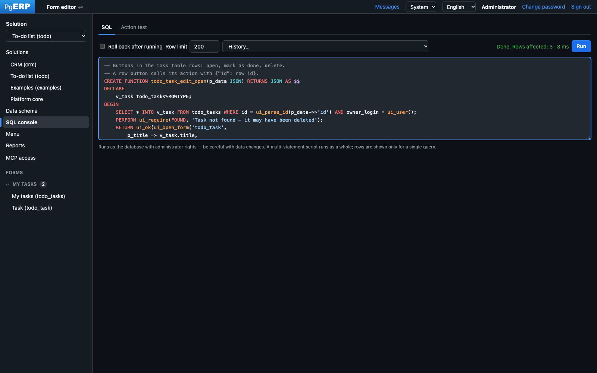

Deletion takes two steps: the first call returns <nobr>`ui_confirm`</nobr> (the "Delete task …?" dialog); if the user agrees, the
browser calls the same action with <nobr>`"confirmed": true`</nobr>, and <nobr>`ui_confirmed(p_data)`</nobr> skips the question.

> Action handlers (<nobr>`fn(p_data JSON) RETURNS JSON`</nobr>) can be opened and edited later with "{ }" in the form editor;
> helper functions and triggers go through the SQL console.

## 8. Menu

**Menu → "+ Item"** — title "My tasks" (a folder); **"+ Sub-item"** — "Tasks", form <nobr>`todo_tasks`</nobr>. "Save".

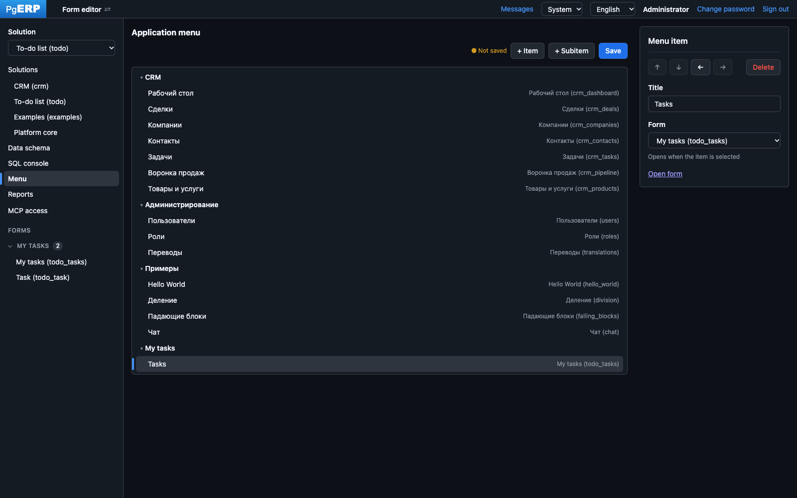

## 9. Permissions

An administrator sees everything; other users get a form through a role. In the application: **Administration → Roles
→ "New role"**: code <nobr>`todo_user`</nobr>, title "To-do list", "Save"; then the "My tasks" form → "Add form".
The <nobr>`todo_task`</nobr> card does not need to be granted: it is opened from the list and is available automatically, with all its actions.

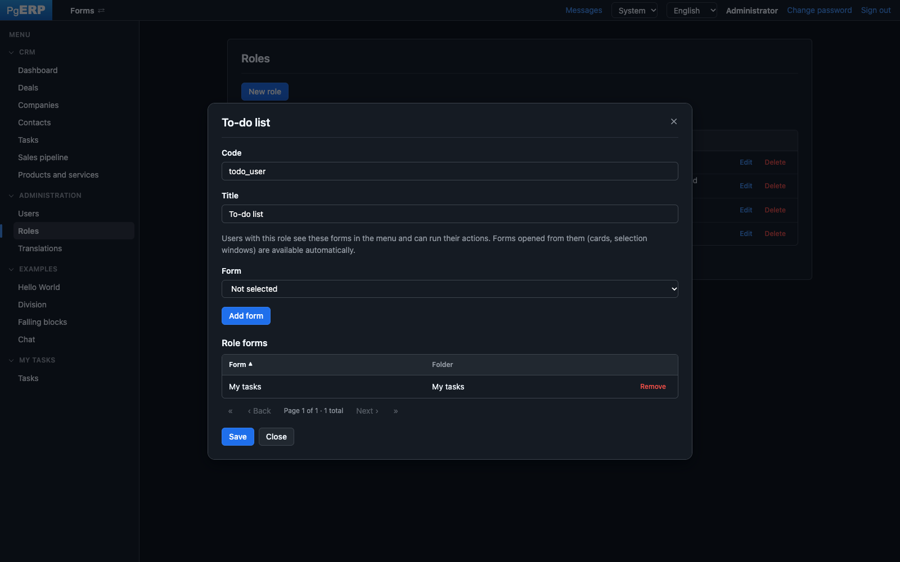

Assign the role to users in **Administration → Users**. Everyone sees only their own tasks — that is
<nobr>`WHERE t.owner_login = ui_user()`</nobr> in the view.

## 10. Using the application

Switch to "Forms" (or press "Open" in the form editor): **My tasks → Tasks → "New task"**.

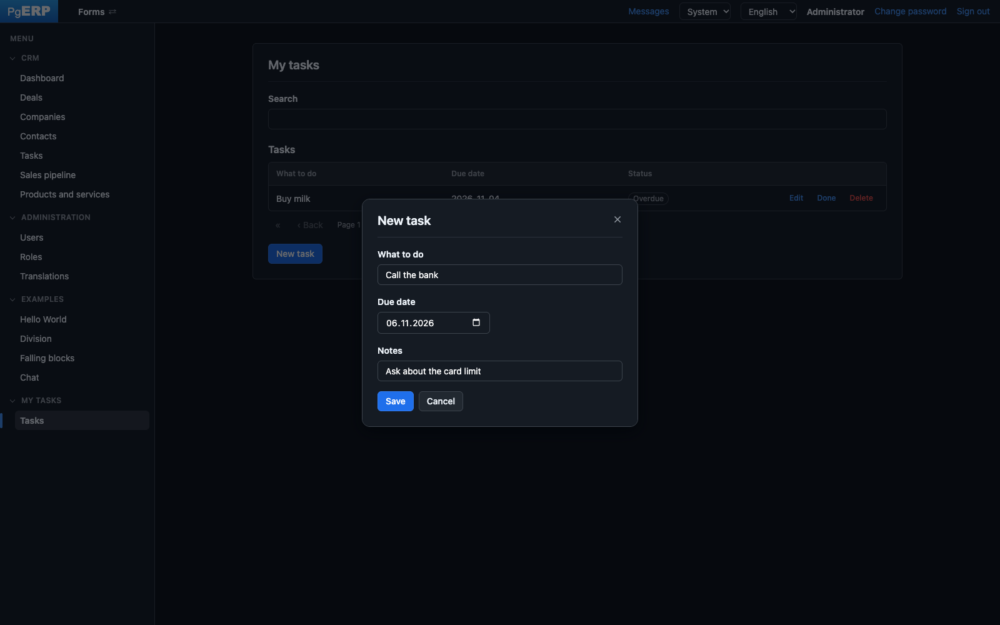

A due date in the past shows "Overdue", the "Done" button toggles the mark, search filters by title.


"Delete" asks first:

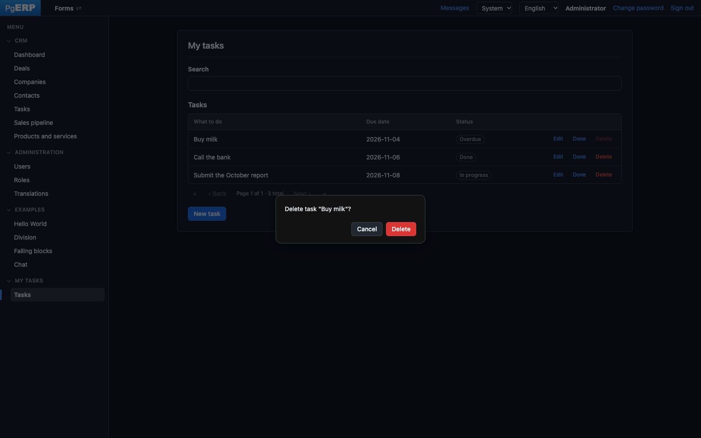

An empty title is not saved — this is the <nobr>`ui_require`</nobr> from the save function:

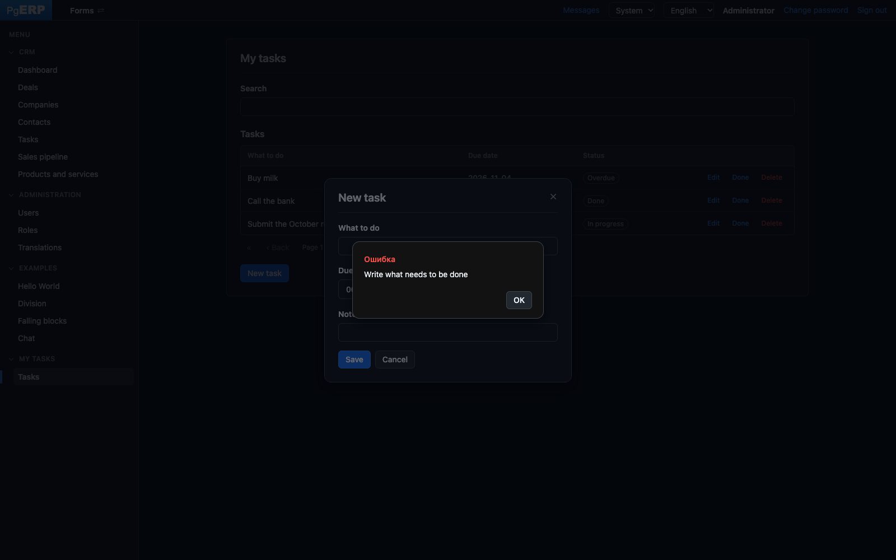

## 11. Testing an action without the interface

**SQL console → "Action test"**: the action is called the way a form button calls it — with field data and the
permissions of the selected user. With "Roll back changes" checked nothing is saved — handy for testing handlers,
including as a user with the <nobr>`todo_user`</nobr> role (the "As user" field).

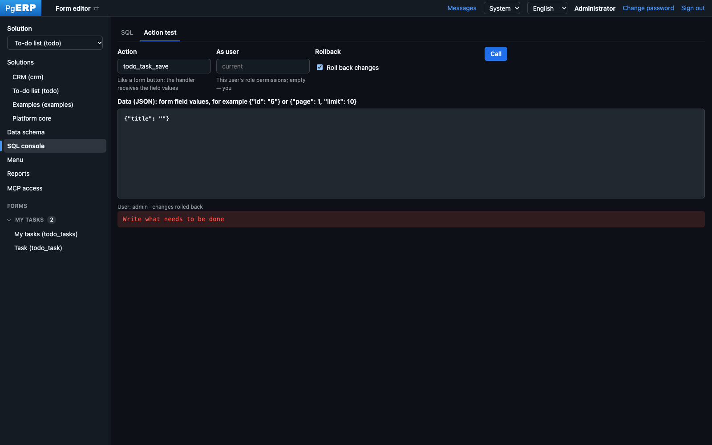

Queries to the data go to the SQL tab, for example <nobr>`SELECT * FROM todo_tasks`</nobr>; "Data" in the table designer opens
the console with such a query.

## 12. Release: moving to another installation

**Solutions → To-do list.** "Contents" shows everything that joined the solution by prefix: the table, the view, six
functions and actions, two forms, the role. Enter a release name and press "Check changes": the list of changes and
the release text.

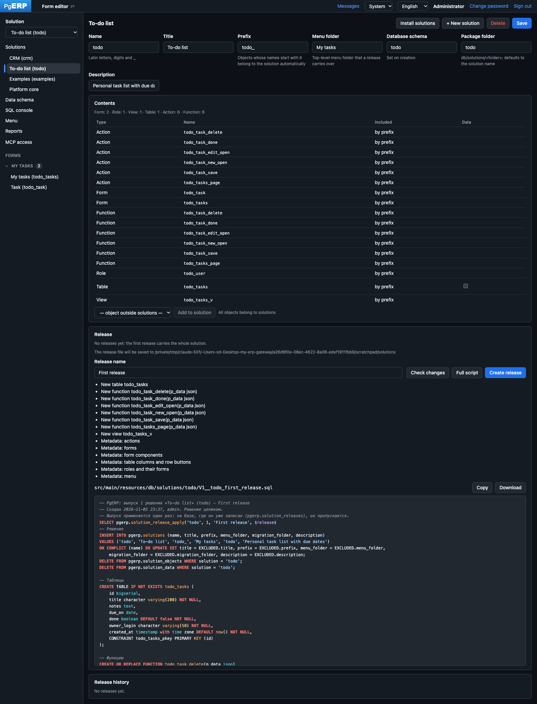

"Create release" produces the file <nobr>`V<number>__todo_<name>.sql`</nobr>. If the project packages folder is set
(<nobr>`ERP_DEV_SOLUTIONS_DIR=…/src/main/resources/db/solutions`</nobr>), it is saved to <nobr>`db/solutions/todo/`</nobr> by itself
together with the package description <nobr>`solution.json`</nobr>, otherwise it is downloaded — put it there. On another
installation the administrator installs the solution at first sign-in or in "Solutions → Install solutions" (into any
schema), and later releases are applied at application start; on your database the release is already recorded and
will be skipped.

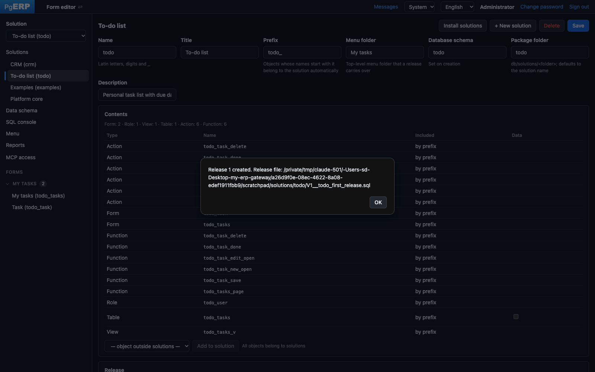

From here on, change the solution as you like and release again: the next release carries only the changes
(new columns — <nobr>`ALTER TABLE`</nobr>, changed functions — <nobr>`CREATE OR REPLACE`</nobr>, forms and menu — whole).
If a table's rows are needed on every installation (reference data), tick "Data" for it in "Contents".

## The same with an AI agent (MCP)

Everything above is available to an agent through the application's MCP server. **MCP access → "Issue token"**, then in
Claude Code:

```bash
claude mcp add --transport http pgerp http://localhost:8080/mcp --header "Authorization: Bearer <token>"
```

and ask in plain words, for example:

> Create a PgERP solution "todo" — "To-do list" (prefix todo_, menu folder "My tasks"): a task table with a due date,
> notes and a "done" mark, every user has their own tasks; a list with search and row buttons "Edit", "Done", "Delete"
> (with confirmation), a task card, a menu item, the role todo_user. Test the actions with action_run and show
> release_preview.

The agent reads the platform guide (<nobr>`platform_guide`</nobr>) and performs the same steps with the tools
<nobr>`solution_save`</nobr>, <nobr>`table_save`</nobr>, <nobr>`view_save`</nobr>, <nobr>`function_save`</nobr>, <nobr>`form_save`</nobr>, <nobr>`grid_columns_save`</nobr>, <nobr>`sql_run`</nobr>,
<nobr>`menu_save`</nobr>, <nobr>`role_set`</nobr>, <nobr>`action_run`</nobr>, <nobr>`release_preview`</nobr>. The result opens in the same editor.
