[English](tutorial-todo.md) · **Русский**

# Пример: список дел (todo list) с нуля

Пошаговое руководство: приложение «Список дел» создаётся целиком в редакторе PgERP — таблица, код, формы,
меню, права — и выпускается пакетом решения для других установок. Java при этом не меняется: всё живёт в PostgreSQL.
Устройство платформы — в [ARCHITECTURE.ru.md](../ARCHITECTURE.ru.md), здесь — только практика.

Что получится: у каждого пользователя свой список задач со сроком, поиском, отметкой «Сделано», правкой
и удалением с подтверждением; просроченные задачи подсвечиваются.

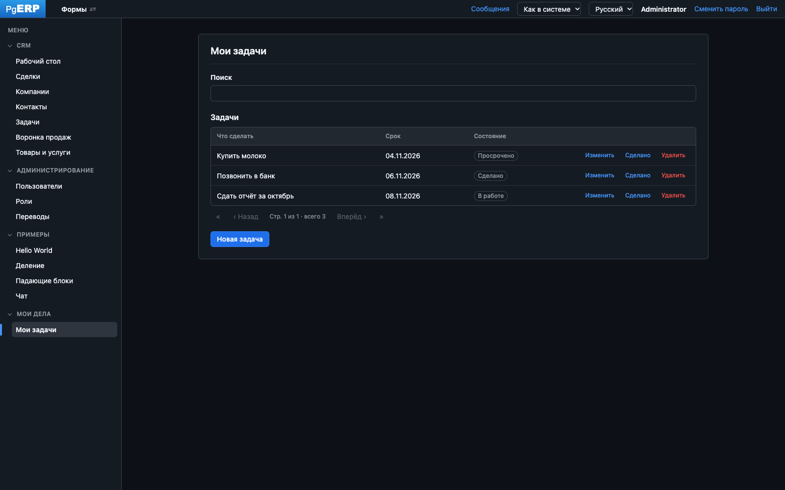

| Шаг | Где | Что создаём |
|---|---|---|
| 1 | Вход | редактор форм |
| 2 | Решения | решение <nobr>`todo`</nobr> с префиксом <nobr>`todo_`</nobr> |
| 3–4 | Схема данных | таблица <nobr>`todo_tasks`</nobr>, представление <nobr>`todo_tasks_v`</nobr> |
| 5 | Редактор форм | карточка <nobr>`todo_task`</nobr> и функция <nobr>`todo_task_save`</nobr> |
| 6 | Редактор форм | список <nobr>`todo_tasks`</nobr>, источник <nobr>`todo_tasks_page`</nobr>, колонки, кнопка «Новая задача» |
| 7 | SQL-консоль | кнопки в строках: «Изменить», «Сделано», «Удалить» |
| 8–9 | Меню, Роли | пункт меню и роль <nobr>`todo_user`</nobr> |
| 10–11 | Приложение, консоль | проверка |
| 12 | Решения | выпуск — файл пакета решения |

## Как это работает (коротко)

Форма — строки метаданных (компоненты: поля, кнопки, таблица). Кнопка вызывает **действие** — функцию
<nobr>`имя(p_data JSON) RETURNS JSON`</nobr> в схеме базы решения. В <nobr>`p_data`</nobr> приходят значения всех полей формы, функция меняет данные
и отвечает инструкциями для браузера: закрыть окно, обновить таблицу, показать сообщение. Права, проверки
и тексты ошибок — тоже в базе.

```
кнопка «Сохранить» → POST /api/ui/event?action=todo_task_save {"title": "…", "due_on": "…"}
                   → pgerp.handle_ui_event → todo_task_save(p_data)
                   ← {"status": "success", "ui_instructions": [close_form, refresh_grid, show_message]}
```

> Тексты, которые вы вводите (заголовки форм, подписи, сообщения в коде), становятся **исходными текстами**
> приложения. Исходный язык платформы — английский, на другие языки тексты переводятся в форме «Переводы».
> В этом руководстве тексты русские — так тоже работает, но английским пользователям они покажутся без перевода.

## 1. Вход

Откройте приложение и войдите администратором (первый вход — **admin / admin**, пароль попросят сменить).
Интерфейс по умолчанию английский: выберите **Русский** в переключателе языка в шапке — выбор запомнится.
В шапке переключатель «Формы ⇄ Редактор форм» ведёт в редактор: `editor.html`.

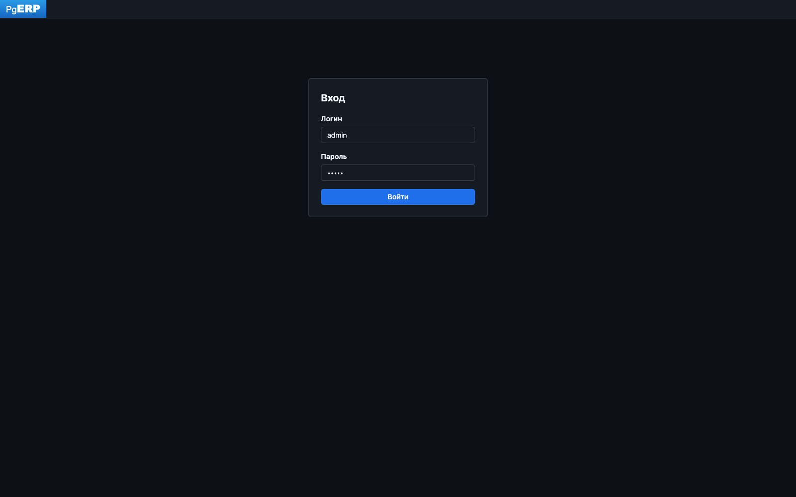

## 2. Решение

**Решения → «+ Новое решение».** Решение объединяет всё, что относится к приложению. Объекты, имена которых
начинаются с **префикса**, входят в решение автоматически — поэтому дальше все имена начинаются с `todo_`.

| Поле | Значение | Зачем |
|---|---|---|
| Имя | <nobr>`todo`</nobr> | код решения; по умолчанию им же названы схема базы и папка пакета |
| Название | Список дел | для людей |
| Префикс | <nobr>`todo_`</nobr> | что входит в решение |
| Папка меню | Мои дела | папка меню, которую перенесёт выпуск |

«Сохранить». Затем в боковой панели выберите **Решение: Список дел** — формы, отчёты и схема данных будут
показаны только для него, а новые формы получат префикс и папку.

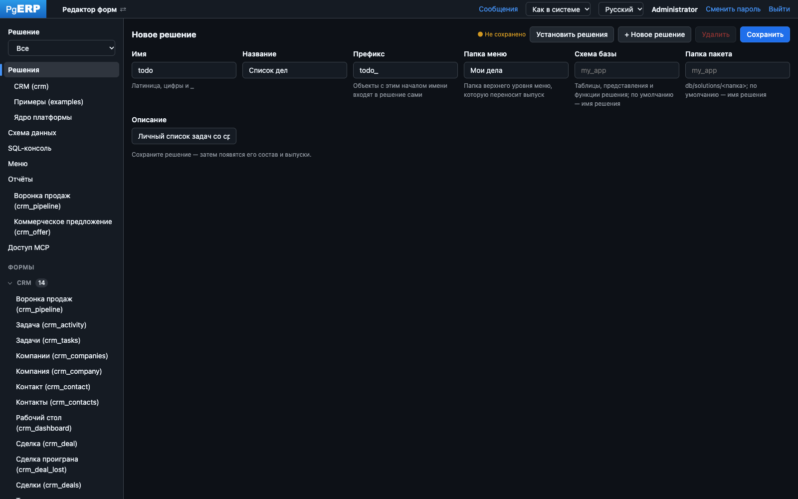

## 3. Таблица

**Схема данных → «+ Таблица».** Имя <nobr>`todo_tasks`</nobr>, комментарий «Задачи списка дел». Колонка
<nobr>`id bigserial`</nobr> с галочкой «Ключ» уже есть. Добавьте колонки кнопкой «+ Колонка»:

| Имя | Тип | Обяз. | По умолчанию | Комментарий |
|---|---|---|---|---|
| <nobr>`title`</nobr> | <nobr>`varchar(200)`</nobr> | ✓ | | Что сделать |
| <nobr>`notes`</nobr> | <nobr>`text`</nobr> | | | Заметки |
| <nobr>`due_on`</nobr> | <nobr>`date`</nobr> | | | Срок |
| <nobr>`done`</nobr> | <nobr>`boolean`</nobr> | ✓ | <nobr>`false`</nobr> | Сделано |
| <nobr>`owner_login`</nobr> | <nobr>`varchar(50)`</nobr> | ✓ | | Чья задача |
| <nobr>`created_at`</nobr> | <nobr>`timestamptz`</nobr> | ✓ | <nobr>`now()`</nobr> | |

В блоке «Индексы» добавьте индекс <nobr>`owner_login, due_on`</nobr> — список всегда выбирается по владельцу и сроку.

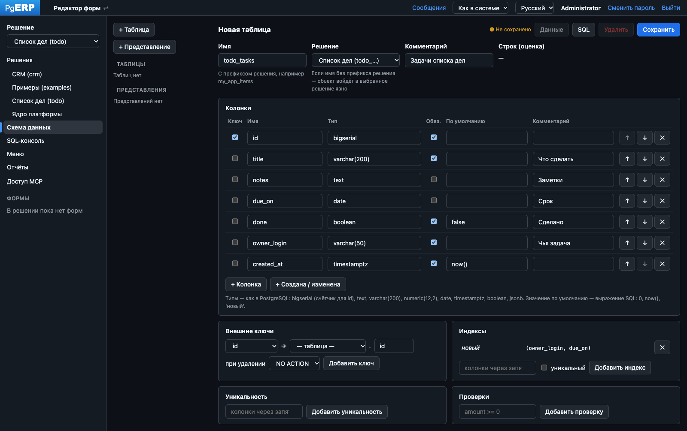

«Сохранить» показывает SQL, который будет выполнен, — проверьте и нажмите «Применить».

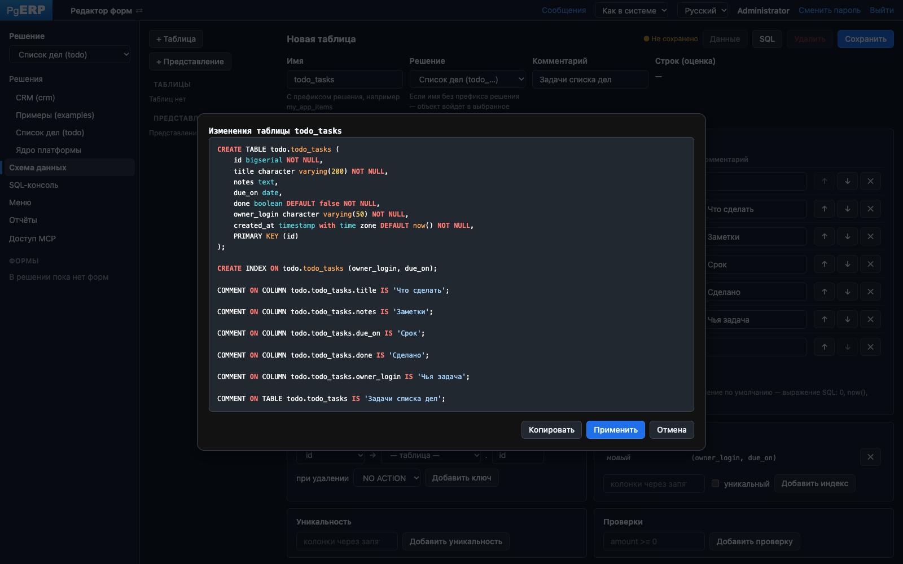

> Переименовывать колонки и таблицы лучше здесь же, в конструкторе: он запоминает переименование, и выпуск
> переименует колонку на другой базе, а не удалит её вместе с данными.

## 4. Представление для списка

**«+ Представление»**, имя <nobr>`todo_tasks_v`</nobr>. Таблица формы показывает строки представления — в нём удобно
подготовить всё для показа: срок текстом, состояние меткой, строку для поиска, и оставить **только задачи
текущего пользователя** (<nobr>`ui_user()`</nobr> — логин того, кто вызвал действие):

```sql
SELECT t.id,
       t.title,
       t.notes,
       t.due_on,
       to_char(t.due_on, 'DD.MM.YYYY') AS due,
       t.done,
       jsonb_build_object(
           'code',  CASE WHEN t.done THEN 'done' WHEN t.due_on < current_date THEN 'overdue' ELSE 'new' END,
           'label', CASE WHEN t.done THEN 'Сделано' WHEN t.due_on < current_date THEN 'Просрочено' ELSE 'В работе' END) AS state,
       lower(t.title) AS search_text
FROM todo_tasks t
WHERE t.owner_login = ui_user()
```

Колонка <nobr>`state`</nobr> — значение для формата «Метка»: <nobr>`code`</nobr> выбирает цвет (<nobr>`done`</nobr> — зелёный, <nobr>`overdue`</nobr> — красный,
<nobr>`new`</nobr> — синий), <nobr>`label`</nobr> — текст. «Сохранить» → «Применить».

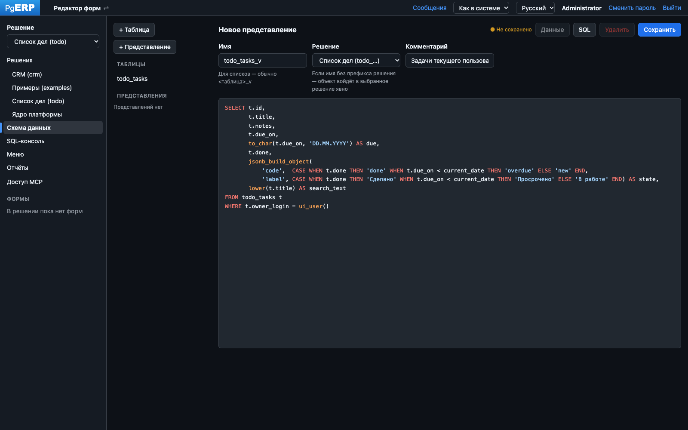

## 5. Карточка задачи

**Редактор форм → «+ Новая форма».** Свойства формы (справа): имя <nobr>`todo_task`</nobr>, заголовок «Задача», папка
«Мои дела». Добавьте компоненты щелчком по палитре слева и задайте свойства справа:

| Компонент | Имя | Подпись | Действие |
|---|---|---|---|
| Скрытое поле | <nobr>`id`</nobr> | | |
| Поле ввода | <nobr>`title`</nobr> | Что сделать | |
| Дата | <nobr>`due_on`</nobr> | Срок | |
| Поле ввода | <nobr>`notes`</nobr> | Заметки | |
| Кнопка | <nobr>`btn_save`</nobr> | Сохранить | <nobr>`todo_task_save`</nobr> — создаём ниже |
| Кнопка | <nobr>`btn_cancel`</nobr> | Отмена | <nobr>`form_close`</nobr> — готовое действие ядра |

**Имя поля** — ключ, под которым его значение придёт в функцию: <nobr>`p_data->>'title'`</nobr>. Скрытое поле <nobr>`id`</nobr> пусто
у новой задачи и заполнено у существующей — по нему функция понимает, создавать или менять. Первая кнопка
ряда — основная (синяя).

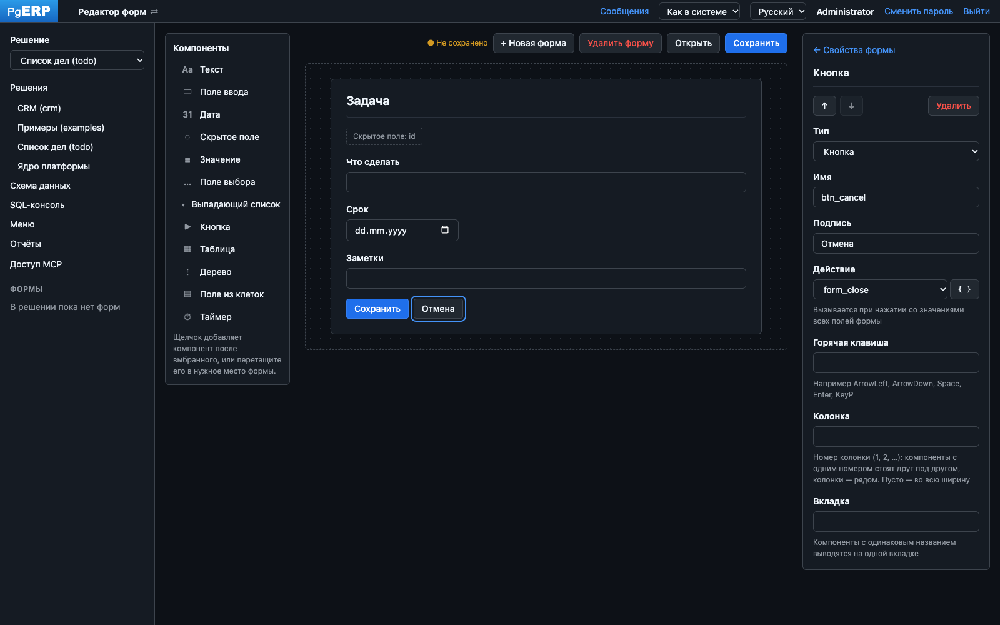

**Код кнопки «Сохранить».** Выберите кнопку <nobr>`btn_save`</nobr> и нажмите **«{ }»** у поля «Действие». Редактор предложит
заготовку: переменные для полей формы уже объявлены, проверка первого поля написана.

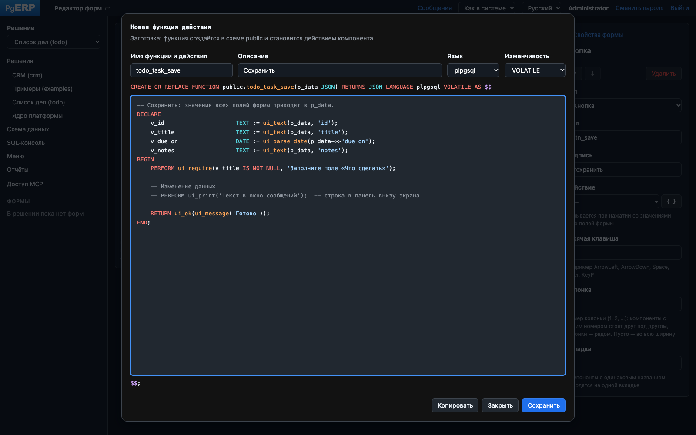

Имя — <nobr>`todo_task_save`</nobr>, описание — «Список дел: сохранить задачу». Замените тело на:

```sql
-- «Сохранить» в карточке задачи: значения всех полей формы приходят в p_data.
DECLARE
    v_id     BIGINT := ui_parse_id(p_data->>'id');
    v_title  TEXT   := ui_text(p_data, 'title');
    v_due_on DATE   := ui_parse_date(p_data->>'due_on');
    v_notes  TEXT   := ui_text(p_data, 'notes');
BEGIN
    PERFORM ui_require(v_title IS NOT NULL, 'Напишите, что нужно сделать');

    IF ui_is_new(p_data) THEN
        INSERT INTO todo_tasks (title, due_on, notes, owner_login)
        VALUES (v_title, v_due_on, v_notes, ui_user());
    ELSE
        UPDATE todo_tasks SET title = v_title, due_on = v_due_on, notes = v_notes
        WHERE id = v_id AND owner_login = ui_user();
        PERFORM ui_require(FOUND, 'Задача не найдена — возможно, её удалили');
    END IF;

    RETURN ui_ok(
        ui_close_form(),
        ui_refresh_grid('todo_tasks_grid', p_keep_page => TRUE),
        ui_message(format('Задача «%s» сохранена', v_title)));
END;
```

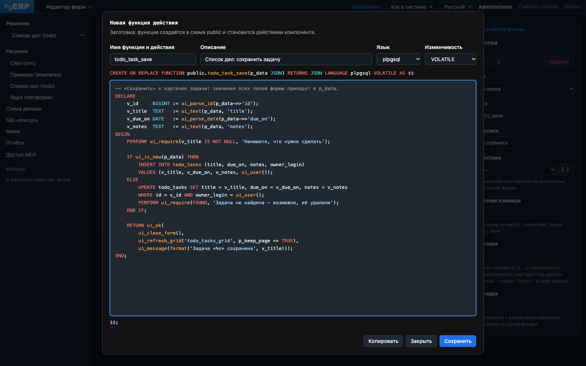

Что здесь важно:

- <nobr>`ui_text`</nobr>, <nobr>`ui_parse_id`</nobr>, <nobr>`ui_parse_date`</nobr> читают поля формы (пустое поле — <nobr>`NULL`</nobr>, неверная дата — <nobr>`NULL`</nobr>);
- <nobr>`ui_require(условие, 'текст')`</nobr> — ошибка для пользователя: текст покажется в окне, изменения откатятся;
- <nobr>`ui_is_new(p_data)`</nobr> — в форме нет <nobr>`id`</nobr>, значит задача новая;
- <nobr>`owner_login = ui_user()`</nobr> в <nobr>`UPDATE`</nobr> не даёт изменить чужую задачу, даже если подставить чужой <nobr>`id`</nobr>;
- <nobr>`ui_ok(...)`</nobr> — ответ: закрыть карточку, перечитать таблицу списка (она в другой форме — найдётся по имени
  <nobr>`todo_tasks_grid`</nobr>), показать сообщение.

«Сохранить» в окне кода: база создаёт функцию и регистрирует действие — оно сразу встаёт в кнопку. Ошибка
компиляции покажется в окне, прежняя версия функции останется. Затем «Сохранить» форму.

## 6. Список задач

**«+ Новая форма»:** имя <nobr>`todo_tasks`</nobr>, заголовок «Мои задачи». Компоненты:

| Компонент | Имя | Подпись | Действие / параметры |
|---|---|---|---|
| Поле ввода | <nobr>`search`</nobr> | Поиск | «Фильтр таблицы»: <nobr>`todo_tasks_grid`</nobr> — таблица перечитывается при вводе |
| Таблица | <nobr>`todo_tasks_grid`</nobr> | Задачи | <nobr>`todo_tasks_page`</nobr> — источник строк |
| Кнопка | <nobr>`btn_new`</nobr> | Новая задача | <nobr>`todo_task_new_open`</nobr> |

**Источник таблицы.** Выберите таблицу и нажмите «{ }»: заготовка для таблицы — вызов <nobr>`ui_grid_page`</nobr>.

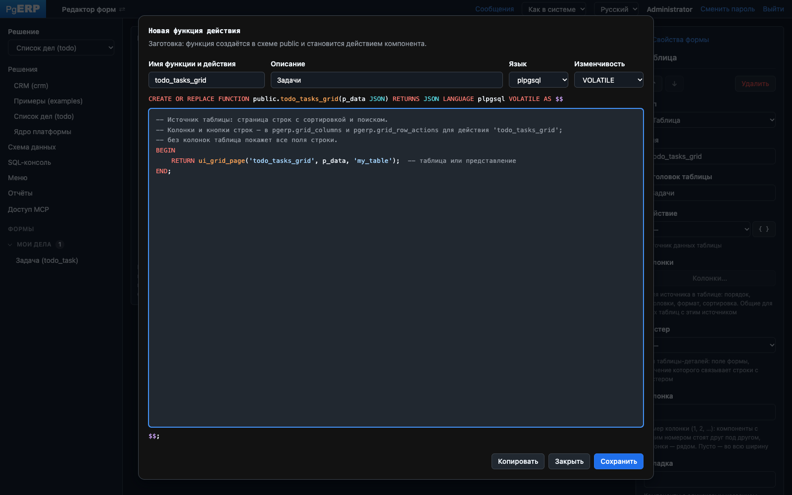

Имя <nobr>`todo_tasks_page`</nobr>, язык <nobr>`sql`</nobr>, изменчивость <nobr>`STABLE`</nobr> (только читает), тело:

```sql
-- Источник таблицы: страница задач текущего пользователя, поиск по названию, по умолчанию — по сроку.
SELECT ui_grid_page('todo_tasks_page', p_data, 'todo_tasks_v', NULL, 'due_on', 'asc',
                    p_search_column => 'search_text', p_search => lower(p_data->>'search'));
```

<nobr>`ui_grid_page`</nobr> сам делает страницы, сортировку и поиск: получает <nobr>`page`</nobr>, <nobr>`limit`</nobr>, <nobr>`sort_field`</nobr> и значения полей формы
(<nobr>`search`</nobr>), читает представление и отвечает строками с колонками и кнопками строк.

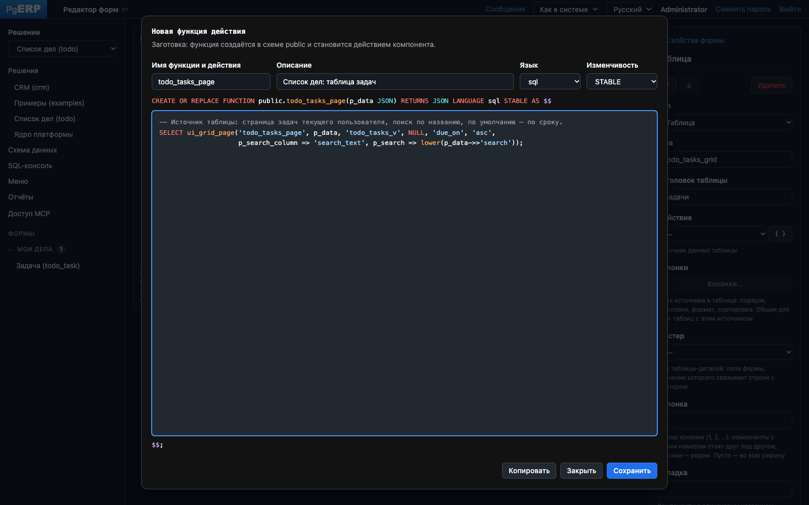

**Колонки.** Кнопка «Колонки…» в свойствах таблицы: какие поля источника показать, с какими заголовками
и в каком формате.

| Поле | Заголовок | Формат | Сортировка |
|---|---|---|---|
| <nobr>`title`</nobr> | Что сделать | Текст | ✓ |
| <nobr>`due`</nobr> | Срок | Текст | — по умолчанию строки и так идут по сроку |
| <nobr>`state`</nobr> | Состояние | Метка | |

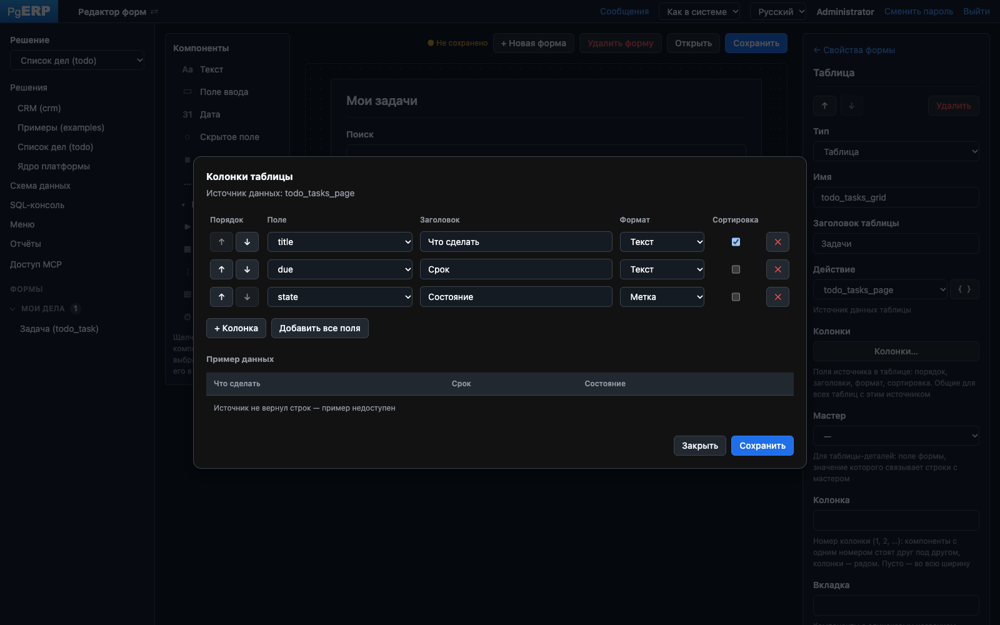

**Кнопка «Новая задача»** — «{ }», имя <nobr>`todo_task_new_open`</nobr>:

```sql
-- «Новая задача»: открыть пустую карточку, срок по умолчанию — завтра.
BEGIN
    RETURN ui_ok(ui_open_form('todo_task',
        p_title => 'Новая задача',
        p_data  => jsonb_build_object('due_on', to_char(current_date + 1, 'YYYY-MM-DD'))));
END;
```

<nobr>`ui_open_form`</nobr> открывает карточку в окне; <nobr>`p_data`</nobr> — начальные значения полей (дата — в формате <nobr>`ГГГГ-ММ-ДД`</nobr>).
«Сохранить» форму.

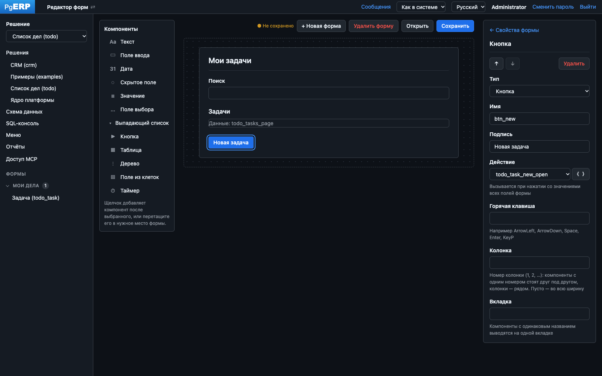

## 7. Кнопки в строках — SQL-консолью

Кнопки строк таблицы (у каждой задачи: «Изменить», «Сделано», «Удалить») задаются для источника таблицы
в <nobr>`pgerp.grid_row_actions`</nobr>; кнопка вызывает своё действие с <nobr>`{"id": id строки}`</nobr>. Три функции и их регистрацию
удобно выполнить одним скриптом: **SQL-консоль → вкладка SQL → «Выполнить»** (Ctrl+Enter).

```sql
-- Кнопки в строках таблицы задач: открыть, отметить сделанной, удалить.
-- Кнопка строки вызывает своё действие с {"id": id строки}.
CREATE FUNCTION todo_task_edit_open(p_data JSON) RETURNS JSON AS $$
DECLARE
    v_task todo_tasks%ROWTYPE;
BEGIN
    SELECT * INTO v_task FROM todo_tasks WHERE id = ui_parse_id(p_data->>'id') AND owner_login = ui_user();
    PERFORM ui_require(FOUND, 'Задача не найдена — возможно, её удалили');
    RETURN ui_ok(ui_open_form('todo_task',
        p_title => v_task.title,
        p_data  => jsonb_build_object(
            'id',     v_task.id::TEXT,
            'title',  v_task.title,
            'due_on', COALESCE(to_char(v_task.due_on, 'YYYY-MM-DD'), ''),
            'notes',  COALESCE(v_task.notes, ''))));
END;
$$ LANGUAGE plpgsql;

CREATE FUNCTION todo_task_done(p_data JSON) RETURNS JSON AS $$
BEGIN
    UPDATE todo_tasks SET done = NOT done WHERE id = ui_parse_id(p_data->>'id') AND owner_login = ui_user();
    PERFORM ui_require(FOUND, 'Задача не найдена — возможно, её удалили');
    RETURN ui_ok(ui_refresh_grid('todo_tasks_grid', p_keep_page => TRUE));
END;
$$ LANGUAGE plpgsql;

CREATE FUNCTION todo_task_delete(p_data JSON) RETURNS JSON AS $$
DECLARE
    v_title TEXT;
BEGIN
    SELECT title INTO v_title FROM todo_tasks WHERE id = ui_parse_id(p_data->>'id') AND owner_login = ui_user();
    PERFORM ui_require(FOUND, 'Задача не найдена — возможно, её удалили');
    -- Первый вызов — вопрос; при согласии клиент вызывает действие снова с "confirmed": true
    IF NOT ui_confirmed(p_data) THEN
        RETURN ui_ok(ui_confirm(format('Удалить задачу «%s»?', v_title), 'todo_task_delete',
                                jsonb_build_object('id', p_data->>'id', 'confirmed', TRUE),
                                p_confirm_label => 'Удалить'));
    END IF;
    DELETE FROM todo_tasks WHERE id = ui_parse_id(p_data->>'id');
    RETURN ui_ok(ui_refresh_grid('todo_tasks_grid', p_keep_page => TRUE));
END;
$$ LANGUAGE plpgsql;

INSERT INTO pgerp.ui_actions (action_name, function_name, description) VALUES
    ('todo_task_edit_open', 'todo_task_edit_open', 'Список дел: открыть задачу'),
    ('todo_task_done',      'todo_task_done',      'Список дел: сделано / не сделано'),
    ('todo_task_delete',    'todo_task_delete',    'Список дел: удалить задачу');

INSERT INTO pgerp.grid_row_actions (source_action, sort_order, row_action, label, style) VALUES
    ('todo_tasks_page', 1, 'todo_task_edit_open', 'Изменить', 'default'),
    ('todo_tasks_page', 2, 'todo_task_done',      'Сделано',  'default'),
    ('todo_tasks_page', 3, 'todo_task_delete',    'Удалить',  'danger');
```

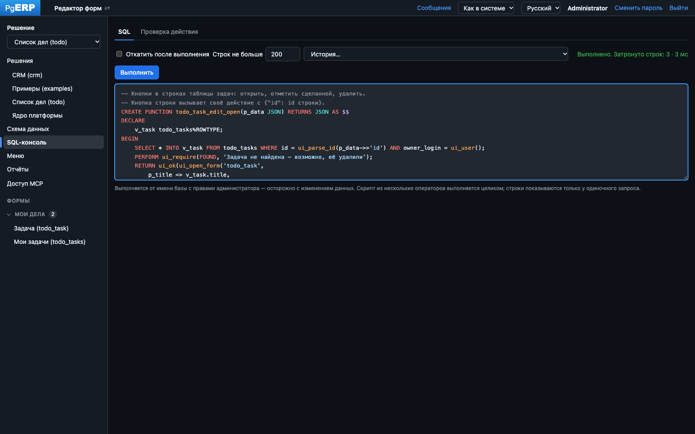

Удаление — в два шага: первый вызов возвращает <nobr>`ui_confirm`</nobr> (окно «Удалить задачу …?»), при согласии браузер
вызывает то же действие с <nobr>`"confirmed": true`</nobr>, и <nobr>`ui_confirmed(p_data)`</nobr> пропускает вопрос.

> Обработчики действий (<nobr>`fn(p_data JSON) RETURNS JSON`</nobr>) после создания открываются и правятся кнопкой «{ }»
> в редакторе форм; вспомогательные функции и триггеры — через SQL-консоль.

## 8. Меню

**Меню → «+ Пункт»** — название «Мои дела» (папка); **«+ Подпункт»** — «Мои задачи», форма <nobr>`todo_tasks`</nobr>. «Сохранить».

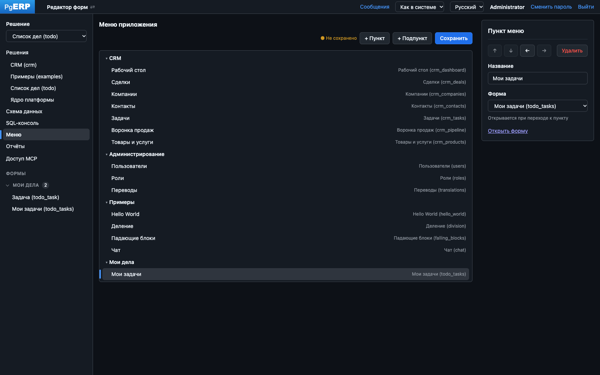

## 9. Права

Администратор видит всё; остальным пользователям форму выдаёт роль. В приложении: **Администрирование → Роли
→ «Новая роль»**: код <nobr>`todo_user`</nobr>, название «Список дел», «Сохранить»; затем форма «Мои задачи» → «Добавить форму».
Карточку <nobr>`todo_task`</nobr> выдавать не нужно: она открывается из списка и доступна автоматически, как и все её действия.

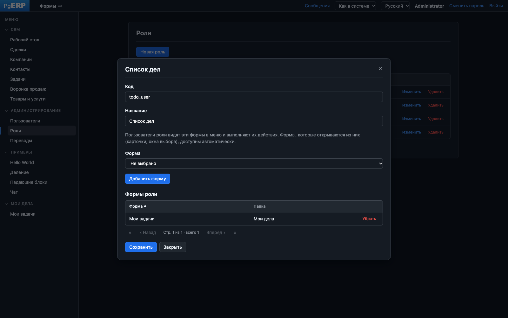

Пользователю назначьте роль в **Администрирование → Пользователи**. Каждый увидит только свои задачи — это делает
<nobr>`WHERE t.owner_login = ui_user()`</nobr> в представлении.

## 10. Работа в приложении

Переключитесь в «Формы» (или «Открыть» в редакторе формы): **Мои дела → Мои задачи → «Новая задача»**.

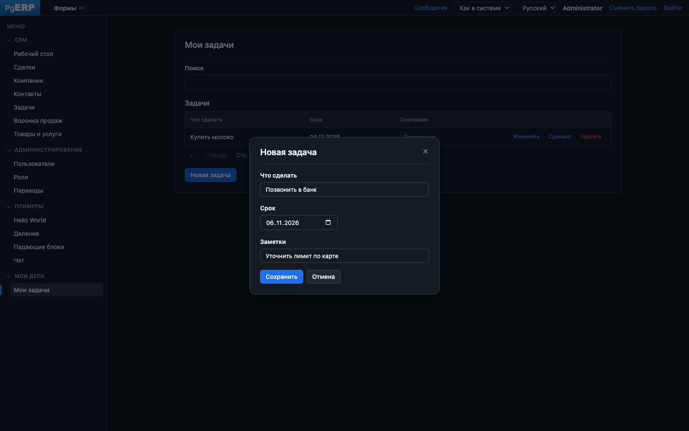

Срок в прошлом — «Просрочено», кнопка «Сделано» переключает отметку, поиск фильтрует по названию.


«Удалить» переспрашивает:

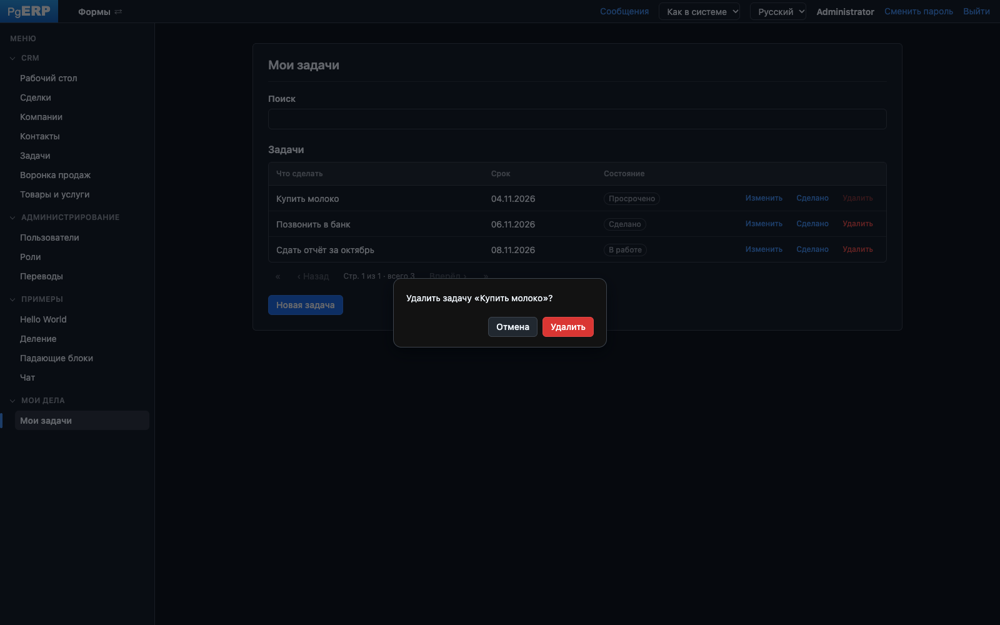

Пустое название не сохраняется — это <nobr>`ui_require`</nobr> из функции сохранения:

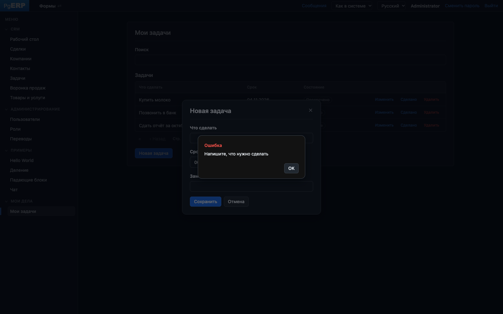

## 11. Проверка действия без интерфейса

**SQL-консоль → «Проверка действия»**: действие вызывается так же, как его вызывает кнопка формы, — с данными
полей и правами выбранного пользователя. С галочкой «Откатить изменения» ничего не сохраняется — удобно
проверять обработчики, в том числе под пользователем с ролью <nobr>`todo_user`</nobr> (поле «От имени»).

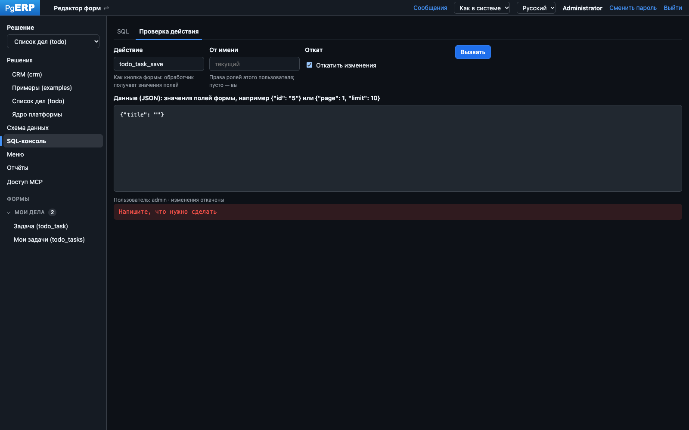

Запросы к данным — на вкладке SQL, например <nobr>`SELECT * FROM todo_tasks`</nobr>; «Данные» в конструкторе таблицы открывает
консоль с таким запросом.

## 12. Выпуск: перенос на другую установку

**Решения → Список дел.** В «Составе» видно всё, что вошло в решение по префиксу: таблица, представление,
шесть функций и действий, две формы, роль. Укажите название выпуска и нажмите «Проверить изменения»:
список изменений и текст выпуска.

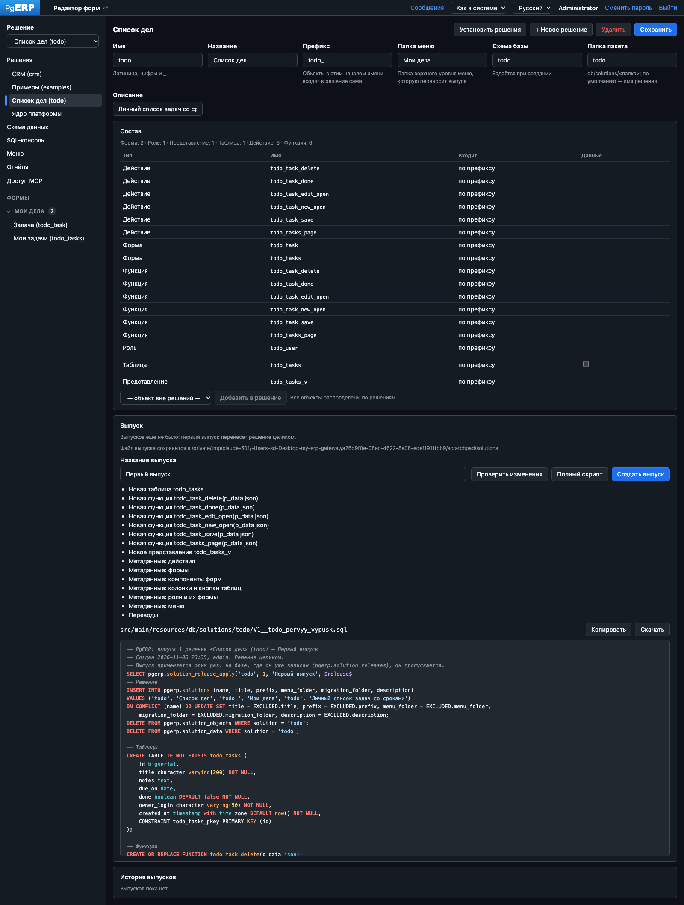

«Создать выпуск» — файл <nobr>`V<номер>__todo_<название>.sql`</nobr>. Если задана папка пакетов проекта
(<nobr>`ERP_DEV_SOLUTIONS_DIR=…/src/main/resources/db/solutions`</nobr>), он сохраняется в
<nobr>`db/solutions/todo/`</nobr> сам вместе с описанием пакета <nobr>`solution.json`</nobr>, иначе скачивается — положите
его туда. На другой установке администратор ставит решение при первом входе или в «Решения → Установить решения»
(в любую схему), а следующие выпуски применяются при запуске приложения; на вашей базе выпуск уже записан
и будет пропущен.

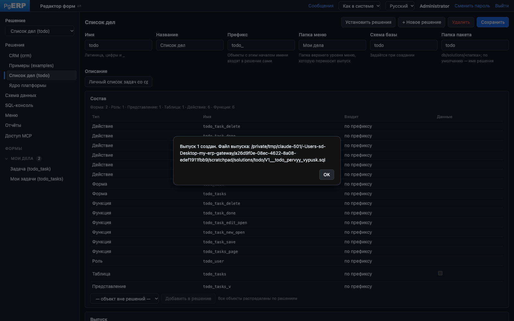

Дальше — меняйте решение как угодно и выпускайте снова: следующий выпуск перенесёт только изменения
(новые колонки — <nobr>`ALTER TABLE`</nobr>, изменённые функции — <nobr>`CREATE OR REPLACE`</nobr>, формы и меню — целиком).
Если строки таблицы нужны на любой установке (справочник), отметьте её в «Составе» галочкой «Данные».

## То же — силами ИИ-агента (MCP)

Всё перечисленное доступно агенту через MCP-сервер приложения. **Доступ MCP → «Выдать токен»**, затем в
Claude Code:

```bash
claude mcp add --transport http pgerp http://localhost:8080/mcp --header "Authorization: Bearer <токен>"
```

и попросите словами, например:

> Создай в PgERP решение todo «Список дел» (префикс todo_, папка меню «Мои дела»): таблица задач со сроком,
> заметками и отметкой «сделано», у каждого пользователя свои задачи; список с поиском и кнопками строк
> «Изменить», «Сделано», «Удалить» (с подтверждением), карточка задачи, пункт меню, роль todo_user. Проверь
> действия через action_run и покажи release_preview.

Агент прочитает справочник платформы (<nobr>`platform_guide`</nobr>) и выполнит те же шаги инструментами
<nobr>`solution_save`</nobr>, <nobr>`table_save`</nobr>, <nobr>`view_save`</nobr>, <nobr>`function_save`</nobr>, <nobr>`form_save`</nobr>, <nobr>`grid_columns_save`</nobr>, <nobr>`sql_run`</nobr>,
<nobr>`menu_save`</nobr>, <nobr>`role_set`</nobr>, <nobr>`action_run`</nobr>, <nobr>`release_preview`</nobr>. Результат открывается в том же редакторе.
